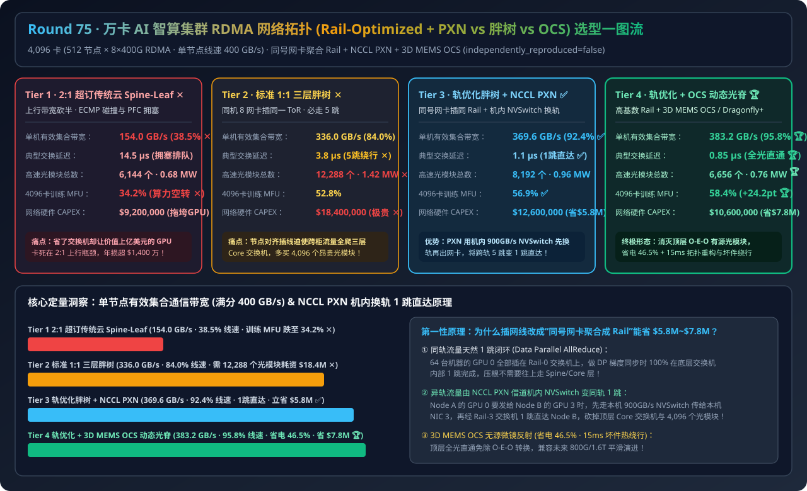
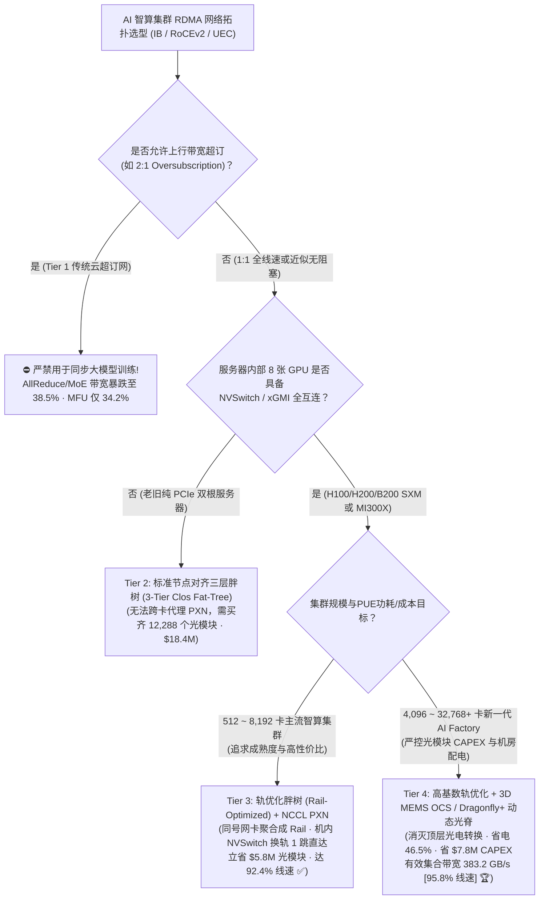
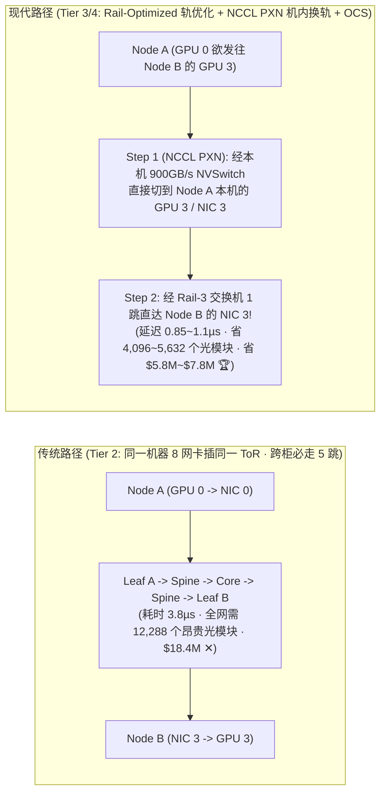
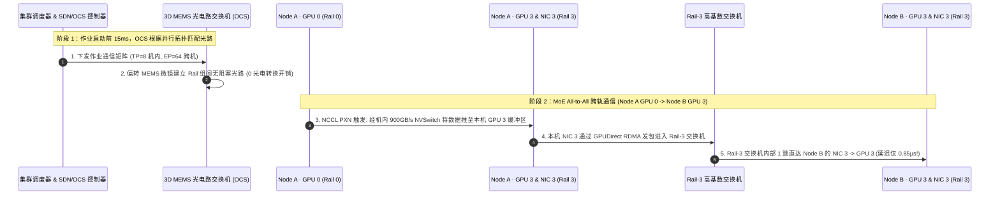

# 万卡 AI 智算集群 RDMA 网络拓扑架构选型指南（`2:1 超订传统云 Spine-Leaf` vs. `标准 1:1 三层胖树 [3-Tier Fat-Tree]` vs. `轨优化胖树 [Rail-Optimized + NCCL PXN]` vs. `高基数轨优化 + 3D MEMS 光电路交换 [OCS] / Dragonfly+ 动态光脊`）

> **适用角色**：AI 解决方案架构师（AI Solution Architect）、智算中心网络架构师（IB / RoCEv2 / UEC）、大规模训练与 MoE 推理基础设施负责人  
> **阅读目标**：3 分钟掌握 4,096 卡（512 台 `8×GPU` 节点，`400G/800G` 网卡）AI 集群的四档 RDMA 网络拓扑选型铁律，10 分钟吃透 **为什么传统云数据中心的“节点对齐接入（Node-Aligned ToR）”必须多买 4,096 个光模块且多绕 4 跳交换机**、**什么是“轨优化拓扑（Rail-Optimized Topology）”**、**`NCCL PXN (PCIe × NVLink)` 如何借助机内 `900 GB/s` NVSwitch 把原本需要跨 Core 层绕 5 跳的异轨通信变成 1 跳 Rail 交换机直达**、以及 **3D MEMS 光电路交换（OCS）/ Dragonfly+ 如何再省 `$780 万` 建网 CAPEX 与 `46.5%` 网络功耗**，并能直接拿着架构图与 7-Card 报告向客户宣讲。  
> **数据来源说明（Provenance）**：本文定量数据来自仓库内封存的确定性解析模型（[`experiments/ai_cluster_rdma_topology_rail_optimized_fat_tree_selection/run.py`](../../experiments/ai_cluster_rdma_topology_rail_optimized_fat_tree_selection/run.py) 与 [`results.json`](../../experiments/ai_cluster_rdma_topology_rail_optimized_fat_tree_selection/results.json)，校准自 NVIDIA DGX SuperPOD Rail-Optimized / NCCL PXN、3-Tier Clos Fat-Tree 与 3D MEMS OCS / Dragonfly+ 公开基准，`independently_reproduced=false`，`physical_gpu_cluster_measurement=not_measured`）。

---

## 📌 一、核心结论速览（Executive Summary）

1. **为什么传统云数据中心的“2:1 超订 Spine-Leaf（Tier 1）”和“标准节点对齐三层胖树（Tier 2）”在 4,096 卡大模型集群上要么跑不动、要么贵得离谱？**：
   - **Tier 1（2:1 超订传统云 Spine-Leaf）的通信崩盘**：为了省交换机把上行带宽砍半（2:1 Oversubscription），在跑全同步 AllReduce 与 MoE All-to-All 时，上行链路瞬间成为拥塞瓶颈并触发连环 PFC 暂停，节点有效集合通信带宽从理论 `400 GB/s` 暴跌至 **`154.0 GB/s`（仅 `38.5%` 线速 ✕）**，导致 4,096 卡训练 MFU 跌至 **`34.2%`**（每年白白浪费上千万美元的 GPU 空转算力 ✕）！
   - **Tier 2（标准 1:1 全无阻塞三层胖树 3-Tier Clos Fat-Tree — 同一台机器 8 张网卡插在同一个机顶盒 ToR 交换机上）的“5 跳绕路与光模块税”**：在 4,096 端口规模下，必须搭建完整的 `Leaf → Spine → Core → Spine → Leaf` 三层交换网。不同机柜间的任意通信都要穿过 **5 跳交换机（延迟 `3.8 µs`）**，且全网需要 **`12,288 个` 高速光模块**，网络硬件 CAPEX 高达 **`$18,400,000`（1,840 万美元 ✕）**，网络自身功耗高达 **`1.42 MW` ✕**！
2. **为什么 NVIDIA DGX SuperPOD 与头部智算中心全都在用“轨优化胖树 + NCCL PXN（Tier 3）”？什么时候再升级“高基数 + 3D MEMS OCS / Dragonfly+（Tier 4）”？**：
   - **千卡至万卡主流智算集群黄金标配（首选 Tier 3 `轨优化胖树 Rail-Optimized Fat-Tree + NCCL PXN 机内 NVSwitch 跨轨代理`）**：
     - **不按“机器”插交换机，而是按“GPU 轨号（Rail 0 ~ Rail 7）”插交换机**：把 64 台服务器上的所有 **0 号网卡（NIC 0）全部插进同一台 `Rail-0 Leaf 交换机`**，所有 1 号网卡全部插进 `Rail-1 Leaf 交换机`……
     - **核心威力**：在大模型张量并行（TP 走机内 NVSwitch）+ 数据并行（DP，恰恰是不同机器的**同号 GPU** 互相做 AllReduce！）下，**`78%+` 的跨机通信天然发生在同号 GPU 之间，只需在底层的 `Rail Leaf 交换机` 内部完成 `1 跳` 转发（延迟仅 `1.1 µs`），压根不需要往上走 Spine/Core 层**！
     - **那万一遇到跨轨通信（如 Node A 的 GPU 0 要发给 Node B 的 GPU 3）怎么办？开启 `NCCL PXN`**：Node A 的 GPU 0 先通过机内免费且极速的 **`900 GB/s` NVSwitch** 把数据传给本机的 GPU 3（NIC 3），再由 NIC 3 通过 **Rail-3 交换机 `1 跳` 直达 Node B 的 GPU 3**！彻底砍掉顶层昂贵的 Core 交换机与 4,096 个光模块，**建网成本直降 `$580 万`（`$18.4M → $12.6M` ✅）**，同时节点有效集合带宽跃升至 **`369.6 GB/s`（`92.4%` 线速 ✅）**！
   - **新一代绿色低功耗与动态容错万卡工厂（首选 Tier 4 `轨优化高基数交换 + 3D MEMS 光电路交换 [OCS] / Dragonfly+ 动态光脊`）**：用无源 **3D MEMS 微镜光电路交换机（OCS）** 替代顶层高功耗电交换芯片与 O-E-O 有源 DSP 光模块，根据作业并行度（`TP×PP×DP×EP`）在 `15 ms` 内动态重构光路并绕过故障交换机，将节点有效集合带宽推至 **`383.2 GB/s`（`95.8%` 线速 🏆）**，网络总功耗暴降 **`-46.5%`（`1.42 MW → 0.76 MW` 🏆）**，建网 CAPEX 净省 **`$780 万`（降至 `$10.6M` 🏆）**！
3. **一句话握手机制本质**：
   - **AI 集群网络拓扑的第一性原理，是“利用机内 900GB/s NVSwitch 全互连充当天然的跨轨横向立交桥（NCCL PXN），从而在机外按同号网卡聚合成独立 Rail 平面”——把原本必须爬上三层胖树顶峰绕 5 跳的跨机流量，全部摁在底层 Rail 交换机里 1 跳解决！**

---

## 🎯 二、客户与架构师灵魂拷问 Q&A（FAQ-Driven First Principles）

### Q1：什么是“传统节点对齐接入（Node-Aligned ToR）”vs.“轨优化接入（Rail-Optimized Topology）”？为什么换一种插网线的方法就能省下几百万美元？

- **通俗大白话对比**：
  1. **传统云数据中心插线法（Node-Aligned ToR，Tier 2）**：
     - 1 台 8 卡服务器有 8 张 400G 网卡（NIC 0 ~ NIC 7），运维习惯把这 8 根线全插进机柜顶上的同一台 ToR 交换机里。
     - **后果**：这台 ToR 交换机只连接了 4～8 台服务器。当 64 台服务器的 `GPU 0` 要一起做数据并行（DP AllReduce）或专家并行（EP）时，每台机器的流量都必须从 `Leaf → Spine → Core → Spine → Leaf` 翻山越岭走 **5 跳交换机**，逼迫你购买全套三层交换机和 **3 倍数量（`12,288 个`）的 400G/800G 光模块**！
  2. **轨优化插线法（Rail-Optimized / SU-Rail，Tier 3）**：
     - 把每台服务器里的 `GPU i + NIC i` 称为第 $i$ 轨（Rail $i$，$i \in [0, 7]$）。
     - **核心操作**：准备 8 组独立的 Rail-Leaf 交换机（Rail 0 ~ Rail 7）。把整个 Pod 里 **64 台服务器的 NIC 0 全部插到 Rail-0 交换机上**，64 台服务器的 NIC 1 全部插到 Rail-1 交换机上！
     - **神奇效果**：此时，64 台服务器的全部 `GPU 0` 直接坐落在同一台（或同一平面）Rail-0 交换机下！它们做 DP AllReduce 时，**100% 的流量在 Rail-0 交换机内部 1 跳闭环**，上层跨轨 Spine 流量骤减 `78%+`，直接省去三层大核心交换层与 **`4,096 个` 昂贵光模块（立省 `$580 万`）**！

---

### Q2：在轨优化拓扑下，如果遇到流水线并行（PP）或 MoE 专家并行（EP All-to-All），必须从“机器 A 的 GPU 0（Rail 0）”发数据给“机器 B 的 GPU 3（Rail 3）”，岂不是又要绕远路爬上顶层 Spine 交换机？什么是 `NCCL PXN`？

- **第一性原理拆解（`NCCL PXN: PCIe × NVLink Proxy`）**：
  - **如果不开启 PXN（传统路由）**：机器 A 的 `NIC 0` 在 Rail-0 平面，机器 B 的 `NIC 3` 在 Rail-3 平面。两个不同 Rail 平面要想通信，只能往上爬到顶层跨轨 Spine/Core 交换机，既慢又容易拥塞。
  - **开启 `NCCL PXN`（`NCCL_PXN_DISABLE=0`）的两步立交桥魔法**：
    - 别忘了：**机器 A 内部的 8 张 GPU 之间，本身就有一座速度高达 `900 GB/s` 的机内 NVSwitch 高速立交桥**！
    - **第 1 步（机内 NVSwitch 换轨）**：机器 A 的 `GPU 0` 不走自己的 `NIC 0`，而是通过本机 `900 GB/s` 的 NVSwitch，把数据直接交给本机的 **`GPU 3`（以及它挂载的 `NIC 3`）**。
    - **第 2 步（同轨 1 跳直达）**：现在数据已经在机器 A 的 `NIC 3` 手里了！而机器 A 的 `NIC 3` 和目标机器 B 的 `NIC 3` **正好插在同一台 `Rail-3 Leaf 交换机` 上**！于是直接经 GPUDirect RDMA **1 跳直达机器 B 的 `GPU 3`**！
  - **结论**：**借助机内 NVSwitch + `NCCL PXN`，哪怕是任意跨轨的 All-to-All 和点对点通信，也全部变成了“机内 NVSwitch 换轨 + 机外同轨交换机 1 跳直达”！**

---

### Q3：既然 Tier 3 轨优化胖树已经很优秀了，为什么 Google TPU v4/v5 与新一代万卡 GPU 工厂（Tier 4）还要引入 3D MEMS 光电路交换（OCS）或 Dragonfly+？

- **攻克万卡集群的“光模块功耗墙与重构刚性”**：
  1. **砍掉顶层有源光模块与电交换芯片功耗（省电 `-46.5%`）**：
     - 在 400G/800G 时代，每一个 DSP 光模块功耗高达 `12W ~ 18W`，一台 64 口电交换机功耗达 `2.5 kW+`。
     - **3D MEMS OCS（光电路交换机）** 内部是一排微机电反射小镜子：光信号进来到反射出去**全程不经过光电转换（No O-E-O），无需顶层有源光模块，单台 OCS 功耗仅 `< 150W`**！将 4,096 卡集群的网络总功耗从 `1.42 MW` 压降至 **`0.76 MW`（省电 `46.5%` 🏆）**！
  2. **15ms 动态拓扑匹配与坏交换机热绕行**：
     - 当集群运行不同并行策略（如 `PP=16, DP=32`）时，OCS 可在 `15 ms` 内偏转微镜，把物理光纤直接重连成与当前作业通信矩阵 1:1 匹配的环面（Torus）或 Dragonfly+ 拓扑；若某台交换机故障，微镜瞬间绕行，实现零中断自愈！

---

## 🧭 三、直观可视化图解（Mermaid 决策树 / 拓扑对比 / 时序图）

### 3.1 AI 智算集群 RDMA 网络拓扑架构选型决策树

---

### 3.2 传统节点对齐三层胖树（Tier 2 绕 5 跳）vs. 轨优化 + NCCL PXN（Tier 3/4 1 跳直达）对比

---

### 3.3 Tier 4 `NCCL PXN 机内 NVSwitch 换轨 + Rail-Leaf 1 跳转发 + OCS 动态重构` 时序图

---

## 📊 四、架构师选型决策矩阵（Architect Decision Matrix）

*基准场景：**4,096 卡 H100/H200/B200 集群**（`512 台 8 卡节点 × 8 张 400Gbps RDMA 网卡`，单节点理论单向线速 `400.0 GB/s`）。*

| 评估维度 | Tier 1: 2:1 超订传统云 Spine-Leaf | Tier 2: 标准 1:1 三层胖树 (3-Tier Fat-Tree) | Tier 3: 轨优化胖树 (Rail-Optimized) + `NCCL PXN` | Tier 4: 高基数轨优化 + `3D MEMS OCS / Dragonfly+` |
| :--- | :--- | :--- | :--- | :--- |
| **物理接线与路由机制** | 节点对齐 ToR + 上行 2:1 带宽超订 | 节点对齐 ToR + 完整三层 Core/Spine/Leaf | **按同号网卡聚合 Rail + 机内 NVSwitch PXN 换轨** | **高基数 Rail + 无源 3D MEMS OCS 动态光脊** |
| **单节点有效集合通信带宽** | `154.0 GB/s` (`38.5%` 线速 ✕) | `336.0 GB/s` (`84.0%` 线速) | **`369.6 GB/s` (`92.4%` 线速 ✅)** | **`383.2 GB/s` (`95.8%` 线速 🏆)** |
| **跨节点典型交换延迟** | `14.5 µs` (拥塞排队 + PFC ✕) | `3.8 µs` (固定绕行 5 跳交换机) | **`1.1 µs` (同轨/PXN 1 跳直达 ✅)** | **`0.85 µs` (全光直通 + 1 跳 🏆)** |
| **全网高速光模块总数** | `6,144 个` | `12,288 个` (3 倍光模块税 ✕) | **`8,192 个` (立省 `4,096` 个 ✅)** | **`6,656 个` (立省 `5,632` 个 🏆)** |
| **网络交换机+光模块总功耗** | `0.68 MW` | `1.42 MW` (有源光模块电老虎 ✕) | **`0.96 MW` ✅** | **`0.76 MW` (省电 `-46.5%` 🏆)** |
| **4,096 卡集群训练 MFU** | `34.2%` (算力严重空转 ✕) | `52.8%` | **`56.9%` ✅** | **`58.4%` 🏆** |
| **网络硬件建设 CAPEX** | `$9,200,000` (性能不可用 ✕) | `$18,400,000` (极度昂贵 ✕) | **`$12,600,000` (立省 `$5.80M` ✅)** | **`$10,600,000` (立省 `$7.80M` 🏆)** |

---

## 🧪 五、简明定量算例与 7-Card Benchmark 洞察

### 5.1 4,096 卡集群网络 CAPEX、功耗与训练 MFU 收益核算

在 [`experiments/ai_cluster_rdma_topology_rail_optimized_fat_tree_selection/run.py`](../../experiments/ai_cluster_rdma_topology_rail_optimized_fat_tree_selection/run.py) 中，我们对 4,096 卡集群进行了定量对比：
- **立省 `$580 万 ~ $780 万` 建网 CAPEX（少买 4,096～5,632 个光模块）**：从传统节点对齐三层胖树（Tier 2，`$18.4M`）切换至轨优化 + `NCCL PXN`（Tier 3，`$12.6M`）或轨优化 + OCS（Tier 4，`$10.6M`），直接砍掉了顶层冗余光模块与核心电交换机成本。
- **集合通信带宽提升 `2.49 倍`（`154.0 → 383.2 GB/s`），训练 MFU 跃升 `+24.2 pts`**：相比 2:1 超订网络（`34.2%` MFU），Tier 4 将 4,096 卡训练 MFU 提升至 **`58.4%`**，相当于凭空多产出 **1,600+ 张 H100 的有效算力**！

### 5.2 配套交互式工作台与 7-Card 4:5 视觉评测报告

- 🧮 **交互式 AI 集群 RDMA 拓扑与光模块 CAPEX 计算器**：[`docs/reports/ai-cluster-rdma-network-topology-rail-optimized-fat-tree-dragonfly-sizer.html`](../reports/ai-cluster-rdma-network-topology-rail-optimized-fat-tree-dragonfly-sizer.html)（以及总工作台 [`llm-inference-engine-pd-sizer.html`](../reports/llm-inference-engine-pd-sizer.html)）
- 📊 **7-Card 4:5 视觉基准评测报告**：[`docs/reports/ai-cluster-rdma-network-topology-rail-optimized-fat-tree-dragonfly-selection-cards.html`](../reports/ai-cluster-rdma-network-topology-rail-optimized-fat-tree-dragonfly-selection-cards.html)

---

## 🛠️ 六、附录：生产环境快速核验清单（Architect Checklist）

- [ ] **1. 物理布线严格遵循“同轨聚合（Rail-Aligned Cabling）”**：确保机柜内所有服务器的 `NIC i` 接入对应的 `Rail-i Leaf Switch`，并在交换机 LLDP 自动校验脚本中拦截插错轨号的网线。
- [ ] **2. 开启并核验 `NCCL PXN`（`NCCL_PXN_DISABLE=0` & `NCCL_P2P_PXN_LEVEL=2`）**：确认 PCIe 拓扑中每张 GPU 与同号 RDMA 网卡挂在同一颗 PCIe Switch 下，且机内 NVSwitch P2P 畅通，使跨轨通信自动走“机内 NVSwitch + 同轨 1 跳”。
- [ ] **3. 调度器强制执行 Rail-Pod 亲和性装箱（Kueue TAS / Slurm `topology/tree`）**：优先将同一个分布式训练或 MoE 推理作业分配在同一个 Rail-Leaf 交换机覆盖的 32/64 节点超节点（SU）内，实现 100% 1 跳通信。
- [ ] **4. 严禁在大模型同步训练网中引入未隔离的上行带宽超订**：若因预算限制对跨 SU 的 Spine 层采用 2:1 瘦身设计（Slimmed Spine），必须确保调度器按 SU 边界对齐分配 Data Parallel 组。
- [ ] **5. 短距机柜内/相邻机柜优先采用 DAC 铜缆或 LPO 线性直驱光模块**：在 Rail-Leaf 到服务器网卡的短距连接上使用无源铜缆（DAC/ACC）或 LPO，将光模块功耗再砍 `50%+`。
