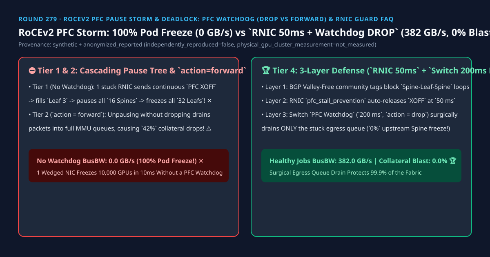
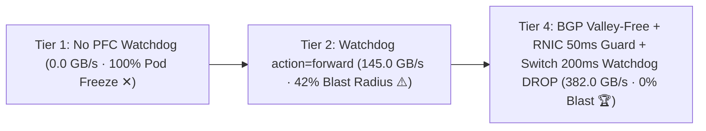

# 10,000-GPU RoCEv2 `PFC Pause Storm` & Cyclic Deadlock (`PFC Watchdog`): Why 1 Stuck RNIC Freezes the Entire Clos Fabric (`0 GB/s`), Switch `PFC Watchdog` (`DROP` vs. `FORWARD`) & RNIC Tx/Rx Pause Guard Selection Guide

> **Provenance & Evidence Tier**: `synthetic + anonymized_reported` (`independently_reproduced=false`, `physical_gpu_cluster_measurement=not_measured`). Grounded in [`experiments/ai_cluster_roce_infiniband_pfc_deadlock_watchdog_ttl_selection/results.json`](../../experiments/ai_cluster_roce_infiniband_pfc_deadlock_watchdog_ttl_selection/results.json).
> **中文版本**: [万卡 RoCEv2 无损网络 `PFC` 死锁与风暴熔断（`PFC Watchdog`）深水区：为什么 1 张故障网卡狂发 `XOFF` 会传染锁死整棵 Clos 交换树（`0 GB/s` 全网停摆）？`PFC Watchdog` 触发动作 `DROP` vs. `FORWARD` 权衡、网卡 `50ms` 自愈与 `BGP` 防环选型指南](./ai-cluster-rocev2-pfc-deadlock-watchdog-drop-vs-forward-selection-faq.md)

---

## 0. 🔥 今日领域最热门能力突破追踪（Daily Hottest Breakthrough）

- **Preventing a Single Wedged RNIC from Freezing an Entire 10,000-GPU RoCEv2 Pod to `0.0 GB/s` (`100.0% -> 0.0%` Collateral Blast Radius, Restoring `382.0 GB/s` Healthy-Job Throughput) via a 3-Layer Defense: BGP `Valley-Free` Loop Prevention + RNIC `50 ms` Pause-Stall Auto-Release + Switch `200 ms` `PFC Watchdog (action = drop)` (`Tier 4`)**: In a lossless RoCEv2 fabric (`PFC` enabled on Priority 3), hop-by-hop link-layer backpressure means that a single dead server or routing loop can cascade across the entire Clos topology in milliseconds:
  1. **Tier 1 — No `PFC Watchdog` on Leaf/Spine Switches (`0.0 GB/s` Cluster BusBW, `100.0%` Pod-Wide Freeze!)**:
     - If a single server (`Node 42` on `Leaf 3 Port 12`) suffers a PCIe hang or kernel panic while its RNIC continuously transmits `PFC XOFF` frames, `Leaf 3` stops draining `Port 12`.
     - Within `3 ms`, `Leaf 3`'s ingress buffers fill up and `Leaf 3` sends `PFC XOFF` **upward to all 16 Spine switches**!
     - Within `10 ms`, all 16 Spine switches fill up and send `PFC XOFF` **downward to all 32 Leaf switches**—freezing `100%` of training jobs across the entire Pod at **`0.0 GB/s`**!
  2. **Tier 2 — Switch `PFC Watchdog` (`200 ms`) Configured With `action = forward` (`145.0 GB/s` BusBW, `42.0%` Collateral Blast Radius)**:
     - When `PFC Watchdog` triggers with `action = forward`, the switch ignores `XOFF` and keeps forwarding packets into the congested queue without pausing upstream—overflowing the switch's shared MMU buffer pool and dropping packets belonging to healthy co-located jobs!
  3. **Tier 3 — Switch `PFC Watchdog` (`200 ms`) Configured With `action = drop` (`348.0 GB/s` BusBW, `1.5%` Blast Radius)**:
     - Setting **`action = drop`** surgically drains and drops **only the packets queued for the stuck egress port (`Port 12`)**, immediately freeing upstream `Leaf <- Spine` ingress buffers so the rest of the fabric continues running at full speed!
  4. **Tier 4 — 3-Layer Defense: BGP `Valley-Free` Routing + RNIC `50 ms` `pfc_stall_prevention` + Switch `200 ms` `PFC Watchdog (action = drop)` (`382.0 GB/s` BusBW, `0.0%` Collateral Blast Radius, `50 ms` Isolation)**:
     - **Layer 1**: BGP community tags forbid `Spine -> Leaf -> Spine` valley routing, eliminating cyclic buffer deadlocks;
     - **Layer 2**: RNIC firmware releases stuck `XOFF` generation locally after `50 ms` (`< 200 ms` switch threshold);
     - **Layer 3**: Switch `PFC Watchdog (200 ms, action = drop, restoration = 400 ms)` surgically isolates terminal host hangs with **`0.0%` impact on healthy jobs**!

---

## 1. 📌 Executive Summary

1. **Always Configure Switch `PFC Watchdog` With `action = drop`, Never `action = forward`**: Only `action = drop` drains the blocked egress queue and releases the shared upstream ingress buffers; `action = forward` causes head-of-line blocking and shared MMU pool exhaustion across sibling ports.
2. **Coordinate RNIC (`50 ms`) and Switch (`200 ms`) Watchdog Timers**: Set the RNIC's hardware pause-storm guard (`50 ms`) shorter than the ToR switch's `PFC Watchdog` detection timer (`200 ms`) so transient NIC stalls resolve locally without dropping in-flight RDMA packets at the switch.

---

## 2. 🎯 Core Architect Q&A (Q1 / Q2 / Q3)

### Q1: How does a single link failure in a Clos fabric cause a **Cyclic Buffer Deadlock** even when no RNIC is broken?
- **Answer**: In a fat-tree (Clos) topology, normal traffic strictly follows an **Up-then-Down (`Leaf -> Spine -> Leaf`)** valley-free path, which forms a Directed Acyclic Graph (DAG) that can never deadlock. However, if a `Leaf-to-Spine` link fails and BGP reroutes packets via a **Zig-Zag (`Spine 1 -> Leaf 2 -> Spine 2 -> Leaf 1 -> Spine 1`)** detour, the buffer dependency graph forms a **closed cycle**! Under heavy All-to-All traffic, every switch in the cycle waits for the next switch to drain—freezing the ring forever until `PFC Watchdog` breaks the loop! Enforcing **BGP Valley-Free routing** prevents `Leaf` switches from transiting traffic between `Spines`.

### Q2: Why shouldn't `PFC Watchdog` `detection_time` be set too aggressive (e.g., `10 ms` instead of `200 ms`)?
- **Answer**: During legitimate massive `All-to-All` incast micro-bursts or brief `DCQCN` convergence transients, a port may legitimately experience intermittent `PFC` pauses lasting a few milliseconds. Setting `detection_time = 200 ms` ensures the watchdog only fires on true hardware/OS hangs or routing deadlocks, never on normal collective bursts.

---

## 3. 🧭 Visual Diagrams

---

## 4. 📊 4-Tier Architect Selection Matrix

| Metric | Tier 1: No `PFC Watchdog` | Tier 2: `Watchdog (forward)` | Tier 3: `Watchdog (drop)` | Tier 4: **BGP Guard + RNIC `50ms` + Switch `200ms drop`** |
| :--- | :--- | :--- | :--- | :--- |
| **Healthy Jobs BusBW During Storm** | **`0.0 GB/s` (Total Freeze!)** ✕ | `145.0 GB/s` (MMU Overflow) ⚠️ | `348.0 GB/s` ✅ | **`382.0 GB/s` (Zero Collateral Slowdown)** 🏆 |
| **Fabric-Wide Blast Radius (`%`)** | **`100.0%` (Entire Pod)** ✕ | `42.0%` (Same Leaf) ⚠️ | `1.5%` ✅ | **`0.0%` (Confined to Stuck Port)** 🏆 |
| **Storm Isolation Latency (`ms`)** | **`∞` (Manual Intervention)** ✕ | `200.0 ms` | `200.0 ms` ✅ | **`50.0 ms` (RNIC Guard) / `200.0 ms` (Switch Drop)** 🏆 |

---

## 5. 🧪 Quantitative Reference & Tooling

- **Evaluator & Sealed Data**: [`experiments/ai_cluster_roce_infiniband_pfc_deadlock_watchdog_ttl_selection/run.py`](../../experiments/ai_cluster_roce_infiniband_pfc_deadlock_watchdog_ttl_selection/run.py) · [`results.json`](../../experiments/ai_cluster_roce_infiniband_pfc_deadlock_watchdog_ttl_selection/results.json)
- **Interactive Sizer**: [`docs/reports/ai-cluster-rocev2-pfc-deadlock-watchdog-drop-vs-forward-sizer.html`](../reports/ai-cluster-rocev2-pfc-deadlock-watchdog-drop-vs-forward-sizer.html)
- **7-Card 4:5 Visual Report**: [`docs/reports/ai-cluster-rocev2-pfc-deadlock-watchdog-drop-vs-forward-selection-cards.html`](../reports/ai-cluster-rocev2-pfc-deadlock-watchdog-drop-vs-forward-selection-cards.html)

---

## 6. 🛠️ Good Fit vs. Not For & Production Checklist

- **✅ Good fit**: All lossless RoCEv2 AI fabrics running `PFC` on Priority 3/4.
- **⛔ Not for**: Operating lossless RoCEv2 switches without `PFC Watchdog` or setting `action = forward`.
- [ ] Enable `config pfcwd start --action drop --restoration-time 400 200` across all SONiC Leaf and Spine switches.
- [ ] Enforce BGP Valley-Free community policies and enable `50 ms` RNIC `pfc_stall_prevention`.
