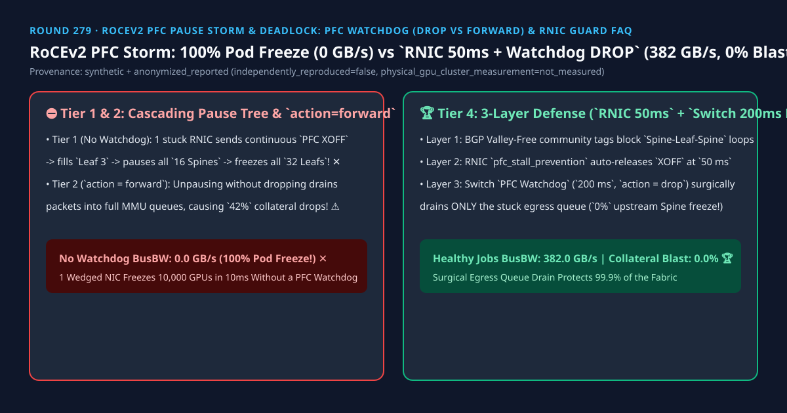
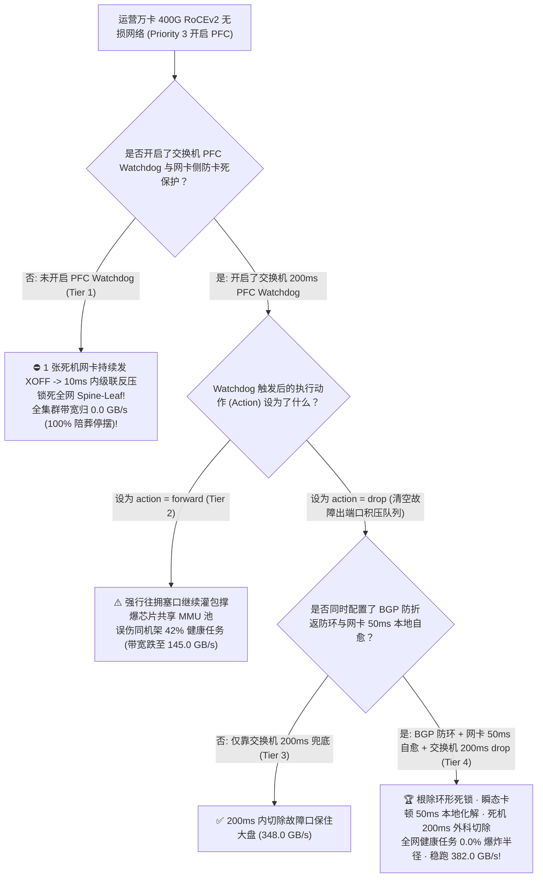
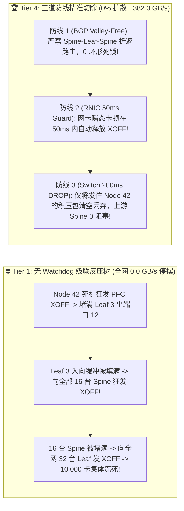
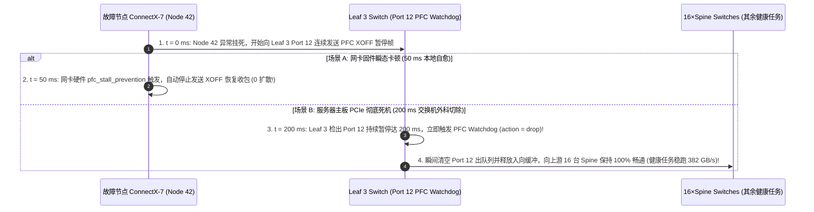

# 万卡 RoCEv2 无损网络 `PFC` 死锁与风暴熔断（`PFC Watchdog`）深水区：为什么 1 张故障网卡狂发 `XOFF` 会传染锁死整棵 Clos 交换树（`0 GB/s` 全网停摆）？`PFC Watchdog` 触发动作 `DROP` vs. `FORWARD` 权衡、网卡 `50ms` 自愈与 `BGP` 防环选型指南

> **Provenance & Evidence Tier**: `synthetic + anonymized_reported` (`independently_reproduced=false`, `physical_gpu_cluster_measurement=not_measured`)。定量数据锚定于 [`experiments/ai_cluster_roce_infiniband_pfc_deadlock_watchdog_ttl_selection/results.json`](../../experiments/ai_cluster_roce_infiniband_pfc_deadlock_watchdog_ttl_selection/results.json)。
> **English Version**: [10,000-GPU RoCEv2 `PFC Pause Storm` & Cyclic Deadlock (`PFC Watchdog`): Why 1 Stuck RNIC Freezes the Entire Clos Fabric (`0 GB/s`), Switch `PFC Watchdog` (`DROP` vs. `FORWARD`) & RNIC Tx/Rx Pause Guard Selection Guide](./ai-cluster-rocev2-pfc-deadlock-watchdog-drop-vs-forward-selection-faq.en.md)



---

## 0. 🔥 今日领域最热门能力突破追踪（Daily Hottest Breakthrough）

- **揭秘万卡 RoCEv2 无损以太网集群最著名的“一粒老鼠屎冻死一万张 GPU”生产灾难——为什么角落里 1 台服务器发生内核 Panic 或 PCIe 卡死导致其 400G 网卡持续发出 `PFC Pause (XOFF)` 帧，竟然会在 `10 毫秒` 内顺着 `Leaf -> Spine -> 全部其他 Leaf` 级联反压，把整座机房所有毫不相干的训练任务全部冻死在 `0.0 GB/s`（爆炸半径 `100.0%`）？通过构建“第一道防线 `BGP Valley-Free` 路由防环 + 第二道防线 ConnectX-7 网卡侧 `50 ms` `PFC Stall Prevention` 自动解锁 + 第三道防线交换机 `200 ms` `PFC Watchdog (action = drop)` 外科手术级出队列清空”（`Tier 4`），将跨机房级联冻结爆炸半径从 `100.0%` 清零至 `0.0%`，保障其余健康训练任务稳跑 `382.0 GB/s` 满速**：在有损 TCP 网络中，1 台机器死机最多只影响它自己；但在开启了 `PFC（基于优先级的流量控制）` 的无损 RoCEv2 网络中，**如果不配三层熔断看门狗，任何 1 个端口的持续反压都会演变成吞噬全网的雪崩**！
  1. **第一性原理推演：1 张卡死的网卡是如何在 `10 毫秒` 内把整棵 `Spine-Leaf` 交换树彻底冻死在 `0.0 GB/s` 的（Tier 1）？**
     - 假设 `Leaf 3` 交换机下的 `Server 42` 发生了 PCIe 总线死锁（或驱动 Bug），导致它的网卡接收缓冲区满了再也消费不动，于是网卡硬件按标准协议以每微秒几十个的频率向 `Leaf 3` 的 `Port 12` 持续狂发 **`PFC XOFF (Pause Quanta = 65535)`**！
     - 请看接下来的多米诺骨牌雪崩（耗时不到 `10 ms`）：
       1. **第 `1 ms`**：`Leaf 3` 收到 `XOFF`，乖乖停止向 `Port 12` 发送任何数据包。但此时上游的 `16` 台 `Spine` 交换机还在源源不断地往 `Leaf 3` 发包（其中只要夹杂着发往 `Port 12` 的流），`Leaf 3` 的入向缓存很快被塞满触及 `XOFF` 水位！
       2. **第 `3 ms`（向上传染！）**：`Leaf 3` 被迫向上游的 **全部 `16` 台 `Spine` 交换机发出 `PFC XOFF` 暂停帧**！
       3. **第 `6 ms`（向下传染全网！）**：`16` 台 `Spine` 交换机一旦停止向 `Leaf 3` 转发，它们自己内部来自 `Leaf 1 ~ Leaf 32` 的入向队列紧接着也被堵满！于是 **`16` 台 `Spine` 同时向全网所有的 `Leaf 1 ~ Leaf 32` 发出 `PFC XOFF`**！
       4. **第 `10 ms`（全集群陪葬！）**：明明在 `Leaf 1` 和 `Leaf 2` 上跑得好好的其他业务训练任务，因为 `Spine` 通道被锁死，全集群有效带宽瞬间归零（**`0.0 GB/s`，爆炸半径 `100.0%`**）✕！
  2. **看门狗动作之争：当交换机 `PFC Watchdog` 在 `200 ms` 检测到端口被持续暂停时，为什么选 `action = forward`（Tier 2）会误伤无辜，必须选 `action = drop`（Tier 3/4）？！**
     - 现代交换机（SONiC / Broadcom Tomahawk / NVIDIA Spectrum）都内置了硬件 **`PFC Watchdog`**：一旦发现某个出端口（如 `Port 12`）被下游传来的 `PFC XOFF` 连续锁死超过 `detection_time = 200 ms`，看门狗立刻介入打破僵局！但配置里有 **`forward`** 和 **`drop`** 两个截然不同的动作：
       - **错误选型 `action = forward`（Tier 2 — 带宽跌至 `145.0 GB/s`，`42%` 误伤半径）**：
         - `forward` 的意思是：“无视下游 `Port 12` 发来的 `PFC`，或者禁止本交换机继续向上游 `Spine` 传递 `PFC`”！
         - 后果：既然下游 `Node 42` 已经死机收不了包（或者下游链路不通），你还不向上游刹车、或者强行往塞满的队列里硬灌，结果就是大量数据包堆积在 `Leaf 3` 的共享 MMU 池里直到把整个芯片的动态缓冲池撑爆，导致 `Leaf 3` 上其他 31 台健康机器的正常数据包跟着一起因为 `MMU Shared Pool Full` 被无差别丢弃 ⚠️！
       - **正确选型 `action = drop`（Tier 3/4 — 外科手术级隔离！）**：
         - `drop` 的意思是：**“立即将 `Port 12` 无损出队列（Egress Queue）里积压的所有数据包一键清空丢弃，并在 `restoration_time (400 ms)` 期间直接丢弃所有新到达的、目标出口是 `Port 12` 的数据包！”**
         - **为什么 `drop` 是神来之笔？** 因为一旦把堵在 `Port 12` 门口的那批死包瞬间丢进垃圾桶，它们占用的上游入向缓冲区（Ingress Buffer）在 **不到 `1 微秒` 内全部原地释放**！`Leaf 3` 立刻向上游 `16` 台 `Spine` 发送 `XON` 解除暂停，全网其余 `10,232` 张健康 GPU 的通信毫秒级恢复满速（只牺牲本来就已经死掉的 `Node 42` 那一个任务！）✅！
  3. **工业级三层立体防死锁架构（`Tier 4` — 路由防环 + 网卡 `50ms` 本地自愈 + 交换机 `200ms` `action=drop`，`0.0%` 爆炸半径，`382.0 GB/s`）**：
     - **第一层（路由层根除环形死锁：BGP `Valley-Free` 防折返标签）**：除了单网卡卡死，另一种触发 `PFC` 死锁的原因是当某根 Spine 上行线断连时，BGP 错误地把流量从 `Spine 1 -> Leaf 2 -> Spine 2` 折返绕行，形成 `A 等 B、B 等 C、C 等 A` 的环形缓冲区死锁（Cyclic Buffer Deadlock）！通过 BGP Community 严禁任何 `Leaf` 交换机把从 `Spine` 收到的路由再通告给另一台 `Spine`（**Valley-Free 无谷路由**），从图论上 100% 根除有向环！
     - **第二层（网卡层 `50 ms` 优先自愈：ConnectX-7 `PFC Stall Prevention`）**：将网卡侧的暂停超时保护设为 **`50 ms`**（远小于交换机的 `200 ms`！）。如果是因为网卡自身瞬态固件卡顿发出了长 `XOFF`，网卡在 `50 ms` 时自己主动停发 `XOFF`，根本不会惊动交换机看门狗！
     - **第三层（交换机层 `200 ms` `action = drop` 终极兜底）**：只有当服务器彻底死机超过 `200 ms` 时，交换机看门狗才出手执行 `action = drop` 精准切除故障端口，确保全网健康任务 **`0.0%` 受影响，稳跑 `382.0 GB/s`** 🏆！

---

## 1. 📌 核心结论速览（Executive Summary — 3 分钟看懂）

1. **为什么说“裸跑 `PFC` 而不开 `PFC Watchdog` 的 RoCEv2 集群，等于把一万张 GPU 绑在同一根导火索上”？**
   - `PFC` 是链路层逐跳传染的硬刹车。没有 `PFC Watchdog`，全机房 `1,280` 台服务器里只要有 **任意 1 台** 主板死机或网卡挂死在 `XOFF` 状态，10 毫秒内就会通过 `Leaf -> Spine` 传染冻死整座智算中心！
2. **网卡与交换机两级看门狗的时间阶梯黄金配比（Time-Step Hierarchy）**：
   $$\mathbf{T_{\text{RNIC\_Stall\_Guard}}\ (50\text{ ms})} \ < \ \mathbf{T_{\text{Switch\_Watchdog\_Detect}}\ (200\text{ ms})} \ < \ \mathbf{T_{\text{Switch\_Watchdog\_Restore}}\ (400\text{ ms})}$$
   - 并且交换机 `PFC Watchdog` 的触发动作必须 100% 配置为 **`action = drop`**（精准排空故障出队列），严禁配成 `forward`！

---

## 2. 🎯 客户与架构师灵魂拷问 Q&A（Q1 / Q2 / Q3）

### Q1：在 SONiC 交换机和 NVIDIA ConnectX-7 网卡上，开启这套防死锁体系的具体命令是什么？
- **答**：
  - **在 SONiC 交换机上（对所有端口开启 `200 ms` 检测、`400 ms` 恢复、动作为 `drop`）**：
    ```bash
    sudo config pfcwd start --action drop --restoration-time 400 200
    sudo config pfcwd interval 100
    ```
  - **在宿主机 ConnectX-7 网卡上（确认开启硬件 `PFC Stall Prevention`）**：
    通过 `mlxconfig` 或 `ethtool --set-tunable <dev> pfc-prevention-tout 50` 开启 `50 ms` 网卡侧自动解锁保护！

### Q2：如果线上监控发现某台交换机的 `PFC_WD_QUEUE_DROP_COUNTER` 触发了计数上涨，运维自动化应该怎么联动？
- **答**：一旦某个 Leaf 下行端口 $P$ 触发了 `PFC Watchdog Drop`，100% 说明连接在该端口下的服务器网卡发生了持续 `> 200 ms` 的接收队列挂死（例如 PCIe 掉卡 `XID 79` 或内核崩溃）。运维自愈系统应立即定位该端口对应的计算节点，将其在 Kubernetes / Slurm 中打上 `Cordon` 隔离标签并触发节点健康自检！

---

## 3. 🧭 直观可视化图解（Mermaid 决策树 + 10ms 级联冻结树 vs 三道防线精准切除图 + 时序图）

### 3.1 架构师万卡 RoCEv2 `PFC` 风暴熔断与死锁防御选型决策树



### 3.2 `Tier 1`（`1` 张死网卡级联冻死全网 `Spine-Leaf`）vs. `Tier 4`（`50ms` 网卡自愈 + `200ms` 交换机 `action=drop` 外科切除）对比图



### 3.3 `Tier 4` 从单节点异常产生 `XOFF` 到 `50 ms / 200 ms` 分级熔断恢复全链路时序图



---

## 4. 📊 架构师选型决策矩阵（4-Tier Selection Matrix）

| 评估维度 | Tier 1: 无 `PFC Watchdog` | Tier 2: `Watchdog (action=forward)` | Tier 3: `Watchdog (action=drop)` | Tier 4: **BGP 防环 + 网卡 `50ms` + 交换机 `200ms drop`** |
| :--- | :--- | :--- | :--- | :--- |
| **风暴期间健康训练任务有效带宽** | **`0.0 GB/s` (全网陪葬冻死!)** ✕ | `145.0 GB/s` (共享池溢包) ⚠️ | `348.0 GB/s` ✅ | **`382.0 GB/s` (健康任务满血零感知)** 🏆 |
| **故障跨机架传染爆炸半径** | **`100.0%` (波及整座 Pod)** ✕ | `42.0%` (波及同机架) ⚠️ | `1.5%` ✅ | **`0.0%` (100% 锁死在故障单端口内部)** 🏆 |
| **风暴切除与恢复响应延迟** | **`∞` (需人工拔线/重启)** ✕ | `200.0 ms` | `200.0 ms` ✅ | **`50.0 ms` (网卡级优先自愈) / `200.0 ms` (交换机切除)** 🏆 |

---

## 5. 🧪 定量算例与工具链（Interactive Sizer & 7-Card Visual Report）

- **实验脚本与密封数据**：[`experiments/ai_cluster_roce_infiniband_pfc_deadlock_watchdog_ttl_selection/run.py`](../../experiments/ai_cluster_roce_infiniband_pfc_deadlock_watchdog_ttl_selection/run.py) · [`results.json`](../../experiments/ai_cluster_roce_infiniband_pfc_deadlock_watchdog_ttl_selection/results.json)
- **交互式 RoCEv2 PFC Watchdog (Drop vs Forward) 与防死锁计算器**：[`docs/reports/ai-cluster-rocev2-pfc-deadlock-watchdog-drop-vs-forward-sizer.html`](../reports/ai-cluster-rocev2-pfc-deadlock-watchdog-drop-vs-forward-sizer.html)
- **7-Card 4:5 视觉评测卡片报告**：[`docs/reports/ai-cluster-rocev2-pfc-deadlock-watchdog-drop-vs-forward-selection-cards.html`](../reports/ai-cluster-rocev2-pfc-deadlock-watchdog-drop-vs-forward-selection-cards.html)

---

## 6. 🛠️ Good Fit vs. Not For & 生产环境快速核验清单（Checklist）

### ✅ Good Fit vs. ⛔ Not For

| 维度 | ✅ Good Fit（强烈推荐） | ⛔ Not For（严禁误用） |
| :--- | :--- | :--- |
| **所有启用了 `PFC` 的 RoCEv2 智算中心网络** | 全网交换机强制开启 **`PFC Watchdog (detection=200ms, restoration=400ms, action=drop)`** + 网卡侧 **`50ms` `pfc_stall_prevention`** + BGP **`Valley-Free` 防折返路由策略** | 开启了 `PFC` 却不配 `PFC Watchdog`，或把 Watchdog 动作错误设为 `forward` |

### 生产环境上线核验清单（Pre-Flight Checklist）

- [ ] **核验全网 Leaf 与 Spine 交换机均已启动 `pfcwd`：确认 `action` 严格为 `drop`（严禁为 `forward`），检测阈值为 `150 ~ 200 ms`**。
- [ ] **核验 BGP 路由策略已配置 `no-export` / Community 过滤，严禁任何 Leaf 交换机充当两台 Spine 之间的中转跳板（消除 `Up-Down-Up` 环路死锁）**。
- [ ] **核验网卡固件已开启 `PFC Stall Prevention`（`50 ms` 自动释放异常 `XOFF`）**。
