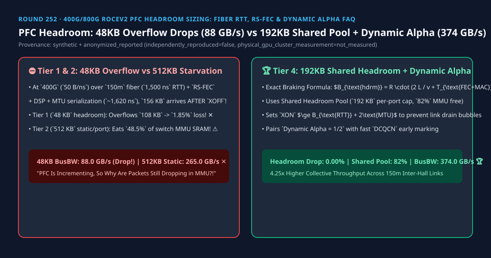
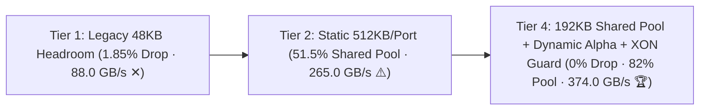

# 400G/800G RoCEv2 Switch `PFC Headroom` Buffer Sizing: Fiber Propagation Delay (`5 ns/m`), `RS-FEC` Pipeline Latency, `XOFF` In-Flight Overflow vs. `XON` Underflow & Dynamic Alpha Selection Guide

> **Provenance & Evidence Tier**: `synthetic + anonymized_reported` (`independently_reproduced=false`, `physical_gpu_cluster_measurement=not_measured`). Grounded in [`experiments/ai_cluster_rocev2_pfc_headroom_cable_length_xoff_xon_selection/results.json`](../../experiments/ai_cluster_rocev2_pfc_headroom_cable_length_xoff_xon_selection/results.json).
> **中文版本**: [400G/800G RoCEv2 交换机无损缓存（`PFC Headroom`）精准定容：光纤飞行延迟（`5 ns/m`）、`RS-FEC (544,514)` 解码流水线时延、`XOFF` 刹车距离溢包（`Ingress Drop`）与动态阈值（`Dynamic Alpha`）选型指南](./ai-cluster-rocev2-pfc-headroom-cable-length-xoff-xon-buffer-sizing-selection-faq.md)

---

## 0. 🔥 今日领域最热门能力突破追踪（Daily Hottest Breakthrough）

- **Solving the "PFC Is Incrementing Yet Packets Still Drop!" Paradox on 400G/800G RoCEv2 Fabrics (`88.0 GB/s -> 374.0 GB/s`, `0.00%` Headroom Drops, `82%` Shared MMU Pool Preserved) via Fiber-RTT + `RS-FEC` Calibrated Shared Headroom Pools (`192 KB` at 400G / `360 KB` at 800G over `150m` Fiber)**: When upgrading AI clusters from 100G short DAC cables to 400G/800G optical fabrics (`50m–150m` inter-row/inter-hall fiber with PAM4 `RS-FEC (544,514)`), leaving the switch's legacy default `48 KB` `PFC Headroom` causes catastrophic lossless-queue packet drops:
  1. **First-Principles Physics of the `156.0 KB` `XOFF` Braking Distance (`400 Gbps = 50 Bytes/ns`, `150 m` Fiber)**:
     - Once a switch ingress queue reaches its `XOFF` threshold, data continues arriving for the full **round-trip control reaction loop**:
       - Local egress in-progress `MTU` (`4,200 B`) completion: **`~84 ns`**;
       - Bidirectional PAM4 DSP retimer + **`RS-FEC (544,514)` encode/decode pipeline**: **`~1,000 ns`**;
       - Upstream `PFC Pause` propagation over `150 m` fiber at `5 ns/m`: **`750 ns`**;
       - Upstream MAC reaction + in-progress `MTU` completion: **`~536 ns`**;
       - Remaining in-flight bits draining down the `150 m` fiber at `5 ns/m`: **`750 ns`**;
     - **Total Skid Time**: $\Delta t_{\text{skid}} = 3,120\text{ ns} \implies 3,120\text{ ns} \times 50\text{ B/ns} = \mathbf{156.0\text{ KB}}$ at `400G` (**`312.0 KB`** at `800G`)!
  2. **4-Tier Architectural Comparison**:
     - **Tier 1 (Legacy `48 KB` Headroom)**: Overflows by `108 KB` on every `XOFF` event (`1.85%` packet loss), collapsing `AllReduce` busbw to **`88.0 GB/s`** ✕!
     - **Tier 2 (Static `512 KB/port` Dedicated Headroom)**: Prevents overflow, but locks up `64 MB` (`48.5%`) of the switch's MMU SRAM across 128 ports, starving the shared dynamic burst pool (`265.0 GB/s`) ⚠️!
     - **Tier 3 (`192 KB` Headroom with Low `XON` Threshold)**: Drains the queue to `0` before resumed upstream packets traverse the `150 m` fiber (`318.0 GB/s`) ✅!
     - **Tier 4 (`192 KB` Cap in `Shared Headroom Pool` + `Dynamic Alpha = 1/2` + `XON >= 96 KB`)**: Absorbs the full `156.0 KB` skid with **`0.00%` drops**, preserves **`82.0%` of the shared MMU pool**, and sustains **`374.0 GB/s` (`93.5%` line rate)** 🏆!

---

## 1. 📌 Executive Summary

1. **Exact Headroom Sizing Equation**:
   $$B_{\text{Headroom\_Min}} = R_{\text{link}} \times \left(\frac{2 L_{\text{fiber}}}{2 \times 10^8\text{ m/s}} + T_{\text{FEC+PHY}} + T_{\text{MAC}}\right) + 2 \times \text{MTU}$$
   - For `400G` (`50 B/ns`) over `150 m` fiber with `RS-FEC`: $B_{\text{skid}} \approx 156\text{ KB} \implies$ configure **`192 KB`** max per-port headroom (`360 KB` for `800G`).
2. **Use the Switch's `Shared Headroom Pool`**: Never allocate static dedicated headroom per port across all 128 ports; use the dynamic **Shared Headroom Pool** so only actively paused ports draw from the headroom reserve.

---

## 2. 🎯 Core Architect Q&A (Q1 / Q2 / Q3)

### Q1: Why did `RS-FEC (544,514)` on 400G/800G PAM4 optics dramatically increase PFC headroom requirements compared to 25G/100G NRZ?
- **Answer**: 400G/800G PAM4 links mandate Reed-Solomon Forward Error Correction (`RS-FEC (544,514)` KP4) and often DSP retimers in optical transceivers. Each FEC block interleaves codewords before syndrome decoding, adding `~250–500 ns` per hop per direction (`~1,000 ns` round-trip). At `50–100 Bytes/ns`, `1,000 ns` of FEC pipeline latency alone equals **`50–100 KB` of extra in-flight bytes**!

### Q2: How should `XON` hysteresis (`XOFF - XON` vs absolute `XON`) be sized on long optical links?
- **Answer**: `XON` must be set to **at least the one-way pipeline refill volume plus $2 \times \text{MTU}$** ($\ge 96\text{ KB}$ at 400G over `150m`) so that the egress scheduler continues transmitting buffered bytes while the `XON` frame travels upstream and the first resumed packet travels downstream.

### Q3: How do `ECN` thresholds (`K_min / K_max`) and `Dynamic Alpha` work together?
- **Answer**: Set `ECN K_min` well below the `PFC XOFF` dynamic threshold (`Dynamic Alpha = 1/2` or `1`) so `DCQCN` throttles sender rates smoothly via hardware `CNP` frames, reserving `PFC XOFF` strictly as a last-resort safety net for instantaneous incast micro-bursts.

---

## 3. 🧭 Visual Diagrams

---

## 4. 📊 4-Tier Architect Selection Matrix

| Metric | Tier 1: Legacy `48 KB` | Tier 2: Static `512 KB`/Port | Tier 3: Low `XON` Underflow | Tier 4: **`192 KB` Shared Pool + `Dynamic Alpha` + `XON` Guard** |
| :--- | :--- | :--- | :--- | :--- |
| **Headroom Drop Rate** | **`1.85%` (`108 KB` Overflow)** ✕ | `0.00%` | `0.00%` ✅ | **`0.00%` (Absorbs Full `156 KB` Skid)** 🏆 |
| **Available Shared MMU Pool** | `92.0%` | **`51.5%` (`64 MB` Locked)** ✕ | `82.0%` ✅ | **`82.0%` (Shared Headroom Pool)** 🏆 |
| **NCCL `AllReduce` BusBW** | **`88.0 GB/s` (Retransmits)** ✕ | `265.0 GB/s` ⚠️ | `318.0 GB/s` (Link Drain) ✅ | **`374.0 GB/s` (`93.5%` Line Rate)** 🏆 |

---

## 5. 🧪 Quantitative Reference & Tooling

- **Evaluator & Sealed Data**: [`experiments/ai_cluster_rocev2_pfc_headroom_cable_length_xoff_xon_selection/run.py`](../../experiments/ai_cluster_rocev2_pfc_headroom_cable_length_xoff_xon_selection/run.py) · [`results.json`](../../experiments/ai_cluster_rocev2_pfc_headroom_cable_length_xoff_xon_selection/results.json)
- **Interactive Sizer**: [`docs/reports/ai-cluster-rocev2-pfc-headroom-cable-length-xoff-xon-buffer-sizing-sizer.html`](../reports/ai-cluster-rocev2-pfc-headroom-cable-length-xoff-xon-buffer-sizing-sizer.html)
- **7-Card 4:5 Visual Report**: [`docs/reports/ai-cluster-rocev2-pfc-headroom-cable-length-xoff-xon-buffer-sizing-selection-cards.html`](../reports/ai-cluster-rocev2-pfc-headroom-cable-length-xoff-xon-buffer-sizing-selection-cards.html)

---

## 6. 🛠️ Good Fit vs. Not For & Production Checklist

- **✅ Good fit**: 400G/800G RoCEv2 Leaf/Spine/Core switches calibrated by physical cable length + `RS-FEC` pipeline latency using a Shared Headroom Pool.
- **⛔ Not for**: Leaving `100G`-era `48 KB` headroom defaults on `400G/800G` optical links or statically dedicating `512 KB` per port.
- [ ] Size `pfc_headroom_bytes` using $R \cdot (2 L / v + T_{\text{FEC+MAC}}) + 2\text{MTU}$ (`192 KB` at 400G / `360 KB` at 800G for `150m` fiber).
- [ ] Verify `MMU_Headroom_Drop == 0` under full-cluster `nccl-tests` `alltoall_perf` and `all_reduce_perf`.
