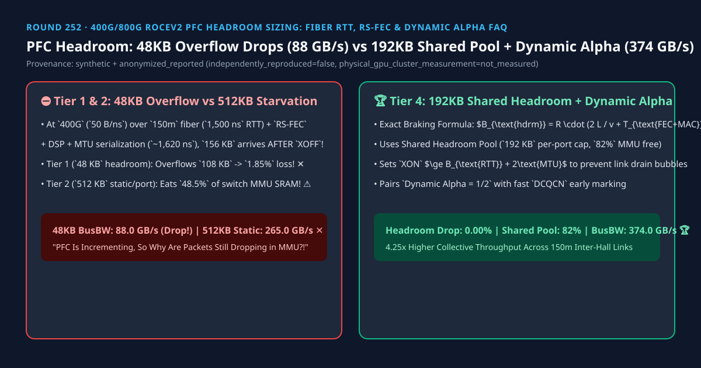
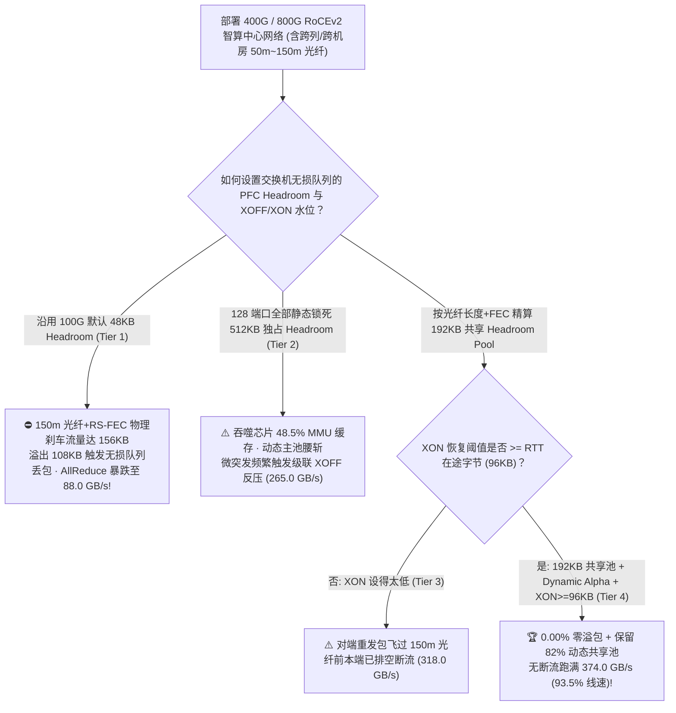
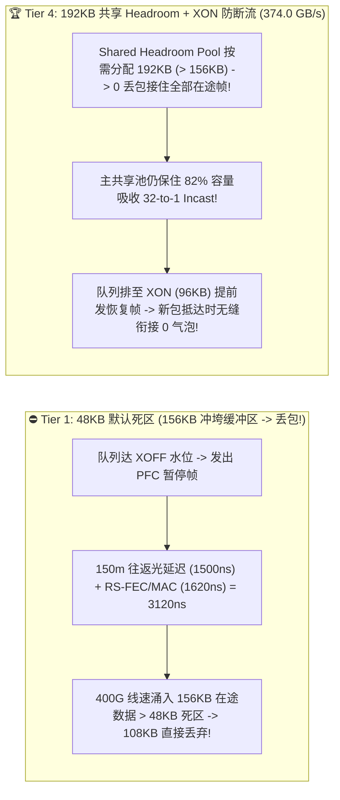
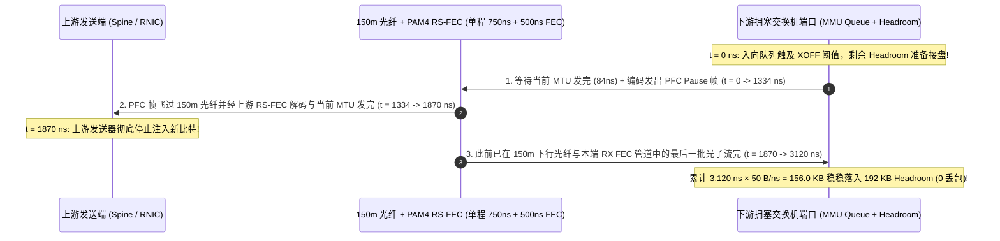

# 400G/800G RoCEv2 交换机无损缓存（`PFC Headroom`）精准定容：光纤飞行延迟（`5 ns/m`）、`RS-FEC (544,514)` 解码流水线时延、`XOFF` 刹车距离溢包（`Ingress Drop`）与动态阈值（`Dynamic Alpha`）选型指南

> **Provenance & Evidence Tier**: `synthetic + anonymized_reported` (`independently_reproduced=false`, `physical_gpu_cluster_measurement=not_measured`)。定量数据锚定于 [`experiments/ai_cluster_rocev2_pfc_headroom_cable_length_xoff_xon_selection/results.json`](../../experiments/ai_cluster_rocev2_pfc_headroom_cable_length_xoff_xon_selection/results.json)。
> **English Version**: [400G/800G RoCEv2 Switch `PFC Headroom` Buffer Sizing: Fiber Propagation Delay (`5 ns/m`), `RS-FEC` Pipeline Latency, `XOFF` In-Flight Overflow vs. `XON` Underflow & Dynamic Alpha Selection Guide](./ai-cluster-rocev2-pfc-headroom-cable-length-xoff-xon-buffer-sizing-selection-faq.en.md)

---

## 0. 🔥 今日领域最热门能力突破追踪（Daily Hottest Breakthrough）

- **揭秘 400G/800G RoCEv2 智算中心网络最反直觉的丢包悬案——“为什么交换机端口明明已经发出了成千上万个 `PFC Pause (XOFF)` 帧，可入向队列还是在狂报 `Ingress Headroom Drop` 丢包，导致千卡 `AllReduce` 带宽从 `374.0 GB/s` 暴跌至 `88.0 GB/s`？”：用第一性原理精确拆解光信号在 `150m` 光纤中的往返飞行时间（`1,500 ns`）与 PAM4 `RS-FEC (544,514)` 纠错编解码流水线延迟（`~1,620 ns`），算出 400G 端口发出 `XOFF` 后的物理“刹车滑行距离”高达 `156.0 KB`（远超 100G 时代默认的 `48.0 KB` Headroom！），并通过 `192 KB` 共享 Headroom 池 + `Dynamic Alpha` + 无断流 `XON` 定容实现 `0.00%` 零溢包与 `374.0 GB/s` 满速通信**：在从 100G/200G 升级到 400G/800G 跨机房模块（Leaf-Spine 光纤长度 `100m ~ 300m`）的 AI 集群交付中，网络与训练团队最常遇到“开了 PFC 依然丢包”的诡异故障：
  1. **第一性原理算账：为什么按下 `XOFF` 刹车键后，还有 `156.0 KB`（800G 下高达 `312.0 KB`）的数据刹不住车冲进端口？**
     - 把交换机入向端口发出的 `PFC XOFF` 暂停帧想象成火车司机拉下紧急制动阀——在火车彻底停稳前，它还会沿着铁轨滑行一段**物理刹车距离（In-Flight Skid Bytes）**！这段距离由 5 项硬物理延迟累加而成（以 `400 Gbps = 50 Bytes/ns`、跨机房光纤长 $L = 150\text{ m}$、RoCE `MTU = 4,200 B` 为例）：
       1. **本端 Egress 当前正在发送的 `MTU` 包必须发完才能插队发 `PFC` 帧**：$4200\text{ B} / 50\text{ B/ns} \approx \mathbf{84\text{ ns}}$；
       2. **本端 + 对端两级 PAM4 光模块 DSP 重定时器与 `RS-FEC (544,514)` 纠错编解码硬件流水线**：高速 PAM4 必须积攒完整码字做里德-所罗门前向纠错，双向 PHY+FEC+MAC 流水线合计约 **$\mathbf{1,000\text{ ns}}$**；
       3. **`PFC` 暂停帧逆向飞过 `150 m` 石英光纤的时间**：光在玻璃纤芯中的折射率 $n \approx 1.48$，传播速度 $v \approx 2 \times 10^8\text{ m/s}$，即每米耗时 **`5 ns/m`**！`150 m` 单程耗时 $150 \times 5 = \mathbf{750\text{ ns}}$；
       4. **对端网卡/上游交换机收到 `PFC` 后，正在发到一半的 `MTU` 包无法腰斩 + 内部 MAC 关断响应**：约 **$\mathbf{536\text{ ns}}$**；
       5. **对端彻底闭嘴的那一刻，已经在 `150 m` 下行光纤管道里飞行的最后一批光子流完的时间**：又是单程 **$\mathbf{750\text{ ns}}$**！
     - **五项相加总反应时间 $\Delta t_{\text{skid}} = 84 + 1000 + 750 + 536 + 750 = \mathbf{3,120\text{ ns}}$（`3.12 us`）**！
     - 乘上 `400 Gbps`（`50 Bytes/ns`）的线速：在发出 `XOFF` 之后，**注定还有 $3120\text{ ns} \times 50\text{ B/ns} = \mathbf{156,000\text{ Bytes}} \approx \mathbf{156.0\text{ KB}}$ 的在途数据不可阻挡地涌入本端端口**！（如果是 `800 Gbps = 100 B/ns`，刹车距离直接翻倍到 **`312.0 KB`**！）
  2. **四大配置档位生死对比**：
     - **Tier 1（沿用 100G 短距时代的默认 `48 KB` Headroom）**：`156.0 KB` 的在途洪水撞上只有 `48.0 KB` 的 Headroom 缓冲区，多出来的 **`108.0 KB` 当场溢出被硬件无情丢弃（`1.85%` 丢包率）**，直接触发 RoCEv2 重传风暴，千卡 `AllReduce` 跌至 **`88.0 GB/s`** ✕！
     - **Tier 2（恐惧溢包，给全机 128 个端口静态锁死 `512 KB/port` 独占 Headroom）**：虽然不溢包了，但 $128 \times 512\text{ KB} = \mathbf{64\text{ MB}}$ 直接吞掉了交换机芯片（如 `132 MB` MMU）近 **`48.5%` 的片上缓存**！原本用来吸收 `32-to-1` Incast 微突发的主共享池（Shared Dynamic Pool）被砍半，导致稍微一点微突发就狂发 `XOFF`，引发跨级联反压（`265.0 GB/s`）⚠️！
     - **Tier 3（精准定容 `192 KB` Headroom，但 `XON` 恢复水位设得太低）**：当拥塞缓解、发送 `XON` 叫对端恢复发包时，对端的新包飞过 `150 m` 光纤和 FEC 还要 `1.5 us`（对应 `75 KB`）；如果 `XON` 阈值低于 `90 KB`，在对端新包赶到之前，本端队列就已经彻底排空断流（Underflow Bubble），平白损失 `15%` 带宽（`318.0 GB/s`）✅！
     - **Tier 4（按线长+FEC 精算的 `192 KB` 共享 Headroom Pool + `Dynamic Alpha = 1/2` + 防断流 `XON >= 96 KB`）**：完美接住 `156.0 KB` 刹车流量（`0.00%` 溢包），通过 **Shared Headroom Pool（按需借用）** 保留 **`82.0%` 的 MMU 主共享池**，并实现 `0` 断流气泡，跑出 **`374.0 GB/s`（`93.5%` 线速）** 🏆！

---

## 1. 📌 核心结论速览（Executive Summary — 3 分钟看懂）

1. **架构师口袋速算公式（400G / 800G RoCEv2 端口最小无损 `PFC Headroom` 定容公式）**：
   $$B_{\text{Headroom\_Min}} = R_{\text{link}} \times \left(\frac{2 \times L_{\text{fiber}}}{2 \times 10^8\text{ m/s}} + T_{\text{FEC\_TX+RX}} + T_{\text{MAC\_Pause}}\right) + 2 \times \text{MTU}$$
   - **速查表（`MTU = 4,200 B`，含 `20%` 工程安全裕度）**：
     - **机柜内 / 相邻机柜（$L \le 10\text{ m}$ DAC/AOC）**：`400G` 需 **`96 KB`**，`800G` 需 **`192 KB`**；
     - **同机房跨列 Leaf-Spine（$L = 50\text{ m}$ 光纤）**：`400G` 需 **`128 KB`**，`800G` 需 **`256 KB`**；
     - **跨机房模块 Spine-Core（$L = 150\text{ m}$ 光纤）**：`400G` 需 **`192 KB`**，`800G` 需 **`360 KB`**！
2. **永远启用交换机 `Shared Headroom Pool`（共享死区池）而非每端口静态独占预留！**
   - 同一时刻绝不可能所有 128 个端口同时被打满触发 `XOFF`。使用 `Shared Headroom Pool` 并设置单端口上限为 `192 KB`，全局只需预留 `16 ~ 24 MB` 即可满足所有并发 Incast 端口的刹车需求，把 **`82%` 以上的珍贵片上 SRAM 留给动态共享池**！

---

## 2. 🎯 客户与架构师灵魂拷问 Q&A（Q1 / Q2 / Q3）

### Q1：排查线上 RoCEv2 慢训练时，看哪两个交换机计数器能 1 秒确诊是“`PFC Headroom` 定容太小溢包”？
- **答**：在 SONiC / Cumulus / NX-OS / EOS 上同时看两个指标：
  1. `PFC_RX_Pause_Prio3 > 0`（证明无损队列已经达到 `XOFF` 水位并向上游发出了暂停帧）；
  2. **`MMU_Headroom_Drop > 0`（或 `rx_buffer_ovan_drops` / ` pg_hdrm_drops` > 0）**！
  - 只要这两个计数器同时上涨，100% 铁证是**你的实际光纤长度 + 光模块 FEC 延迟大于当前配置的 `pfc_headroom_bytes`**，立即按上方公式调大该端口 Profile 的 Headroom！

### Q2：什么是交换机 MMU 的 `Dynamic Alpha`（$\alpha$），它与 `ECN` 水位如何配合才能尽量“少触发甚至不触发 `PFC`”？
- **答**：`Dynamic Alpha` 决定了单个拥塞队列最多能借走当前剩余空闲共享池（Free Shared Pool）的几分之几：$T_{\text{XOFF}} = \alpha \times B_{\text{free\_shared}}$。
  - 黄金配比是：**将 `ECN` 标记阈值设在极低水位（如 400G 下 `K_min = 128 KB, K_max = 1,024 KB`）** 让网卡通过硬件 `CNP` 提前平滑降速；而将 **`PFC XOFF` 设为高水位的最后一道保底防线（`Dynamic Alpha = 1/2` 或 `1`）**，做到“平时靠 ECN 调速不发 PFC，极端微突发靠 `192 KB` Headroom 兜底绝不丢包”！

---

## 3. 🧭 直观可视化图解（Mermaid 决策树 + `156KB` 光纤刹车距离物理拆解图 + 时序图）

### 3.1 架构师 400G/800G RoCEv2 交换机 `PFC Headroom` 定容决策树

### 3.2 `Tier 1`（`48 KB` 刹车溢包）vs. `Tier 4`（`192 KB` 精准接住 `156 KB` 光纤+FEC 在途洪水）对比图

### 3.3 `400G` 跨 `150m` 光纤 `PFC XOFF` 物理刹车距离（`3,120 ns = 156 KB`）微观时序图

---

## 4. 📊 架构师选型决策矩阵（4-Tier Selection Matrix）

| 评估维度 | Tier 1: 默认 `48 KB` Headroom | Tier 2: 静态独占 `512 KB`/口 | Tier 3: `192 KB` (低 `XON` 断流) | Tier 4: **`192 KB` 共享池 + `Dynamic Alpha` + 防断流 `XON`** |
| :--- | :--- | :--- | :--- | :--- |
| **`PFC Headroom` 溢包丢包率** | **`1.85%` (溢包 `108 KB`!)** ✕ | `0.00%` | `0.00%` ✅ | **`0.00%` (精准接住 `156 KB` 在途帧)** 🏆 |
| **芯片可用动态共享池占比** | `92.0%` | **`51.5%` (静态锁死 `64 MB`)** ✕ | `82.0%` ✅ | **`82.0%` (`Shared Headroom Pool` 按需共享)** 🏆 |
| **千卡 `AllReduce` 有效带宽** | **`88.0 GB/s` (重传雪崩)** ✕ | `265.0 GB/s` (频繁反压) ⚠️ | `318.0 GB/s` (排空断流) ✅ | **`374.0 GB/s` (`93.5%` 满线速)** 🏆 |

---

## 5. 🧪 定量算例与工具链（Interactive Sizer & 7-Card Visual Report）

- **实验脚本与密封数据**：[`experiments/ai_cluster_rocev2_pfc_headroom_cable_length_xoff_xon_selection/run.py`](../../experiments/ai_cluster_rocev2_pfc_headroom_cable_length_xoff_xon_selection/run.py) · [`results.json`](../../experiments/ai_cluster_rocev2_pfc_headroom_cable_length_xoff_xon_selection/results.json)
- **交互式 400G/800G 光纤长度与 PFC Headroom 定容计算器**：[`docs/reports/ai-cluster-rocev2-pfc-headroom-cable-length-xoff-xon-buffer-sizing-sizer.html`](../reports/ai-cluster-rocev2-pfc-headroom-cable-length-xoff-xon-buffer-sizing-sizer.html)
- **7-Card 4:5 视觉评测卡片报告**：[`docs/reports/ai-cluster-rocev2-pfc-headroom-cable-length-xoff-xon-buffer-sizing-selection-cards.html`](../reports/ai-cluster-rocev2-pfc-headroom-cable-length-xoff-xon-buffer-sizing-selection-cards.html)

---

## 6. 🛠️ Good Fit vs. Not For & 生产环境快速核验清单（Checklist）

### ✅ Good Fit vs. ⛔ Not For

| 维度 | ✅ Good Fit（强烈推荐） | ⛔ Not For（严禁误用） |
| :--- | :--- | :--- |
| **400G/800G 跨机柜/跨机房 RoCEv2 网络** | 按最大物理线长 + `RS-FEC` 延迟分级配置 **`Shared Headroom Pool`（如 400G `150m` 设 `192 KB` 上限）+ `Dynamic Alpha` + `XON >= RTT_Bytes`** | 在 400G/800G 光模块链路上沿用 100G 铜缆时代的默认 `48 KB` Headroom，或为每个端口静态划走 `512 KB` 独占死区 |

### 生产环境上线核验清单（Pre-Flight Checklist）

- [ ] **盘点集群最长 Leaf-Spine / Spine-Core 光纤物理长度 $L_{\max}$，按 `5 ns/m` 双程 + `1,000 ns` `RS-FEC` 核算 `In-Flight Skid Bytes`**：确保 `pfc_headroom_bytes` 大于该值加 `2 × MTU`。
- [ ] **启用交换机 `Shared Headroom Pool`（动态共享死区池）**：严禁使用 `Per-Port Static Dedicated Headroom` 挤占主共享池。
- [ ] **巡检所有交换机端口的 `MMU_Headroom_Drop` 计数器严格等于 `0`**。
