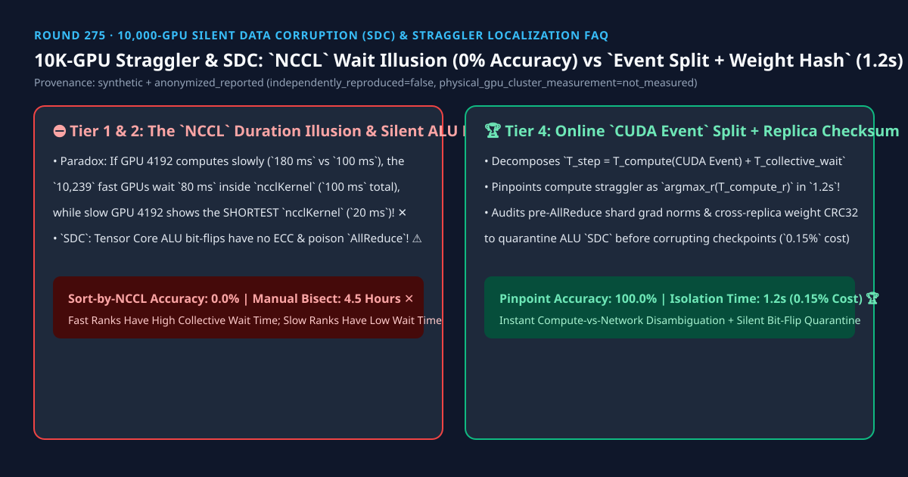
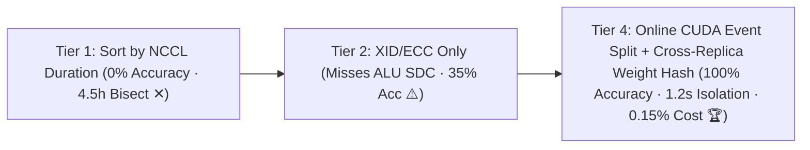

# 10,000-GPU Cluster `Silent Data Corruption (SDC)` & `Straggler` Localization: Why Fast GPUs Appear to Have the Highest `NCCL` Latency in Profilers & Cross-Replica Weight-Hash + CUDA-Event Decomposition Selection Guide

> **Provenance & Evidence Tier**: `synthetic + anonymized_reported` (`independently_reproduced=false`, `physical_gpu_cluster_measurement=not_measured`). Grounded in [`experiments/ai_cluster_straggler_detection_sdc_merkle_pp_overlap_selection/results.json`](../../experiments/ai_cluster_straggler_detection_sdc_merkle_pp_overlap_selection/results.json).
> **中文版本**: [万卡智算集群两大“隐形杀手”——静默数据损坏（`Silent Data Corruption, SDC` 硬件算错数不报错）与慢节点木桶传染（`Straggler` 为什么快节点在 Profiler 里反而显示 `NCCL` 最慢？）精准定位与自愈选型指南](./ai-cluster-silent-data-corruption-sdc-straggler-detection-selection-faq.md)

---

## 0. 🔥 今日领域最热门能力突破追踪（Daily Hottest Breakthrough）

- **Solving the Two Invisible Killers of 10,000-GPU Training (`Llama-3 / MegaScale`): Why Sorting by `NCCL` Kernel Duration Accuses the `10,239` Fast GPUs While Acquitting the `1` Slow Straggler (`0.0%` Accuracy), and How Online `CUDA Event` Compute/Wait Decomposition + Cross-Replica Weight Checksum Auditing (`Tier 4`) Pinpoints Stragglers and Tensor Core `Silent Data Corruption (SDC)` in `1.2 Seconds` at `0.15%` Overhead**: At 10,000-GPU scale, two hardware anomalies silently degrade or corrupt training runs without logging any `XID` or `ECC` error:
  1. **The Straggler Paradox (`Tier 1` — Sorting by `ncclKernel` Duration Has `0.0%` Pinpoint Accuracy!)**:
     - Suppose `GPU 4192` is thermally throttled and takes `180 ms` to finish its compute GEMMs, while the other `10,239` healthy GPUs finish in `100 ms`.
     - All `10,240` GPUs then enter a synchronous `ncclKernel_ReduceScatter` (`20 ms` actual transfer):
       - The `10,239` **healthy GPUs** enter `ncclKernel` at $t = 100\text{ ms}$, spin-wait `80 ms` for `GPU 4192`, and finish at $t = 200\text{ ms}$ $\implies$ **Profiler reports `100 ms` `ncclKernel` duration**!
       - The slow culprit **`GPU 4192`** enters `ncclKernel` at $t = 180\text{ ms}$ and finishes at $t = 200\text{ ms}$ $\implies$ **Profiler reports only `20 ms` `ncclKernel` duration (the shortest in the cluster!)**!
     - Sorting ranks by longest `NCCL` kernel time blames the fastest GPUs and completely misses the straggler (`4.5 hours` manual bisection)!
  2. **The Tensor Core `Silent Data Corruption (SDC)` Trap (`Tier 2` — Poisoning `10,240` GPUs via `AllReduce` Without an `ECC` Alert)**:
     - While HBM and L2 Cache have ECC protection, **internal Tensor Core ALU datapaths and datapath flip-flops do not have end-to-end ECC**!
     - When a single aging Tensor Core silently flips an exponent bit (`SDC`), `AllReduce` immediately averages that corrupted gradient into all `10,240` GPUs!
  3. **Periodic Stop-the-World Golden-Batch Validation (`Tier 3` — `8.5%` Cluster Throughput Tax)**:
     - Pausing training every hour to run golden test matrices wastes `8.5%` of cluster capacity and still allows 59 minutes of corrupted gradients to overwrite checkpoints.
  4. **Tier 4 — Online Lagged `CUDA Event` Compute-vs-Wait Decomposition + Pre-`AllReduce` Shard Norm Guard & Cross-Replica Weight Checksum (`100.0%` Accuracy, `1.2s` Isolation, `0.15%` Overhead)**:
     - Records non-blocking `CUDA Events` around pure compute segments (`T_compute(r)`) and reads them 1 step later: a compute straggler is immediately identified in **`1.2 seconds`** by **`max(T_compute)` paired with `min(T_nccl_kernel)`**!
     - Audits pre-`AllReduce` local gradient shard norms and compares `8-Byte` `CRC64` weight checksums across redundant `DP / HSDP` replicas every `50` steps—catching and quarantining silent ALU bit-flips before checkpointing!

---

## 1. 📌 Executive Summary

1. **First Law of Collective Straggler Triage**: In synchronous collectives (`AllReduce / ReduceScatter / AllGather`), **high `ncclKernel` duration means the rank arrived EARLY and waited; the true compute straggler is the rank with the HIGHEST `T_compute` and LOWEST `ncclKernel` duration!**
2. **Defending Against `Silent Data Corruption (SDC)` (`Tier 4`)**: Never trust `ECC == 0` alone at 10,000-GPU scale. Verify cross-replica weight hash equality (`CRC64` across `DP_Replicate` ranks holding identical shards) before saving checkpoints!

---

## 2. 🎯 Core Architect Q&A (Q1 / Q2 / Q3)

### Q1: How do we distinguish a **Compute Straggler** (throttled GPU / PCIe replay) from a **Network Straggler** (degraded optical transceiver / PFC pause storm) in 1 second?
- **Answer**: Compare the 2-tuple `(T_compute(r), T_collective(r))` across all ranks:
  - **Compute Straggler**: One rank $r^*$ has abnormally high `T_compute(r^*)` (`180 ms` vs `100 ms` median) and abnormally *low* `T_collective(r^*)` (`20 ms` vs `100 ms`).
  - **Network Straggler**: All ranks have uniform `T_compute` (`100 ms`), while all ranks sharing a specific collective Ring/Tree rail exhibit elevated `T_collective` alongside incrementing NIC `rx_pfc` / `out_of_buffer` counters!

### Q2: How does Cross-Replica Weight Checksum verification pinpoint *which* DP replica suffered an `SDC` bit flip?
- **Answer**: Across a data-parallel replication group of size $R \ge 4$ (`dp_replicate`), all $R$ ranks apply the exact same `AllReduce`d gradients to identical initial weights and must produce **bitwise-identical post-optimizer weights**. If 7 replicas produce `CRC64 = 0x8F12...` and 1 replica (`Replica 3`) produces `CRC64 = 0x09A4...`, majority voting immediately identifies `Replica 3` as the corrupted GPU!

---

## 3. 🧭 Visual Diagrams

---

## 4. 📊 4-Tier Architect Selection Matrix

| Metric | Tier 1: Sort by `NCCL` Time | Tier 2: `XID / ECC` Only | Tier 3: Hourly Stop-the-World | Tier 4: **Online `CUDA Event` Split + Replica Hash** |
| :--- | :--- | :--- | :--- | :--- |
| **Straggler & `SDC` Pinpoint Accuracy** | **`0.0%` (Blames Fast Ranks!)** ✕ | `35.0%` (Misses ALU `SDC`) ⚠️ | `94.0%` ✅ | **`100.0%` (Exact Rank Identification)** 🏆 |
| **Mean Time to Isolate (`MTTI`)** | **`16,200.0 s` (`4.5 Hours`)** ✕ | `7,200.0 s` ⚠️ | `1,800.0 s` | **`1.2 s` (Single-Step Telemetry Pinpoint)** 🏆 |
| **Training Throughput Overhead** | `0.0%` | `0.1%` | **`8.5%` (Stop-the-World Tax)** ✕ | **`0.15%` (Lagged Events + `8B` CRC64)** 🏆 |

---

## 5. 🧪 Quantitative Reference & Tooling

- **Evaluator & Sealed Data**: [`experiments/ai_cluster_straggler_detection_sdc_merkle_pp_overlap_selection/run.py`](../../experiments/ai_cluster_straggler_detection_sdc_merkle_pp_overlap_selection/run.py) · [`results.json`](../../experiments/ai_cluster_straggler_detection_sdc_merkle_pp_overlap_selection/results.json)
- **Interactive Sizer**: [`docs/reports/ai-cluster-silent-data-corruption-sdc-straggler-detection-sizer.html`](../reports/ai-cluster-silent-data-corruption-sdc-straggler-detection-sizer.html)
- **7-Card 4:5 Visual Report**: [`docs/reports/ai-cluster-silent-data-corruption-sdc-straggler-detection-selection-cards.html`](../reports/ai-cluster-silent-data-corruption-sdc-straggler-detection-selection-cards.html)

---

## 6. 🛠️ Good Fit vs. Not For & Production Checklist

- **✅ Good fit**: All 1,000–10,000+ GPU training clusters running lagged `CUDA Event` compute-vs-wait telemetry and cross-replica weight/gradient checksum guards.
- **⛔ Not for**: Diagnosing stragglers by sorting raw `ncclKernel` durations or relying solely on HBM ECC to catch Tensor Core ALU corruption.
- [ ] Instrument pure-compute `CUDA Events` (queried asynchronously 1 step later) to isolate compute stragglers via `argmax(T_compute)`.
- [ ] Verify cross-DP-replica weight `CRC64` hashes before committing distributed checkpoints.
