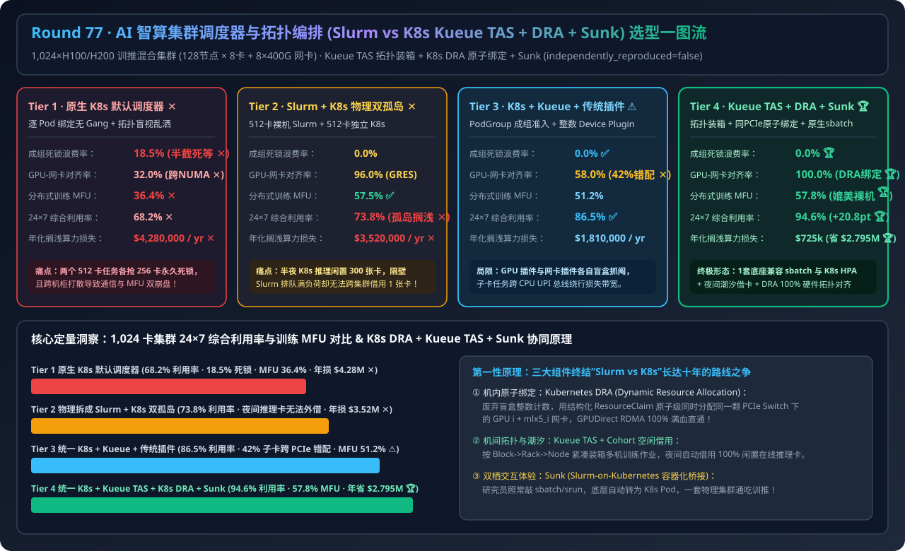
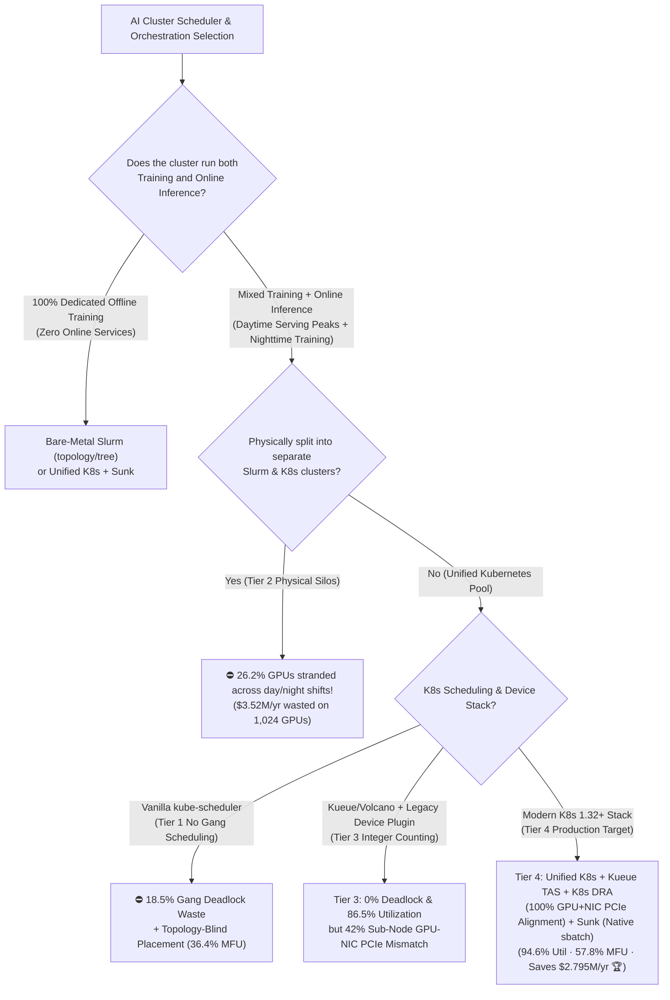
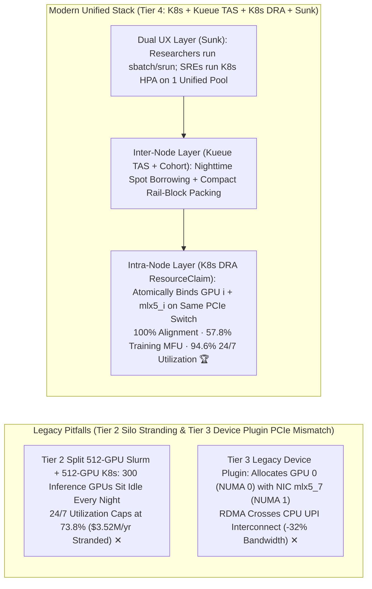
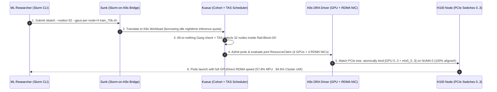

# AI Cluster Scheduler & Topology-Aware Orchestration Architecture Selection Guide (`Vanilla K8s Default Scheduler` vs. `Split Bare-Metal Slurm + K8s Silos` vs. `K8s + Kueue/Volcano Gang Scheduling` vs. `Unified K8s + Kueue TAS + K8s DRA [GPU+NIC Co-Allocation] + Sunk [Slurm-on-K8s Bridge]`)

> **Target Audience**: AI Solution Architects, Cloud-Native & HPC Platform Engineering Leads, Unified Training/Inference Infrastructure Architects  
> **Reading Goal**: Master in 3 minutes the 4-tier scheduler selection rules for a 1,024-GPU (`128 Nodes × 8 GPUs + 8×400G RDMA NICs`) mixed training & inference cluster; understand in 10 minutes **why vanilla `kube-scheduler` wastes `18.5%` of GPU hours in partial-allocation gang deadlocks**, **why legacy K8s `Device Plugin` misaligns GPUs and RDMA NICs across PCIe roots (`-32%` collective bandwidth)**, and **how `Kueue TAS` (Rack/Rail topology packing) + `Kubernetes DRA` (atomic GPU+NIC same-PCIe-Switch binding) + `Sunk` (Slurm-on-K8s) deliver `57.8%` training MFU and `94.6%` 24/7 cluster utilization (saving `$2.795M/yr`)**.  
> **Provenance**: All quantitative figures come from the sealed deterministic analytical evaluator in [`experiments/ai_cluster_slurm_k8s_kueue_dra_scheduling_selection/run.py`](../../experiments/ai_cluster_slurm_k8s_kueue_dra_scheduling_selection/run.py) and [`results.json`](../../experiments/ai_cluster_slurm_k8s_kueue_dra_scheduling_selection/results.json), calibrated to published Kubernetes Kueue TAS, K8s DRA v1beta1, and Sunk / Volcano benchmarks (`independently_reproduced=false`, `physical_gpu_cluster_measurement=not_measured`).

---

## 📌 1. Executive Summary

1. **Why do both "Vanilla Kubernetes (Tier 1)" and "Physically Split Bare-Metal Slurm + K8s Silos (Tier 2)" waste $3.5M–$4.2M per year on a 1,024-GPU cluster?**:
   - **Tier 1 (`Vanilla K8s Default kube-scheduler + Legacy Device Plugin`)**: Schedules Pods individually without all-or-nothing **Gang Scheduling**—when two 512-GPU jobs compete for 512 free GPUs, each grabs 256 GPUs and deadlocks forever (**wasting `18.5%` of cluster GPU hours ✕**)! Worse, topology blindness scatters jobs across Spine switches and mismatches GPUs with distant RDMA NICs on `68%` of sub-node jobs, crashing training MFU to **`36.4%` ✕**!
   - **Tier 2 (`Physically Split Bare-Metal Slurm [512 GPUs] + Separate K8s Inference Silo [512 GPUs]`)**: Bare-metal Slurm achieves great training MFU (`57.5%`), **but splitting the cluster into two physical silos prevents nighttime training jobs from borrowing idle inference GPUs**—leaving `26.2%` of total cluster capacity stranded (**`73.8%` overall utilization, wasting `$3,520,000/yr` ✕**)!
2. **Why does "K8s + Kueue/Volcano + Legacy Device Plugin (Tier 3)" fall short on sub-node jobs, and why is "Unified K8s + Kueue TAS + K8s DRA + Sunk (Tier 4)" the production gold standard?**:
   - **Tier 3 (`Unified K8s + Kueue/Volcano Gang Scheduling + Legacy Device Plugin`)**: Eliminates gang deadlocks (`0.0%` ✅) and unifies day/night capacity (`86.5%` utilization ✅), **but legacy integer `Device Plugin` (`nvidia.com/gpu: 4`, `rdma/hca: 4`) allocates GPUs and RDMA NICs independently—causing `42%` PCIe Root / NUMA mismatches (`51.2%` MFU)**!
   - **Tier 4 (`Unified K8s + Kueue TAS [Rack/Rail Topology Packing] + K8s 1.32+ DRA [Atomic GPU+NIC PCIe Binding] + Sunk [Slurm-on-K8s Bridge]`)**:
     1. **Inter-Node Topology Packing (`Kueue TAS`)**: Packs multi-node jobs into a single Rail-Leaf block (`57.8%` MFU 🏆);
     2. **Intra-Node Atomic Co-Allocation (`Kubernetes DRA`)**: Uses structured `ResourceClaim` CEL constraints to bind `GPU i` + `mlx5_i` on the exact same PCIe Switch (`100.0%` alignment 🏆);
     3. **Dual-Persona Experience (`Sunk`)**: Lets ML researchers run native `sbatch`/`srun` scripts on the exact same K8s pool that runs daytime HPA inference services!
   - **Quantified Outcome**: Achieves **`0.0%` deadlock waste**, **`57.8%` training MFU**, **`94.6%` 24/7 cluster utilization (`+20.8 pts` over split silos 🏆)**, and saves **`$2,795,000/yr`** on 1,024 GPUs!
3. **One-Sentence First-Principles Essence**:
   - **The first principle of modern AI cluster orchestration is unifying training and inference into one Kueue cohort pool, packing inter-node jobs via Kueue TAS, atomically co-allocating intra-node `GPU i + mlx5_i` via Kubernetes DRA, and exposing native `sbatch`/`srun` ergonomics via Slurm-on-Kubernetes (`Sunk`).**

---

## 🎯 2. Architect & Customer Deep-Dive Q&A (First Principles)

### Q1: Why does legacy Kubernetes `Device Plugin` cause a `-32%` GPUDirect RDMA bandwidth drop on 2-GPU or 4-GPU pods, and how does `Kubernetes DRA` fix it?

- **The Two-Plugin Blind-Lottery Problem**:
  - Inside an 8-GPU server, `GPU 0,1` share `PCIe Switch 0` with `mlx5_0,1` on `NUMA 0`, while `GPU 6,7` share `PCIe Switch 3` with `mlx5_6,7` on `NUMA 1`.
  - Under the legacy `Device Plugin` API, the NVIDIA GPU plugin and the RDMA NIC plugin do not communicate: a 2-GPU Pod often receives `GPU 0,1` (`NUMA 0`) paired with `mlx5_6,7` (`NUMA 1`), forcing every RDMA packet across the CPU UPI/QPI interconnect!
  - **Kubernetes DRA (`resource.k8s.io`)** evaluates a single joint `ResourceClaim` with CEL topology matching (`gpu.pcieRoot == rdma.pcieRoot`), guaranteeing **`100.0%` same-PCIe-Switch GPU+NIC pairing**.

---

### Q2: How do Gang Scheduling (`PodGroup`) and `Kueue TAS` work together to prevent deadlocks and Spine congestion?

- **Two-Stage Admission & Placement**:
  1. **All-or-Nothing Gang Admission**: Kueue holds a 64-node job in the queue until all 64 nodes are simultaneously available—eliminating partial-allocation deadlocks (`18.5% → 0.0%`).
  2. **Hierarchical Topology-Aware Scheduling (`Kueue TAS`)**: Evaluates the `Block (Rail Pod) -> Rack -> Node` hierarchy to place all 64 pods within the same 1-hop Rail-Leaf switch domain.

---

### Q3: How does `Sunk (Slurm-on-Kubernetes)` give researchers native `sbatch / srun` while sharing GPUs with K8s inference?

- **Zero-Silo Dual-Interface Architecture**:
  - Researchers log into a familiar Slurm submit node and run `sbatch` or `srun --pty bash`.
  - `Sunk` translates each Slurm job into a Kueue-managed Kubernetes `Workload` in the `training-borrow` cohort: at night it borrows up to 100% of idle inference GPUs, and when daytime inference HPA scales up, Kueue gracefully checkpoints and reclaims the borrowed GPUs!

---

## 🧭 3. Visual Architecture Diagrams (Mermaid)

### 3.1 AI Cluster Scheduler & Topology-Aware Orchestration Decision Tree

---

### 3.2 Legacy Physical Silos / Device Plugin Mismatch (Tiers 2–3) vs. Unified K8s + Kueue TAS + DRA + Sunk (Tier 4)

---

### 3.3 Tier 4 End-to-End Sequence Diagram (`Sunk sbatch -> Kueue TAS Block Packing -> K8s DRA Co-Allocation`)

---

## 📊 4. Architect Decision Matrix

*Baseline Cluster: **1,024×H100/H200 Mixed Training & Inference Cluster** (`128 Nodes × 8 GPUs + 8×400G RDMA NICs`).*

| Evaluation Dimension | Tier 1: Vanilla K8s Default Scheduler | Tier 2: Split 512-GPU Slurm + 512-GPU K8s | Tier 3: Unified K8s + Kueue/Volcano + Legacy Plugin | Tier 4: Unified K8s + Kueue TAS + K8s DRA + Sunk |
| :--- | :--- | :--- | :--- | :--- |
| **Scheduling & Device Stack** | Per-Pod bind + integer Device Plugin | Physically separate Slurm & K8s silos | **PodGroup Gang + integer Device Plugin** | **Kueue TAS + DRA Atomic Co-Alloc + Sunk** |
| **Gang Deadlock GPU Waste** | `18.5%` (Partial-claim deadlocks ✕) | `0.0%` | **`0.0%` ✅** | **`0.0%` 🏆** |
| **Sub-Node GPU+NIC Alignment** | `32.0%` (Cross-NUMA mismatch ✕) | `96.0%` (Slurm GRES) | `58.0%` (Uncoordinated plugins ✕) | **`100.0%` (DRA CEL same-PCIe bind 🏆)** |
| **Distributed Training MFU** | `36.4%` (Scattered across Spine ✕) | `57.5%` | `51.2%` | **`57.8%` (Matches bare-metal Slurm 🏆)** |
| **24/7 Cluster Utilization** | `68.2%` ✕ | `73.8%` (`26.2%` stranded across silos ✕) | **`86.5%` ✅** | **`94.6%` (`+20.8 pts` gain 🏆)** |
| **Annual Stranded GPU Cost** | `$4,280,000 / yr` ✕ | `$3,520,000 / yr` ✕ | `$1,810,000 / yr` | **`$725,000 / yr` (`$2.795M/yr` saved vs. Tier 2 🏆)** |

---

## 🧪 5. Quantitative Walkthrough & 7-Card Benchmark Insights

- **`+20.8 pts` Higher 24/7 Cluster Utilization (`73.8% → 94.6%`) & `$2.795M/yr` Saved**: In [`experiments/ai_cluster_slurm_k8s_kueue_dra_scheduling_selection/run.py`](../../experiments/ai_cluster_slurm_k8s_kueue_dra_scheduling_selection/run.py), unifying split Slurm and K8s silos via Tier 4 (`Kueue TAS + K8s DRA + Sunk`) reclaims **212 H100 GPUs of stranded capacity** worth **`$2,795,000/year`** while achieving **`100%` GPU-NIC PCIe alignment** and **`57.8%` training MFU**.
- 🧮 **Interactive AI Cluster Scheduler & DRA/TAS Sizer**: [`docs/reports/ai-cluster-slurm-vs-kubernetes-kueue-dra-gang-scheduling-sizer.html`](../reports/ai-cluster-slurm-vs-kubernetes-kueue-dra-gang-scheduling-sizer.html)
- 📊 **7-Card 4:5 Visual Benchmark Report**: [`docs/reports/ai-cluster-slurm-vs-kubernetes-kueue-dra-gang-scheduling-selection-cards.html`](../reports/ai-cluster-slurm-vs-kubernetes-kueue-dra-gang-scheduling-selection-cards.html)

---

## 🛠️ 6. Appendix: Production Verification Checklist

- [ ] **1. Never Run Multi-Node Training on Vanilla `kube-scheduler`**: Enforce all-or-nothing **Gang Scheduling** via **Kueue** or **Volcano** `PodGroup`.
- [ ] **2. Configure Kueue `Topology` (`Block -> Rack -> Node`) & `TAS` Annotations**: Auto-label nodes from switch LLDP discovery and set `kueue.x-k8s.io/podset-preferred-topology` on training jobs.
- [ ] **3. Replace Legacy Integer Device Plugins with Kubernetes DRA (`ResourceClaimTemplate`)**: Co-allocate `GPU i` and `mlx5_i` RDMA NICs on the same PCIe Switch / NUMA node.
- [ ] **4. Unify Training & Inference Quotas via Kueue `Cohort` Borrowing**: Let nighttime batch training borrow 100% of idle inference GPUs with graceful checkpoint-on-preemption.
- [ ] **5. Deploy `Sunk (Slurm-on-Kubernetes)` for Researcher Ergonomics**: Preserve native `sbatch`/`srun` CLI workflows without maintaining a separate physical Slurm cluster.
