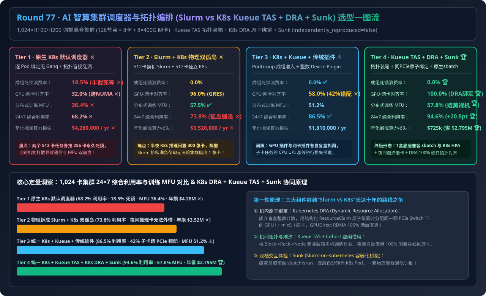
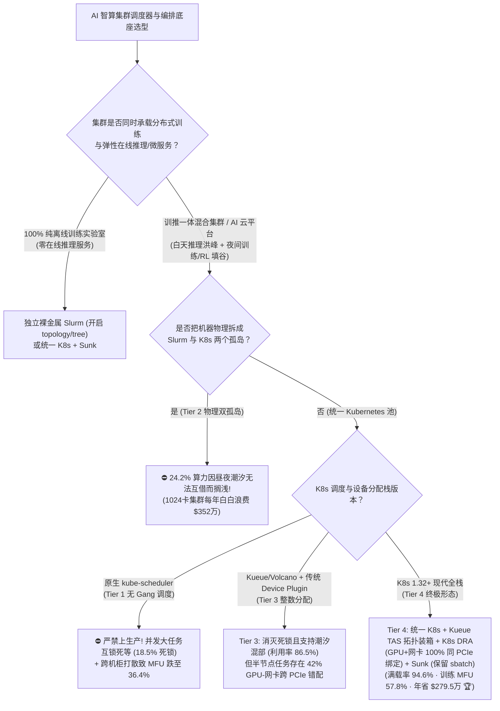
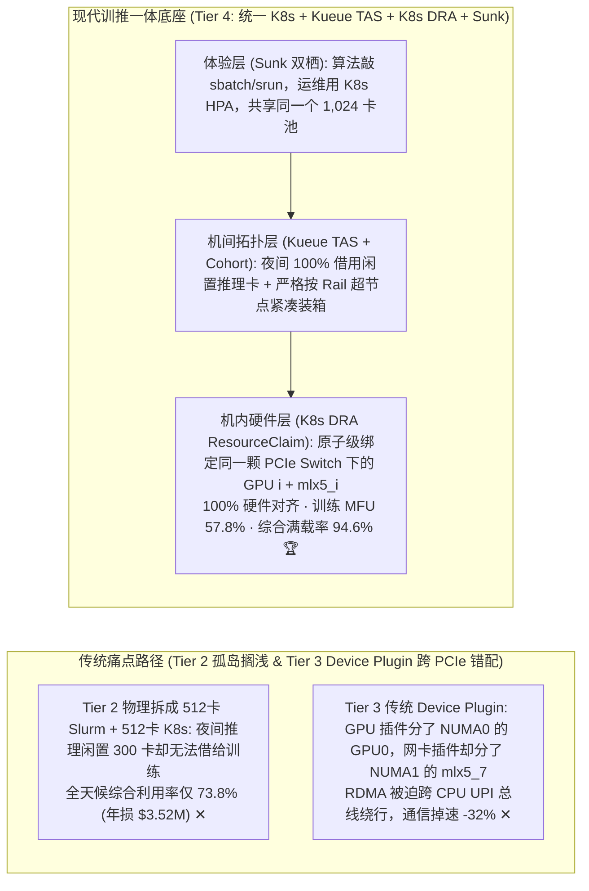
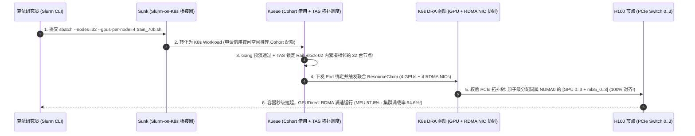

# AI 智算集群作业调度器与拓扑感知编排架构选型指南（`原生 K8s 默认调度器` vs. `物理割裂 Slurm + K8s 双孤岛` vs. `K8s + Kueue/Volcano 成组调度` vs. `统一 K8s + Kueue TAS 拓扑亲和 + K8s DRA [GPU+网卡原子对齐] + Sunk [Slurm-on-K8s 双栖融合]`）

> **适用角色**：AI 解决方案架构师（AI Solution Architect）、智算中心云原生与 HPC 平台负责人、训推一体算力调度架构师  
> **阅读目标**：3 分钟掌握 1,024 卡（128 台 `8×GPU + 8×400G RDMA 网卡` 节点）训推混合集群的四档调度器选型铁律，10 分钟吃透 **为什么原生 K8s `kube-scheduler` 会发生“各占一半卡互锁死等”的成组死锁（浪费 `18.5%` 算力）**、**为什么传统 K8s `Device Plugin` 会把 GPU 和 RDMA 网卡分在不同 PCIe Root 上导致通信暴跌 `-32%`**、以及 **如何通过 `Kueue TAS`（机柜/轨交换机拓扑装箱）+ `Kubernetes DRA`（GPU 与 RDMA 网卡原子级同 PCIe Switch 绑定）+ `Sunk`（Slurm-on-K8s 双栖桥接）在保留算法工程师 `sbatch/srun` 体验的同时实现 `94.6%` 全天候满载率（年省 `$279.5 万`）**！  
> **数据来源说明（Provenance）**：本文定量数据来自仓库内封存的确定性解析模型（[`experiments/ai_cluster_slurm_k8s_kueue_dra_scheduling_selection/run.py`](../../experiments/ai_cluster_slurm_k8s_kueue_dra_scheduling_selection/run.py) 与 [`results.json`](../../experiments/ai_cluster_slurm_k8s_kueue_dra_scheduling_selection/results.json)，校准自 Kubernetes Kueue TAS、K8s DRA v1beta1 与 Sunk / Volcano 公开基准，`independently_reproduced=false`，`physical_gpu_cluster_measurement=not_measured`）。

---

## 📌 一、核心结论速览（Executive Summary）

1. **为什么建千卡智算集群时，“直接裸跑原生 Kubernetes（Tier 1）”和“拆成裸金属 Slurm 训练池 + 独立 K8s 推理池两个孤岛（Tier 2）”都会每年白白损失三四百万美元？**：
   - **Tier 1（原生 Kubernetes 默认 `kube-scheduler` + 传统 `Device Plugin`）的死锁与拓扑盲人摸象**：
     - **成组死锁（Gang Deadlock）**：原生 K8s 是逐个 Pod 调度的。当集群剩 512 张卡，而两个需要 512 卡的分布式训练任务同时提交时，任务 A 抢到 256 张卡、任务 B 抢到 256 张卡，两边都在等对方释放剩下的 256 张卡，**512 张 H100 直接僵死空转（浪费 `18.5%` 总算力 ✕）**！
     - **拓扑盲视**：原生 K8s 不懂机柜 Rail 交换机与机内 PCIe 拓扑，把同一个训练作业随机洒在跨 Spine 的不同机柜上，且分给容器的 GPU 和 RDMA 网卡有 `68%` 概率不在同一颗 PCIe Switch 上，训练 MFU 暴跌至 **`36.4%` ✕**！
   - **Tier 2（物理隔离双孤岛：512 卡裸金属 Slurm 训练集群 + 512 卡独立 K8s 在线推理集群）的潮汐搁浅税**：
     - 算法研究员爱用 Slurm（`sbatch / srun` + `topology/tree` 达 `57.5%` MFU），而在线推理必须用 K8s（Ingress / KEDA 弹性扩缩容）。如果物理拆成两个固定集群：**到了半夜在线推理流量跌去 70%，300 多张推理 GPU 闲得长草，而隔壁 Slurm 队列排着 50 个训练任务却借不到一张卡**！全集群 24 小时平均利用率卡在 **`73.8%`（每年搁浅浪费 `$3,520,000` 算力 ✕）**！
2. **为什么仅靠“K8s + Kueue/Volcano 成组调度（Tier 3）”还差最后一口气？生产终极形态为什么是“K8s + Kueue TAS + K8s DRA + Sunk 双栖底座（Tier 4）”？**：
   - **Tier 3（`统一 K8s + Kueue/Volcano Gang Scheduling + 传统 Device Plugin`）的半节点拓扑盲区**：通过 `PodGroup` 全有或全无准入消灭了成组死锁（`0.0%` 死锁 ✅），并实现了训推昼夜潮汐混部（利用率升至 `86.5%` ✅）；**但传统 K8s `Device Plugin` 只认整数（`nvidia.com/gpu: 4`）**——当节点跑 2 卡或 4 卡任务时，GPU Device Plugin 和 RDMA SR-IOV Device Plugin 各自独立抓阄，导致 **`42%` 的任务拿到的 GPU 与 RDMA 网卡跨了 CPU NUMA / PCIe Root**，GPUDirect RDMA 退化走 QPI/UPI 总线，训练 MFU 掉到 `51.2%`！
   - **Tier 4（`统一 K8s + Kueue TAS [机柜/轨拓扑亲和] + K8s 1.32+ DRA [GPU+RDMA 网卡原子级同 PCIe Switch 绑定] + Sunk [Slurm-on-K8s 容器化桥接]`）**：
     1. **机间拓扑装箱（`Kueue Topology-Aware Scheduling, TAS`）**：声明 `cloud.provider.com/topology-block` 与 `topology-rack` 层级，强制把同一个多机训练任务紧凑装箱进同一个 Rail-Leaf 超节点内；
     2. **机内设备原子对齐（`Kubernetes DRA: Dynamic Resource Allocation`）**：用结构化 `ResourceClaim` 替代死板的整数计数，在调度层**原子级同时分配挂载在同一颗 PCIe Switch 下的 `GPU i + mlx5_i` RDMA 网卡（对齐率 `100.0%` 🏆）**；
     3. **用户体验双栖统一（`Sunk: Slurm-on-Kubernetes`）**：算法研究员照常敲 `sbatch / srun`，底层自动转化为受 Kueue 管控的 K8s Pod，与白天高优在线推理共享同一个 1,024 卡池，夜间自动借用全部空闲推理卡，白天秒级抢占归还！
   - **最终工程收益**：成组死锁 **`0.0%`**，分布式训练 MFU 达 **`57.8%`（完全追平裸金属 Slurm 🏆）**，全集群 24×7 综合利用率飙升至 **`94.6%`（比物理双集群高出 `+20.8 pts`，1,024 卡集群每年少浪费 `$2,795,000` 🏆）**！
3. **一句话握手机制本质**：
   - **现代智算中心编排的第一性原理，是“用 Kueue Cohort 潮汐借用打通训推孤岛，用 Kueue TAS 管住跨机柜 Rail 拓扑，用 K8s DRA 管住机内 GPU+RDMA 网卡同 PCIe Switch 原子绑定，再用 Sunk 给研究员保留原汁原味的 Slurm CLI”！**

---

## 🎯 二、客户与架构师灵魂拷问 Q&A（FAQ-Driven First Principles）

### Q1：为什么传统的 Kubernetes `Device Plugin`（写一行 `nvidia.com/gpu: 2` 和 `rdma/hca: 2`）会导致 GPUDirect RDMA 带宽腰斩？`Kubernetes DRA (Dynamic Resource Allocation)` 到底强在哪？

- **通俗大白话拆解**：
  1. **传统 `Device Plugin` 的“盲盒抓阄”缺陷**：
     - 在一台 8 卡 H100 服务器内部，有 4 颗 PCIe Switch：比如 `GPU 0, 1` 和网卡 `mlx5_0, mlx5_1` 挂在左边的 `PCIe Switch 0 (NUMA 0)` 上；而 `GPU 6, 7` 和网卡 `mlx5_6, mlx5_7` 挂在右边的 `PCIe Switch 3 (NUMA 1)` 上。
     - 传统 K8s `Device Plugin` 接口极度简陋——它只知道向 Kubelet 汇报一个整数，且 **NVIDIA GPU 插件和 Mellanox RDMA 网卡插件之间没有任何通气机制**！
     - 当一个 2 卡 Pod 请求 `gpu: 2, rdma: 2` 时，GPU 插件可能分给它左边的 `GPU 0, 1`，而网卡插件却分给它右边的 `mlx5_6, mlx5_7`！结果每次做 RDMA 通信，数据没法走 PCIe Switch P2P 直通，被迫绕道两颗 CPU 之间的 UPI/QPI 总线，**RDMA 带宽当场暴跌 `-32% ~ -50%`**！
  2. **Kubernetes DRA（`ResourceClaim` 结构化协同分配）的破局**：
     - DRA（K8s 1.32+ 核心特性）彻底废弃了整数计数，允许设备驱动暴露完整的 **PCIe Root / NUMA / NVLink 拓扑属性图**。
     - 用户提交一个联合 `ResourceClaim`，通过 CEL 表达式声明约束：`device["gpu"].pcieRoot == device["rdma"].pcieRoot`。调度器在绑定节点的同时，**100% 原子级确保分给你的永远是同一颗 PCIe Switch 下成对的 `GPU i + mlx5_i`**！

---

### Q2：什么是成组调度（Gang Scheduling）与 `Kueue TAS`（拓扑感知调度）？它们是如何配合解决“互锁死等”和“跨机柜乱洒”的？

- **第一性原理拆解**：
  1. **Gang Scheduling（全有或全无 `All-or-Nothing` 准入）**：
     - 一个 64 节点的 PyTorch 分布式训练任务，必须等 64 个 Pod 全部启动才能跑 `torch.distributed.init_process_group()`。只要少 1 个 Pod，已启动的 63 个 Pod 就会干等直到超时。
     - **Kueue / Volcano** 引入 `Workload / PodGroup` 原语：在调度器内存里先做预演（Pre-flight Reservation）——**只有当集群确实能同时满足全部 64 个 Pod 的资源请求时，才一次性下发绑定；如果只剩 40 个节点的空位，则 1 个 Pod 都不启动，先把这 40 个节点借给能放得下的中小任务跑**，死锁浪费率直接归零（`0.0%`）！
  2. **Kueue TAS（Topology-Aware Scheduling 层级紧凑装箱）**：
     - 在管理员定义的 `Block (SU 超节点) -> Rack (机柜) -> Node (机器)` 拓扑树上，训练任务只需加一行注解：`kueue.x-k8s.io/podset-preferred-topology: "cloud.provider.com/topology-block"`。
     - Kueue 会自动挑选空闲机器最集中的同一个 Rail-Pod 超节点把任务塞进去，避免把一个 32 节点作业拆散到 8 个不同机柜去抢 Spine 带宽，**将多机训练 MFU 从 `36.4%` 拉升至 `57.8%`**！

---

### Q3：算法团队写了上百个 Slurm `sbatch / srun` 脚本，死活不肯改写成 Kubernetes YAML 怎么办？`Sunk (Slurm-on-Kubernetes)` 是怎么做到“既不改一行脚本、又能和 K8s 推理混部”的？

- **双栖融合架构原理（Tier 4）**：
  - 不需要逼算法研究员学 `kubectl` 和 YAML，也绝不需要把机器物理切成两半！
  - 在统一的 Kubernetes 底座之上部署容器化的 **Slurm 控制面（`slurmctld`）与 `Sunk` 桥接器**：
    1. 算法研究员照常 SSH 登录 Login Node，敲他们最熟悉的 `sbatch train.sh` 或 `srun --nodes=32 python train.py`；
    2. `Sunk` 拦截该作业并自动将其包装为一个标准的 **Kubernetes `Workload`（携带 Kueue 优先级与 DRA/TAS 拓扑声明）**；
    3. 白天在线推理高峰期，K8s 推理服务拥有 `high-priority` 保底配额；到了晚上 22:00 推理缩容，Kueue 自动将空出来的 300 张推理 GPU 借给 `Sunk` 队列里的夜间训练任务，实现 **1 套物理集群、2 种交互界面、`94.6%` 全天候极致满载**！

---

## 🧭 三、直观可视化图解（Mermaid 决策树 / 架构对比 / 时序图）

### 3.1 AI 智算集群作业调度器与编排架构选型决策树

---

### 3.2 传统物理双孤岛 / Device Plugin 错配（Tier 2/3）vs. 统一 K8s + Kueue TAS + DRA + Sunk（Tier 4）对比

---

### 3.3 Tier 4 `Sunk sbatch 提交 -> Kueue TAS 超节点装箱 -> K8s DRA 同 PCIe 绑定` 时序图

---

## 📊 四、架构师选型决策矩阵（Architect Decision Matrix）

*基准场景：**1,024×H100/H200 训推混合集群**（`128 台 8 卡节点 + 8×400G RDMA 网卡`，年硬件折旧与电费成本约 `$1,345 万/年`）。*

| 评估维度 | Tier 1: 原生 K8s 默认调度器 | Tier 2: 物理隔离 512卡 Slurm + 512卡 K8s | Tier 3: 统一 K8s + Kueue/Volcano + 传统插件 | Tier 4: 统一 K8s + Kueue TAS + K8s DRA + Sunk |
| :--- | :--- | :--- | :--- | :--- |
| **调度与资源分配机制** | 逐 Pod 绑定 + 整数 Device Plugin | Slurm 与 K8s 物理硬切两套集群 | **PodGroup 成组准入 + 整数 Device Plugin** | **Kueue TAS 拓扑装箱 + DRA 原子绑定 + Sunk** |
| **成组死锁浪费算力占比** | `18.5%` (半截争抢死锁 ✕) | `0.0%` | **`0.0%` ✅** | **`0.0%` 🏆** |
| **子卡任务 GPU-网卡对齐率** | `32.0%` (随机抓阄跨 NUMA ✕) | `96.0%` (Slurm GRES 绑定) | `58.0%` (两插件独立分配错位 ✕) | **`100.0%` (DRA CEL 同 PCIe 绑定 🏆)** |
| **多机分布式训练 MFU** | `36.4%` (跨机柜打散 + 跨 NUMA ✕) | `57.5%` | `51.2%` | **`57.8%` (追平甚至超越裸机 Slurm 🏆)** |
| **24×7 全集群综合利用率** | `68.2%` ✕ | `73.8%` (昼夜潮汐孤岛搁浅 `26.2%` ✕) | **`86.5%` ✅** | **`94.6%` (`+20.8 pts` 跃升 🏆)** |
| **年化搁浅/死锁算力损失** | `$4,280,000 / yr` ✕ | `$3,520,000 / yr` ✕ | `$1,810,000 / yr` | **`$725,000 / yr` (比双孤岛年省 `$2.795M` 🏆)** |

---

## 🧪 五、简明定量算例与 7-Card Benchmark 洞察

### 5.1 1,024 卡训推混合集群年化算力回收账单

在 [`experiments/ai_cluster_slurm_k8s_kueue_dra_scheduling_selection/run.py`](../../experiments/ai_cluster_slurm_k8s_kueue_dra_scheduling_selection/run.py) 中，我们对 1,024 卡集群进行了定量对比：
- **打破 Slurm 与 K8s 物理孤岛，年省 `$2,795,000`（多收回 212 张 H100 等效算力）**：将两套各 512 卡的物理孤岛合并为一套受 **Kueue Cohort + Sunk** 管控的 1,024 卡统一底座后，夜间训练任务可自动借用闲置推理卡，全天候综合利用率从 `73.8%` 跃升至 **`94.6%`**！
- **K8s DRA + Kueue TAS 让训练 MFU 从 `36.4%` 飙升至 `57.8%`**：彻底解决了云原生 K8s 过去被诟病“跑分布式训练不如裸机 Slurm 快”的根源（机间乱洒与机内 GPU-网卡跨 PCIe 错配）。

### 5.2 配套交互式工作台与 7-Card 4:5 视觉评测报告

- 🧮 **交互式 AI 集群调度器与训推潮汐混部计算器**：[`docs/reports/ai-cluster-slurm-vs-kubernetes-kueue-dra-gang-scheduling-sizer.html`](../reports/ai-cluster-slurm-vs-kubernetes-kueue-dra-gang-scheduling-sizer.html)（以及总工作台 [`llm-inference-engine-pd-sizer.html`](../reports/llm-inference-engine-pd-sizer.html)）
- 📊 **7-Card 4:5 视觉基准评测报告**：[`docs/reports/ai-cluster-slurm-vs-kubernetes-kueue-dra-gang-scheduling-selection-cards.html`](../reports/ai-cluster-slurm-vs-kubernetes-kueue-dra-gang-scheduling-selection-cards.html)

---

## 🛠️ 六、附录：生产环境快速核验清单（Architect Checklist）

- [ ] **1. 严禁在多节点训练集群裸跑原生 `kube-scheduler`**：必须部署 **Kueue**（配合 Kubeflow Training Operator / RayJob）或 **Volcano**，强制开启 `All-or-Nothing` Gang Scheduling 成组准入。
- [ ] **2. 配置 Kueue `Topology` 层级（`Block -> Rack -> Node`）与 `TAS` 注解**：通过交换机 LLDP 自动为 K8s 节点打上所属 Rail-Block 与机柜标签，并在训练作业模板中默认开启 `podset-preferred-topology`。
- [ ] **3. 升级至 K8s DRA（`resource.k8s.io`）替代分离的 GPU/RDMA `Device Plugin`**：使用 NVIDIA DRA Driver 与网络 DRA Driver 联合 `ResourceClaimTemplate`，强制校验 `GPU i` 与 `mlx5_i` 处于同一 PCIe Switch / NUMA 域。
- [ ] **4. 通过 Kueue `Cohort` 实现白天推理与夜间训练潮汐互借**：为推理队列配置高优先级（`Preemption: ReclaimWithinCohort`），允许训练队列在夜间免费借用空闲推理配额并在早高峰前平滑让路。
- [ ] **5. 为习惯 Slurm 的算法团队部署 `Sunk (Slurm-on-K8s)` 登录节点**：保留 100% 原生 `sbatch / srun / squeue` 命令行体验，消除团队工具链迁移阻力。
