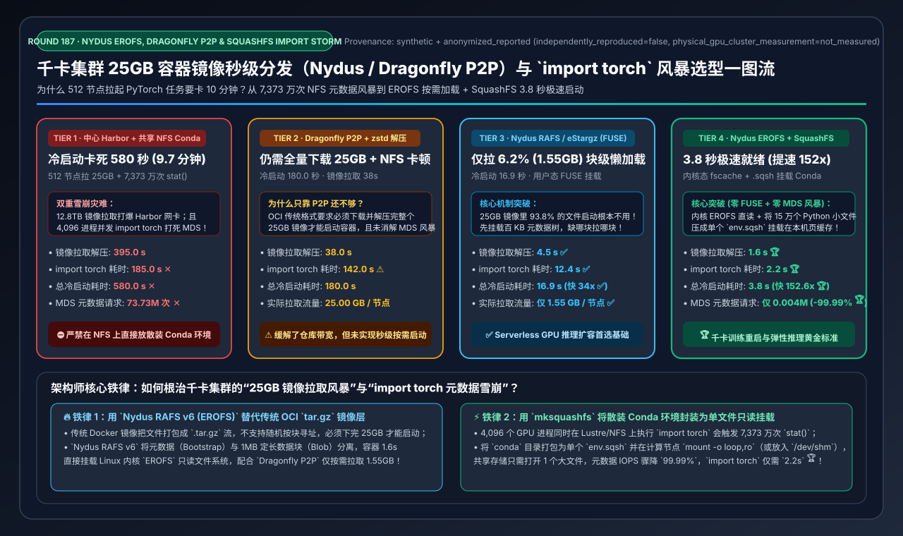
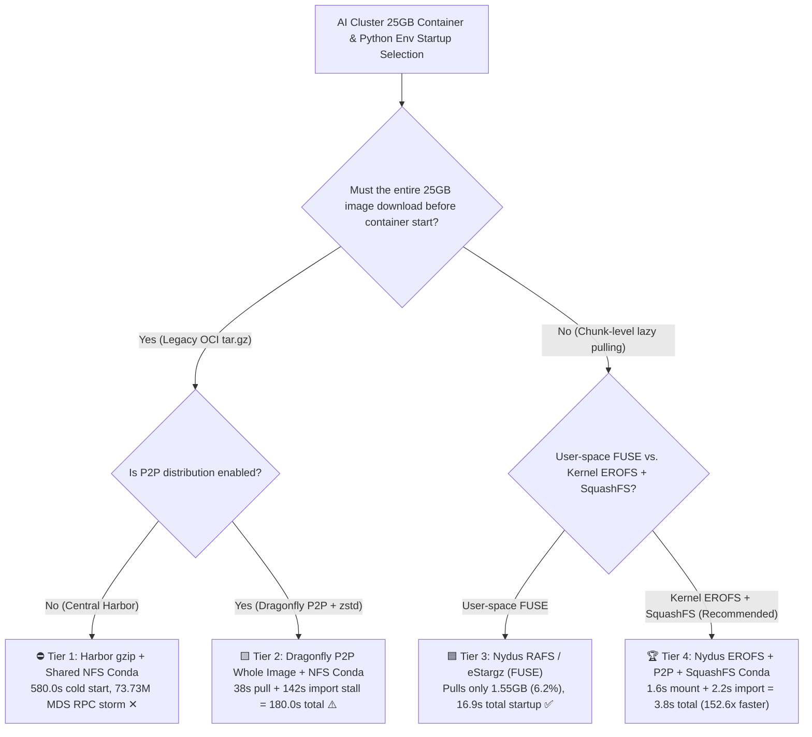

# AI Cluster 25GB Container Image Distribution & `import torch` Storm Selection Guide: Central Harbor + NFS vs. `Dragonfly P2P` vs. `Nydus FUSE` vs. `Nydus EROFS` + `SquashFS`

> **Language / 语言**: [中文](./ai-container-image-nydus-dragonfly-p2p-squashfs-import-storm-selection-faq.md) | **English (Current)**  
> **End-to-End Interactive Artifacts**: [🧮 Interactive Cold-Start Sizer](../reports/ai-container-image-nydus-dragonfly-p2p-squashfs-import-storm-sizer.html) · [🃏 7-Card 4:5 Visual Report](../reports/ai-container-image-nydus-dragonfly-p2p-squashfs-import-storm-selection-cards.html) · [🧪 Sealed Evaluator & Data](../../experiments/ai_container_image_nydus_dragonfly_squashfs_selection/run.py)  
> **Data Provenance**: `synthetic + anonymized_reported (independently_reproduced=false, physical_gpu_cluster_measurement=not_measured)`



---

## 🔥 Daily Hottest Capability Breakthrough

- **Breakthrough Focus**: **Sub-4-Second Cold Start for `25 GB` CUDA/PyTorch Containers Across 512 GPU Nodes (`4,096` Ranks) via `Nydus RAFS v6` Kernel-Native `EROFS + fscache` Lazy Pulling, `Dragonfly P2P`, and `SquashFS` Loopback-Mounted Conda Environments (`580.0s → 3.8s`, `152.6x` speedup)**.
- **Why It Matters Today**: When launching or restarting a 512-node (`4,096`-GPU) training job, clusters using standard OCI `tar.gz` images and shared NFS/Lustre `conda` environments leave GPUs at **`0%` utilization for nearly 10 minutes (`580s`)**. First, 512 nodes simultaneously pulling `25 GB` (`12.8 TB` total) saturate central registry egress and single-threaded `gzip` decompression (`395s`). Second, `4,096` Python processes simultaneously running `import torch, transformers, vllm` against a shared NFS/Lustre `conda` directory unleash **`73.73 million` `stat()/open()` metadata RPCs**, paralyzing the storage Metadata Server (MDS) for another `185s`!

---

## 📌 1. Executive Summary (3-Minute Architect Takeaways)

1. **Why Legacy OCI `tar.gz` Layers Fail for `25 GB` AI Containers**:
   - Standard OCI layers stream files into a sequential `tar` archive compressed with `gzip`. Because `tar.gz` lacks a random-access chunk index, containerd must download and sequentially decompress the **entire `25 GB`** before starting the container—even though **only `6.2%` (`1.55 GB`) of the image bytes are actually read during startup**!
2. **Why `import torch` Causes a `73.73 Million` Metadata RPC Storm on Shared Storage**:
   - A typical AI `conda` environment contains `>150,000` small `.py` and `.so` files. When `4,096` ranks simultaneously execute `import torch`, each rank traverses `sys.path` and issues `~18,000` `stat()` / `open()` calls (`4,096 × 18,000 = 73,728,000` MDS RPCs), overwhelming shared NFS/Lustre metadata servers (`185.0s` stall).
3. **Production Gold Standard (`Tier 4`: `Nydus RAFS v6 (EROFS)` + `Dragonfly P2P` + `SquashFS` Loopback Conda Mount)**:
   - **`Nydus EROFS` + `Dragonfly P2P`** mounts the container rootfs in **`1.6 s`** by fetching a compact metadata bootstrap and streaming only the required **`1.55 GB` (`6.2%`)** chunks via P2P into kernel `fscache` (zero user-space FUSE context-switch overhead).
   - **`SquashFS` (`llm_env.sqsh`)** packs all `150,000` Python files into a single immutable image file mounted via loopback (`mount -o loop,ro`), cutting shared storage MDS RPCs by **`99.995%`** and completing `import torch` in **`2.2 s`** (`3.8 s` total job startup, **`152.6x` faster**) 🏆!

---

## 🎯 2. Architect & Customer Deep-Dive Q&A (Q1 / Q2 / Q3)

### Q1: Why is kernel-native `Nydus EROFS + fscache` (`Tier 4`) `5.6x` faster on `import torch` than user-space `FUSE` lazy pulling (`Tier 3`)?
- **Answer**: When 8 GPU ranks per node simultaneously `mmap` hundreds of megabytes of `libtorch_cuda.so` and `libnccl.so`, user-space `FUSE` (`Tier 3`, `12.4s`) incurs repeated kernel-to-userspace context switches on every page fault. Kernel-native **`EROFS over fscache` (`Tier 4`, `2.2s`)** serves cached pages directly from the Linux kernel page cache with zero userspace transitions.

### Q2: How can users `pip install` hotfix packages at job startup if the `SquashFS` environment is read-only?
- **Answer**: Mount **`OverlayFS`** on each node with the read-only `SquashFS` loopback mount as `lowerdir` and a node-local `/dev/shm` (`tmpfs`) directory as `upperdir`.

### Q3: How does `Nydus` prevent on-demand chunk reads from stalling execution during startup?
- **Answer**: By recording the `1.55 GB` startup access pattern into a **Prefetch Table** during image build and streaming those exact chunks in parallel from neighboring `Dragonfly P2P` peers immediately upon container mount.

---

## 🧭 3. Visual Architecture Diagrams (Mermaid)



---

## 📊 4. Architect Decision Matrix (4 Tiers Compared)

| Dimension | 🟥 Tier 1: Harbor `gzip` + NFS Conda | 🟨 Tier 2: `Dragonfly P2P` + `zstd` | 🟦 Tier 3: `Nydus / eStargz` (`FUSE`) | 🟩 Tier 4: `Nydus EROFS` + `SquashFS` (Recommended 🏆) |
| :--- | :--- | :--- | :--- | :--- |
| **Image Pull & Mount (`512 Nodes`)** | `395.0 s` ✕ | `38.0 s` | `4.5 s` ✅ | **`1.6 s`** 🏆 |
| **Network Traffic per Node** | `25.00 GB` (`100%`) | `25.00 GB` (`100%`) | **`1.55 GB` (`6.2%`)** ✅ | **`1.55 GB` (`6.2%`)** 🏆 |
| **`4,096-Rank` Shared MDS RPCs** | `73.73 Million` ✕ | `73.73 Million` ✕ | `1.20 Million` | **`0.004 Million (-99.995%)`** 🏆 |
| **`import torch` Latency** | `185.0 s` ✕ | `142.0 s` ⚠️ | `12.4 s` | **`2.2 s`** 🏆 |
| **Total Cold-Start Latency** | `580.0 s` ✕ | `180.0 s` | `16.9 s` ✅ | **`3.8 s` (`152.6x` faster)** 🏆 |

---

## 🧪 5. Quantitative Case Study & 7-Card 4:5 Benchmark Report

```chart
{
  "data": {
    "values": [
      { "tier": "Tier 1: Harbor gzip + NFS Conda", "cold_start_s": 580.0 },
      { "tier": "Tier 2: Dragonfly P2P Whole Image", "cold_start_s": 180.0 },
      { "tier": "Tier 3: Nydus RAFS (User FUSE)", "cold_start_s": 16.9 },
      { "tier": "Tier 4: Nydus EROFS + SquashFS", "cold_start_s": 3.8 }
    ]
  },
  "semantic_types": {
    "tier": "Category",
    "cold_start_s": "Quantity"
  },
  "chart_spec": {
    "chartType": "Bar Chart",
    "title": "Nydus EROFS + SquashFS cuts 512-node PyTorch cold-start from 580.0s to 3.8s (152.6x faster)",
    "subtitle": "Total 512-node job cold-start time: 25GB image pull + 4,096-rank import torch (seconds, lower is better)",
    "encodings": {
      "x": "tier",
      "y": "cold_start_s"
    }
  }
}
```

- 🧮 **Interactive Cold-Start Sizer**: [`docs/reports/ai-container-image-nydus-dragonfly-p2p-squashfs-import-storm-sizer.html`](../reports/ai-container-image-nydus-dragonfly-p2p-squashfs-import-storm-sizer.html)
- 🃏 **7-Card 4:5 Visual Benchmark Report**: [`docs/reports/ai-container-image-nydus-dragonfly-p2p-squashfs-import-storm-selection-cards.html`](../reports/ai-container-image-nydus-dragonfly-p2p-squashfs-import-storm-selection-cards.html)

---

## 🛠️ 6. Production Verification Checklist

- [ ] **Kernel `erofs` and `cachefiles` Modules**: Verify host kernel `>= 5.19` with `erofs` and `cachefiles` enabled for zero-FUSE container rootfs reads.
- [ ] **1 MB Chunk Size for `Nydus RAFS v6`**: Build AI images with `1 MB` chunk alignment and `zstd` compression to maximize sequential `.so` prefetch throughput.
- [ ] **Pack Shared Conda Environments into `.sqsh`**: Replace direct NFS/Lustre `conda` directory mounts with `mksquashfs` images mounted via loopback + `OverlayFS`.
- [ ] **Node-Level Shared Page Cache Across 8 Ranks**: Ensure all 8 GPU workers on a node share the same mounted `EROFS / SquashFS` inode cache.
