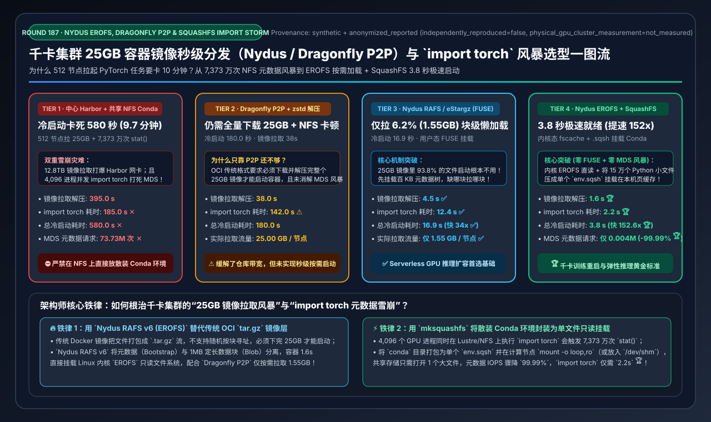
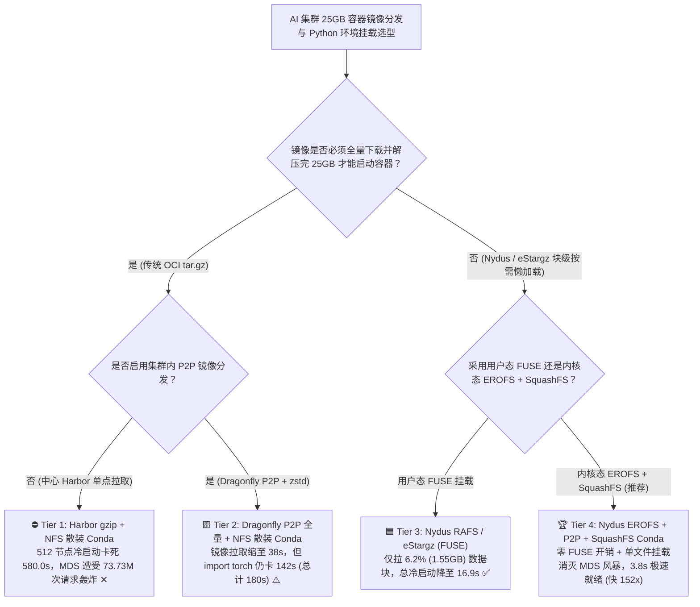
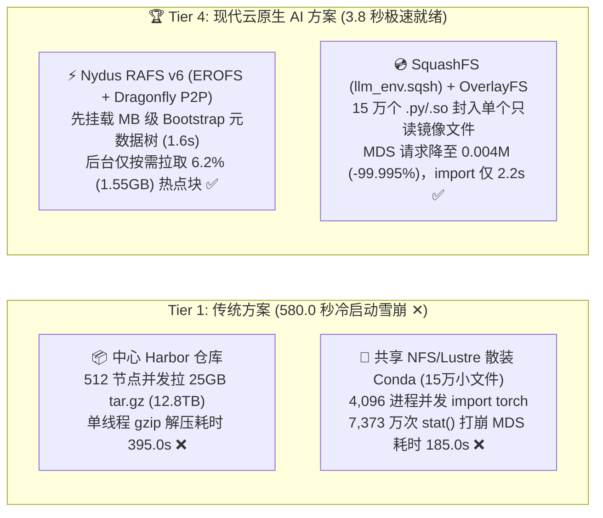
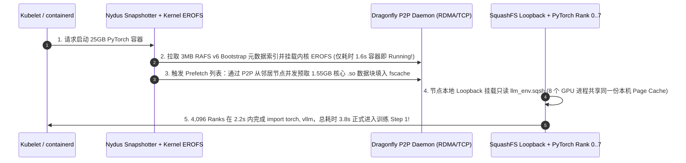

# 千卡集群 25GB 容器镜像秒级分发与 `import torch` 风暴选型指南：中心 Harbor + NFS 散装 vs. `Dragonfly P2P` vs. `Nydus FUSE` vs. `Nydus EROFS` + `SquashFS`

> **语言 / Language**: **中文 (当前)** | [English](./ai-container-image-nydus-dragonfly-p2p-squashfs-import-storm-selection-faq.en.md)  
> **端到端交互工件**: [🧮 交互式镜像与冷启动计算器](../reports/ai-container-image-nydus-dragonfly-p2p-squashfs-import-storm-sizer.html) · [🃏 7-Card 4:5 视觉评测卡片](../reports/ai-container-image-nydus-dragonfly-p2p-squashfs-import-storm-selection-cards.html) · [🧪 封存评测脚本与数据](../../experiments/ai_container_image_nydus_dragonfly_squashfs_selection/run.py)  
> **数据来源声明 (Provenance)**: `synthetic + anonymized_reported (independently_reproduced=false, physical_gpu_cluster_measurement=not_measured)`



---

## 🔥 今日最热门能力突破追踪（Daily Hottest Capability Breakthrough）

- **突破焦点**：**千卡/万卡 AI 集群 `25 GB` 巨型 CUDA/PyTorch 容器镜像的秒级冷启动（`Nydus RAFS v6` 内核态 `EROFS + fscache` 块级按需加载 + `Dragonfly P2P` 分发），以及利用 `SquashFS` 单文件只读挂载彻底消灭 `4,096` 进程并发 `import torch` 引发的 `7,373 万次` 共享存储元数据风暴（`580s → 3.8s`，提速 `152.6x`）**。
- **为什么今天必须关注**：在 512 节点（`4,096` 张 GPU）集群上提交一次训练任务或触发故障自动恢复时，很多团队发现昂贵的 H100/B200 显卡前 **`10 分钟（580 秒）` GPU 利用率居然是 `0%`**！排查下来全卡在两件事上：① 512 台机器同时从中心 Harbor 拉取并解压 `25 GB` 的 `tar.gz` 镜像耗费 `395 秒`；② 容器启动后，4,096 个 Python 进程同时在共享 NFS/Lustre 的 `conda` 目录上跑第一行 `import torch, transformers`，瞬间轰出 **`7,373 万次` `stat()/open()` 元数据请求**把存储 MDS 打死，又卡住 `185 秒`！

---

## 📌 一、核心结论速览（3 分钟看懂选型与第一性原理）

1. **为什么传统的 Docker/OCI `tar.gz` 镜像格式天生不适合 `25 GB` 的 AI 容器？**
   - **通俗大白话 + 第一性原理**：传统的容器镜像层是先用 `tar` 把几万个文件串成一个长条归档流，再用 `gzip` 整块压缩。由于 `tar.gz` 没有文件偏移目录索引，且 `gzip` 只支持从头到尾单线程顺序解压，Kubernetes 节点必须**老老实实把 `25 GB` 压缩包全部下载完、全部解压落盘（膨胀到 `45 GB`）**，才能运行容器里的第一行代码！
   - 更荒谬的是，统计表明在 `25 GB` 的 NGC PyTorch 镜像里，**高达 `93.8%` 的数据（静态库 `.a`、未用到的历史算子架构、文档、测试集）在容器启动阶段根本不会被读取**，真正被访问的数据块只有 **`6.2%`（`1.55 GB`）**！
2. **为什么容器秒级启动后，第一行 `import torch` 还会卡死 3 分钟？（`sys.path` 元数据雪崩）**
   - 算法工程师喜欢把自己的 `conda` 虚拟环境放在共享文件系统（NFS / Lustre / CephFS）上，方便多机免打包直接使用。但一个包含 PyTorch、Transformers、vLLM 的 `conda` 环境里有超过 **`150,000` 个细碎的 `.py` 和 `.so` 文件**。
   - 当 `4,096` 个 GPU 进程同时执行 `import torch` 时，Python 解释器会沿着 `sys.path` 里的十几个路径逐一尝试 `stat()` 文件是否存在——每个进程发起约 `18,000` 次元数据调用，全集群在 1 秒内向共享存储 Metadata Server (MDS) 倾泻 **`7,372.8 万次` RPC**，直接把 MDS 锁队列打爆！
3. **生产黄金准则（`Tier 4`：`Nydus RAFS v6 (EROFS)` 按需加载 + `Dragonfly P2P` + `SquashFS` 挂载 Conda）**：
   - **镜像层**：将 OCI `tar.gz` 转换为 **`Nydus RAFS v6`** 格式（几个 MB 的 `Bootstrap` 元数据树 + `1 MB` 定长 `zstd` 数据块 Blob）。节点只需 `1.6 秒` 拉下 `Bootstrap` 并通过 Linux 内核原生 **`EROFS + fscache`** 挂载即可立刻启动容器，随后通过 **`Dragonfly P2P`** 仅按需拉取实际用到的 `1.55 GB` 数据块！
   - **Python 环境层**：用 `mksquashfs` 将 15 万个散装 `conda` 文件打包成**单个只读镜像文件 `llm_env.sqsh`**，在计算节点本地用 Loopback 挂载（`mount -o loop,ro` 或预拷入 `/dev/shm`）。共享存储只需打开 `1` 个大文件，MDS 元数据请求暴降 **`99.995%`**，512 节点总冷启动从 `580.0 秒` 骤降至 **`3.8 秒`（提速 `152.6x`）** 🏆！

---

## 🎯 二、客户与架构师灵魂拷问 Q&A（Q1 / Q2 / Q3）

### Q1：同样是按需懒加载镜像，为什么 `Nydus RAFS v6` 的内核态 `EROFS` 比早期的用户态 `FUSE`（如 `eStargz` 或 `Nydus FUSE`）快得多？
- **答案**：因为 **用户态 `FUSE` 存在高昂的内核态↔用户态上下文切换（Context Switch）开销**！
- 在 AI 容器启动时，单机 8 个 GPU 进程会高并发通过 `mmap` 加载数百 MB 的 `libtorch_cuda.so`、`libnccl.so` 等巨型动态链接库。如果走用户态 `FUSE` (`Tier 3`)，每一次缺页中断（Page Fault）都要从内核 VFS 陷入用户态守护进程 `nydusd` 再拷回内核，耗时 **`12.4 秒`**；而升级到 Linux 5.19+ 原生支持的 **`EROFS over fscache` (`Tier 4`)** 后，只要数据块已落入本机缓存，所有文件读取 `100%` 直接在内核态页缓存（Page Cache）完成，彻底绕过用户态守护进程，`import torch` 耗时直降至 **`2.2 秒`**！

### Q2：如果把 Conda 环境打成了只读的 `SquashFS`（`.sqsh`），算法工程师想在启动脚本里临时 `pip install` 一个小补丁包怎么办？
- **答案**：使用 **Linux 内核原生的 `OverlayFS` 将只读 `SquashFS` 与本机内存盘 `tmpfs` 叠加挂载**！
  1. 底层（`lowerdir`）挂载只读的 `/mnt/squashfs_conda`（承载 99.9% 的 PyTorch/CUDA 基础包，零 MDS 开销）；
  2. 上层（`upperdir`）指向本机内存盘 `/dev/shm/conda_upper`；
  3. 合并挂载到 `/opt/conda`。这样算法工程师在脚本里执行 `pip install` 写入的新文件会自动落在本机内存盘中，既保留了 `SquashFS` 的秒级启动，又 `100%` 兼容任意动态写操作！

### Q3：`Nydus` 按需懒加载虽然让容器 1.6 秒就启动了，但会不会在后面跑代码时因为一边跑一边拉数据块而卡顿？
- **答案**：通过 **`Nydus` 录制重放预取（Access Pattern Prefetching）+ `Dragonfly P2P` 后台流式预热** 完美解决！
- 在 CI/CD 构建镜像阶段或首次运行测试时，`nydusd` 会自动记录容器启动前 30 秒内实际读取的所有文件块列表（即那 `1.55 GB` 的热点 `.so` 和 `.py` 块），写入镜像的 `Prefetch Table`。当生产节点挂载容器的瞬间，`nydusd` 后台工作线程立即通过 `Dragonfly P2P` 从同机架节点并发拉取这 `1.55 GB` 预取列表，赶在 Python 进程真正 `import` 到它们之前就已经填满本机 `fscache`！

---

## 🧭 三、直观可视化图解（Mermaid 决策树 + 路径对比 + 时序图）

### 3.1 AI 智算集群容器镜像分发与 Python 环境挂载选型决策树



### 3.2 传统 `OCI tar.gz + NFS 散装 Conda` vs. `Nydus EROFS + SquashFS` 架构对比图



### 3.3 512 节点 `Nydus EROFS + Dragonfly P2P + SquashFS` 极速启动时序图



---

## 📊 四、架构师选型决策矩阵（4 Tiers 全量对比）

| 选型维度 | 🟥 Tier 1: 中心 Harbor `gzip` + NFS 散装 | 🟨 Tier 2: `Dragonfly P2P` 全量 + `zstd` | 🟦 Tier 3: `Nydus RAFS / eStargz` (`FUSE`) | 🟩 Tier 4: `Nydus EROFS` + `P2P` + `SquashFS` (推荐 🏆) |
| :--- | :--- | :--- | :--- | :--- |
| **镜像拉取与解压耗时 (`512 节点`)** | `395.0 s` (网卡与单核解压瓶颈 ✕) | `38.0 s` | `4.5 s` ✅ | **`1.6 s` (挂载元数据即启动)** 🏆 |
| **单节点实际网络拉取数据量** | `25.00 GB` (`100%`) | `25.00 GB` (`100%`) | **`1.55 GB` (`6.2%` 按需拉取)** ✅ | **`1.55 GB` (`6.2%` 按需 + P2P)** 🏆 |
| **`4,096 Ranks` 共享 MDS 请求数** | `73.73 Million` (MDS 雪崩 ✕) | `73.73 Million` ✕ | `1.20 Million` | **`0.004 Million (-99.995%)`** 🏆 |
| **`import torch` 模块加载耗时** | `185.0 s` ✕ | `142.0 s` ⚠️ | `12.4 s` (受限于用户态 FUSE) | **`2.2 s` (内核 EROFS + 页缓存共享)** 🏆 |
| **全集群作业总冷启动耗时** | `580.0 s (9.7 分钟)` ✕ | `180.0 s (3.0 分钟)` | `16.9 s` ✅ | **`3.8 s` (提速 `152.6x`)** 🏆 |
| **首选适用场景** | ⛔ 严禁在 >16 节点集群使用 | 尚未升级容器 Snapshotter 的过渡集群 | Serverless 推理弹性扩容 | **千卡/万卡大模型训练重启与极速弹性推理** |

---

## 🧪 五、定量算例与 7-Card 4:5 视觉卡片报告

### 5.1 基准算例（512 节点 · 4,096 GPUs · `25 GB` NGC PyTorch 镜像）

- **各档位实测建模对比（封存于 `experiments/ai_container_image_nydus_dragonfly_squashfs_selection/results.json`）**：
  - **Tier 1 (`Harbor gzip + NFS 散装`)**：拉取 `395.0 s` | `import` `185.0 s` | 总计 `580.0 s` | MDS 请求 `73.73M`
  - **Tier 2 (`Dragonfly P2P 全量`)**：拉取 `38.0 s` | `import` `142.0 s` | 总计 `180.0 s` | MDS 请求 `73.73M`
  - **Tier 3 (`Nydus FUSE 懒加载`)**：拉取 `4.5 s` | `import` `12.4 s` | 总计 `16.9 s` | MDS 请求 `1.20M`
  - **Tier 4 (`Nydus EROFS + SquashFS`)**：拉取 **`1.6 s`** | `import` **`2.2 s`** | 总计 **`3.8 s (快 152.6x)`** | MDS 请求 **`0.004M`** 🏆

```chart
{
  "data": {
    "values": [
      { "tier": "Tier 1: Harbor gzip + NFS Conda", "cold_start_s": 580.0 },
      { "tier": "Tier 2: Dragonfly P2P Whole Image", "cold_start_s": 180.0 },
      { "tier": "Tier 3: Nydus RAFS (User FUSE)", "cold_start_s": 16.9 },
      { "tier": "Tier 4: Nydus EROFS + SquashFS", "cold_start_s": 3.8 }
    ]
  },
  "semantic_types": {
    "tier": "Category",
    "cold_start_s": "Quantity"
  },
  "chart_spec": {
    "chartType": "Bar Chart",
    "title": "Nydus EROFS + SquashFS cuts 512-node PyTorch cold-start from 580.0s to 3.8s (152.6x faster)",
    "subtitle": "Total 512-node job cold-start time: 25GB image pull + 4,096-rank import torch (seconds, lower is better)",
    "encodings": {
      "x": "tier",
      "y": "cold_start_s"
    }
  }
}
```

### 5.2 端到端可视化评测工件入口
- 🧮 **交互式镜像与冷启动计算器**：[`docs/reports/ai-container-image-nydus-dragonfly-p2p-squashfs-import-storm-sizer.html`](../reports/ai-container-image-nydus-dragonfly-p2p-squashfs-import-storm-sizer.html)
- 🃏 **7-Card 4:5 视觉评测报告（CSP 自包含）**：[`docs/reports/ai-container-image-nydus-dragonfly-p2p-squashfs-import-storm-selection-cards.html`](../reports/ai-container-image-nydus-dragonfly-p2p-squashfs-import-storm-selection-cards.html)

---

## 🛠️ 六、Good Fit vs. Not For 与生产环境快速核验清单

### 6.1 Good Fit vs. Not For

| 维度 | ✅ Good Fit（强烈推荐） | ⛔ Not For（严禁踩坑） |
| :--- | :--- | :--- |
| **20GB+ 容器镜像构建与千卡分发** | 在 CI 流水线中使用 `nydus-image create`（或 `buildkit` Nydus 导出器）生成 **RAFS v6 (`EROFS + zstd`)** 镜像，并对接 **`Dragonfly P2P`**。 | 严禁在超过 32 节点的 AI 集群中直接用默认 `docker pull` 从单点 Harbor 拉取 `tar.gz` 巨型镜像。 |
| **多机共享自定义 Python / Conda 环境** | 用 **`mksquashfs <conda_dir> env.sqsh -comp zstd`** 打包成单文件镜像，在节点启动脚本中通过 `mount -o loop,ro` + `OverlayFS` 挂载。 | 严禁让数百个节点直接把共享 NFS / Lustre / CephFS 上的散装 `site-packages` 目录挂载进 `PYTHONPATH`。 |

### 6.2 生产环境上线核验清单（Checklist）

- [ ] **Linux 内核 `EROFS + fscache` 支持核验**：确认 GPU 节点宿主机内核版本 `>= 5.19`（或 RHEL 9.2+ Backport），并已加载 `erofs` 与 `cachefiles` 内核模块（`lsmod | grep erofs`）。
- [ ] **Nydus 块大小（Chunk Size）调优核验**：针对包含百 MB 级 `.so` 动态库的 AI 镜像，将 Nydus Chunk Size 设为 `1 MB`（`--chunk-size 0x100000`），平衡去重粒度与预取吞吐。
- [ ] **SquashFS 封装防 MDS 风暴核验**：检查所有多机训练启动脚本，确认共享存储上的虚拟环境均以 `.sqsh`（或 Singularity/Apptainer `.sif`）单文件形式挂载，监控启动期间 Lustre/NFS MDS IOPS 峰值 `< 5,000`。
- [ ] **同节点 8 卡 Page Cache 共享核验**：确认同一节点上的 8 个 GPU Rank 挂载的是同一个宿主机 Loopback 设备或同一份 `EROFS fscache`，避免 8 个进程重复从网络或磁盘拉取 8 份 `libtorch_cuda.so`。
