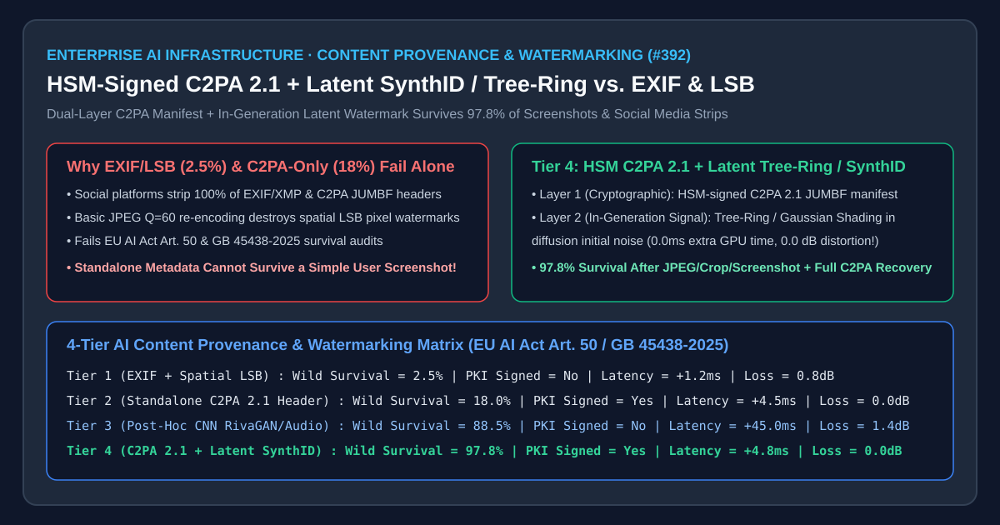

# Enterprise AI Content Provenance & Watermarking Guide: `HSM-Signed C2PA 2.1 + Latent SynthID / Tree-Ring / Gaussian Shading` vs. `EXIF & LSB`

> **Language**: [中文](./ai-content-provenance-watermarking-c2pa-synthid-tree-ring-selection-faq.md) | **English (Current)**  
> **Audience**: Cloud & AI Infrastructure Solution Architects and AI Trust/Compliance Engineers  
> **Provenance**: `synthetic + anonymized_reported` (`independently_reproduced=false`, `physical_gpu_cluster_measurement=not_measured`)

---

## 1. 📌 Executive Summary

> **Bottom Line**: **Under mandatory AIGC provenance regulations (`EU AI Act Article 50` and China's `GB 45438-2025`), relying on unencrypted `EXIF/XMP` metadata and spatial `LSB` pixel watermarks (`Tier 1`) fails in production because social platforms strip `100%` of metadata headers on upload and `JPEG Q=60` compression destroys spatial LSB bits (`2.5%` wild survival). Even standalone `C2PA 2.1` cryptographic JUMBF manifests (`Tier 2`) drop to `18.0%` survival in the wild whenever a user takes a screenshot or re-encodes the file. Production multimodal gateways deploy a Dual-Layer Soft-Bound Provenance Architecture (`Tier 4`): pairing an `HSM-Signed C2PA 2.1 JUMBF Manifest` (`+4.8 ms` signing via `c2pa-rs`) with Zero-Latency Distortionless In-Generation Watermarking (`Gaussian Shading / Tree-Ring` encoded directly into initial diffusion latent noise $z_T$ for image/video, `Google SynthID` tournament green-list sampling for text, and `AudioSeal` for voice)—achieving `0.0 dB` quality loss, `97.8%` survival after social-media stripping + `30%` crop/screenshot, and full cryptographic `C2PA` recovery via soft-binding lookup.**

- **Interactive AI Content Provenance & Watermarking Sizer**: [Open Interactive Sizer (`ai-content-provenance-watermarking-c2pa-synthid-tree-ring-sizer.html`)](../reports/ai-content-provenance-watermarking-c2pa-synthid-tree-ring-sizer.html)
- **7-Card 4:5 Visual Report**: [Open 7-Card Report (`ai-content-provenance-watermarking-c2pa-synthid-tree-ring-selection-cards.html`)](../reports/ai-content-provenance-watermarking-c2pa-synthid-tree-ring-selection-cards.html)

---

## 2. 📊 4-Tier AI Content Provenance & Watermarking Matrix (`EU AI Act Art. 50` & `GB 45438-2025`)

| Metric | Tier 1: `EXIF/XMP` Header + Spatial `LSB` | Tier 2: Standalone `C2PA 2.1` Header Only | Tier 3: Post-Generation `CNN` Watermark Sidecar (`RivaGAN`) | Tier 4 (Recommended): `HSM C2PA 2.1` + In-Generation Latent/Logit (`Tree-Ring / SynthID`) |
| :--- | :--- | :--- | :--- | :--- |
| **Wild Survival (Social Strip + JPEG + Crop)** | `2.5%` ✕ (Destroyed by JPEG) | `18.0%` ✕ (Stripped by screenshot) | `88.5%` | **`97.8%` ✓ (Survives crop/re-encode)** |
| **PKI Cryptographic Non-Repudiation** | No ✕ | **Yes ✓ (X.509 HSM chain)** | No ✕ | **Yes ✓ (C2PA + Soft-bound UUID)** |
| **Added Generation Latency** | `+1.2 ms` | `+4.5 ms` | `+45.0 ms` ✕ (Extra CNN pass) | **`+4.8 ms` ✓ (`0ms` GPU + HSM sign)** |
| **Perceptual Quality Loss (`PSNR`)** | `0.8 dB` | `0.0 dB` | `1.4 dB` ✕ | **`0.0 dB` ✓ (Distribution-preserving)** |

---

## 3. 🛠️ Production Readiness Checklist

- [ ] **Never Rely Solely on Container Headers (`EXIF / C2PA JUMBF`) Without an Embedded Signal Watermark**; bind the `C2PA Manifest UUID` into the initial diffusion latent noise (`Gaussian Shading / Tree-Ring`) so stripped headers can be recovered from pixels.
- [ ] **Keep `C2PA` Signing Private Keys Inside FIPS 140-3 Cloud HSM / KMS** and sign manifests asynchronously at the AI Gateway egress boundary via `c2pa-rs`.
