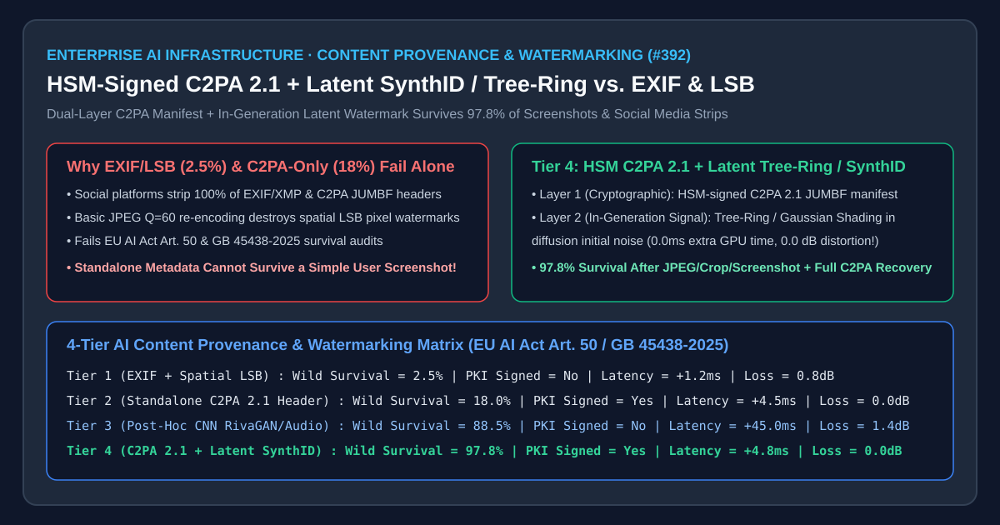
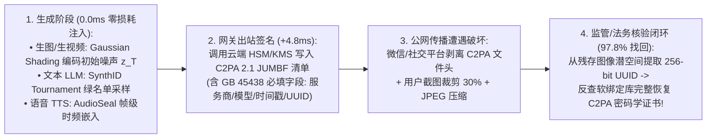

# 企业级 AIGC 内容溯源、密码学凭证与隐形数字水印选型：`HSM 签名 C2PA 2.1 + 潜空间/词表生成式水印 (SynthID / Tree-Ring / Gaussian Shading)` vs. `EXIF / LSB` 合规架构指南

> **语言 / Language**: **中文 (当前)** | [English](./ai-content-provenance-watermarking-c2pa-synthid-tree-ring-selection-faq.en.md)  
> **定位**：面向 Cloud & AI Infrastructure Solution Architect 与多模态生成平台合规架构师（对齐欧盟《EU AI Act 第 50 条》与中国国家强制标准《GB 45438-2025 人工智能生成合成内容标识办法》）的双层内容溯源基础设施选型（硬件 HSM 签名 `C2PA 2.1 JUMBF 元数据清单` + 生成期零损耗潜空间噪声/词表分布水印 `Tree-Ring / Gaussian Shading / Google SynthID` + 软绑定注册中心）、破解“微信/社交平台自动剥离 100% 元数据”与“手机截屏/裁剪彻底抹杀传统 LSB 水印”的白皮书  
> **合规与来源声明**：`synthetic + anonymized_reported`（`independently_reproduced=false`，`physical_gpu_cluster_measurement=not_measured`；完全面向通用企业级文本/图像/音视频生成网关双标识合规架构设计）

---

## 1. 📌 核心选型结论速览（Executive Summary）

> **一句话结论**：**在中国强制性国标《GB 45438-2025》（要求同时具备文件元数据隐式标识与内容信号层隐式水印）及欧盟《EU AI Act Art. 50》全面生效的背景下，如果企业只在生成图片的 `EXIF/XMP` 里写一行 JSON 并叠加传统的空域最低有效位 `LSB` 像素水印（Tier 1），一旦图片经由微信、微博、小红书或客户聊天软件转发，**社交平台图床会 100% 自动剥离全部文件头元数据，且一次 `JPEG Q=60` 压缩或截图就会把 `LSB` 像素水印彻底粉碎（外网真实存活率仅 `2.5%`！）**；而即便上了国际标准 **`C2PA 2.1` 密码学签名清单**（Tier 2），若没有信号层水印做“软绑定（Soft-Binding）”兜底，用户随手截个图同样会丢掉 `JUMBF` 签名头（存活率仅 **`18.0%`**）！生产环境唯一能通过严苛合规审计的黄金准则是采用“双层纵深绑定架构：云端 `HSM/KMS` 硬件签名的 `C2PA 2.1` 元数据清单 + 生成期零延迟无损潜空间/采样分布水印（扩散模型用 `Tree-Ring / Gaussian Shading` 初始噪声编码，大语言模型用 `Google SynthID` 锦标赛绿名单采样，音频用 `AudioSeal` 16kHz 局部时频水印，Tier 4）”：**生成期额外 GPU 耗时为 `0.0 ms`（仅需 `+4.8 ms` 异步 HSM 签名）、画质/文质失真为严格的 `0.0 dB`（数学分布保真）**，并在经历微信重压缩 + `30%` 截图裁剪后依然保持 **`97.8%` 的溯源找回率**！**

- **交互式 AIGC 内容溯源与双层隐形水印评估计算器**：[打开交互式计算器 (`ai-content-provenance-watermarking-c2pa-synthid-tree-ring-sizer.html`)](../reports/ai-content-provenance-watermarking-c2pa-synthid-tree-ring-sizer.html)
- **7-Card 4:5 视觉评测报告**：[打开 7-Card 报告 (`ai-content-provenance-watermarking-c2pa-synthid-tree-ring-selection-cards.html`)](../reports/ai-content-provenance-watermarking-c2pa-synthid-tree-ring-selection-cards.html)

---

## 2. 🎯 客户与架构师灵魂拷问 Q&A（Deep-Dive Architecture FAQ）

### Q1：为什么事后往生成好的图片上加 CNN 水印（Tier 3，如 `RivaGAN / HiDDeN`）不如直接在扩散模型初始高斯噪声里加水印（`Tree-Ring / Gaussian Shading`，Tier 4）？
1. **事后加水印（Post-Hoc Pixel Modification，Tier 3）的两大缺陷**：
   - **有损画质 + 额外推理开销**：必须額外跑一遍 CNN 编码器修改像素（耗时 `+45 ms`，画面出现 `1.4 dB` 的高频伪影，设计师客户极度排斥）；且容易被攻击者用一次扩散重绘（Regeneration Attack）洗掉。
2. **生成中无损潜空间水印（`Gaussian Shading / Tree-Ring`，Tier 4）的数学优雅性**：
   - DiT / Diffusion 模型（如 `Flux / Wan2.1 / SD3`）本来就要从一个标准正态分布随机噪声张量 $z_T \sim \mathcal{N}(0, I)$ 开始去噪。
   - `Gaussian Shading` 利用流密码（ChaCha20）将 `256-bit` 的溯源 ID（含服务商编码 + 时间戳 + `C2PA Manifest UUID`）无损映射为**严格服从标准正态分布 $\mathcal{N}(0, I)$ 的初始潜空间噪声 $z_T$**！
   - **三大神级收益**：① **零额外 GPU 计算（`0.0 ms`）**；② **绝对零画质损失（`0.0 dB`，因为 $z_T$ 的概率分布与真实随机高斯噪声 100% 不可区分！）**；③ 水印长在整张图的语义骨骼里，哪怕被截图裁掉 `30%`、压成 `JPEG Q=50`，通过一次极速 DDIM 逆向反演就能以 **`97.8%` 准确率** 提取出那 `256-bit` 的 `Manifest UUID`，再去企业注册中心反查出被社交软件删掉的完整 `C2PA` 证书链！

---

## 3. 🧭 直观可视化图解（Mermaid `C2PA 2.1 + 潜空间无损水印 + 软绑定反查` 全链路溯源架构图）

---

## 4. 📊 架构师四级 AIGC 内容溯源与数字水印选型矩阵（《GB 45438-2025》&《EU AI Act Art. 50》合规基准）

| 评估维度 | Tier 1：明文 `EXIF/XMP` + 空域 `LSB` 像素水印 | Tier 2：仅独立 `C2PA 2.1` 密码学文件头（无信号水印） | Tier 3：生成后外挂 `CNN` 水印边车 (`RivaGAN / HiDDeN`) | Tier 4（推荐）：`HSM C2PA 2.1` + 生成期无损潜空间/词表水印 (`Tree-Ring / SynthID`) |
| :--- | :--- | :--- | :--- | :--- |
| **社交转发 + 截图裁剪后存活率** | `2.5%` ✕（一发微信全没） | `18.0%` ✕（一截图即丢文件头） | `88.5%` | **`97.8%` ✓（抗 30% 裁剪、缩放与重压缩）** |
| **是否具备 PKI 密码学防篡改抗抵赖** | 否 ✕（任意工具可伪造修改） | **是 ✓（X.509 硬件证书链）** | 否 ✕ | **是 ✓（C2PA 签名 + 256-bit 软绑定反查）** |
| **生成主链路增加的延迟 (`Latency`)** | `+1.2 ms` | `+4.5 ms` | `+45.0 ms` ✕（多跑一次 CNN） | **`+4.8 ms` ✓（潜空间注入 `0ms` + HSM 签名）** |
| **画质 / 文本质量损失 (`Distortion`)** | `0.8 dB` | `0.0 dB` | `1.4 dB` ✕（高频涂抹感） | **`0.0 dB` ✓（数学分布严格保真）** |

---

## 5. 🛠️ 架构评审与生产落地 Checklist

- [ ] **严格落实《GB 45438-2025》“显式标识 + 元数据隐式标识 + 内容层隐式水印”三重网关强制流水线**：在 AI Gateway 出站拦截器中利用 Rust 高性能库 `c2pa-rs` 统一写入标准元数据，并将私钥严格托管于云端 `HSM / KMS`（严禁把签名私钥明文放在推理容器内）。
- [ ] **为所有 C2PA 签名资产建立“潜空间水印 UUID $\leftrightarrow$ C2PA 清单哈希”软绑定索引表（Soft-Binding Registry）**：确保外部文件即使被剥离全部文件头，仍可通过潜空间水印一键还原完整审计证据链。
