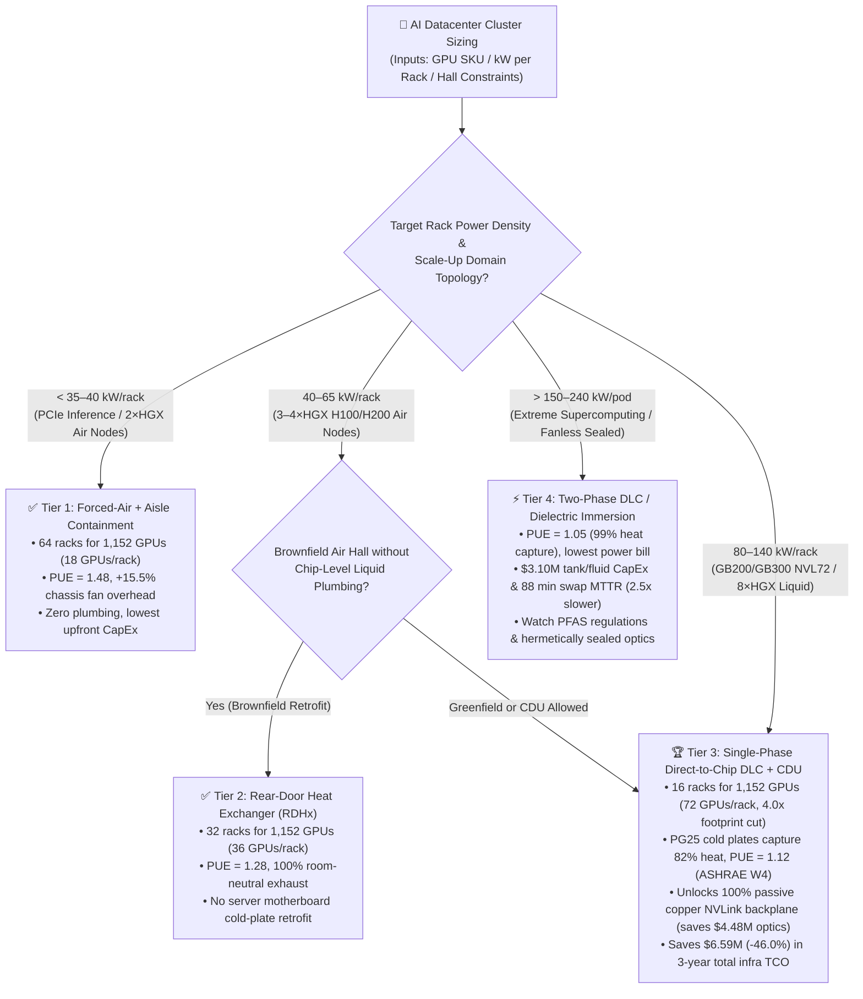
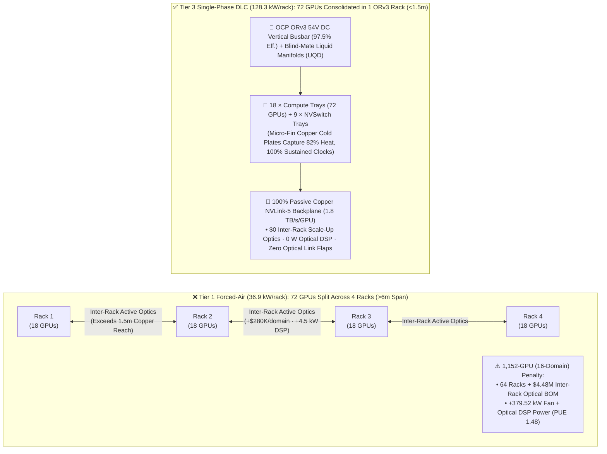
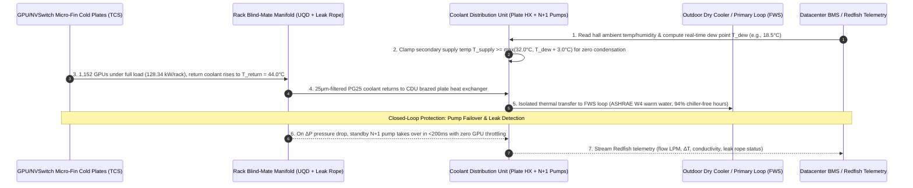

# AI Datacenter Rack Density, Power Delivery & Cooling Architecture Selection Guide (Forced-Air vs. Rear-Door Heat Exchanger RDHx vs. Single-Phase Direct-to-Chip DLC vs. Two-Phase / Immersion Cooling)

> **Purpose**: Field-ready architectural selection and whiteboard guide for AI Solution Architects and infrastructure leads (modeled strictly on the 6-part structure of `ib-vs-ethernet-roce-selection-faq.md`).  
> **Data Provenance**: Quantitative case studies in this guide are strictly bound to the sealed deterministic thermal, PUE, and copper-vs-optics BOM evaluator (`experiments/ai_datacenter_cooling_power_selection/run.py` & `results.json`, classified as `synthetic`, `independently_reproduced=false`), calibrated against publicly documented engineering specifications (`anonymized_reported`: NVIDIA HGX H100/H200 `10.2–12.5 kW/node` and GB200/GB300 NVL72 `120–132 kW/rack` facility reference designs, OCP Open Rack v3 `48V/54V DC` busbar specifications, and ASHRAE TC 9.9 `W3/W4` warm-water cooling guidelines). No physical 1,152-GPU datacenter hall was constructed or metered during this run (`physical_datacenter_measurement: not_measured`); local CPU unit tests and deterministic verification passed (`local_cpu_harness_measurement: measured`).

---

## ① 📌 Executive Summary

1. **Select Across Four Cooling & Rack-Density Tiers by Thermal Flux and Facility Constraints**:
   - When sizing a **1,152-GPU flagship cluster (16 × 72-GPU scale-up domains, `1,984.0 kW` base silicon IT load, 3-year `26,280-hour` horizon at `$0.10/kWh`)**:
     - **Tier 1 (Forced-Air Hot/Cold Aisle Containment, `≤35–40 kW/rack`)**: Fits only 18 GPUs per rack (`64 racks` total), burns `15.5%` extra IT power on high-RPM chassis fans (`+307.52 kW`), and runs at `PUE = 1.48`—viable only for **sub-35 kW/rack PCIe inference or small L40S/H100 air-cooled deployments**;
     - **Tier 2 (Rear-Door Heat Exchanger `RDHx` Brownfield Retrofit, `40–65 kW/rack`)**: Keeps air-cooled server motherboards intact while mounting a chilled-water coil door on the back of each rack to neutralize **100.0% of exhaust heat at the rack boundary**, halving rack count from `64 -> 32 racks` (`PUE = 1.28`)—the **best brownfield retrofit bridge for `40–60 kW/rack` HGX H100/H200 clusters in existing raised-floor halls**;
     - **Tier 3 (Single-Phase Direct-to-Chip Liquid Cooling `1-Phase DLC + CDU` + `ORv3 54V DC` Busbar, `80–140 kW/rack`)**: Micro-fin copper cold plates directly attached to GPU/CPU/NVSwitch dies capture **`82.0%` of heat in liquid**, lowering `PUE` to **`1.12`** (saving **`$3,148,764.48`** in 3-year electricity vs. air) while consolidating 72 GPUs into a single `128.34 kW` (`132 kW` peak) rack (`16 racks` total, **`4.0x` footprint reduction**). Crucially, single-rack consolidation unlocks a **100% passive copper NVLink-5 backplane**, eliminating **`$4,480,000.00`** in inter-rack scale-up optical transceivers and delivering **`$6,588,764.48 (-46.0%)` net 3-year infrastructure TCO savings**—the **production standard for Blackwell GB200/GB300 NVL72 and modern AI factories**;
     - **Tier 4 (Two-Phase Direct-to-Chip / Dielectric Immersion Cooling, `150–240+ kW/pod`)**: Pushes `PUE` down to **`1.05`** (saving an additional `$525,573.72` in 3-year electricity), but incurs **`$3,100,000.00`** in specialty dielectric fluid and sealed tank CapEx, faces PFAS regulatory headwinds, and stretches hardware swap MTTR by **`2.51x`** (`88.0 min` vs. `35.0 min` for 1-Phase DLC), resulting in a higher 3-year total infra TCO (`$8,618,432.08`) than Tier 3—reserve for **extreme `>150 kW/pod` supercomputing or harsh fanless edge environments**.
2. **First-Principles Insight (Why Liquid Cooling Is Actually a Network Interconnect Enabler, Not Just an Energy Saver)**:
   - Many executives view liquid cooling purely as a PUE energy-saving project. For an AI Solution Architect, **the primary economic driver of Single-Phase DLC is packing 72 `1,000W–1,400W` GPUs inside a single `<1.5-meter` rack envelope**. Passive copper `1.8 TB/s` NVLink-5 backplane cables have a physical reach limit of ~1–2 meters; if air cooling forces you to split 72 GPUs across 4 racks, you must replace passive copper with inter-rack optical transceivers (`+$280,000` optical BOM + `+4.5 kW` optical DSP power per 72-GPU domain, plus optical link-flap failure modes).
3. **Thermodynamic First Principles (`3,450x` Volumetric Heat Capacity & ASHRAE W4 Warm-Water Free Cooling)**:
   - Water/Propylene Glycol (`PG25`) has **`~3,450x` higher volumetric heat capacity** ($\rho C_p \approx 3,900\text{–}4,180\text{ kJ/(m}^3\cdot\text{K)}$) than air ($\approx 1.2\text{ kJ/(m}^3\cdot\text{K)}$). Above `700W–1,200W` per GPU socket, air cooling hits acoustic and junction-temperature ($T_j$) throttling walls (`92.0%` sustained clock retention), whereas Single-Phase DLC operates with **ASHRAE W4 `35°C–45°C` warm supply water**, enabling chiller-less dry-cooler free cooling for **`94.0%` of the year**.

---

## ② 🎯 Customer & Architect Q&A (FAQ-Driven)

### Q1: When planning a 1,000+ GPU H200 / GB200 cluster, when should we keep Forced-Air (Tier 1), when should we retrofit Rear-Door Heat Exchangers RDHx (Tier 2), and when is Single-Phase Direct-to-Chip DLC (Tier 3) mandatory?

- **First-Principles Decision Boundary**: Evaluate **per-socket thermal flux + target kW/rack density** alongside **Scale-Up copper reach constraints**:
  1. **Sub-35 kW/rack (PCIe L40S/H100 NVL inference, or `≤2` air-cooled HGX nodes per rack) $\rightarrow$ Choose Tier 1 Forced-Air Containment**:
     - Zero plumbing inside the hall and fastest swap MTTR (`25.0 min`). Never over-pack `>40 kW/rack` on pure forced air: server chassis fans consume `15.5%` of silicon IT power just overcoming static pressure, acoustic levels exceed `95 dBA`, and summer ambient spikes trigger GPU thermal clock throttling (`-8.0%` sustained TFLOPS).
  2. **Brownfield Air Datacenter Retrofit at `40–65 kW/rack` (`3–4 × HGX H100/H200` per rack) $\rightarrow$ Choose Tier 2 Rear-Door Heat Exchanger (RDHx)**:
     - **The Bottleneck**: Enterprise colocation halls often lack chip-level manifolds and cannot tear up raised floors, yet need to double GPU density from `18 -> 36 GPUs/rack`.
     - **How It Works**: Server motherboards remain air-cooled, while a passive or active chilled-water coil door replaces the standard rear rack door. `55°C` server exhaust air passes through the water coil and exits into the hall at `24°C` (**100.0% room-neutral heat capture**), cutting rack count from `64 -> 32 racks` and lowering `PUE` from `1.48 -> 1.28`.
  3. **New AI Factory or `GB200/GB300 NVL72` (`80–140 kW/rack`, `1,000W–1,400W` per socket) $\rightarrow$ Choose Tier 3 Single-Phase Direct-to-Chip Liquid Cooling (1-Phase DLC + CDU)**:
     - **The Bottleneck**: At `>100 W/cm²` die heat flux, air boundary resistance cannot keep silicon junction temperature $T_j < 85^\circ\text{C}$, and NVL72 requires 72 GPUs + 36 Grace CPUs + 18 NVSwitch dies packed inside a single ORv3 rack.
     - **How It Works**: Micro-fin copper cold plates directly contact the GPU, CPU, and NVSwitch dies, connected via blind-mate dripless quick disconnects (UQDs) to vertical rack manifolds and an N+1 redundant Coolant Distribution Unit (CDU). Liquid captures **`82.0%` of rack heat** (with the remaining `18.0%` from DIMMs/PSUs/NICs handled by low-RPM fans), delivering **`100.0%` sustained boost clocks** and **`$0` inter-rack Scale-Up optical BOM**.

---

### Q2: Why do hyperscalers (Azure, AWS, Meta, Google, CoreWeave) standardize on Single-Phase Cold-Plate DLC (Tier 3) instead of Full Immersion Cooling (Tier 4), even though Immersion reaches `PUE = 1.05`?

- **Evaluate the Complete 3-Year Engineering Ledger (CapEx vs. OpEx + Optical Reliability + Serviceability MTTR)**:
  1. **Diminishing PUE Returns vs. Specialty Fluid & Tank CapEx**:
     - Moving from Forced-Air (`PUE = 1.48`) to 1-Phase DLC (`PUE = 1.12`) cuts total facility power for 1,152 GPUs from `3,498.01 kW -> 2,299.85 kW` (`-1,198.16 kW`), saving **`$3,148,764.48`** over 3 years against a `$1,680,000` DLC/CDU CapEx.
     - Moving from 1-Phase DLC (`PUE = 1.12`) to Full Immersion (`PUE = 1.05`) trims only `199.99 kW` more (`$525,573.72` over 3 years), while sealed tanks, overhead cranes, and specialty dielectric fluid inventory drive CapEx to **`$3,100,000.00`** (`+$1,420,000` higher than DLC)—making Immersion **`$894,426.28` more expensive** in 3-year total TCO!
  2. **800G/1.6T Optical Transceiver Refraction & `2.51x` Slower Swap MTTR**:
     - Standard pluggable optical transceivers rely on an air-gap lens interface; submerging them in dielectric oil alters the refractive index unless costly hermetically sealed optics are used.
     - During hardware maintenance, 1-Phase DLC preserves standard vertical rack trays—engineers unclip dripless UQDs and swap a node in **`35.0 minutes`**. Immersion tanks require opening the lid, hoisting dripping blades with a gantry crane, and wiping down hydrocarbon/fluorochemical residue, pushing average swap MTTR to **`88.0 minutes` (`2.51x` slower)**.
  3. **PFAS Environmental Regulations & Structural Floor Loading**:
     - Two-phase fluorochemical fluids face strict PFAS phase-outs, while single-phase hydrocarbon oils require heavy horizontal tanks. Single-Phase DLC uses benign, low-viscosity **25% Propylene Glycol in deionized water (`PG25`)**.

---

### Q3: How do `OCP ORv3 48V/54V DC Busbars` and `Dual-Loop CDUs (FWS vs. TCS)` work under the hood to prevent micro-channel clogging and condensation?

- **Deconstructing the Power and Thermal Arteries of a 132 kW Rack**:
  1. **Power Artery: Why `>50 kW/rack` Eliminates `208V AC PDU` Cables in Favor of `OCP ORv3 48V/54V DC` Busbars**:
     - By Joule's Law ($P_{\text{loss}} = I^2 R$), stepping internal rack distribution from `12V` to `50V–54V DC` reduces current by `>4x` and resistive loss by **`>16x`**, raising power conversion efficiency from `91.5% -> 97.5%` while replacing dozens of thick AC power cords with a single rear vertical copper busbar that compute trays blind-mate into on insertion.
  2. **Thermal Artery: Dual-Loop Isolation (`FWS` Primary vs. `TCS` Secondary Loop) & Dew-Point Control**:
     - Copper cold-plate micro-fins are only **`0.1–0.2 mm` wide**. Feeding raw cooling-tower water directly into cold plates would clog GPU micro-channels within days.
     - The **CDU** physically isolates the **Facility Water System (`FWS`)** from the **Technology Cooling System (`TCS`)** via a stainless-steel brazed plate heat exchanger. The closed `TCS` loop circulates **`25 μm`-filtered `PG25` coolant** with corrosion inhibitors and dynamically regulates supply temperature $T_{\text{supply}} \ge T_{\text{dew}} + 3.0^\circ\text{C}$ above hall dew point to **guarantee zero condensation**.

---

## ③ 🧭 Visual Diagrams (Mermaid Decision Tree + Multi-Rack Optics vs. Single-Rack Copper + CDU Control Sequence)

### 3.1 AI Datacenter Cooling & Power Selection Decision Tree (`flowchart TD`)

### 3.2 Why Liquid Cooling Dictates Scale-Up Network BOM: 4-Rack Forced-Air Optics vs. 1-Rack DLC Copper Backplane (`flowchart LR`)

### 3.3 Dual-Loop CDU (`FWS`/`TCS`) Dew-Point Protection & Redundant Pump Failover Sequence (`sequenceDiagram`)

---

## ④ 📊 Architect Decision Matrix

| Evaluation Dimension | Tier 1: Forced-Air + Aisle Containment (`Forced-Air`) | Tier 2: Rear-Door Heat Exchanger (`RDHx Retrofit`) | Tier 3: Single-Phase Direct-to-Chip DLC (`1-Phase PG25 DLC + CDU`) | Tier 4: Two-Phase DLC / Dielectric Immersion (`Immersion`) |
| :--- | :--- | :--- | :--- | :--- |
| **Primary Use Case** | `≤35–40 kW/rack` PCIe inference clusters, small legacy IDC PoCs | Brownfield raised-floor air halls retrofitting `40–65 kW/rack` `HGX H100/H200` | **Greenfield AI factories & `GB200/GB300 NVL72` (`80–140 kW/rack`) production standard** | `>150–240 kW/pod` extreme density or sealed fanless environments |
| **Racks Needed for 1,152 GPUs & Density** | `64 racks` (18 GPUs/rack, `36.93 kW/rack`) | `32 racks` (36 GPUs/rack, `69.95 kW/rack` peak) | **`16 racks` (72 GPUs/rack, `128.34 kW/rack`, `4.0x` footprint reduction)** | **`16 tanks` (72 GPUs/tank, `124.99 kW/tank`, scalable to `240 kW`)** |
| **Coolant Medium & Liquid Heat Capture** | Air convection (`0.0%` liquid capture, chassis fans add `15.5%` IT power) | Internal server air + rear-door water coil (`100.0%` room-neutral exhaust, `11.0%` fan overhead) | **Micro-fin copper cold plates + PG25 (`82.0%` chip heat in liquid, `3.5%` fan overhead)** | **Dielectric fluid phase-change or immersion (`99.0%` liquid capture, `0.8%` pump overhead)** |
| **Facility PUE & Sustained Clock Retention** | `PUE = 1.48` · `92.0%` sustained clock (prone to thermal throttling) | `PUE = 1.28` · `96.5%` sustained clock | **`PUE = 1.12` (ASHRAE W4 warm-water free cooling) · `100.0%` sustained clock** | **`PUE = 1.05` · `100.0%` sustained clock** |
| **Scale-Up Interconnect & Swap MTTR** | Split across 4 racks (`+$4.48M` inter-rack optics BOM) · `25.0 min` MTTR | Split across 2 racks (`+$2.24M` inter-rack optics BOM) · `30.0 min` MTTR | **Single-rack 100% passive copper NVLink backplane (`$0` inter-rack optics) · `35.0 min` UQD swap** | Single-tank copper backplane (requires sealed scale-out optics) · **`88.0 min` crane swap (`2.5x` slower)** |
| **1,152-GPU 3-Year Total Infra TCO** | `$14,312,770.28` (`$9.19M` power + `$4.48M` optics + `$0.64M` air CapEx) | `$10,889,088.60` (`$7.53M` power + `$2.24M` optics + `$1.12M` RDHx CapEx) | **`$7,724,005.80` (`$6.04M` power + `$0` optics + `$1.68M` DLC/CDU CapEx, saves `$6.59M / -46.0%`)** | `$8,618,432.08` (`$5.52M` power + `$0` optics + `$3.10M` tank/fluid CapEx) |

---

## ⑤ 🧪 Quantitative Case Study & 7-Card Benchmark Insights

> **Provenance Notice**: All numbers below come directly from the sealed evaluator `experiments/ai_datacenter_cooling_power_selection/run.py` and `experiments/ai_datacenter_cooling_power_selection/results.json` (`provenance_type: "synthetic"` calibrated to `anonymized_reported` specifications, `independently_reproduced: false`; physical datacenter build: `not_measured`; local unit test verification: `tests/test_ai_datacenter_cooling_power_selection.py` `measured` PASS).

### 5.1 Baseline Cluster Parameters (1,152 GPUs · 3-Year TCO Horizon)
- **Cluster Scale**: `1,152 GPUs` (16 × 72-GPU Scale-Up domains), base silicon compute/switch IT power **`1,984.0 kW`** (`124.0 kW` per 72-GPU domain).
- **Operating Horizon & Power Tariff**: 3 years continuous operation (`26,280 hours`) at **`$0.10 / kWh`**.
- **Copper Reach Constraint**: Passive copper NVLink-5 backplane reach is limited to `~1.5 meters` (single rack); splitting a 72-GPU domain across multiple racks adds `$280,000` in active optical transceivers and `4.5 kW` optical DSP power per domain.

### 5.2 Quantitative Comparison Across the 4 Cooling & Rack-Density Tiers

| Cooling Architecture Tier | Racks Required (GPUs/Rack) | Chassis Fan + Inter-Rack Optical DSP Overhead | Total IT Power (`kW`) | Facility `PUE` | Total Facility Power (`kW`) | 3-Year Electricity Cost (`USD`) | Inter-Rack Scale-Up Optics BOM (`USD`) | Cooling Retrofit CapEx (`USD`) | 3-Year Total Infra TCO (`USD`) |
| :--- | :--- | :--- | :--- | :--- | :--- | :--- | :--- | :--- | :--- |
| **Tier 1: Forced-Air Containment** | `64 racks` (`18 GPUs/rack`) | `307.52 + 72.00 = 379.52 kW` | `2,363.52 kW` (`36.93 kW/rack`) | `1.48` | `3,498.01 kW` | `$9,192,770.28` | `$4,480,000.00` | `$640,000.00` | `$14,312,770.28` (Baseline) |
| **Tier 2: Rear-Door Heat Exchanger (`RDHx`)** | `32 racks` (`36 GPUs/rack`) | `218.24 + 36.00 = 254.24 kW` | `2,238.24 kW` (`69.95 kW/rack`) | `1.28` | `2,864.95 kW` | `$7,529,088.60` | `$2,240,000.00` | `$1,120,000.00` | `$10,889,088.60` (`-23.9%`) |
| **Tier 3: Single-Phase DLC (`1-Phase DLC + CDU`)** | **`16 racks` (`72 GPUs/rack`)** | **`69.44 + 0.00 = 69.44 kW`** | **`2,053.44 kW` (`128.34 kW/rack`)** | **`1.12`** | **`2,299.85 kW`** | **`$6,044,005.80`** | **`$0.00` (Copper Backplane)** | **`$1,680,000.00`** | **`$7,724,005.80` (`-46.0%` 🏆)** |
| **Tier 4: Two-Phase / Immersion (`Immersion`)** | `16 tanks` (`72 GPUs/tank`) | `15.87 + 0.00 = 15.87 kW` | `1,999.87 kW` (`124.99 kW/tank`) | `1.05` | `2,099.86 kW` | `$5,518,432.08` | `$0.00` (Copper Backplane) | `$3,100,000.00` | `$8,618,432.08` (`-39.8%`) |

### 5.3 Exact Arithmetic Verification for Solution Architects
1. **3-Year Electricity Savings of Tier 3 Single-Phase DLC vs. Tier 1 Forced-Air**:
   $$\text{Power Savings}_{3\text{yr}} = (3,498.01\text{ kW} - 2,299.85\text{ kW}) \times 26,280\text{ h} \times \$0.10/\text{kWh} = 1,198.16 \times 2,628 = \$3,148,764.48$$
   Electricity savings alone (`$3.15M`) pay back the entire `$1.68M` cold-plate and CDU CapEx **`1.87x` over** (payback in `<1.6 years`).
2. **Combined Copper-Backplane + Energy 3-Year Net Infrastructure TCO Savings**:
   $$\text{Total TCO Savings}_{3\text{yr}} = \$14,312,770.28 - \$7,724,005.80 = \$6,588,764.48 \quad (-46.0\%)$$

---

## ⑥ 🛠️ Appendix: Production Facility Readiness & Presales Checklist (Architect Checklist)

- [ ] **1. Slab Floor Loading & Freight Elevator Verification**: A fully populated `GB200/GB300 NVL72` liquid-cooled rack weighs **`1,360–1,600 kg` (~1.5 metric tons)** including coolant and copper busbars. Confirm hall live load rating is **`≥12–15 kN/m²`** or install structural load-spreading skids before delivery.
- [ ] **2. Secondary Loop Dew-Point Interlock (`T_supply >= T_dew + 3°C`)**: Verify the CDU controller dynamically tracks room humidity and clamps `TCS` supply temperature at least `3.0°C` above ambient dew point (`32°C–40°C` ASHRAE W3/W4 warm water) to eliminate internal condensation risk.
- [ ] **3. Residual 18% Air Heat Removal Closure**: Even with `82.0%` liquid heat capture, each `128.34 kW` rack still exhausts **`~23 kW` of residual air heat** from DIMMs, PSUs, and optical transceivers. Ensure perimeter CRAHs or supplemental rear-door coils are sized for `23 kW/rack`.
- [ ] **4. `25 μm` Filtration & `PG25` Inhibitor Chemistry**: Enforce `25%` inhibited Propylene Glycol in deionized water (`PG25`) with duplex `≤25–50 μm` filters on the secondary `TCS` loop to protect `0.1–0.2 mm` cold-plate micro-channels from fouling or galvanic corrosion.
- [ ] **5. Blind-Mate Dripless UQDs & Leak Detection Ropes**: Confirm OCP-compliant dripless quick disconnects (`<0.05 mL` fluid loss per mate) and drip-tray optical/rope leak sensors wired to `<200 ms` CDU valve isolation and Redfish alerting.
- [ ] **6. OCP ORv3 `48V/54V DC` Busbar & Synchronous Transient Power Headroom**: Provision redundant `415V/480V AC` overhead busways feeding `N+N` ORv3 `54V DC` power shelves (`97.5%` efficiency), with breaker curves sized for `1.15x–1.25x` synchronous AllReduce transient power spikes.
