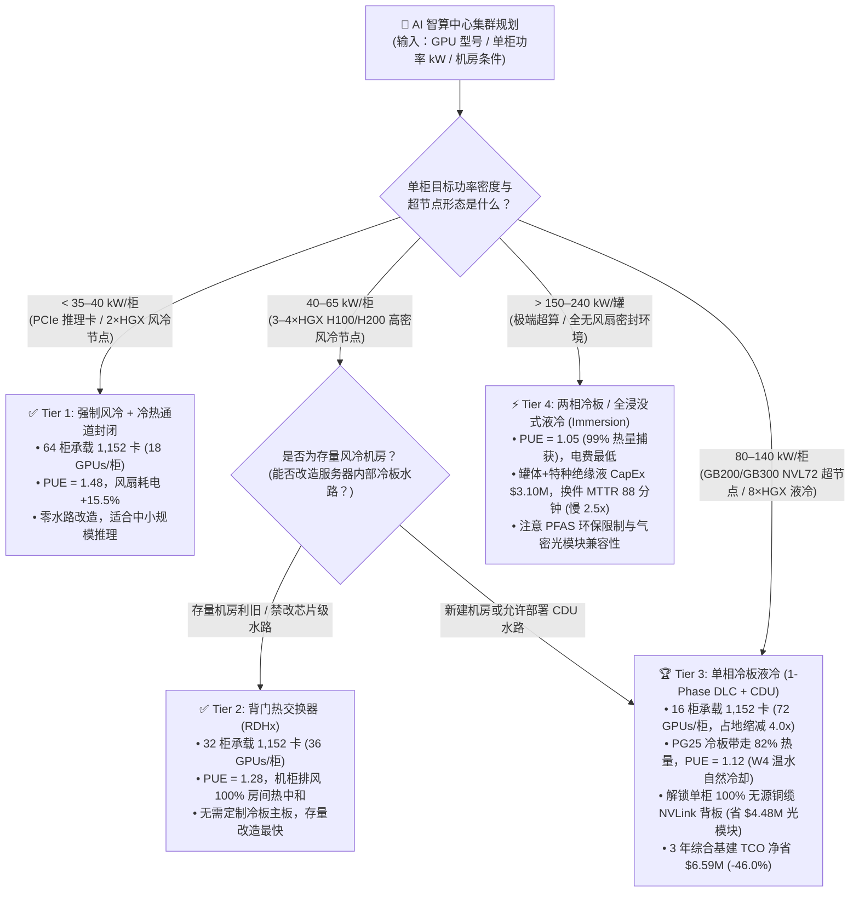
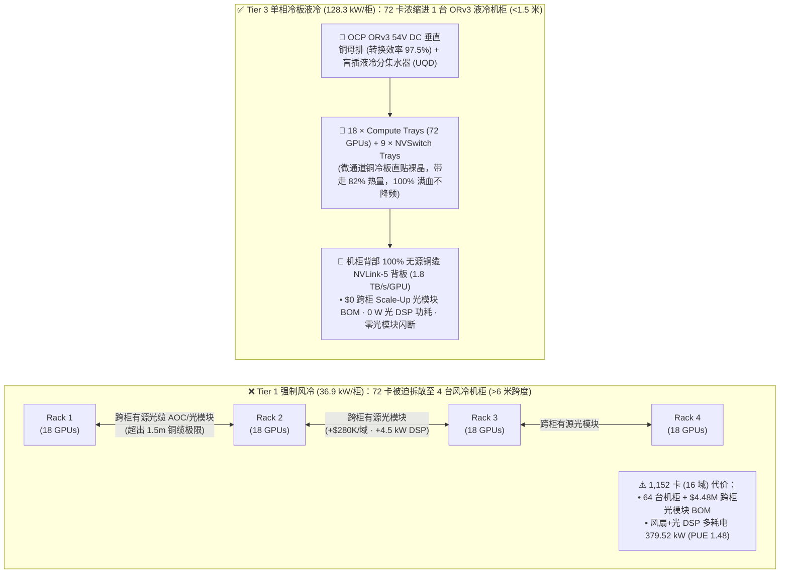
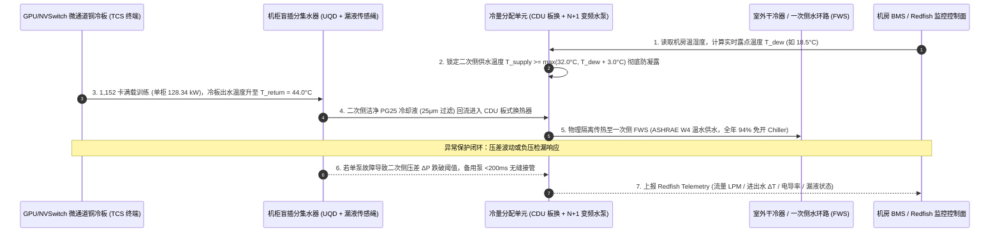

# AI 智算中心高密机柜供电与液冷散热架构选型指南（强制风冷 vs. 背门热交换 RDHx vs. 单相冷板液冷 DLC vs. 两相/浸没式液冷）

> **文档定位**：面向 AI Solution Architect（AI 解决方案架构师）与基础设施负责人的实战选型与白板宣讲手册（严格对齐 `ib-vs-ethernet-roce-selection-faq.md` 标准六段式结构）。  
> **数据溯源与真实性声明（Provenance）**：本文定量算例基于本仓库封存的确定性热力学、PUE 与铜缆/光模块 BOM 评估模型（`experiments/ai_datacenter_cooling_power_selection/run.py` & `results.json`，标记为 `synthetic`，`independently_reproduced=false`），参数校准自公开硬件工程规范（`anonymized_reported`：NVIDIA HGX H100/H200 `10.2–12.5 kW/节点` 与 GB200/GB300 NVL72 `120–132 kW/柜` 设施参考设计、OCP Open Rack v3 `48V/54V DC` 母排规范、ASHRAE TC 9.9 `W3/W4` 温水冷却标准）。本轮未建设或实测物理 1,152 卡数据中心机房（`physical_datacenter_measurement: not_measured`），本机 CPU 单测与确定性校验已通过（`local_cpu_harness_measurement: measured`）。

---

## ① 📌 核心结论速览（Executive Summary）

1. **按单柜热流密度与存量/新建机房条件四档选型**：
   - 在部署 **1,152 张旗舰 GPU（16 个 72 卡超节点域，基础硅片算力功耗 `1,984.0 kW`，3 年 `26,280 小时`，电价 `$0.10/kWh`）** 时：
     - **Tier 1（强制风冷冷热通道封闭，`≤35–40 kW/柜`）**：单柜仅能放 18 张 GPU（需拆成 `64 柜`），机箱暴力风扇吃掉 `15.5%` 额外功耗（`+307.52 kW`），综合 `PUE = 1.48`，仅适合 **单柜 `<35 kW` 的中小规模推理/L40S/PCIe 卡集群**；
     - **Tier 2（背门热交换器 `RDHx` 存量机房利旧改造，`40–65 kW/柜`）**：不改服务器内部主板管路，靠机柜后门冷冻水盘管将排风热量 **100.0% 房间级中和**，将机柜数从 `64 柜` 压至 `32 柜`（`PUE = 1.28`），是 **无法承重/改造架空地板的存量风冷机房部署 `HGX H100/H200`（`40–60 kW/柜`）的最佳过渡方案**；
     - **Tier 3（单相冷板式直接芯片液冷 `1-Phase DLC + CDU` + `ORv3 54V DC` 母排，`80–140 kW/柜`）**：微通道铜冷板直接贴合 GPU/CPU/NVSwitch 芯片带走 **`82.0%` 热量**，不仅将 `PUE` 压至 **`1.12`**、三年电费立省 **`$3,148,764.48`**，更关键的是将 72 张 GPU 浓缩进单台 `128.34 kW`（峰值 `132 kW`）机柜（仅需 `16 柜`，机房占地缩减 **`4.0x`**），解锁 **机柜内 100% 无源铜缆 NVLink-5 背板**，直接省去跨柜 Scale-Up 光模块 BOM **`$4,480,000.00`**，三年综合基建 TCO 净省 **`$6,588,764.48 (-46.0%)`**，是 **Blackwell GB200/GB300 NVL72 与百千瓦级新建 AI 智算中心的首选事实标准**；
     - **Tier 4（两相冷板 / 全浸没式氟化液/碳氢液冷，`150–240+ kW/罐`）**：虽将 `PUE` 压至极限 **`1.05`**（三年电费再省 `$525,573.72`），但因特种绝缘冷却液与密封罐体 CapEx 高昂（`$3,100,000` vs 冷板 `$1,680,000`）、PFAS 环保合规限制以及光模块/内存条拔插维护时间拉长 **`2.5x`**（MTTR `88.0 分钟` vs 冷板 `35.0 分钟`），导致三年综合基建 TCO（`$8,618,432.08`）反而高于单相冷板，仅推荐在 **单柜 `>150 kW` 极端超算或特种无风扇封闭环境** 按需选配。
2. **第一性原理洞察（为什么液冷本质上是“保住铜缆互连的网络架构刚需”，而不仅是省电费？）**：
   - 很多客户以为上液冷只是为了省 PUE 电费；但对 AI 架构师而言，**单相冷板液冷最大的商业价值是把 72 张 `1,000W–1,400W` 的 GPU 压进同一个物理机柜（`<1.5 米` 距离内）**。因为 `1.8 TB/s` NVLink-5 高速 SerDes 无源铜缆（DAC/背板）的物理极限传输距离仅约 **1～2 米**；一旦因为风冷散不掉热而被迫把 72 张卡拆散到 4 个风冷机柜，机柜间就必须换成昂贵的有源光模块（AOC/LPO），每 72 卡域凭空增加 **`$280,000` 光模块成本 + `4.5 kW` 光 DSP 功耗 + 光模块闪断故障率**！
3. **热力学第一性原理（3,450 倍体积热容鸿沟与 ASHRAE W4 温水自然冷却）**：
   - 水/丙二醇溶液（PG25）的单位体积热容（$\rho C_p \approx 3,900\text{–}4,180\text{ kJ/(m}^3\cdot\text{K)}$）是空气（$\approx 1.2\text{ kJ/(m}^3\cdot\text{K)}$）的 **`~3,450 倍`**。当单颗 GPU TDP 突破 `700W–1,200W` 时，空气散热会撞上风速声学墙与硅片结温（$T_j$）降频墙（风冷持续满载算力保持率跌至 `92.0%`）；而单相冷板支持 **ASHRAE W4 级 `35°C–45°C` 进水温度**，全年 `94.0%` 时间可关闭高耗能冷水机组（Chiller），直接靠室外干冷器（Dry Cooler）实现自然冷却（Free Cooling）。

---

## ② 🎯 客户与架构师灵魂拷问 Q&A（FAQ-Driven）

### Q1：客户正在规划千卡级 H200 / GB200 智算中心，到底什么时候继续用风冷（Tier 1），什么时候用背门热交换 RDHx（Tier 2），什么时候必须上单相冷板液冷 DLC（Tier 3）？

- **第一性原理判据**：先看 **单颗 GPU TDP 与单柜功率密度（kW/Rack）**，再看 **Scale-Up 超节点铜缆半径要求**：
  1. **单柜 `<35 kW`（如 PCIe 推理卡 L40S/H100 NVL，或单柜仅放 2 台 `8×H100` 风冷节点）$\rightarrow$ 选 Tier 1 强制风冷（冷热通道封闭）**：
     - 传统 IDC 机房无需改造水路即可直接上架，故障维护最简单（MTTR `25.0 分钟`）。但千万不要强行在风冷柜里塞满 4 台以上 HGX 节点，否则风扇噪音超过 `95 dBA`、风扇自身耗电占比飙升至 `15.5%`，且夏季高温时段 GPU 会触发热降频（丢失约 `8.0%` 持续算力）。
  2. **存量风冷机房利旧，单柜 `40–65 kW`（如单柜混插 3～4 台 `HGX H100/H200`）$\rightarrow$ 选 Tier 2 背门热交换器（RDHx）**：
     - **传统痛点**：许多政企/金融客户租用的存量机房没有做芯片级分集水器（Manifold），也不允许停机砸掉架空地板，但业务又急需将单柜密度从 `15 kW` 提升到 `50+ kW`。
     - **核心机制**：服务器内部依然保持风冷（无需定制液冷主板），但在每个机柜后门安装内嵌冷冻水盘管的热交换背门。服务器吹出的 `55°C` 热风穿出机柜背门的瞬间被冷冻水冷却回 `24°C` 再排入机房（**100% 房间热中和**），机柜数直接减半（`64 柜 -> 32 柜`），`PUE` 从 `1.48` 降至 `1.28`。
  3. **新建高密智算中心，或部署 `GB200/GB300 NVL72`（单柜 `80–140 kW`、单芯片 `1,000W–1,400W`）$\rightarrow$ 必选 Tier 3 单相冷板式直接芯片液冷（1-Phase DLC + CDU）**：
     - **传统痛点**：当单颗 GPU 芯片热流密度突破 `100 W/cm²`（堪比火箭喷管外壁），空气边界层热阻已经无法将硅片结温控制在 `85°C` 安全线以内；同时，72 卡 NVLink 超节点要求所有 GPU 必须紧凑叠放在同一台标准 48U/52U Open Rack v3 机柜内。
     - **核心机制**：采用闭环微通道纯铜冷板（Micro-fin Cold Plate）直贴 GPU、Grace CPU 与 NVSwitch 裸晶，通过无滴漏盲插快接头（Blind-Mate Quick Disconnect, UQD）接入机柜竖向分集水器（Manifold）与冷量分配单元（CDU，配备 N+1 冗余水泵与板式换热器）。液冷直接带走 **`82.0%` 热量**，剩余 `18.0%`（光模块、电源、部分存储）由低转速静音风扇结合背门风道带走，实现 **`100.0%` 持续满血不降频** 与 **`0` 跨柜 Scale-Up 光模块开销**。

---

### Q2：很多厂商宣传“全浸没式液冷（Immersion）或两相液冷（Tier 4）PUE 能做到 1.05”，为什么在真实大模型生产机房里，主流云厂商（Azure / AWS / Meta / Google / CoreWeave）依然全线押注“单相冷板液冷（Tier 3）”？

- **算一笔真实工程总账（三年基建 TCO + 运维 MTTR + 光模块兼容性）**：
  1. **PUE 边际收益递减 vs. 冷却液与罐体 CapEx 暴涨**：
     - 从风冷（`PUE = 1.48`）升级到单相冷板（`PUE = 1.12`），1,152 卡集群总设施功率从 `3,498.01 kW` 骤降至 `2,299.85 kW`（削减 `1,198.16 kW`，三年省电费 **`$3,148,764.48`**）；
     - 而从单相冷板（`PUE = 1.12`）再压到全浸没式（`PUE = 1.05`），总设施功率仅再降 `199.99 kW`（三年仅多省电费 **`$525,573.72`**），但全浸没式需要采购昂贵的氟化液/特种合成碳氢绝缘油及密封卧式罐体，基建 CapEx 从 `$1,680,000` 飙升至 **`$3,100,000`**（多花 `$1,420,000`），三年算总账反而比单相冷板贵 **`$894,426.28`**！
  2. **高速光模块（800G/1.6T OSFP）气密性与现场换件 MTTR 痛点**：
     - 大模型集群每张 GPU 配 1 个 400G/800G RoCE/IB 光模块，传统可插拔光模块的光学透镜依赖空气折射率校准，直接泡进浸没液体会导致光路折射率失配，必须定制昂贵的气密密封（Hermetically Sealed）专用光模块或尾纤穿舱。
     - 更棘手的是运维排障：单相冷板（Tier 3）保持标准立式 19/21 英寸机柜形态，节点故障时拔出干式快接头（UQD）即可像普通服务器一样在 **`35.0 分钟`** 内完成热插拔换件；而浸没式液冷（Tier 4）需要开罐、行车吊装沥干油液、擦洗排障，平均单次硬件更换 MTTR 高达 **`88.0 分钟`（慢 `2.51x`）**。
  3. **环保法规（PFAS 禁令）与机房楼板承重**：
     - 传统两相浸没式广泛使用的全氟化合物（PFAS 氟化液）面临欧美严格环保限产（3M 已于 2025 年底退出 PFAS 生产），而单相碳氢矿物油粘度高、满液罐体极重（往往需要一层加固楼板）。相比之下，单相冷板采用无毒、低成本的 **25% 丙二醇去离子水溶液（PG25）**，完全符合全球主流数据中心环保与消防规范。

---

### Q3：什么是“OCP ORv3 48V/54V 直流母排供电”与“CDU 二次侧液冷环路（Primary vs. Secondary Loop）”？架构师做机房交底时必须盯住哪些底层机制？

- **用第一性原理拆解百千瓦机柜的“供电血管”与“散热血管”**：
  1. **供电血管：为什么超过 `50 kW/柜` 必须淘汰传统 `208V/230V AC PDU` 线束，改用 `OCP ORv3 48V/54V DC` 铜母排（Busbar）？**
     - 如果用传统 `12V` 板级配电或满柜几十根粗重的 `AC PDU` 电源线给 `132 kW` 机柜供电，根据焦耳定律 $P_{\text{loss}} = I^2 R$，电流高达上万安培，不仅转换损耗高达 `8.5%`（效率仅 `91.5%`），而且机柜背部会被密密麻麻的电源线彻底堵死，连液冷管路都插不进去。
     - **ORv3 54V DC 母排机制**：机柜中置电源架（Power Shelf）统一将机房三相 `415V/480V AC` 高效整流为 `50V–54V DC`（电压提升 4 倍，电流降至 1/4，线路热损降至 **1/16**，转换效率达 **`97.5%`**），服务器计算托盘（Compute Tray）推入机柜时，背部镀银盲插夹子直接咬合垂直铜母排，实现 **“零电源线盲插上架”**。
  2. **散热血管：CDU（Coolant Distribution Unit）如何隔离机房大楼水路与芯片精密微水道？**
     - 芯片铜冷板内部的微鳍片水道宽度仅 **`0.1–0.2 mm`**（比头发丝还细），如果直接把大楼冷却塔的生水通进去，水垢、微生物或铁锈颗粒会在几天内把 GPU 冷板彻底堵死！
     - **一二次侧双环路物理隔离**：
       - **一次侧环路（Facility Water Sys, FWS）**：连接大楼室外干冷器/冷却塔，负责长距离大流量排热；
       - **冷量分配单元（CDU）**：内部通过不锈钢钎焊板式换热器（Brazed Plate Heat Exchanger）将一次侧与二次侧做 **100% 物理水路隔离（只传热、不混水）**；
       - **二次侧环路（Technology Cooling Sys, TCS）**：在 CDU 与机柜 GPU 冷板之间形成超洁净闭环，注入经过 **`25–50 μm` 精密过滤**、添加缓蚀杀菌剂的 **PG25 丙二醇去离子水**，由 CDU 内部双冗余变频水泵（配备压差传感器 $\Delta P$ 与漏液检测绳）精准控温控压（保持二次侧进水温度高于机房露点温度 `2°C–3°C`，**彻底杜绝冷凝水滴落短路**）。

---

## ③ 🧭 直观可视化图解（Mermaid 选型决策树 + 铜缆 vs. 跨柜光模块对比图 + CDU 双环路控制时序图）

### 3.1 智算中心机柜散热与供电架构选型决策树（`flowchart TD`）

### 3.2 为什么液冷决定了 Scale-Up 网络成本：多柜风冷光互连 vs. 单柜液冷铜背板（`flowchart LR`）

### 3.3 单相冷板液冷双环路（FWS/TCS）露点防凝露与 N+1 泵控时序图（`sequenceDiagram`）

---

## ④ 📊 架构师选型决策矩阵（Architect Decision Matrix）

| 评估维度 | Tier 1：强制风冷 + 冷热通道封闭 (`Forced-Air Containment`) | Tier 2：背门热交换器改造 (`Rear-Door Heat Exchanger RDHx`) | Tier 3：单相冷板式直接芯片液冷 (`1-Phase Direct-to-Chip DLC + CDU`) | Tier 4：两相冷板 / 全浸没式液冷 (`2-Phase DLC / Dielectric Immersion`) |
| :--- | :--- | :--- | :--- | :--- |
| **核心适用场景** | 单柜 `≤35–40 kW` 的 PCIe 推理集群、存量普通 IDC 小规模 PoC | 无法改造服务器内部冷板水路的存量风冷机房利旧部署 `HGX H100/H200`（`40–65 kW/柜`） | **新建千卡智算中心、`GB200/GB300 NVL72`（`80–140 kW/柜`）生产主力标准** | 单柜 `>150–240 kW` 极端超算密度或特种无风扇静音/恶劣环境 |
| **1,152 卡所需机柜数与单柜密度** | `64 柜`（18 GPUs/柜，`36.93 kW/柜`） | `32 柜`（36 GPUs/柜，`69.95 kW/柜` 峰值） | **`16 柜`（72 GPUs/柜，`128.34 kW/柜`，占地缩减 `4.0x`）** | **`16 柜/罐`（72 GPUs/罐，`124.99 kW/罐`，可扩展至 `240 kW`）** |
| **底层传热介质与液体捕热占比** | 空气对流（液体捕热 `0.0%`，服务器风扇耗电占 IT 功率 `15.5%`） | 服务器内风冷 + 机柜后门冷冻水盘管（排风 `100.0%` 房间热中和，风扇耗电 `11.0%`） | **微通道铜冷板 + PG25 水溶液（直接带走芯片 `82.0%` 热量，风扇仅耗电 `3.5%`）** | **氟化液 / 碳氢合成绝缘液相变或浸没（带走 `99.0%` 热量，零风扇，泵耗 `0.8%`）** |
| **综合 PUE 与持续满血算力保持率** | `PUE = 1.48` · 持续频率保持率 `92.0%`（夏季/高密易触发热降频） | `PUE = 1.28` · 持续频率保持率 `96.5%` | **`PUE = 1.12`（支持 ASHRAE W4 温水自然冷却）· `100.0%` 满血不降频** | **`PUE = 1.05` · `100.0%` 满血不降频** |
| **Scale-Up 互连介质与运维 MTTR** | 跨 4 柜被迫走有源光模块（`+$4.48M` 光模块 BOM）· 换件 MTTR `25.0 分钟` | 跨 2 柜走半数有源光模块（`+$2.24M` 光模块 BOM）· 换件 MTTR `30.0 分钟` | **单柜内 100% 无源铜缆 NVLink 背板（`$0` 跨柜光模块）· UQD 快接换件 `35.0 分钟`** | 单罐铜背板（但 Scale-Out 需定制气密光模块）· **开罐沥油换件 MTTR `88.0 分钟`（慢 `2.5x`）** |
| **1,152 卡三年基建总 TCO（电费+光模块+液冷 CapEx）** | `$14,312,770.28`（电费 `$9.19M` + 跨柜光模块 `$4.48M` + 风道 `$0.64M`） | `$10,889,088.60`（电费 `$7.53M` + 跨柜光模块 `$2.24M` + 背门 `$1.12M`） | **`$7,724,005.80`（电费 `$6.04M` + 跨柜光模块 `$0` + 冷板/CDU `$1.68M`，净省 `$6.59M / -46.0%`）** | `$8,618,432.08`（电费 `$5.52M` + 跨柜光模块 `$0` + 罐体/绝缘液 `$3.10M`） |

---

## ⑤ 🧪 简明定量算例与 Benchmark 洞察

> **算例 provenance 声明**：以下全部定量数据 100% 源自本仓库封存的确定性脚本 `experiments/ai_datacenter_cooling_power_selection/run.py` 与 `experiments/ai_datacenter_cooling_power_selection/results.json`（分类：`synthetic` 模型校准自 `anonymized_reported` 厂商参考架构，`independently_reproduced=false`；物理机房实测：`not_measured`；本地单测校验：`tests/test_ai_datacenter_cooling_power_selection.py` `measured` PASS）。

### 5.1 基准参数设定（1,152-GPU 超节点集群 · 3 年 TCO 周期）
- **集群规模**：`1,152 GPUs`（16 个 72-GPU Scale-Up 超节点域），基础芯片与交换硅片算力负荷 **`1,984.0 kW`**（`124.0 kW / 72-GPU 域`）。
- **运营周期与电价**：3 年连续满载运行（$3 \times 365 \times 24 = 26,280\text{ 小时}$），工业电价 **`$0.10 / kWh`**。
- **物理约束**：无源铜缆 NVLink-5 背板极限距离 `~1.5 米`（仅限单机柜内互连）；若单柜放不下 72 张 GPU，跨柜 Scale-Up 必须引入有源光模块（每 72 卡域增加 `$280,000` 光模块 BOM 与 `4.5 kW` 光 DSP 功耗）。

### 5.2 四种散热与机柜密度方案核心指标定量对比表

| 方案档位 | 机柜总数 (GPUs/柜) | 服务器风扇 + 跨柜光 DSP 额外功耗 | 总 IT 功率 (`kW`) | 机房 `PUE` | 总设施输入功率 (`kW`) | 3 年总电费 (`USD`) | 跨柜 Scale-Up 光模块 BOM (`USD`) | 散热改造 CapEx (`USD`) | 3 年综合基建 TCO (`USD`) |
| :--- | :--- | :--- | :--- | :--- | :--- | :--- | :--- | :--- | :--- |
| **Tier 1: 强制风冷 (冷热通道封闭)** | `64 柜` (`18 卡/柜`) | `307.52 + 72.00 = 379.52 kW` | `2,363.52 kW` (`36.93 kW/柜`) | `1.48` | `3,498.01 kW` | `$9,192,770.28` | `$4,480,000.00` | `$640,000.00` | `$14,312,770.28` (基线) |
| **Tier 2: 背门热交换器 (`RDHx`)** | `32 柜` (`36 卡/柜`) | `218.24 + 36.00 = 254.24 kW` | `2,238.24 kW` (`69.95 kW/柜`) | `1.28` | `2,864.95 kW` | `$7,529,088.60` | `$2,240,000.00` | `$1,120,000.00` | `$10,889,088.60` (`-23.9%`) |
| **Tier 3: 单相冷板液冷 (`1-Phase DLC + CDU`)** | **`16 柜` (`72 卡/柜`)** | **`69.44 + 0.00 = 69.44 kW`** | **`2,053.44 kW` (`128.34 kW/柜`)** | **`1.12`** | **`2,299.85 kW`** | **`$6,044,005.80`** | **`$0.00` (全铜背板)** | **`$1,680,000.00`** | **`$7,724,005.80` (`-46.0%` 🏆)** |
| **Tier 4: 两相 / 浸没式液冷 (`Immersion`)** | `16 罐` (`72 卡/罐`) | `15.87 + 0.00 = 15.87 kW` | `1,999.87 kW` (`124.99 kW/罐`) | `1.05` | `2,099.86 kW` | `$5,518,432.08` | `$0.00` (全铜背板) | `$3,100,000.00` | `$8,618,432.08` (`-39.8%`) |

### 5.3 关键算术推导与架构师避坑公式核验
1. **单相冷板（Tier 3）三年电费净节省推导**：
   $$\text{Power Savings}_{3\text{yr}} = (3,498.01\text{ kW} - 2,299.85\text{ kW}) \times 26,280\text{ h} \times \$0.10/\text{kWh} = 1,198.16 \times 2,628 = \$3,148,764.48$$
   仅靠消减机箱暴力风扇耗电（从 `307.52 kW` 降至 `69.44 kW`）与降低机房空调 PUE（从 `1.48` 降至 `1.12`），节省的 `$3.15M` 电费就已经是冷板与 CDU 改造 CapEx（`$1.68M`）的 **`1.87 倍`**（不到 1.6 年即靠省电收回全部液冷改造投资！）。
2. **铜缆背板红利 + 电费节省的三年综合基建 TCO 账单**：
   $$\text{Total TCO Savings}_{3\text{yr}} = \$14,312,770.28 - \$7,724,005.80 = \$6,588,764.48 \quad (-46.0\%)$$
   其中 **`$4,480,000.00`** 直接来自“单柜装下 72 卡后，用无源铜背板替代跨柜有源光模块”的硬件 BOM 削减！

---

## ⑥ 🛠️ 附录：生产环境快速核验与售前打单清单（Architect Checklist）

在客户智算中心机电（MEP）评审、机房选址勘测或超节点交付验收前，请逐项核对以下 6 条工程实战检查项：

- [ ] **1. 机房楼板承重与电梯通道核验（Floor Loading & Clearance）**：满配 `GB200/GB300 NVL72` 单相冷板机柜含冷却液与铜母排总重达 **`1,360–1,600 kg`（约 1.5 吨/柜）**！上架前必须核验机房楼板活荷载是否达到 **`≥12–15 kN/m²`（`1,200–1,500 kg/m²`）**，否则必须加装槽钢散力架（Load-Spreading Skid）。
- [ ] **2. 二次侧露点防凝露联锁（Dew-Point Interlock Verification）**：检查 CDU 控制器是否已接入机房环境温湿度传感器，并强制设定二次侧供水温度 $T_{\text{supply}} \ge T_{\text{dew}} + 3.0^\circ\text{C}$（推荐 ASHRAE W3/W4 温水区间 `32°C–40°C`），严禁将 `12°C–15°C` 低温冷冻水直接通入无保温层的服务器内部冷板！
- [ ] **3. 剩余 15%–20% 风冷热负荷闭合检查（Residual Air Heat Removal）**：单相冷板带走了 `82%` 的芯片热量，但每台 `128 kW` 液冷机柜仍有约 **`20–23 kW` 的电源、内存与光模块热量排入空气**！必须核验机房精密空调（CRAH）或配套背门盘管（RDHx）是否具备每柜 `23 kW` 的余热回收能力。
- [ ] **4. 二次侧水质过滤与 PG25 防腐化学检测（Coolant Chemistry & 25μm Filtration）**：验收时确认二次侧环路已采用 **25% 丙二醇去离子水（PG25）** 并配备 **`≤25–50 μm` 双联在线过滤器**，严禁使用未添加缓蚀杀菌剂的普通自来水或纯水，并配置每季度一次的 pH 值、电导率与微生物抽检计划。
- [ ] **5. 无滴漏快接头（UQD）与负压防漏设计（Blind-Mate UQD & Leak Containment）**：确认机柜分集水器（Manifold）采用符合 OCP 标准的无滴漏盲插快接头（插拔滴漏量 `<0.05 mL`），每层接水盘与机柜底部均铺设光电/绳式漏液传感器，并验证 CDU 压差突变时的 `<200 ms` 关阀告警动作。
- [ ] **6. OCP ORv3 48V/54V 母排与 N+N 供电冗余（Power Shelf & Whip Sizing）**：确认单柜 `132 kW` 配置至少 `6+2` 或 `8+8` 冗余的 `33 kW` ORv3 电源架（Power Shelves），机柜顶部配置双路独立三相 `415V/480V AC` 工业母线插接箱，并预留大模型同步 AllReduce 瞬态功率尖峰（Power Spike, `~1.15x–1.25x TDP`）的断路器余量。
