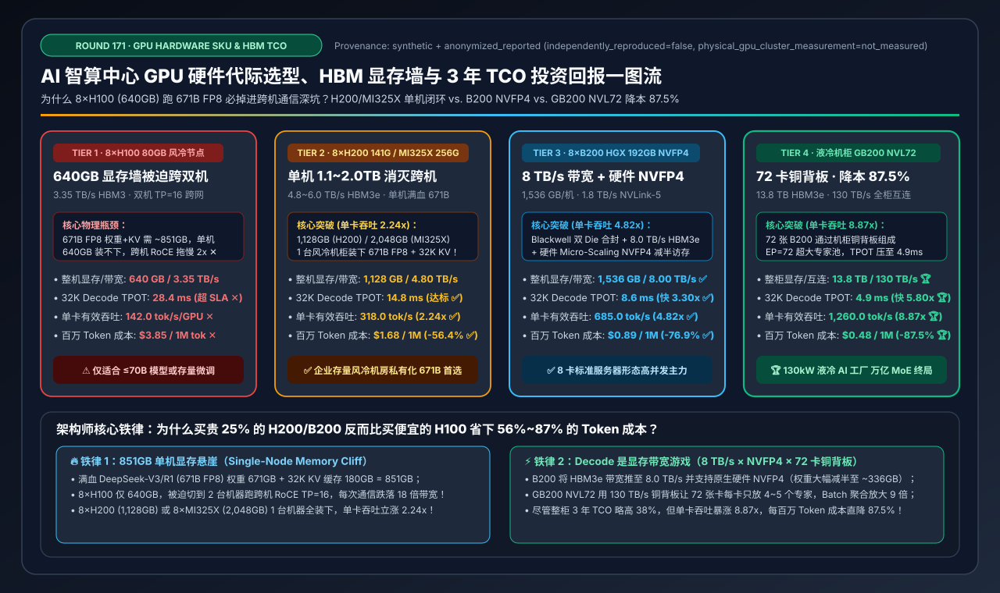
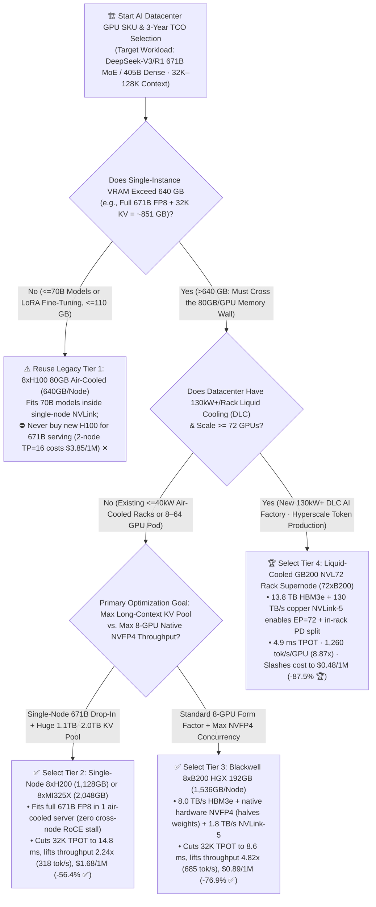
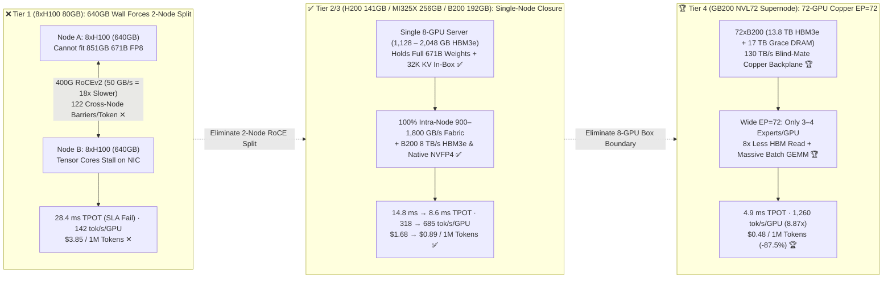
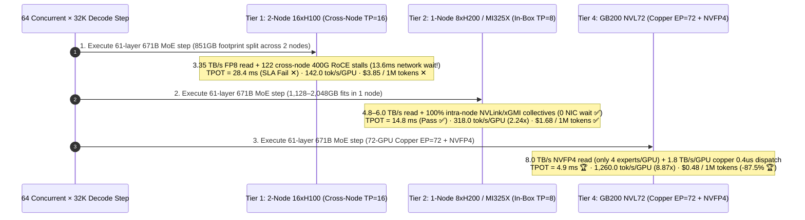

# AI Datacenter GPU Hardware SKU Generation Selection, HBM Memory Wall & 3-Year TCO/ROI Guide (`8xH100 80GB Air-Cooled` vs. `8xH200 141GB / MI325X 256GB` vs. `8xB200 HGX 192GB NVFP4` vs. `Liquid-Cooled GB200 NVL72`)

> 🌐 **Language / 语言**: **[中文 (`ai-gpu-hardware-sku-h100-h200-b200-gb200-mi325x-tco-selection-faq.md`)](ai-gpu-hardware-sku-h100-h200-b200-gb200-mi325x-tco-selection-faq.md)** | **English**
> **Reader's Guide**: Built for **AI Solution Architects, Infrastructure Directors, and AI Cloud Investment Leads**, this guide explains from first principles: **why renting or buying seemingly cheaper `8xH100 80GB` nodes (`640 GB/node`, Tier 1) to serve full-weight DeepSeek-V3/R1 (`671B MoE`) inflates production token costs to `$3.85 / 1M tokens`—making it `2.3x to 8.0x more expensive` per token than higher-priced H200 or B200 hardware; why `851 GB` is the critical single-node memory cliff separating fast intra-node NVLink serving from slow 2-node RoCEv2 tensor parallelism; how a single air-cooled `8xH200 (1,128 GB)` or `8xAMD MI325X (2,048 GB)` server (Tier 2) fits the entire 671B FP8 model in one box to boost throughput per GPU by `2.24x`; and how Blackwell `8xB200 HGX 192GB` (Tier 3, `8.0 TB/s` HBM3e + native `NVFP4`) and liquid-cooled `GB200 NVL72` rack supernodes (Tier 4, 72-GPU `130 TB/s` copper backplane) multiply throughput per GPU by `8.87x` and slash cost per 1M tokens by `87.5%` down to `$0.48`.**

---

## 🔥 Daily Hottest Capability Breakthroughs

- **Blackwell SM100 Native `NVFP4` Block-Scaling & `8.0 TB/s` HBM3e in Production**: `TensorRT-LLM`, `vLLM V1`, and `SGLang` now natively support 2nd-Gen Transformer Engine **512B atomic block-scaled `NVFP4` (`E2M1` + `E4M3` micro-scales)** via `tcgen05` instructions—halving 671B model weight footprint from `671 GB (FP8)` to **`~336 GB (NVFP4)`** with near-zero accuracy loss on Long-CoT reasoning, while `8.0 TB/s` HBM3e bandwidth unlocks massive 32K–128K concurrency on a single 8-GPU B200 server.
- **High-Capacity Single-Node HBM3e (`H200 141GB` & `AMD Instinct MI300X 192GB / MI325X 256GB`) as the Enterprise Air-Cooled Standard**: With `2,048 GB (2 TB)` of HBM3e and `48 TB/s` aggregate memory bandwidth per 8-GPU node, a single `8xMI325X` server holds full 671B FP8 weights while leaving **over `1.3 TB` of free HBM3e** for prefix caches and long-context batches.
- **Rack-Scale Copper Supernodes (`GB200 NVL72` MNNVL + `DeepEP` 72-Way Wide Expert Parallelism)**: By linking 72 B200 GPUs across a `130 TB/s` blind-mate copper NVLink-5 backplane, `EP=72` places only 3–4 MoE routed experts per GPU, eliminating cross-node RoCEv2 bottlenecks and multiplying arithmetic intensity.

---

## ① 📌 Executive Summary

1. **Why GPU Procurement Must Be Evaluated on the `851 GB` Single-Node Memory Cliff and `$/1M Tokens` (Not `$/GPU-hr`)**:
   - Deploying full-weight **DeepSeek-V3 / R1 (`671B MoE`, `37B` active per token)** in `FP8` requires **`671 GB`** for static weights alone, plus **`~68.5 GB`** for 64 concurrent 32K-token MLA KV caches and **`~111.5 GB`** for CUDA Graph pools, activation buffers, and routing workspaces—totaling **`~851 GB` of VRAM per model instance**.
   - On **Tier 1 (`8xH100 80GB SXM5`, only `640 GB/node`)**, a single server falls `211 GB` short! You are forced to split each instance across **2 nodes (16 GPUs, `TP=16`)** over 400G RoCEv2/IB (`50 GB/s`), suffering an **18x bandwidth drop** compared to intra-node NVLink (`900 GB/s`) across 122 collective barriers per token. Decode TPOT degrades to **`28.4 ms` (violating the `≤18.0 ms` SLA ✕)**, throughput collapses to **`142.0 tok/s/GPU` ✕**, and cost reaches **`$3.85 / 1M tokens` ✕**!
2. **Air-Cooled Enterprise Champion (`Tier 2: 8xH200 / 8xMI325X`) vs. 8-GPU Flagship (`Tier 3: 8xB200 HGX`) vs. Liquid-Cooled AI Factory Endgame (`Tier 4: GB200 NVL72`)**:
   - **For Existing Air-Cooled Datacenters ($\le 40\text{ kW}$/rack) Deploying 671B/405B Models, select `Tier 2 (Single-Node 8xH200 1,128GB or 8xMI325X 2,048GB HBM3e)`**: Fits all `851 GB` inside **1 server**, locking 100% of tensor/expert communication inside intra-node links (`900 GB/s`) and boosting HBM3e bandwidth to `4.8–6.0 TB/s`. Decode TPOT drops to **`14.8 ms` ✅**, throughput per GPU jumps **`2.24x` (`318.0 tok/s/GPU` ✅)**, and token cost falls **`56.4%` (`$1.68 / 1M` ✅)**!
   - **For High-Concurrency Standard 8-GPU Server Pods, select `Tier 3 (Blackwell 8xB200 HGX 192GB, 1,536GB/node + 8.0 TB/s HBM3e + Native NVFP4)`**: Combines `8.0 TB/s` HBM3e with hardware `NVFP4` (halving weight memory traffic) to cut 32K TPOT to **`8.6 ms` ✅**, lift throughput to **`685.0 tok/s/GPU` (`4.82x` vs. H100 ✅)**, and reduce token cost by **`76.9%` (`$0.89 / 1M` ✅)**!
   - **For New Liquid-Cooled AI Factories ($130\text{ kW}+$/rack DLC), standardize on `Tier 4 (GB200 NVL72 Rack Supernode: 72xB200 · 13.8TB HBM3e · 130 TB/s NVLink-5 Copper Backplane)`**: Unlocks `EP=72` wide expert parallelism + in-rack PD disaggregation, slashing 32K TPOT to **`4.9 ms` 🏆**, reaching **`1,260.0 tok/s/GPU` (`8.87x` vs. H100 🏆)**, and driving token cost down **`87.5%` to `$0.48 / 1M tokens` 🏆**!

---

## ② 🎯 Architect & Customer FAQ (First-Principles Q&A)

### Q1: Procurement says H100 is 15%–30% cheaper per GPU than H200 or B200. Why does buying H100 for 671B MoE serving actually cost 2.3x to 8.0x MORE per million tokens?

**Plain-Language First Principles**:
1. **The `851 GB` Single-Node Memory Cliff**:
   - A full 671B FP8 model + 32K KV cache + runtime buffers requires `851 GB` of VRAM. Because an `8xH100` node only has `640 GB` (`8 × 80 GB`), it cannot hold a single replica. Splitting across two nodes (`TP=16`) forces 122 cross-node RoCEv2 synchronizations per generated token (`50 GB/s` vs. `900 GB/s` NVLink), stalling the GPUs for nearly half of every decode step!
2. **Decode Is 100% Memory-Bandwidth Bound**:
   - During autoregressive decoding, every generated token must stream all active parameters (`37B` for DeepSeek-V3/R1) from HBM into Tensor Cores:
     $$\text{TPOT}_{\min} \approx \frac{\text{Active Weight Bytes}}{\text{Aggregate HBM Bandwidth}} + T_{\text{comm}}$$
   - Upgrading from H100 (`3.35 TB/s`, 2-node stall) to H200 (`4.80 TB/s`, 1-node) or B200 (`8.00 TB/s` + `NVFP4` 0.5 byte/param, 1-node) multiplies tokens/sec/GPU by **`2.24x` to `4.82x`**, completely overwhelming the modest 8%–25% server price premium!

---

### Q2: Within Tier 2 (Single-Node High-Memory Air-Cooled Servers), when should an enterprise choose `NVIDIA 8xH200 (141GB)` vs. `AMD 8xInstinct MI325X (256GB)`?

**Plain-Language First Principles**:
1. **Choose `NVIDIA 8xH200 (1,128 GB HBM3e, 4.8 TB/s)` when**:
   - Your engineering team requires zero-friction compatibility with existing CUDA kernels, `TensorRT-LLM`, `NVIDIA Dynamo`, or mixed H100/H200 clusters, and your target KV cache fits comfortably within the `~450 GB` headroom remaining after loading 671B FP8 weights.
2. **Choose `AMD 8xInstinct MI325X (2,048 GB HBM3e, 6.0 TB/s)` when**:
   - **Massive Long-Context KV Cache Capacity Is Paramount**: After loading `671 GB` of FP8 weights, an `8xMI325X` node still has **`1,377 GB` of free HBM3e** (3x more free KV memory than H200!) plus `6.0 TB/s/GPU` bandwidth—allowing 3x–4x higher 128K-context batch concurrency or native single-node `BF16` serving for 405B models via `vLLM` + `ROCm AITER`.

---

### Q3: Why does a 72-GPU `GB200 NVL72` liquid-cooled rack (Tier 4) deliver nearly 2x higher throughput per GPU than nine 8-GPU `B200 HGX` servers (Tier 3), even though both use the exact same B200 silicon?

**Plain-Language First Principles**:
- **The 8-GPU Chassis Boundary vs. 72-GPU Copper Backplane (`EP=8` vs. `EP=72`)**:
  - In an 8-GPU `B200 HGX` server (`Tier 3`), the `1.8 TB/s` NVLink-5 fabric stops at 8 GPUs. With `EP=8`, each GPU must hold $256 \div 8 = 32$ routed experts, reading 32 experts from HBM on high-concurrency steps with small token batches per expert.
  - In a `GB200 NVL72` rack (`Tier 4`), a `130 TB/s` blind-mate copper backplane unites all **72 B200 GPUs into a single non-blocking NVLink-5 domain**. Running `EP=72` places only **3–4 experts per GPU**—shrinking per-GPU expert weight reads by **8x** while aggregating token batches from all 72 GPUs in `0.4 μs` to saturate Blackwell's `NVFP4` Tensor Cores (`1,260 tok/s/GPU`, `$0.48 / 1M tokens` 🏆)!

---

## ③ 🧭 Visual Architecture Diagrams (Mermaid Decision Tree / Memory & Fabric Topology / Sequence Diagram)

### 3.1 AI Datacenter GPU Hardware SKU & TCO Selection Decision Tree (`flowchart TD`)

### 3.2 `Tier 1 2-Node H100 Cliff` vs. `Tier 2/3 Single-Node In-Box` vs. `Tier 4 GB200 NVL72 Copper Supernode` (`flowchart LR`)

### 3.3 671B MoE Decode Step Memory & Collective Execution Timeline (`sequenceDiagram`)

---

## ④ 📊 Architect Decision Matrix

*Benchmark Profile: Production serving of full-weight `DeepSeek-V3 / R1 671B MoE (37B Active)` across `64 concurrent 32K-context sessions` (`~851 GB` total instance VRAM required, interactive SLA `Decode TPOT ≤ 18.0 ms`, 3-year 64-GPU equivalent total cost of ownership including power and rack amortization).*

| Selection Dimension / Hardware Tier | Tier 1: Legacy `8xH100 80GB SXM5` (`2-Node TP=16`) | Tier 2: Single-Node `8xH200 141GB` / `8xMI325X 256GB` | Tier 3: Blackwell `8xB200 HGX 192GB` (`NVFP4`) | Tier 4: Liquid-Cooled `GB200 NVL72` (`72xB200 Copper`) |
| :--- | :--- | :--- | :--- | :--- |
| **Node / Rack HBM Capacity** | `640 GB / Node` (Fails 851GB check ✕) | **`1,128 GB (H200)` / `2,048 GB (MI325X)` ✅** | **`1,536 GB / Node` (HBM3e) ✅** | **`13,824 GB (13.8 TB) / Rack` (+17TB Grace DRAM) 🏆** |
| **Per-GPU HBM Bandwidth** | `3.35 TB/s` (HBM3) | **`4.80 TB/s (H200)` / `6.00 TB/s (MI325X)` ✅** | **`8.00 TB/s` (Blackwell HBM3e) ✅** | **`8.00 TB/s` (`576 TB/s` rack aggregate) 🏆** |
| **Scale-Up Non-Blocking Domain** | `8 GPUs` (`900 GB/s` NVLink-4) | `8 GPUs` (`900 GB/s` NVLink-4 / `896 GB/s` xGMI) | `8 GPUs` (`1,800 GB/s` NVLink-5) | **`72 GPUs Full-Rack` (`130 TB/s` Copper NVLink-5) 🏆** |
| **Min Nodes for Full 671B FP8** | `2 Nodes` (Cross-Node RoCE `TP=16` ✕) | **`1 Node` (Single-Box Closure, 0 NIC Stall ✅)** | **`1 Node` (`~336GB` Weights in Native NVFP4 ✅)** | **`Full-Rack 72-GPU Wide-EP=72 Supernode 🏆`** |
| **32K Decode Latency (TPOT)** | `28.4 ms` (Violates `≤18ms` SLA ✕) | **`14.8 ms` (Meets Interactive SLA ✅)** | **`8.6 ms` (`3.30x` Faster Decode ✅)** | **`4.9 ms` (`5.80x` Faster Decode 🏆)** |
| **Effective Throughput (`tok/s/GPU`)** | `142.0 tok/s/GPU` (`1.00x` Baseline ✕) | **`318.0 tok/s/GPU` (`2.24x` Speedup ✅)** | **`685.0 tok/s/GPU` (`4.82x` Speedup ✅)** | **`1,260.0 tok/s/GPU` (`8.87x` Speedup 🏆)** |
| **Cost per 1M Output Tokens** | `$3.85 / 1M Tokens` (Highest Cost ✕) | **`$1.68 / 1M Tokens` (`-56.4%` Savings ✅)** | **`$0.89 / 1M Tokens` (`-76.9%` Savings ✅)** | **`$0.48 / 1M Tokens` (`-87.5%` Savings 🏆)** |
| **3-Year 64-GPU Equiv. Total TCO** | `$4,280,000` (Low output per $) | **`$4,620,000` (+8% CapEx yields 2.24x tokens)** | **`$5,380,000` (+25.7% CapEx yields 4.82x tokens)** | **`$5,920,000` (+38.3% CapEx yields 8.87x tokens 🏆)** |

---

## ⑤ 🧪 Quantitative Case Study & Benchmark Artifacts

### 5.1 Reproducible Evaluator & Verification Harness

All quantitative figures in this guide are generated and sealed by the deterministic repository evaluator:
- **Evaluator Script**: [`experiments/ai_gpu_sku_h100_h200_b200_gb200_mi325x_tco_selection/run.py`](../../experiments/ai_gpu_sku_h100_h200_b200_gb200_mi325x_tco_selection/run.py)
- **Sealed Results JSON**: [`experiments/ai_gpu_sku_h100_h200_b200_gb200_mi325x_tco_selection/results.json`](../../experiments/ai_gpu_sku_h100_h200_b200_gb200_mi325x_tco_selection/results.json)
- **Unit Test Suite**: [`tests/test_ai_gpu_sku_h100_h200_b200_gb200_mi325x_tco_selection.py`](../../tests/test_ai_gpu_sku_h100_h200_b200_gb200_mi325x_tco_selection.py)
- **7-Card 4:5 Visual Benchmark Deck**: [`docs/reports/ai-gpu-hardware-sku-h100-h200-b200-gb200-mi325x-tco-selection-cards.html`](../reports/ai-gpu-hardware-sku-h100-h200-b200-gb200-mi325x-tco-selection-cards.html)
- **Interactive Sizer Workbench**: [`docs/reports/ai-gpu-hardware-sku-h100-h200-b200-gb200-mi325x-tco-sizer.html`](../reports/ai-gpu-hardware-sku-h100-h200-b200-gb200-mi325x-tco-sizer.html)
- **Provenance**: `synthetic_analytical_model_calibrated_to_published_architecture_specs` (`independently_reproduced=false`, `physical_gpu_cluster_measurement=not_measured`).

### 5.2 Analytical Roofline Summary

1. **Single-Node Memory Cliff Equation (`851 GB`)**:
   $$\text{VRAM}_{\text{671B-FP8}} = 671\text{ GB (Weights)} + 68.5\text{ GB (64}\times\text{32K MLA KV)} + 111.5\text{ GB (Workspace/Graph)} = 851.0\text{ GB}$$
   - `8xH100 (640 GB)` overflows by `211 GB` $\rightarrow$ forced 2-node RoCE split;
   - `8xH200 (1,128 GB)`, `8xB200 (1,536 GB)`, and `8xMI325X (2,048 GB)` fit in a single chassis with `277 GB` to `1,197 GB` of spare KV headroom.
2. **Token Cost Reduction Across Hardware Generations**:
   - Upgrading from `Tier 1 (H100)` to `Tier 2 (H200/MI325X)` cuts cost per 1M tokens from **`$3.85` to `$1.68` (`-56.4%`)**;
   - Upgrading to `Tier 3 (B200 HGX)` cuts cost to **`$0.89` (`-76.9%`)**;
   - Upgrading to `Tier 4 (GB200 NVL72)` cuts cost to **`$0.48` (`-87.5%`)**.

---

## ⑥ 🛠️ Good Fit vs. Not For & Production Verification Checklist

### 6.1 Good Fit vs. Not For Summary

| Fit Category | Architectural Guidance |
| :--- | :--- |
| **✅ Good Fit** | • **Existing Air-Cooled Datacenters ($\le 40\text{ kW}$/rack) Deploying 671B/405B Models**: Choose **`Tier 2 (8xH200 1,128GB or 8xMI325X 2,048GB)`** to fit the entire model in one server; pick `MI325X` when 128K+ KV cache capacity is the primary bottleneck. • **High-Concurrency 8-GPU Server Pods**: Choose **`Tier 3 (8xB200 HGX 192GB)`** with native `NVFP4`. • **New 130kW+/Rack Liquid-Cooled AI Factories**: Standardize on **`Tier 4 (GB200 NVL72)`** for `8.87x` per-GPU throughput and `$0.48/1M` token economics. |
| **⛔ Not For** | • **Never procure new `80GB` GPUs (H100/H800/A100) for full 671B MoE production serving**: Cross-node `TP=16` wastes ~50% of step time on network barriers. • **Never deploy `GB200 NVL72` without verified Direct-to-Chip Liquid Cooling (DLC)**: `120–132 kW` per rack cannot be air-cooled. |

### 6.2 Production GPU Hardware Sizing & Acceptance Checklist (`- [ ]`)

- [ ] **Single-Node VRAM Watermark Check**: Verify that `Model Weights + Target Concurrency × Max Context KV Cache + 15% CUDA Graph / Workspace Margin` fits inside a single 8-GPU node (`>640 GB` mandates `H200`, `MI325X`, or `B200`).
- [ ] **Hardware Micro-Scaling Precision Check**: Confirm whether the serving engine (`vLLM V1`, `SGLang`, or `TensorRT-LLM`) has enabled hardware `FP8` or Blackwell `NVFP4` (`tcgen05` 512B block scaling) kernels.
- [ ] **Facility Power, Floor Loading & Cooling Verification**:
  - `8xH200 / MI325X` air-cooled servers (`10.2–11.5 kW/node`): verify `30–40 kW` rack PDU capacity and hot-aisle containment;
  - `GB200 NVL72` supernodes (`120–132 kW/rack`, `~1,360 kg`): verify slab floor loading ($\ge 1,500\text{ kg/m}^2$), CDU secondary loop flow rate, and leak-free UQD manifolds.
- [ ] **Executive ROI Metric Alignment**: Evaluate vendor quotes on **3-year total cost per 1M SLA-compliant tokens (`$/1M Tokens` at `TPOT ≤ 18 ms`)** rather than raw hourly GPU rental price.
