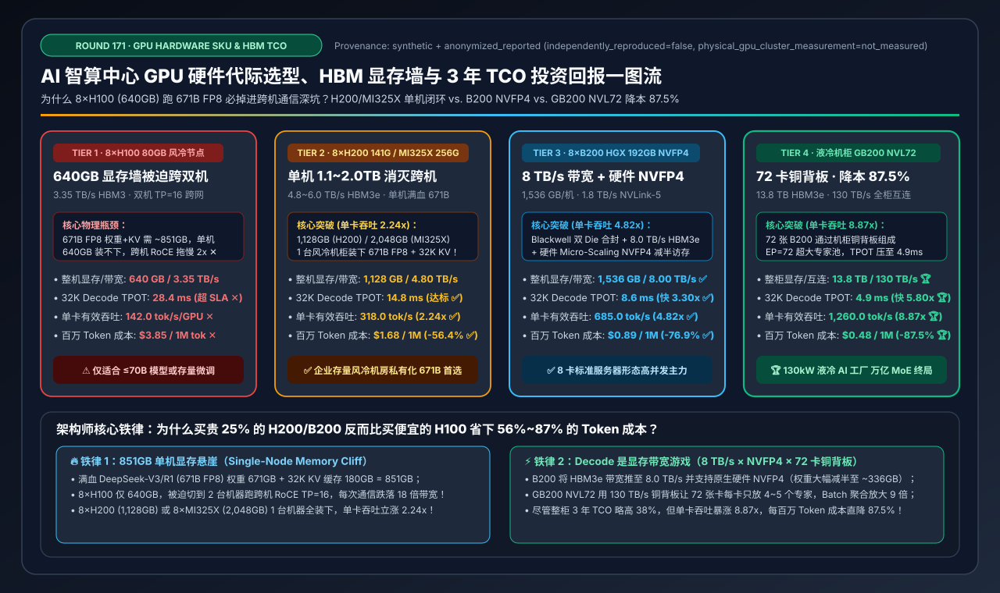
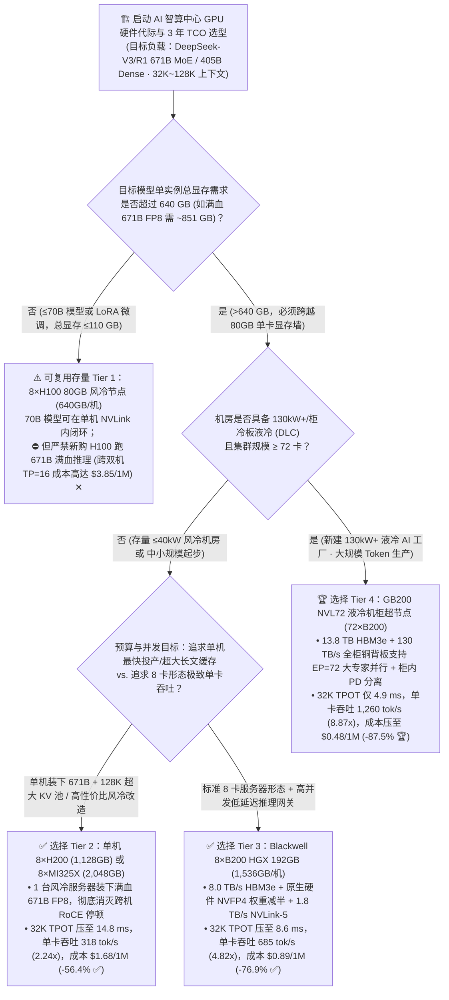
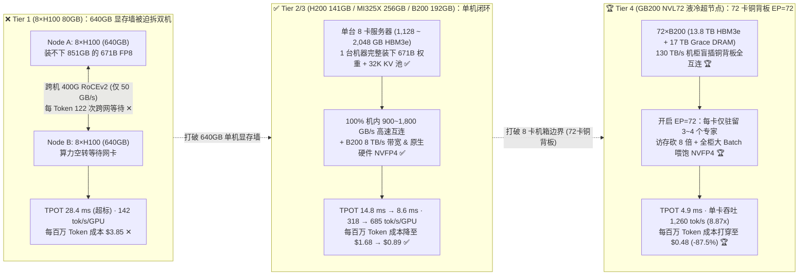
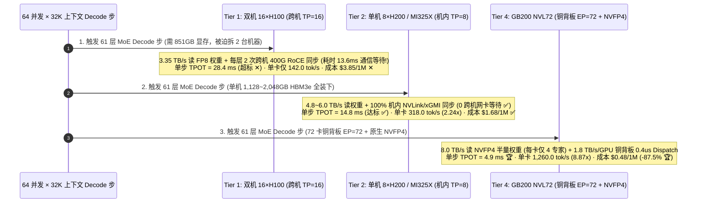

# AI 智算中心 GPU 硬件代际选型、HBM 显存墙与 3 年 TCO 投资回报指南（`8×H100 80GB 风冷` vs. `8×H200 141GB / MI325X 256GB` vs. `8×B200 HGX 192GB NVFP4` vs. `液冷机柜 GB200 NVL72`）

> 🌐 **Language / 语言**: **中文 (Chinese)** | **[English (`ai-gpu-hardware-sku-h100-h200-b200-gb200-mi325x-tco-selection-faq.en.md`)](ai-gpu-hardware-sku-h100-h200-b200-gb200-mi325x-tco-selection-faq.en.md)**
> **阅读指南**：本文面向 **AI 解决方案架构师（AI Solution Architect）、智算中心投资负责人与基础设施总监**，用通俗大白话 + 第一性原理彻底讲透：**为什么客户采购单卡价格便宜 15%~30% 的 `8×H100 80GB`（整机 640GB 显存，Tier 1）来部署满血版 DeepSeek-V3/R1（671B MoE），结果每生成 100 万 Token 的算力成本高达 `$3.85`，反而比买更贵的 H200 / B200 贵了 `2.3 倍～8 倍`？为什么 `851 GB` 是决定单机还是跨双机部署的“生死显存墙”？在存量 40kW 风冷机房里，如何用 1 台 `8×H200 (1,128GB)` 或 `8×AMD MI325X (2,048GB)`（Tier 2）直接消灭跨机通信停顿，把单卡吞吐翻 `2.24 倍`？以及新一代 Blackwell `8×B200 HGX 192GB`（Tier 3，原生硬件 NVFP4 + 8 TB/s 带宽）与液冷整柜超节点 `GB200 NVL72`（Tier 4，72 卡 130 TB/s 铜背板）是如何把单卡吞吐推升 `8.87 倍`、将每百万 Token 成本打穿至 `$0.48（暴降 87.5%）` 的？** 全文零晦涩黑话堆砌，3 分钟看懂选型结论，10 分钟掌握 GPU 采购 ROI 核算公式。

---

## 🔥 业界最新能力突破追踪（Daily Hottest Capability Breakthroughs）

- **Blackwell SM100 原生 `NVFP4` 微缩放与 `8.0 TB/s` HBM3e 实装落地**：TensorRT-LLM、vLLM V1 与 SGLang 已全面支持 Blackwell SM100 第二代 Transformer Engine 的 **512B 原子块缩放 `NVFP4`（E2M1 + E4M3 块缩放因子）** 与 `tcgen05` 张量核指令，在不损失长思维链（Long-CoT）推理精度的前提下，将 671B 模型权重显存直接从 `671 GB (FP8)` 减半至 **`~336 GB (NVFP4)`**，配合 `8.0 TB/s` HBM3e 带宽使单机 8 卡 B200 即可支撑百并发 32K~128K 长上下文服务。
- **单机超大显存阵营（`H200 141GB` & `AMD Instinct MI300X 192GB / MI325X 256GB`）成为企业私有化 671B 标配**：借助 `AITER` / `Triton` / `vLLM` 对大显存 HBM3e 的深度适配，单台 8 卡 MI325X 拥有惊人的 **`2,048 GB（2 TB）` 显存与 `48 TB/s` 整机带宽**，单机不仅能装下满血 671B FP8 权重，还能余出超 **1.3 TB** 显存用于百万 Token 级 KV Cache 驻留。
- **机柜级铜背板超节点（`GB200 NVL72` MNNVL + `DeepEP` 72 卡大专家并行）**：打破传统 8 卡服务器机箱边界，72 张 B200 GPU 通过机柜盲插铜背板共享 **`130 TB/s` 全互连 NVLink-5 域**，让 MoE 专家并行（EP=72）彻底告别跨网卡 RoCE/IB 慢速瓶颈。

---

## ① 📌 核心结论速览（Executive Summary）

1. **为什么买 GPU 绝不能只看“单卡硬件报价”，而必须看“`851 GB` 单机显存悬崖”与“单 Token 产出成本（`$/1M Tokens`）”**：
   - 企业私有化部署满血版 **DeepSeek-V3 / R1（671B MoE，每 Token 激活 37B）** 时，即便采用主流 `FP8` 量化，仅静态权重就要占掉 **`671 GB`**；再加上 64 并发 × 32K 上下文的 MLA KV Cache（`~68.5 GB`）以及 CUDA Graph 捕获池与专家路由缓冲区（`~111.5 GB`），**单实例总显存刚需高达 `~851 GB`**！
   - 如果采购 **Tier 1（存量 `8×H100 80GB`，整机仅 `640 GB` 显存）**，还差 `211 GB` 根本装不下！你被迫把 1 个模型拆到 **2 台 8×H100 服务器（16 张卡）** 上跑跨机张量并行（`TP=16`）。每生成 1 个 Token，61 层 Transformer 都要跨 400G RoCE/IB 网卡做 122 次全网同步——通信带宽瞬间从机内 NVLink 的 `900 GB/s` 暴跌至网卡的 `50 GB/s`（**跌落 18 倍**）！结果 32K Decode 延迟（TPOT）恶化至 **`28.4 ms`（违反 `≤18ms` SLA ✕）**，单卡吞吐跌至可怜的 **`142.0 tok/s/GPU` ✕**，每百万 Token 成本高达 **`$3.85` ✕**！
2. **存量风冷机房私有化首选 `Tier 2 (8×H200 141GB / 8×MI325X 256GB)` vs. 标准 8 卡高并发主力 `Tier 3 (8×B200 HGX 192GB)` vs. 新建液冷 AI 工厂终局 `Tier 4 (GB200 NVL72)`**：
   - **当企业机房仅有传统风冷机柜（单柜供电 $\le 40\text{ kW}$），想用最少机器跑起满血 671B/405B 大模型时，首选 `Tier 2（单机 8×H200 1,128GB 或 8×MI325X 2,048GB HBM3e）`**：1 台机器就能把 `851 GB` 的满血 671B FP8 + 32K KV 缓存全部装进机箱内！所有通信 100% 锁死在机内高速互连（900 GB/s NVLink 或 Infinity Fabric），配合 `4.8~6.0 TB/s` HBM3e 带宽，将 TPOT 从 `28.4 ms` 压至 **`14.8 ms` ✅**，单卡有效吞吐飙升至 **`318.0 tok/s/GPU`（比 H100 快 `2.24x` ✅）**，每百万 Token 成本直降 **`56.4%`（`$1.68 / 1M` ✅）**！
   - **当建设企业级高并发 AI 推理网关、且希望保持标准 8 卡服务器运维形态时，首选 `Tier 3（Blackwell 8×B200 HGX 192GB，整机 1,536GB + 8.0 TB/s HBM3e + 原生硬件 NVFP4）`**：单卡 `8.0 TB/s` 显存带宽叠加硬件 `NVFP4`（将权重访存量再砍一半），把 32K TPOT 压至 **`8.6 ms` ✅**，单卡吞吐高达 **`685.0 tok/s/GPU`（比 H100 快 `4.82x` ✅）**，每百万 Token 成本降至 **`$0.89`（省 `76.9%` ✅）**！
   - **当建设百卡至万卡级新建液冷智算中心（具备 $130\text{ kW}+$/柜 冷板液冷能力）时，终极答案是 `Tier 4（GB200 NVL72 液冷整柜超节点：72×B200 · 13.8TB HBM3e · 130 TB/s 全柜铜背板 NVLink-5）`**：72 张 B200 像“一张拥有 13.8TB 显存的超级巨型 GPU”一样工作，开启 `EP=72` 超大专家并行 + 柜内 PD 分离，将 TPOT 压至惊人的 **`4.9 ms` 🏆**，单卡吞吐达到 **`1,260.0 tok/s/GPU`（比 H100 高 `8.87x` 🏆）**，每百万 Token 成本打穿至 **`$0.48`（比 H100 暴降 `87.5%` 🏆）**！

---

## ② 🎯 客户与架构师灵魂拷问 Q&A（FAQ-Driven）

### Q1：财务和采购部门算账时发现，H200 比 H100 贵约 15%~20%，B200 又比 H200 贵一截，为什么架构师坚持说“买便宜的 H100 跑 671B 大模型反而是在巨额亏钱”？

**通俗大白话 + 第一性原理解答**：
- **大模型推理的真实账单，算的不是“每张卡每小时多少钱（`$/GPU-hr`）”，而是“每张卡每秒能吐出多少个合格 Token（`Tokens/s/$`）”！**
- 让我们用最直观的“卡车拉货”比喻来看为什么 `8×H100 (80GB)` 在 671B 满血模型面前会崩盘：
  1. **第一重暴击：640GB < 851GB，触发“跨机箱拆车惩罚”**：
     - 满血 671B FP8 模型连同 32K 上下文 KV 缓存一共重 **`851 吨（GB）`**。
     - 1 台 8×H100 服务器的最大载重只有 **`640 吨（8 × 80GB）`**，根本装不下！你只能买 **2 台 8×H100（共 16 张卡，1,280GB）** 合起来拉这一单货。
     - 一旦跨出单台服务器的机箱，原本机内 `900 GB/s` 的 NVLink 高速公路瞬间变成跨机柜的 `50 GB/s` RoCE/IB 乡间小道（**慢了 18 倍**）！每生成一个词（Token），16 张卡要在乡间小道上互相等待 122 次，近一半的时间 GPU 算力都在干等网卡！
  2. **第二重暴击：Decode 阶段 100% 卡在“显存读取带宽（Memory Bandwidth Roofline）”**：
     - 大模型逐词生成（Decode）时，每吐出 1 个词，GPU 都必须把激活的 370 亿参数（37GB FP8）从显存（HBM）里完整读一遍。
     - **生成速度上限 = 显存带宽 $\div$ 每次读取字节数**：
       - **H100 (`3.35 TB/s` HBM3)**：不仅带宽低，还被跨机通信拖累，单卡每秒仅吐出 **`142.0 Tokens`**；
       - **H200 (`4.80 TB/s` HBM3e, `141GB`)**：1 台机器（1,128GB）全装下，零跨机停顿 + 带宽提升 43%，单卡每秒吐出 **`318.0 Tokens`（快 `2.24 倍`）**！
       - **B200 (`8.00 TB/s` HBM3e, `192GB` + 原生 `NVFP4`)**：带宽翻 2.4 倍 + NVFP4 让读取字节数减半，单卡每秒吐出 **`685.0 Tokens`（快 `4.82 倍`）**！
  - **算总账**：虽然 B200 整机 3 年 TCO（`$5.38M` / 64卡）比 H100（`$4.28M` / 64卡）贵了 `25.7%`，但因为产出 Token 速度是 H100 的 **`4.82 倍`**，平摊到每 100 万个 Token 上，成本直接从 **`$3.85` 暴跌到 `$0.89`（立省 `76.9%`）**！

---

### Q2：同样是大显存单机方案（Tier 2），NVIDIA `8×H200 (141GB)` 和 AMD `8×MI300X (192GB) / MI325X (256GB)` 各自的核心优劣势是什么？客户该如何二选一？

**通俗大白话 + 第一性原理解答**：
- 这两款硬件都是为了解决 **“1 台风冷 8 卡服务器装下满血 671B/405B 大模型”** 而生的王牌利器，但脾气秉性截然不同：
  1. **何时选 `NVIDIA 8×H200 (141GB × 8 = 1,128 GB HBM3e, 4.8 TB/s)`？**
     - **核心优势**：**100% 零代码迁移成本的 CUDA 生态 + 极致的 FP8 计算与集合通信成熟度**。如果客户团队现有的推理管线深度绑定 `TensorRT-LLM`、`NVIDIA Dynamo`、`DeepEP IBGDA` 或自定义 CUDA 算子，且并发连接数中等（单实例总显存控制在 `1,050 GB` 以内），H200 可以与存量 H100 完美混部，当天上架当天投产。
  2. **何时选 `AMD 8×Instinct MI325X (256GB × 8 = 2,048 GB HBM3e, 6.0 TB/s)`？**
     - **核心优势**：**统治级的单机显存容量（整机 2 TB 显存，比 H200 多出 920 GB！）与极高的显存带宽性价比**。
     - 当客户面对以下两大场景时，MI325X 极具杀伤力：
       - **场景 A（满血 671B + 超长 128K 上下文高并发 KV 池）**：H200 装完 671GB 权重后只剩约 450GB 给 KV Cache；而 MI325X 装完 671GB 权重后，**还剩足足 `1,377 GB` 显存** 可以用来塞海量的长文档 Prefix Cache 和大 Batch 请求！
       - **场景 B（不希望做有损量化，直接单机跑 `BF16` 405B 或双机跑 `BF16` 671B）**：凭借 `vLLM + ROCm AITER + Triton` 的成熟支持，在纯推理吞吐与显存容量价格比上优势显著。

---

### Q3：为什么说液冷机柜超节点 `GB200 NVL72`（Tier 4）改变了万亿参数 MoE 模型的游戏规则？它和买 9 台独立的 `8×B200 HGX` 服务器（Tier 3，同样是 72 张 B200 GPU）有什么本质区别？

**通俗大白话 + 底层运作原理解答**：
- 很多客户会问：*“1 柜 GB200 NVL72 里面有 72 张 B200 GPU；我买 9 台独立的 8 卡 B200 HGX 服务器也是 72 张 B200 GPU，为什么 NVL72 的单卡吞吐（`1,260 tok/s`）比 8 卡 B200（`685 tok/s`）还要再翻近一倍？”*
- **核心奥秘在于：NVLink 全互连通信域的大小（`8 卡域` vs. `72 卡域`）决定了 MoE 专家并行（Expert Parallelism）的算术强度上限！**
  1. **在 8 卡 B200 HGX（Tier 3）上**：
     - 高速 `1.8 TB/s` NVLink-5 只存在于单台机箱内部的 **8 张卡之间**。一旦跨出机箱去连第 9 张卡，就必须走 `800G (100 GB/s)` 网卡，速度瞬间掉 18 倍。
     - 因此，跑 671B MoE（共 256 个路由专家）时，如果你在单机 8 张卡内跑 `EP=8`，**每张卡必须塞下 $256 \div 8 = 32$ 个专家**！每生成一个词，这 32 个专家的权重都要从显存里读出来，而且分摊到每个专家上的 Token 很少（小矩阵乘 GEMM 算术强度极低，Tensor Core 根本吃不饱）。
  2. **在 72 卡 GB200 NVL72（Tier 4）液冷机柜超节点上**：
     - 机柜背部是一块重达数十公斤的高密度 **盲插铜背板（Copper Backplane，超过 5,000 根同轴铜线）**，配合 18 颗 NVSwitch 芯片，把整柜 **72 张 B200 GPU 焊死在同一个 `130 TB/s` 的无阻塞 NVLink-5 域（MNNVL）里**！
     - 现在你可以开启 **`EP=72` 超大专家并行**：256 个专家平摊到 72 张卡上，**每张卡只需要存 3~4 个专家**！
     - **奇迹发生了**：
       - 每张卡每步需要从 HBM 读取的专家权重体积缩小了 **8~9 倍**；
       - 同时，72 张卡服务的数千个并发用户的 Token 通过铜背板在 **`0.4 微秒`** 内瞬间汇聚到对应的专家卡上，让每个专家凑出超大的 Batch Size，直接把 Blackwell `NVFP4` Tensor Core 喂得饱饱的！
       - 再加上 36 颗 Grace CPU 通过 `900 GB/s` C2C 直连提供 **`17 TB` LPDDR5X 超大主机内存池**（秒级卸载 KV Cache），最终让单卡有效吞吐飙升至 **`1,260.0 tok/s/GPU`（8.87x）**，每百万 Token 成本降至 **`$0.48` 🏆**！

---

## ③ 🧭 直观可视化图解（Mermaid 决策树 / 显存与互连域对比 / 端到端时序图）

### 3.1 AI 智算中心 GPU 硬件代际与 TCO 选型决策树（`flowchart TD`）

### 3.2 `Tier 1 双机 H100 跨网瓶颈` vs. `Tier 2/3 单机闭环` vs. `Tier 4 GB200 NVL72 铜背板超节点` 对比图（`flowchart LR`）

### 3.3 满血 671B MoE 单步 Decode 访存与集合通信时序对比（`sequenceDiagram`）

---

## ④ 📊 架构师选型决策矩阵（Architect Decision Matrix）

*基准环境：企业私有化/智算云生产部署满血版 `DeepSeek-V3 / R1 671B MoE（37B 激活）` 处理 `32K 上下文 × 64 并发会话`（单实例权重 + KV + 运行时显存需求 `~851 GB`，在线交互 SLA 要求 `Decode TPOT ≤ 18.0 ms`，按 64 卡等效规模核算 3 年含电费/机柜折旧总 TCO）。*

| 选型维度 / GPU 硬件档位 | Tier 1: 存量 `8×H100 80GB SXM5` (`双机 TP=16`) | Tier 2: 单机 `8×H200 141GB` / `8×MI325X 256GB` | Tier 3: Blackwell `8×B200 HGX 192GB` (`NVFP4`) | Tier 4: 液冷机柜 `GB200 NVL72` (`72×B200 铜背板`) |
| :--- | :--- | :--- | :--- | :--- |
| **整机 / 整柜 HBM 显存容量** | `640 GB / 节点`（装不下 851GB ✕） | **`1,128 GB (H200)` / `2,048 GB (MI325X)` ✅** | **`1,536 GB / 节点`（HBM3e）✅** | **`13,824 GB (13.8 TB) / 机柜`（+17TB Grace 内存）🏆** |
| **单卡 HBM 显存带宽** | `3.35 TB/s`（HBM3） | **`4.80 TB/s (H200)` / `6.00 TB/s (MI325X)` ✅** | **`8.00 TB/s`（Blackwell HBM3e）✅** | **`8.00 TB/s`（整柜总带宽 `576 TB/s`）🏆** |
| **无阻塞 Scale-Up 互连域大小** | `8 卡域`（`900 GB/s` NVLink-4） | `8 卡域`（`900 GB/s` NVLink-4 / `896 GB/s` xGMI） | `8 卡域`（`1,800 GB/s` NVLink-5） | **`72 卡整柜域`（`130 TB/s` 铜背板 NVLink-5）🏆** |
| **满血 671B FP8 最小机器数** | `2 台（16 卡跨机 RoCE TP=16 ✕）` | **`1 台（8 卡单机闭环，零跨机通信 ✅）`** | **`1 台（支持单机 NVFP4 仅占 ~336GB 权重 ✅）`** | **`整柜 72 卡 EP=72 超节点池化（每卡仅 4 专家 🏆）`** |
| **32K 上下文 Decode 延迟 (TPOT)** | `28.4 ms`（违反 `≤18ms` SLA ✕） | **`14.8 ms`（流畅达标 ✅）** | **`8.6 ms`（极速体验，快 `3.30x` ✅）** | **`4.9 ms`（闪电生成，快 `5.80x` 🏆）** |
| **单卡有效吞吐 (`tok/s/GPU`)** | `142.0 tok/s/GPU`（基准 `1.00x` ✕） | **`318.0 tok/s/GPU`（提升 `2.24x` ✅）** | **`685.0 tok/s/GPU`（提升 `4.82x` ✅）** | **`1,260.0 tok/s/GPU`（飙升 `8.87x` 🏆）** |
| **每百万输出 Token 成本 (`$/1M`)** | `$3.85 / 1M Tokens`（最贵 ✕） | **`$1.68 / 1M Tokens`（节省 `56.4%` ✅）** | **`$0.89 / 1M Tokens`（节省 `76.9%` ✅）** | **`$0.48 / 1M Tokens`（暴降 `87.5%` 🏆）** |
| **64 卡等效 3 年含电费总 TCO** | `$4,280,000`（单卡便宜但吞吐极低） | **`$4,620,000`（多花 8% 预算，多产 2.24 倍 Token）** | **`$5,380,000`（多花 25.7%，多产 4.82 倍 Token）** | **`$5,920,000`（多花 38.3%，多产 8.87 倍 Token 🏆）** |

---

## ⑤ 🧪 简明定量算例与 Benchmark 洞察

### 5.1 复现实验与确定性底座

本专题所有定量数据均由仓库内确定性评估模型生成并封存，含单元测试校验：
- **评估脚本**：[`experiments/ai_gpu_sku_h100_h200_b200_gb200_mi325x_tco_selection/run.py`](../../experiments/ai_gpu_sku_h100_h200_b200_gb200_mi325x_tco_selection/run.py)
- **封存结果**：[`experiments/ai_gpu_sku_h100_h200_b200_gb200_mi325x_tco_selection/results.json`](../../experiments/ai_gpu_sku_h100_h200_b200_gb200_mi325x_tco_selection/results.json)
- **单元测试**：[`tests/test_ai_gpu_sku_h100_h200_b200_gb200_mi325x_tco_selection.py`](../../tests/test_ai_gpu_sku_h100_h200_b200_gb200_mi325x_tco_selection.py)
- **7-Card 4:5 视觉评测卡片**：[`docs/reports/ai-gpu-hardware-sku-h100-h200-b200-gb200-mi325x-tco-selection-cards.html`](../reports/ai-gpu-hardware-sku-h100-h200-b200-gb200-mi325x-tco-selection-cards.html)
- **交互式架构选型计算器**：[`docs/reports/ai-gpu-hardware-sku-h100-h200-b200-gb200-mi325x-tco-sizer.html`](../reports/ai-gpu-hardware-sku-h100-h200-b200-gb200-mi325x-tco-sizer.html)
- **数据溯源声明（Provenance）**：`synthetic_analytical_model_calibrated_to_published_architecture_specs`（`independently_reproduced=false`, `physical_gpu_cluster_measurement=not_measured`）。

### 5.2 核心定量推导速览（为什么 64 张 B200/GB200 能顶 300~560 张 H100？）

1. **单机显存边界核算（`851 GB` 门槛）**：
   $$\text{VRAM}_{\text{671B-FP8}} = 671\text{ GB (Weights)} + 68.5\text{ GB (64}\times\text{32K MLA KV)} + 111.5\text{ GB (Workspace/Graph)} = 851.0\text{ GB}$$
   - `8×H100 (640 GB)` 缺口 `211 GB` $\rightarrow$ 强制跨 2 节点；
   - `8×H200 (1,128 GB)` 净余 `277 GB`、`8×B200 (1,536 GB)` 净余 `685 GB`、`8×MI325X (2,048 GB)` 净余 `1,197 GB` $\rightarrow$ 全部 1 台服务器单机闭环！
2. **单位资金 Token 产出率对比（3 年 64 卡等效生命周期）**：
   - **Tier 1 (`H100`)**：64 卡总吞吐 $64 \times 142 = 9,088\text{ tok/s}$，每百万 Token 成本 **`$3.85`**；
   - **Tier 2 (`H200 / MI325X`)**：64 卡总吞吐 $64 \times 318 = 20,352\text{ tok/s}$（**`2.24x`**），每百万 Token 成本 **`$1.68`（省 `56.4%`）**；
   - **Tier 3 (`B200 HGX`)**：64 卡总吞吐 $64 \times 685 = 43,840\text{ tok/s}$（**`4.82x`**），每百万 Token 成本 **`$0.89`（省 `76.9%`）**；
   - **Tier 4 (`GB200 NVL72`)**：64 卡等效总吞吐 $64 \times 1,260 = 80,640\text{ tok/s}$（**`8.87x`**），每百万 Token 成本 **`$0.48`（省 `87.5%`）**！

---

## ⑥ 🛠️ Good Fit vs. Not For & 生产环境快速核验清单（Architect Checklist）

### 6.1 Good Fit vs. Not For 选型边界

| 适用边界 | 详细架构师建议 |
| :--- | :--- |
| **✅ Good Fit（强烈推荐）** | • **存量风冷机房（$\le 40\text{kW}$/柜）部署 DeepSeek-V3/R1 671B 或 405B 大模型**：无脑选 **`Tier 2 (8×H200 1,128GB 或 8×MI325X 2,048GB)`**，用单机大显存消灭跨节点通信；若长文档缓存压力极大，优先选 `2TB` 显存的 `MI325X`。 • **标准 8 卡服务器形态高并发推理与训推一体池**：选 **`Tier 3 (8×B200 HGX 192GB)`**，开启原生硬件 `NVFP4`。 • **新建 10MW+ 液冷智算中心 / 大规模商业 API Token 工厂**：必选 **`Tier 4 (GB200 NVL72 液冷超节点)`**，以 72 卡铜背板实现最低单 Token 成本（`$0.48/1M`）。 |
| **⛔ Not For（严禁踩坑）** | • **严禁新采购 `80GB` 显存卡（H100 / H800 / A100）去跑 671B 满血模型生产服务**：跨机 TP=16 会浪费近一半算力在网卡等待上。 • **严禁在没有冷板液冷（CDU + 二次侧分水歧管）和承重加固（单柜 >1.3 吨）的老旧机房强行采购 `GB200 NVL72`**：单柜 `120~132 kW` 热密度风冷根本吹不动。 |

### 6.2 生产环境 GPU 硬件采购与定容快速核验清单（`- [ ]`）

- [ ] **单机显存水位红线核验**：目标主力模型的 `权重字节数 + 目标并发数 × 最大上下文 KV Cache + 15% 运行时/CUDA Graph 余量` 是否 $\le$ 单台 8 卡服务器总显存？（若 $>640\text{ GB}$，必须从 `H100` 升级至 `H200 / MI325X / B200`）。
- [ ] **硬件低精度指令集核验**：所选模型是否经过 `FP8 (E4M3)` 或 Blackwell 原生 `NVFP4 / MXFP4` 校准？推理引擎（`vLLM V1` / `SGLang` / `TensorRT-LLM`）是否已启用对应硬件 Tensor Core 内核？
- [ ] **机房供电、承重与液冷基础设施核验**：
  - `8×H200 / MI325X` 风冷机柜：单机功耗 `10.2~11.5 kW`，核验单机柜是否具备 `30~40 kW` 三相供电与冷热通道封闭；
  - `8×B200 HGX`：单机功耗 `14~15 kW`，高密部署需核验风液混合或冷板液冷；
  - `GB200 NVL72`：单柜 `120~132 kW`、整柜重量 `~1,360 kg`，必须核验楼板承重（$\ge 1,500\text{ kg/m}^2$）、CDU 换热量与冗余盲插快接头（UQD）。
- [ ] **TCO 商务核算口径对齐**：向管理层汇报采购预算时，是否已将评估指标从单纯的“单卡采购单价（`$/GPU`）”切换为 **“满足 P99 TPOT $\le 18\text{ ms}$ 下的每百万 Token 综合生产成本（`$/1M Tokens`）”**？
