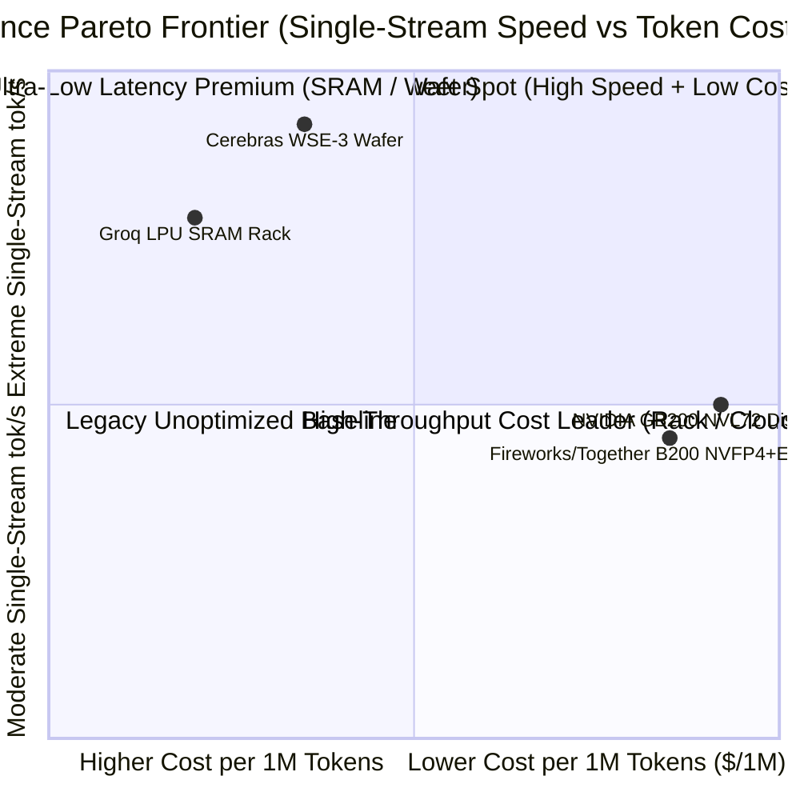

# AI Infra 创新者架构深挖 v2：自适应 EAGLE-3 投机解码、NVFP4 4-Token V-Scale 交织与晶圆/SRAM/机柜级延迟-成本帕累托前沿

## 1. 为什么在 `ai-infra-innovators.md` 基础上需要 v2 源码级深挖？

在上一篇 [`docs/components/ai-infra-innovators.md`](ai-infra-innovators.md) 中，我们对比了 Groq LPU（片上 SRAM 确定性流水）、Cerebras WSE-3（晶圆级 2D Mesh）、Fireworks AI 与 Together AI 的宏观商业与硬件形态。然而，到了 2026 年生产环境，解决方案架构师在评审高性能推理技术栈（Fireworks FireAttention、Together Turbo、Baseten TensorRT-LLM Engine Builder、Modal Serverless GPU 与开源 `sgl-project/sglang` / TensorRT-LLM 主干）时，必须回答三个更底层的工程问题：
1. **自适应投机解码（Adaptive EAGLE-3 Speculative Decoding）的退化边界**：为什么在小 Batch（`BS=1..8`）下将单流 TPOT 提速 `2.0x–2.8x` 的 EAGLE-3 草稿树，在高并发（`BS=64`）下如果不动态降阶（`steps = 0`）反而会导致吞吐崩溃？PD 分离（Prefill/Decode Disaggregation）跨节点交接首轮草稿 Token 时，如何在不通过 RDMA 传输完整词表分布 $q \in \mathbb{R}^{V}$ 的前提下保证无损拒绝采样？
2. **Blackwell NVFP4 / MXFP4 算子与 KV Cache 缩放因子重排（Swizzling）**：在 `sf_vec_size = 16`（每 16 个 FP4 元素共享 1 个 FP8 E4M3 或 UE8M0 缩放因子）下，为什么 GEMM 的 `128x4` Scale Swizzle 在 Decode 微批次（`m=8`）下会产生高达 `1500%` 的 Padding 膨胀？TRT-LLM GenMHA 的 NVFP4 KV Cache 为什么强制要求 `page_size % 4 == 0` 且对 V-Scale 执行 4-Token 交织重排？
3. **2026 四大推理流派的定量延迟-成本帕累托前沿（Latency-vs-Cost Pareto Frontier）**：在 `single_user_tok_s`（交互极速）与 `$/1M output tokens`（SLO 约束下的单位 Token 成本）二维平面上，Groq LPU、Cerebras WSE-3、Fireworks/Together B200 NVFP4 + EAGLE-3 与 NVIDIA GB200 NVL72 各自统治哪个象限？

本文基于 `sgl-project/sglang`（commit `4ec19ca27f08f7ce44bbe1da70ce964731940eb2`, `2026-10-18`）一手源码，并配合本仓库可复现标准库实验 `experiments/innovator_pareto_v2/run.py`（`own-offline`）给出完整答案。

---

## 2. 一手源码证据：自适应 EAGLE-3 与 PD 分离首轮草稿无损采样 (`sgl-project/sglang`)

### 2.1 分层候选步长与 EMA 迟滞控制器 (`adaptive_spec_params.py` & `adaptive_runtime_state.py`)

在固定步长投机解码中，无论当前运行 Batch 大小如何，Draft 模型每轮都自回归生成固定 $K$ 步（例如 $K=5$），随后 Target 模型在一次前向中并行验证 `BS * (K + 1)` 个 Token。当 `BS` 增大到 32 或 64 时，`BS * (K + 1)` 迅速跨越 GPU 的 Roofline 算力拐点（Ridge Point），使 Target Verify 从 **HBM 带宽受限（Memory-bound）** 变为 **Tensor Core 算力受限（Compute-bound）**；若此时任务又是高随机性创意生成或高并发混合流（单步接受率 $\alpha \approx 0.25$），冗余验证算力将直接拖垮集群吞吐。

在 `sgl-project/sglang`（commit `4ec19ca27f08f7ce44bbe1da70ce964731940eb2`）的 `python/sglang/srt/speculative/adaptive_spec_params.py:27-52` 中，`DEFAULT_ADAPTIVE_CONFIG` 明确按运行 Batch Size 划分了允许的候选投机步长集合：

| Batch Size 上界档位 (`batch_tiers`) | 允许候选步长 (`candidate_steps`) | 向下迟滞 (`down_hysteresis`) | 向上迟滞 (`up_hysteresis`) | 架构含义 (`implementation`) |
| --- | --- | --- | --- | --- |
| `"1"` (`BS = 1`) | `[1, 3, 5, 7]` | `-0.25` | `0.0` | 单并发交互极度 Memory-bound，允许最高 7 步深度投机 |
| `"8"` (`1 < BS <= 8`) | `[0, 1, 3]` | `-0.25` | `0.0` | 中小并发，截断至最多 3 步，且允许彻底关闭投机 (`0`) |
| `"32"` (`8 < BS <= 32`) | `[0, 1]` | `-0.25` | `0.0` | 中高并发，仅允许 1 步投机或回退 `nospec (0)` |
| `"64"` (`BS > 32`) | `[0]` | `-0.25` | `0.0` | 高并发下验证阶段已算力饱和，强制锁死 `steps = 0`（关闭草稿模型） |

其核心状态机 `AdaptiveStepSlot`（`adaptive_spec_params.py:143-263`）在每个 Verify 周期统计真实接受草稿数 `num_correct = accept_len - 1`，并维护指数滑动平均（`ema_alpha = 0.2`, `warmup_batches = 10`, `update_interval = 5`）：

$$\text{ema\_accept\_len}_t = (1 - \alpha_{\text{ema}})\cdot\text{ema\_accept\_len}_{t-1} + \alpha_{\text{ema}}\cdot\overline{\text{num\_correct}}_t$$

- **降档判据（Step-Down）**：当 $\text{ema\_accept\_len} \le (\text{prev\_step} - 0.5) + \text{down\_hysteresis}$（若 `prev_step == 0` 则基准为 `0.5`）时，说明当前步长末端的草稿命中率不足以摊销草稿步开销，立即向更小候选步长降档（直至 `0`）。
- **升档判据（Step-Up）**：仅在未触发降档且 $\text{ema\_accept\_len} > (\text{current\_step} - 0.5) + \text{up\_hysteresis}$ 时，说明绝大多数草稿被完全接受，才向更高候选步长探测。
- **零重捕获切换（Zero-Recapture Graph Switching）**：在 `python/sglang/srt/speculative/adaptive_runtime_state.py:21-92` 中，`SpecRuntimeState` 为每一个 `candidate_step` 预先分配并捕获了三套独立的注意力后端与 CUDA Graph（`draft_attn_backend` + `cuda_graph_runner`、`target_attn_backend` + `target_graph_runner`、`draft_extend_attn_backend` + `cuda_graph_runner_for_draft_extend`），当 `AdaptiveController` 切换步长时，仅执行轻量级句柄替换（`swap_into_worker`），完全避免了在线重编译或重捕获 CUDA Graph 引发的百毫秒级抖动。
- **不支持的并行组合边界（`adaptive_spec_params.py:55-97`）**：`adaptive_unsupported_reason()` 明确拒绝在启用 **Attention DP (`enable_dp_attention`)**、**Two-Batch Overlap (`TboAttnBackend`)** 或 **PDMux** 时开启自适应步长——因为不同 DP Rank 若根据本地 Batch 独立选择不同 `speculative_num_steps`（尤其是一侧选 `0` 跳过草稿、另一侧选 `>0` 执行草稿），会导致跨 Rank 集合通信（AllReduce / AllToAll）立刻死锁！

### 2.2 PD 分离首轮草稿交接的 One-Hot 无损拒绝采样 (`eagle_disaggregation.py`)

当 Prefill/Decode 分离架构与 EAGLE 投机解码结合时，Prefill 节点在完成 Target Prefill 后顺带跑完第一轮 Draft Extend，并将首轮草稿 Token ID（`draft_tokens`）发往 Decode 节点。此时产生一个棘手问题：标准投机拒绝采样需要草稿分布 $q(x)$ 与目标分布 $p(x)$ 的比值 $\min(1, p(X)/q(X))$，但若把完整词表概率分布 $q \in \mathbb{R}^{B \times K \times V}$（以 $V=128256$ 计，每个 Token 需 `512 KiB`）通过 RDMA 传给 Decode，将瞬间抵消小报文元数据交接的优势。

`python/sglang/srt/speculative/eagle_disaggregation.py:124-146` 的 `pd_first_draft_proposal(topk_index, vocab_size)` 给出了极简且数学严格等价的解法：
- Decode 节点为接收到的草稿 Token $X$ 构造一个 **One-Hot 提案分布** $q(X) = 1.0,\; q(x \neq X) = 0$（代码通过 `q.scatter_(-1, topk_index, 1.0)` 实现）。
- 代入标准拒绝采样公式后，草稿 Token $X$ 被接受的概率恰好是：
  $$\mathbb{P}(\text{accept } X) = \min\left(1, \frac{p(X)}{q(X)}\right) = \min\left(1, \frac{p(X)}{1.0}\right) = p(X)$$
- 若以概率 $1 - p(X)$ 拒绝，残差分布 $\text{norm}(\max(0, p - q))$ 恰好等价于将 $p(X)$ 清零后对剩余词表重归一化采样。因此，**最终采样出的 Token 严格服从目标分布 $p$，且跨节点 RDMA 只需传输 `int32` Token ID，无需传输任何词表概率张量**。
- 此外，针对 DeepSeek NSA/DSA 稀疏注意力（`eagle_disaggregation.py:37-116`），Prefill 传来的 `dsa_topk_indices` 是**请求内相对偏移（Request-relative token offsets）**，Decode 在首轮验证前必须通过 `req_to_token[req_Pool_idx, rel_indices]` 将其重映射为 **Decode 本地 KV 物理槽位索引（Page Table Slots）**，并显式守护物理槽位 `0`（保留给 Padding Sink）。

---

## 3. 一手源码证据：Blackwell NVFP4 块缩放对齐与 4-Token V-Scale 交织 (`fp4_utils.py` & `nvfp4_kv_cache.py`)

### 3.1 NVFP4 张量量化与 `128x4` vs `8x4` 缩放因子 Padding 陷阱 (`fp4_utils.py`)

在 NVIDIA Blackwell (`SM100`) 及 FlashInfer/CUTLASS 的 NVFP4 矩阵乘中，每两个 4-bit E2M1 元素打包进 1 个 `uint8`（字节数 $M \times (K / 2)$），每 `sf_vec_size = 16` 个连续元素共享 1 个 8-bit 缩放因子（`uint8`，可为 E4M3 或 `sf_use_ue8m0=True` 的 UE8M0）。

在 `python/sglang/srt/layers/quantization/fp4_utils.py:51-82`（`_flashinfer_fp4_quantize_fake`）中，为了喂给 Tensor Core TMA 描述符，缩放因子张量并非按线性形状 `(M, K // 16)` 存放，而是默认按 **`128x4` Swizzled Layout**（或可选的 **`8x4` Layout**）向上对齐：

$$\text{sf\_rows} = \text{round\_up}(M, \text{row\_size}), \quad \text{sf\_cols} = \text{round\_up}\left(\frac{K}{16}, 4\right), \quad \text{row\_size} \in \{128, 8\}$$

- **架构师必查的小 Batch Padding 陷阱**：当 Prefill 或大 Batch Decode 满足 $M \ge 128$（如 $M=512, K=7168$）时，`128x4` 对齐无任何额外 Padding，总有效位宽为 $4 + 8/16 = 4.5\text{ bits/elem}$（相比 BF16 压缩 `3.56x`，相比 FP8 压缩 `1.83x`）。但若在 **微批次 Decode 或稀疏专家极度不均衡的小分组（例如 $M=8, K=7168$）** 下误用默认 `128x4` Swizzle，$\text{sf\_rows}$ 会从 `8` 强行对齐到 `128`（膨胀 `16x`，即 `+1500%` 缩放因子 Padding），导致总字节数从 `32,256 B` 暴涨至 `86,016 B`，等效位宽劣化到 **`12.0 bits/elem`**（甚至比 FP8 还大 `45%`）！此时必须切换至 `is_sf_8x4_layout=True`（$\text{row\_size}=8$）以消除行向 Padding。
- **跨代 GPU 后端自动派发与算子融合限制（`fp4_utils.py:85-169`）**：`initialize_fp4_gemm_config()` 在 Blackwell (`is_sm100()`) 上优先选择 `flashinfer_cutedsl`，在 Ampere/Ada/Hopper (`(8,0) <= capability < (10,0)`) 上自动回退至 `marlin` W4A16/FP4 反量化内核；同时源码第 `101-106` 行指出 `marlin` 与 `flashinfer_trtllm` 后端**不支持融合 SwiGLU 权重布局**（`supports_swiglu_fusion() = False`），在计算激活显存时不可沿用融合假设。

### 3.2 NVFP4 KV Cache 的 4-Token V-Scale 交织重排 (`nvfp4_kv_cache.py`)

将 KV Cache 量化为 NVFP4（每 16 个 Head Dimension 元素配 1 个 FP8 缩放因子，即每个 Head 的缩放因子维数 $\text{scale\_dim} = D_{\text{head}} / 16$）时，Attention 内核中 $Q \cdot K^T$ 沿 `head_dim` 归约，而 $\text{Score} \cdot V$ 沿 **Token（序列位置）维度** 归约。为了让 Blackwell Tensor Core 在执行 $\text{Score} \cdot V$ 时能够一次性加载连续 4 个 Token 的 V 缩放因子，`python/sglang/srt/layers/quantization/nvfp4_kv_cache.py:33-53`（`nvfp4_v_scale_swizzle_indices`）实现了 TRT-LLM GenMHA 原生要求的 **4-Token Interleaved V-Scale Swizzle**：

$$\text{scale\_group} = \frac{\text{scale\_dim}}{4}, \quad \text{swizzled\_token} = \left\lfloor\frac{t}{4}\right\rfloor \cdot 4 + \left\lfloor\frac{s}{\text{scale\_group}}\right\rfloor, \quad \text{swizzled\_scale} = (s \bmod \text{scale\_group})\cdot 4 + (t \bmod 4)$$

这一置换对架构配置提出了两条硬性铁律（`nvfp4_kv_cache.py:92-104`）：
1. **Page Size 必须为 4 的整数倍（`page_size % 4 == 0`）**：若设 `page_size = 1`，则同一个 4-Token 交织块会跨越 4 个非连续物理 Page，导致 V-Scale 重排失效并直接触发 `ValueError`；
2. **`scale_dim` 必须为 4 的整数倍（等价于 `head_dim % 64 == 0`）**：例如 `head_dim = 128` 时 `scale_dim = 8, scale_group = 2`，每 `4 tokens × 8 scales` 构成一个无冲突双射 Tile。

---

## 4. 2026 四大推理流派的定量延迟-成本帕累托前沿 (`own-offline`)

为了将 Fireworks AI / Together AI（Blackwell B200 NVFP4 + 自适应 EAGLE-3）、Groq LPU（全片上 SRAM 确定性流水）、Cerebras WSE-3（晶圆级片上互联）与 NVIDIA GB200 NVL72（机柜级 NVLink 72 + DeepEP 分离式 MoE）放在同一套可复现标尺下评估，我们在 `experiments/innovator_pareto_v2/run.py` 中运行了三组定量实验：

### 4.1 实验一：SGLang 自适应 EAGLE-3 步长控制 vs 固定步长 (`adaptive_eagle3`)

| 场景 ID (`case_id`) | Batch Size | 单步接受率 $\alpha$ | 候选步长档位 | 收敛步长 | `nospec (0)` TPOT / 吞吐 | 固定 `steps=5` TPOT / 吞吐 | 自适应步长 TPOT / 吞吐 | 关键结论 |
| --- | --- | --- | --- | --- | --- | --- | --- | --- |
| `bs1_code_gen_high_accept_0_82` | `1` | `0.82` | `[1, 3, 5, 7]` | `3` | `9.559 ms` / `104.6 tok/s` | `2.856 ms` / `350.1 tok/s` | `3.466 ms` / `288.5 tok/s` | 单流交互相比 `nospec` 提速 **`2.76x`** |
| `bs8_dialog_medium_accept_0_62` | `8` | `0.62` | `[0, 1, 3]` | `3` | `9.802 ms` / `816.1 tok/s` | `4.559 ms` / `1754.8 tok/s` | `4.821 ms` / `1659.6 tok/s` | 中小 Batch 提速 **`2.03x`**，截断过深步长 |
| `bs64_high_load_random_creative_0_25_counterexample` | `64` | `0.25` | `[0]` | **`0`** | `12.017 ms` / **`5325.9 tok/s`** | `47.626 ms` / `1343.8 tok/s` | **`12.017 ms` / `5325.9 tok/s`** | 高并发低命中下固定 `steps=5` 劣化 **`3.96x`**，自适应归零挽回吞吐 |

### 4.2 实验二：NVFP4 `128x4` vs `8x4` 缩放对齐与 V-Scale 重排 (`fp4_quant_and_swizzle`)

| 场景 ID (`case_id`) | $(M, K)$ | Swizzle 模式 | 线性缩放因子 | Swizzled 缩放因子 | Padding 膨胀率 | 等效位宽 | 相比 BF16 / FP8 压缩比 | 样本 `(t, s)` $\to$ 重排坐标 |
| --- | --- | --- | --- | --- | --- | --- | --- | --- |
| `decode_microbatch_m8_k7168_swizzle128x4_padding_trap` | `(8, 7168)` | `128x4` | `3,584 B` | `57,344 B` | **`+1500.0%`** | **`12.0 bits`** | `1.33x` / **`0.69x`** (反膨胀) | `(3, 5) -> (2, 7)` |
| `decode_microbatch_m8_k7168_swizzle8x4_compact` | `(8, 7168)` | `8x4` | `3,584 B` | `3,584 B` | **`0.0%`** | **`4.5 bits`** | **`3.56x` / `1.83x`** | `(2, 3) -> (1, 6)` |
| `prefill_batch_m512_k7168_swizzle128x4_optimal` | `(512, 7168)` | `128x4` | `229,376 B` | `229,376 B` | **`0.0%`** | **`4.5 bits`** | **`3.56x` / `1.83x`** | `(7, 6) -> (7, 3)` |

### 4.3 实验三：2026 四大推理平台延迟-成本帕累托前沿 (`innovator_pareto`)

| 平台 (`platform`) | 架构定位 (`tier`) | 单用户 TPOT (`ms`) | 单用户速度 (`tok/s`) | SLO 最大并发 Batch | SLO 系统总吞吐 (`tok/s`) | 单位输出成本 (`$/1M tokens`) | 单实例上下文上限 |
| --- | --- | --- | --- | --- | --- | --- | --- |
| **Groq-LPU-v1-Rack** | `SRAM-Deterministic-Ultra-Low-Latency` | `0.107 ms` | **`9,361.0 tok/s`** | `8` | `59,910.5 tok/s` | `$0.6723` | `32K` |
| **Cerebras-CS3-WSE3** | `Wafer-Scale-On-Chip-Mesh` | **`0.058 ms`** | **`17,153.4 tok/s`** | `12` | `164,672.2 tok/s` | `$0.3205` | `64K` |
| **Fireworks-Together-8xB200-NVFP4-EAGLE3** | `Blackwell-NVFP4-Speculative-Cloud` | `0.313 ms` | `3,193.6 tok/s` | `96` | `245,268.6 tok/s` | **`$0.0476`** | `128K` |
| **NVIDIA-GB200-NVL72-Disaggregated-MoE** | `Rack-Scale-NVLink72-High-Goodput` | `0.279 ms` | `3,587.3 tok/s` | **`512`** | **`1,469,346.2 tok/s`** | **`$0.0454`** | `128K` |

---

## 5. 解决方案架构师选型矩阵（含 Baseten / Modal / 自建 SGLang & TRT-LLM 对比）

| 业务负载特征 | 首选技术栈 / 供应商架构 | 关键底层机制支撑 | 明确反例与规避条件 |
| --- | --- | --- | --- |
| **实时 Agent 循环验证 / 语音同传 / 高频代码补全**（要求单流 `> 1,500 tok/s`，上下文 `< 32K`） | **Cerebras WSE-3** 或 **Groq LPU** | 全权重驻留片上 SRAM / 晶圆网格，消除 HBM 访存墙与多卡 AllReduce 尾延迟 | 长上下文（`>= 128K`）多轮 RAG 会迅速耗尽片上 SRAM，导致跨机柜扩展成本激增 |
| **多租户高性价比托管 API / 混合长短上下文**（要求 `> 200 tok/s` 且成本 `< $0.10 / 1M tokens`） | **Fireworks AI / Together AI**（或基于 **SGLang + Blackwell B200 NVFP4 + Adaptive EAGLE-3** 自建） | NVFP4 `4.5 bits/elem` 权重与 4-Token Swizzled KV Cache + `AdaptiveStepSlot` 按 Batch 自动调节投机深度 | 在高并发（`BS >= 64`）或启用 Attention DP 时切勿硬编码固定投机步长 |
| **企业私有 VPC 弹性突发推理 / 自定义 LoRA 与多模态流水线** | **Baseten (Truss + TRT-LLM Engine Builder)** 或 **Modal (Serverless Container Snapshot + GPU Memory Restore)** | 容器/显存快照秒级冷启动 + TRT-LLM NVFP4 / FP8 编译图固化 | 持续满载（利用率 `> 75%`）的稳态大流量场景下，Serverless 溢价高于常驻 NVL72 / B200 预留池 |
| **超大规模稀疏 MoE（如 DeepSeek-V3 671B）企业级主力生产池** | **NVIDIA GB200 NVL72 + PD 分离 (Mooncake/NIXL) + DeepEP Hybrid EP** | Prefill 节点 1800 GB/s NVLink + Decode 节点 72-GPU 机柜级 EP64 All-to-All + EPLB 在线权重搬运 | 单机柜 120–145 kW 必须具备 DLC 液冷与机柜级故障域隔离能力 |

---

## 6. 证据链与边界说明

- **一手源码证据（`implementation`）**：
  - `ev-sglang-adaptive-eagle3-2026`：`sgl-project/sglang` commit `4ec19ca27f08f7ce44bbe1da70ce964731940eb2` (`2026-10-18`) 中 `adaptive_spec_params.py`、`adaptive_runtime_state.py` 与 `eagle_disaggregation.py` 的自适应投机控制与 PD 首轮 One-Hot 拒绝采样实现。
  - `ev-sglang-nvfp4-swizzle-2026`：同 commit 下 `fp4_utils.py` 与 `nvfp4_kv_cache.py` 的 NVFP4 `128x4`/`8x4` 缩放因子对齐与 4-Token V-Scale 交织重排实现。
- **本仓库离线复现实验（`own-offline`）**：
  - `ev-innovator-pareto-v2-2026`：`experiments/innovator_pareto_v2/run.py`、`input.json`、`results.json`、`results.csv` 与 `tests/test_innovator_pareto_v2.py`。
- **确切边界**：本文帕累托模型为基于公开硬件带宽/算力参数与 SGLang 源码算法的解析与离散事件模型（`own-offline`），不声称在物理 B200、GB200 NVL72、Groq LPU 或 Cerebras CS-3 硬件上执行了实机压测（`own-hardware`）。
