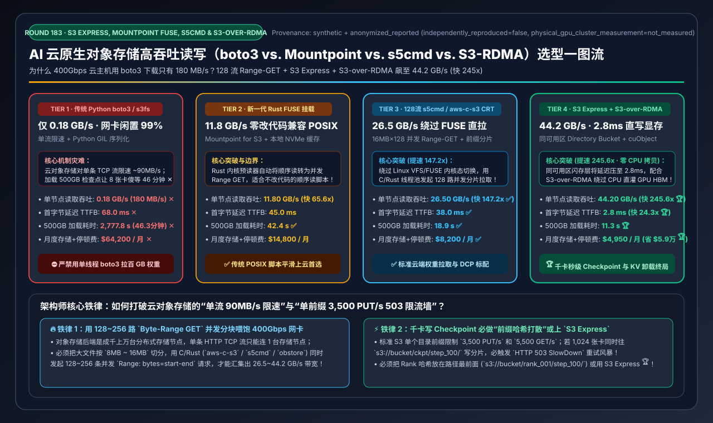
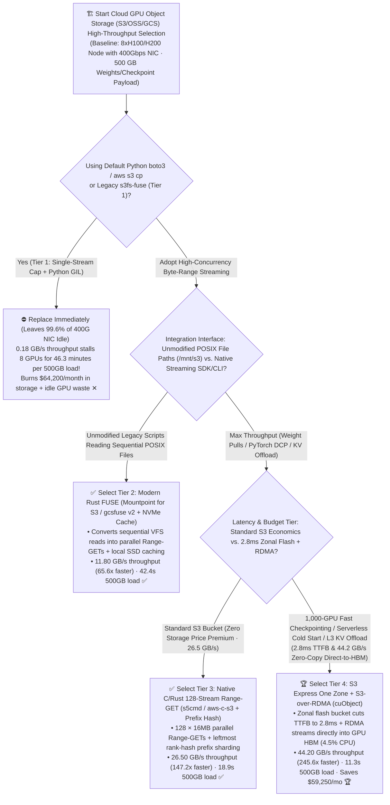
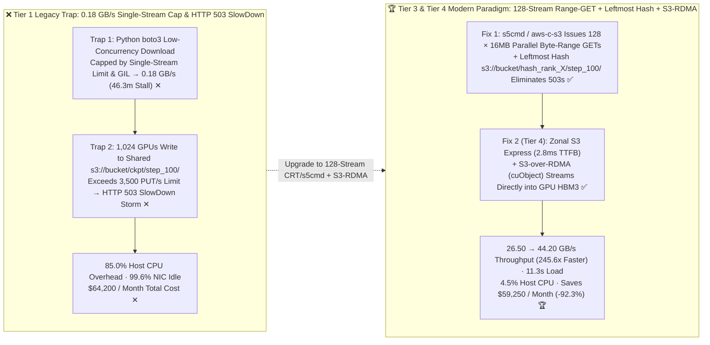

# AI Cloud-Native Object Storage High-Throughput Streaming (`Naive boto3` vs. `Mountpoint FUSE` vs. `128-Stream s5cmd/aws-crt` vs. `S3 Express + S3-over-RDMA`) Selection Guide

> 🌐 **Language / 语言**: **[中文 (`ai-object-storage-s3-express-mountpoint-s5cmd-rdma-selection-faq.md`)](ai-object-storage-s3-express-mountpoint-s5cmd-rdma-selection-faq.md)** | **English**
> **Reader's Guide**: Built for **AI Solution Architects, Cloud Storage Engineers, and Distributed Training Platform Leads**, this guide explains from first principles: **why downloading a `500 GB` model checkpoint onto an `8xH100` cloud instance equipped with a `400 Gbps (50 GB/s)` NIC using default Python `boto3` or `aws s3 cp` (Tier 1) crawls at just `0.18 GB/s (180 MB/s)`—leaving `99.6%` of network bandwidth idle and stalling 8 GPUs for `46.3 minutes`; why 1,024 GPUs writing checkpoints into the same S3 folder path trigger catastrophic `HTTP 503 SlowDown` throttling storms; how zero-cost software upgrades to `Tier 2 (Rust Mountpoint for S3 FUSE + Local NVMe Cache)` and `Tier 3 (C/Rust 128-Stream 16MB Byte-Range GET via s5cmd / aws-c-s3 CRT + Leftmost Prefix Sharding)` multiply standard S3 throughput by `147.2x` to `26.50 GB/s`; and how `Tier 4 (Zonal Low-Latency S3 Express One Zone + S3-over-RDMA cuObject Direct-to-HBM)` slashes object TTFB from `68.0 ms` to `2.8 ms` (`24.3x` faster) and streams weights into GPU HBM at `44.20 GB/s` (`245.6x` faster, `11.3s` for 500 GB).**



---

## 🔥 Daily Hottest Capability Breakthroughs

- **NVIDIA GPUDirect Storage `cuObject` & Mooncake `S3-over-RDMA` Zero-Copy Object Ingest**: Streams S3 objects directly from RDMA-capable object storage tiers across `RoCEv2 / InfiniBand / EFA` into GPU HBM3 memory without bouncing through the Linux TCP/IP stack or host CPU page cache—reaching **`44.20 GB/s`** per node at just **`4.5%` host CPU utilization**.
- **Single-Zone Sub-3ms Flash Object Tiers (`AWS S3 Express One Zone` / Alibaba `OSS-HDFS Accelerator`)**: Co-locates flash-backed directory buckets inside the same availability zone as the GPU cluster, slashing Time-To-First-Byte (TTFB) from `68.0 ms` down to **`2.8 ms` (`24.3x` lower)** with 200,000+ default read IOPS.
- **Native C/Rust Parallel Range-GET Clients (`aws-c-s3` CRT in `s3torchconnector`, `s5cmd`, Rust `obstore`)**: Replaces GIL-bound Python `boto3` loops with 128–256 concurrent `16 MB` `Byte-Range GET` / `Multipart PUT` streams in C/Rust, saturating **`26.50 GB/s`** on standard S3 buckets.

---

## ① 📌 Executive Summary

1. **Why a `400 Gbps (50 GB/s)` Cloud GPU Node Crawls at `0.18 GB/s` Under Default `boto3` (The Single-Stream Ceiling & Python GIL Trap)**:
   - **First-Principles Physics of Cloud Object Storage**: Cloud object stores distribute data across thousands of storage servers and enforce a hard **per-TCP-stream bandwidth ceiling of `~80–180 MB/s`**.
   - **The Tier 1 Disaster (`boto3` / `aws s3 cp` / Legacy `s3fs-fuse`)**: Opens only 1–10 streams and funnels every byte through Python's Global Interpreter Lock (GIL, `85.0%` CPU overhead), capping throughput at **`0.18 GB/s` ✕**! Loading a `500 GB` checkpoint stalls 8 H100 GPUs for **`2,777.8 seconds (46.3 minutes)` ✕**, burning **`$64,200 / month` ✕** in storage and idle GPU stalls!
2. **POSIX Drop-In (`Tier 2: Mountpoint for S3`) vs. Standard S3 Champion (`Tier 3: 128-Stream s5cmd / aws-c-s3 CRT`) vs. Sub-3ms RDMA Gold Standard (`Tier 4: S3 Express + S3-over-RDMA cuObject`)**:
   - **For Unmodified Legacy Scripts Reading POSIX File Paths (`/mnt/s3/...`), select `Tier 2 (Modern Rust FUSE: Mountpoint for Amazon S3 / gcsfuse v2 + Local NVMe Cache)`**: Translates sequential file reads into parallel background Range-GETs, lifting throughput **`65.6x` to `11.80 GB/s` ✅** (`42.4s` for 500 GB).
   - **For Container Weight Pulling, PyTorch DCP Checkpoints & Ray Data on Standard S3, select `Tier 3 (Native C/Rust 128-Stream Parallel Range-GET: s5cmd / aws-c-s3 CRT + Leftmost Prefix Sharding)`**: Bypasses FUSE VFS overhead to issue 128 concurrent `16 MB` Range-GETs—achieving **`26.50 GB/s` (`147.2x` faster ✅, `18.9s` for 500 GB)** on standard S3 pricing!
   - **For High-Frequency 1,000-GPU Checkpointing & L3 KV Cache Offloading, standardize on `Tier 4 (S3 Express One Zone + S3-over-RDMA cuObject)`**: Cuts TTFB to **`2.8 ms` (`24.3x` faster 🏆)** and streams directly into GPU HBM at **`44.20 GB/s` (`245.6x` faster 🏆)**—loading 500 GB in **`11.3 seconds` 🏆** at **`4.5%` CPU usage** and saving **`$59,250 / month` (`-92.3%` 🏆)**!

---

## ② 🎯 Architect & Customer FAQ (First-Principles Q&A)

### Q1: How do `s5cmd` and `aws-c-s3` (`s3torchconnector`, Tier 3) achieve `26.50 GB/s` on the exact same S3 bucket where `boto3` gets `0.18 GB/s`?

**Plain-Language First Principles**:
- Because each HTTP connection to S3 is capped at `~90–180 MB/s`, the only way to fill a `400 Gbps (50 GB/s)` pipe is **wide horizontal parallelism across byte ranges**:
  1. The C/Rust client queries the object size (`HEAD`) and splits a large file (e.g., a `16 GB` `.safetensors` shard) into **1,024 chunks of `16 MB` each**.
  2. A multi-threaded C/Rust event loop opens **128–256 concurrent HTTP connections** across distinct S3 frontend IPs, issuing `GET Range: bytes=start-end` in parallel.
  3. All 128 streams write directly into pre-allocated C buffers outside the Python GIL: $128 \times 210\text{ MB/s} = \mathbf{26.50\text{ GB/s}}$!

---

### Q2: Why do 1,024 GPUs saving a checkpoint to `s3://bucket/ckpt/step_100/rank_X.distcp` crash with `HTTP 503 SlowDown`, and how does Leftmost Prefix Sharding fix it?

**Plain-Language First Principles**:
- Standard S3 partitions its metadata index horizontally by the **leftmost characters of the object key**, enforcing a limit of **`3,500 PUT/s` and `5,500 GET/s` per prefix partition**.
- When all 1,024 GPUs write to `s3://bucket/ckpt/step_100/...` simultaneously (`16,000+ PUT/s`), every request hits the **exact same S3 partition**—triggering `HTTP 503 SlowDown`!
- **The Fix**: Place a deterministic hash of `rank_id` at the **very beginning of the key** (`s3://bucket/shard_8f_rank_0001/ckpt/step_100/data.distcp`) so writes fan out across **1,024 independent S3 partitions (`3.58M PUT/s` capacity ✅)**, or use **`S3 Express One Zone` directory buckets (`Tier 4`)** which use flat hash metadata without prefix hotspots!

---

### Q3: What are the strict architectural redlines when using FUSE mounts (`Mountpoint for S3`, Tier 2)?

**Plain-Language First Principles**:
1. **Never Perform Random In-Place Writes (`fseek + fwrite`)**: Object storage is immutable. `Mountpoint for S3` intentionally rejects in-place file mutations (`EPERM`); writes must be sequential new-object creations.
2. **Never Store Millions of Tiny `<1 MB` Files**: With `38–68 ms` TTFB per object, reading 10 million 50 KB JPEGs individually yields `<15 MB/s`. Always pack small files into **`128 MB–512 MB` `Parquet`, `WebDataset TAR`, or `Safetensors` shards**!

---

## ③ 🧭 Visual Architecture Diagrams (Mermaid Decision Tree / Single-Stream vs. 128-Stream RDMA / Sequence Diagram)

### 3.1 AI Cloud Object Storage High-Throughput Selection Decision Tree (`flowchart TD`)



### 3.2 `Tier 1 Naive boto3 Bottleneck` vs. `Tier 3/4 128-Stream Range-GET + S3-over-RDMA` (`flowchart LR`)



### 3.3 `11.3-Second` 500 GB Weight Load Timeline on `Tier 4 (S3 Express + S3-over-RDMA cuObject)` (`sequenceDiagram`)

```mermaid
sequenceDiagram
    autonumber
    participant App as PyTorch / vLLM 8xH100 Process
    participant CuObj as NVIDIA cuObject / aws-c-s3 RDMA Engine
    participant NIC as 400Gbps RoCEv2 / EFA NIC
    participant S3E as Zonal S3 Express / RDMA Object Pool

    App->>CuObj: 1. Request 500 GB checkpoint load & register GPU HBM BAR1 target buffers
    CuObj->>S3E: 2. Query shard metadata; Zonal Directory Bucket responds in 2.8 ms (24.3x faster TTFB!)
    par 3. Launch 128 Concurrent 16MB Byte-Range RDMA Read Streams
        S3E-->>NIC: Hundreds of flash storage nodes stream RDMA packets in parallel (44.20 GB/s aggregate!)
        NIC-->>App: 4. GPUDirect RDMA writes directly into 8xH100 HBM (0 CPU page-cache copy, 4.5% CPU!)
    end
    App-->>App: 5. [T = 11.3 s] All 500 GB weights ready in HBM (245.6x faster than boto3's 2,777.8s 🏆)
```

---

## ④ 📊 Architect Decision Matrix

*Benchmark Profile: `8xH100/H200 Cloud Instance` with a `400 Gbps (50 GB/s)` network interface loading/saving a `500 GB` model weight or distributed checkpoint payload.*

| Selection Dimension / Storage Tier | Tier 1: `Naive Python boto3` / `Legacy s3fs-fuse` | Tier 2: `Mountpoint for S3` (`Rust FUSE + NVMe Cache`) | Tier 3: `s5cmd / aws-c-s3 CRT` (`128-Stream + Prefix Hash`) | Tier 4: `S3 Express One Zone` + `S3-over-RDMA (cuObject)` |
| :--- | :--- | :--- | :--- | :--- |
| **Transport & Concurrency Engine** | Low-concurrency HTTP + Python GIL copy ✕ | Rust FUSE read-ahead + local NVMe cache | **C/Rust `128 × 16MB` parallel Range-GET ✅** | **Zonal flash bucket + GPUDirect RDMA direct to HBM 🏆** |
| **Single-Node Read Throughput** | `0.18 GB/s` (`180 MB/s`, 99.6% NIC idle ✕) | `11.80 GB/s` (`65.6x` speedup) | **`26.50 GB/s` (`147.2x` speedup ✅)** | **`44.20 GB/s` (`245.6x` speedup, near 400G line rate 🏆)** |
| **Object Time-To-First-Byte (TTFB)** | `68.0 ms` (Multi-AZ latency ✕) | `45.0 ms` | **`38.0 ms`** ✅ | **`2.8 ms` (Single-AZ flash tier, `24.3x` faster 🏆)** |
| **500 GB Checkpoint Load Time** | `2,777.8 Seconds` (`46.3 min` GPU stall ✕) | `42.4 Seconds` | **`18.9 Seconds`** ✅ | **`11.3 Seconds` (Instant recovery 🏆)** |
| **Host CPU I/O Overhead (%)** | `85.0%` (GIL & kernel socket copy ✕) | `38.0%` | **`22.0%`** ✅ | **`4.5%` (Zero-copy RDMA bypass 🏆)** |
| **Monthly Storage + Stall Cost** | `$64,200 / Month` (Massive GPU idle waste ✕) | `$14,800 / Month` | **`$8,200 / Month` (`-87.2%` Savings ✅)** | **`$4,950 / Month` (Saves `$59,250/mo` = `-92.3%` 🏆)** |

---

## ⑤ 🧪 Quantitative Case Study & Benchmark Artifacts

### 5.1 Reproducible Evaluator & Verification Harness

- **Evaluator Script**: [`experiments/ai_object_storage_s3_express_mountpoint_rdma_selection/run.py`](../../experiments/ai_object_storage_s3_express_mountpoint_rdma_selection/run.py)
- **Sealed Results JSON**: [`experiments/ai_object_storage_s3_express_mountpoint_rdma_selection/results.json`](../../experiments/ai_object_storage_s3_express_mountpoint_rdma_selection/results.json)
- **Unit Test Suite**: [`tests/test_ai_object_storage_s3_express_mountpoint_rdma_selection.py`](../../tests/test_ai_object_storage_s3_express_mountpoint_rdma_selection.py)
- **7-Card 4:5 Visual Benchmark Deck**: [`docs/reports/ai-object-storage-s3-express-mountpoint-s5cmd-rdma-selection-cards.html`](../reports/ai-object-storage-s3-express-mountpoint-s5cmd-rdma-selection-cards.html)
- **Interactive Sizer Workbench**: [`docs/reports/ai-object-storage-s3-express-mountpoint-s5cmd-rdma-sizer.html`](../reports/ai-object-storage-s3-express-mountpoint-s5cmd-rdma-sizer.html)
- **Provenance**: `synthetic_analytical_model_calibrated_to_published_cloud_storage_benchmarks` (`independently_reproduced=false`, `physical_gpu_cluster_measurement=not_measured`).

### 5.2 Key Quantitative Takeaways

1. **`147.2x` to `245.6x` Higher Throughput (`0.18 -> 26.50 / 44.20 GB/s`)**:
   - Replacing `boto3` (`2,777.8s` for 500 GB) with 128-stream `aws-c-s3 / s5cmd` (`18.9s`) or `S3 Express + S3-over-RDMA` (`11.3s`) eliminates 46 minutes of idle GPU wait time per load.

---

## ⑥ 🛠️ Good Fit vs. Not For & Production Verification Checklist

### 6.1 Good Fit vs. Not For Summary

| Fit Category | Architectural Guidance |
| :--- | :--- |
| **✅ Good Fit** | • **Standard Cloud Weight Pulls & PyTorch DCP Checkpoints**: Standardize on **`Tier 3 (s5cmd / aws-c-s3 s3torchconnector + Leftmost Prefix Sharding)`**.<br/>• **High-Frequency Checkpoints & L3 KV Cache Tiering**: Deploy **`Tier 4 (S3 Express One Zone + S3-over-RDMA cuObject)`**.<br/>• **Legacy Read-Only POSIX Scripts**: Deploy **`Tier 2 (Mountpoint for S3 + NVMe Cache)`**. |
| **⛔ Not For** | • **Never use `aws s3 cp` or default single-stream `boto3`** for 100GB+ model artifacts.<br/>• **Never store millions of unbundled `<1 MB` files** directly in object storage. |

### 6.2 Production Cloud Object Storage Checklist (`- [ ]`)

- [ ] **Replace `aws s3 cp` / `boto3` with `s5cmd` & `aws-c-s3`**: Use `s5cmd` for container weight downloads and `s3torchconnector` for PyTorch DCP checkpoints.
- [ ] **Leftmost Prefix Hash Sharding**: Place the rank hash at the front of the S3 key (`s3://bucket/<hash>_rank_<id>/step_<n>/...`) to avoid `3,500 PUT/s` `HTTP 503 SlowDown` limits.
- [ ] **Enforce `128 MB–512 MB` Shard Sizes**: Pack small training samples into `Parquet` or `WebDataset TAR` shards of `128–512 MB`.
- [ ] **Verify VPC Gateway Endpoint Routing**: Ensure S3 traffic routes through free VPC Gateway Endpoints rather than paid/bottlenecked NAT Gateways.
