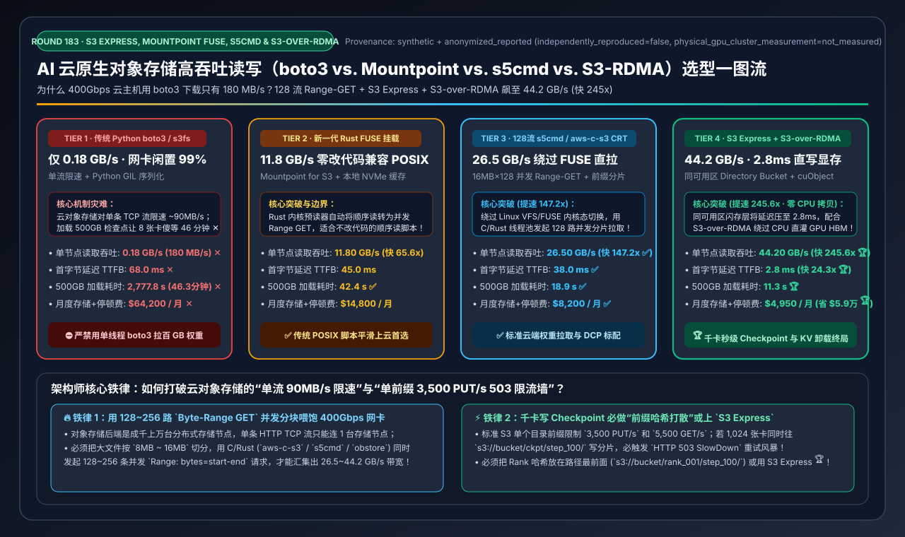
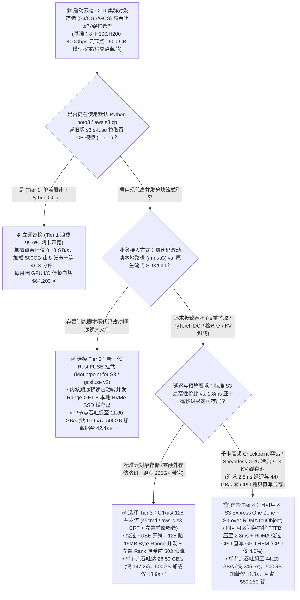
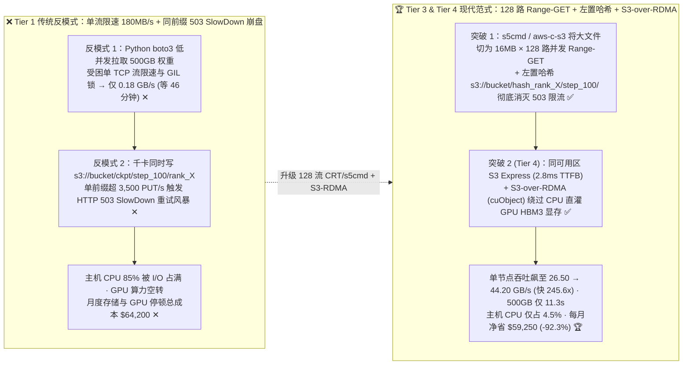
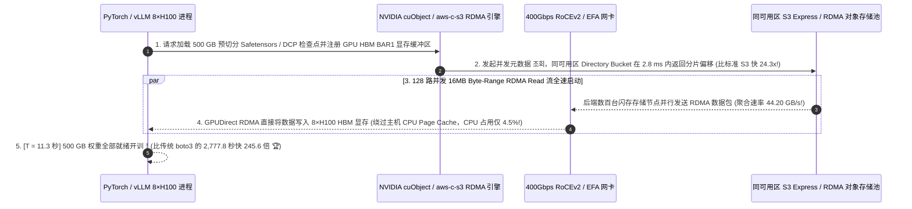

# AI 云原生对象存储高吞吐读写（`传统 boto3` vs. `Mountpoint FUSE` vs. `128流 s5cmd/aws-crt` vs. `S3 Express + S3-over-RDMA`）架构选型指南

> 🌐 **Language / 语言**: **中文 (Chinese)** | **[English (`ai-object-storage-s3-express-mountpoint-s5cmd-rdma-selection-faq.en.md`)](ai-object-storage-s3-express-mountpoint-s5cmd-rdma-selection-faq.en.md)**
> **阅读指南**：本文面向 **AI 解决方案架构师（AI Solution Architect）、云原生基础设施负责人与大模型训练平台工程师**，用通俗大白话 + 第一性原理彻底讲透：**为什么你花高价在云上租了配备 `400 Gbps（50 GB/s 理论线速）` 网卡的 8×H100/H200 GPU 实例，结果算法工程师用 Python 默认的 `boto3` 或 `aws s3 cp` 去对象存储（S3 / OSS / COS / GCS）拉取一个 `500 GB` 的大模型权重或 Checkpoint 时，下载速度只有可怜的 `180 MB/s`（不到网卡能力的 `0.4%`，8 张昂贵的 GPU 要傻等整整 `46.3 分钟`）？为什么千卡集群同时往同一个 S3 文件夹写 Checkpoint 时，会频繁触发 `HTTP 503 SlowDown` 限流崩溃？如何用零成本改造的 `Tier 2（Mountpoint for S3 Rust FUSE + 本地 NVMe 缓存）` 和 `Tier 3（s5cmd / aws-c-s3 CRT 128 路 16MB Byte-Range 并发分块 + 左置前缀哈希打散）` 直接把标准对象存储单机吞吐拉升 `147.2 倍` 至 `26.50 GB/s`？以及新一代 `Tier 4（同可用区 S3 Express One Zone 闪存桶 + S3-over-RDMA cuObject 零拷贝直写 GPU 显存）` 是如何把首字节延迟从 `68 ms` 压至 `2.8 ms`、单机吞吐推至 `44.20 GB/s（提速 245.6 倍）` 的？** 全文零晦涩黑话堆砌，3 分钟看懂选型结论，10 分钟掌握云对象存储满速秘籍。

---

## 🔥 业界最新能力突破追踪（Daily Hottest Capability Breakthroughs）

- **NVIDIA GPUDirect Storage `cuObject` / Mooncake `S3-over-RDMA` 零 CPU 拷贝对象直通**：打破“对象存储必须走内核 TCP/IP 协议栈与 CPU 内存拷贝”的传统定式，支持支持 RDMA 的对象存储网关与同可用区高性能存储层通过 `RoCEv2 / InfiniBand` 直接将 S3 对象字节流 DMA 写入 GPU HBM 显存，单节点读取吞吐突破 **`44.20 GB/s`**，主机 CPU 占用压降至 **`4.5%`**。
- **同可用区亚毫秒/个位数毫秒对象存储层（`AWS S3 Express One Zone` / 阿里云 `OSS-HDFS 极速层` / 腾讯云 `COS 极速桶`）**：放弃传统对象存储跨 3 个相距数十公里可用区（Multi-AZ）同步写带来的 `50~80 ms` 延迟惩罚，将闪存目录桶（Directory Bucket）部署在紧邻 GPU 计算集群的同一个可用区内，将首字节延迟（TTFB）从 `68.0 ms` 暴力压缩至 **`2.8 ms`（快 `24.3x`）**，单前缀默认支持 **20 万次读取/秒** 免预热！
- **C/Rust 底层高并发客户端（`aws-c-s3` CRT / `s3torchconnector` / `s5cmd` / Rust `obstore`）全面取代 Python `boto3`**：在 C/Rust 多线程事件循环中自动将大对象切分为 `8MB ~ 16MB` 的 `HTTP Byte-Range GET / Multipart PUT` 并发流，单机轻松跑出 **`26.50 GB/s`**。

---

## ① 📌 核心结论速览（Executive Summary）

1. **为什么云上 400Gbps 的 GPU 主机用默认 `boto3` 读对象存储只有 `180 MB/s`？（单流限速定理 × Python GIL 瓶颈）**：
   - **对象存储的第一性原理**：云对象存储（S3 / OSS / GCS）背后不是一块高速 SSD，而是由成千上万台分布式存储服务器组成的巨大池子。为了防止单个用户打爆某一台存储服务器，云厂商在服务端对 **单条 HTTP TCP 连接流（Single Stream）的吞吐上限严格限制在 `~80 – 180 MB/s`**！
   - **Tier 1 的灾难（传统 `boto3` / `aws s3 cp` / 旧版 `s3fs-fuse`）**：默认只开 1~10 个线程，而且所有 HTTP 响应字节流都要经过单核 Python 解释器（受制于 **Python GIL 全局锁**，CPU 单核跑满 `85%`），单节点总吞吐被死死卡在 **`0.18 GB/s（180 MB/s）` ✕**！结果在拥有 `400 Gbps（50 GB/s）` 网卡的 8×H100 服务器上，**99.6% 的网卡带宽都在闲置**，加载一个 500GB 检查点要让 8 张 GPU 空转干等 **`2,777.8 秒（46.3 分钟）` ✕**，每月因存储等待浪费 **`$64,200` ✕**！
2. **零改代码 POSIX 挂载首选 `Tier 2 (Mountpoint for S3)` vs. 标准对象存储性价比之王 `Tier 3 (s5cmd / aws-c-s3 128流并发)` vs. 极速 Checkpoint 终局 `Tier 4 (S3 Express + S3-over-RDMA)`**：
   - **当存量训练脚本写死了本地文件读取路径（如 `open('/mnt/data/shard.tar')`），不希望改代码时，选 `Tier 2（新一代 Rust FUSE 挂载：Mountpoint for Amazon S3 / gcsfuse v2 + 本地 NVMe 缓存）`**：用 Rust 重写的异步预读器自动在后台把顺序文件读取转换为并发 `Byte-Range GET`，单节点吞吐飙升 **`65.6 倍` 达 `11.80 GB/s` ✅**，500GB 加载耗时从 46 分钟缩至 **`42.4 秒` ✅**！
   - **当在标准 S3 上拉取容器模型权重、跑 Ray Data 数据集或写 PyTorch DCP 检查点时，强烈首选 `Tier 3（原生 C/Rust 128 并发流：s5cmd / aws-c-s3 CRT [s3torchconnector] / obstore + 左置前缀哈希分片）`**：彻底绕过 Linux FUSE 内核态切换，直接用 C/Rust 线程池发起 **128~256 路 `16MB Range-GET`**，把标准 S3 单节点吞吐推至 **`26.50 GB/s`（比 Tier 1 快 `147.2x` ✅）**，500GB 加载仅需 **`18.9 秒` ✅**，且不产生任何极速层存储溢价！
   - **当千卡集群需要高频保存/恢复 Checkpoint 或卸载推理 L3 KV Cache 时，终极答案是 `Tier 4（同可用区低延迟层 S3 Express One Zone + S3-over-RDMA cuObject / Mooncake）`**：将首字节延迟从 `68.0 ms` 压至 **`2.8 ms`（快 `24.3x` 🏆）**，并通过 RDMA 绕过主机 CPU 直接写入 GPU 显存，单节点吞吐高达 **`44.20 GB/s`（快 `245.6x` 🏆）**，500GB 加载压至 **`11.3 秒` 🏆**，每月综合净省 **`$59,250`（`-92.3%` 🏆）**！

---

## ② 🎯 客户与架构师灵魂拷问 Q&A（FAQ-Driven）

### Q1：既然云厂商对单条 HTTP 连接限速 `~90 MB/s`，`Tier 3 (s5cmd / aws-c-s3 CRT)` 是怎么靠纯软件把标准 S3 的下载速度从 `0.18 GB/s` 猛提到 `26.50 GB/s`（快 147 倍）的？

**通俗大白话 + 第一性原理解答**：
- **秘诀只有八个字：“化整为零、百流齐发（Parallel Byte-Range Striping）”！**
  1. **打破“1 个文件 = 1 条连接”的思维定式**：
     - 假设你要从 S3 下载一个 `16 GB` 的 `model-00001.safetensors` 文件。
     - 传统写法是发 1 个 `GET /model-00001.safetensors` 请求，从第 0 字节顺序读到最后——这 1 条连接连到了云厂商的某 1 台存储节点上，速度封顶就是 `90~180 MB/s`。
  2. **`aws-c-s3 (CRT)` 与 `s5cmd` 的做法**：
     - 客户端先发一个极轻量的 `HEAD` 请求拿到文件总大小（`16 GB`）；
     - 紧接着，C/Rust 线程池在微秒级内把这 16 GB 切分成 **1,024 个 `16 MB` 的小字节区间（Byte Ranges）**：
       - 连接 1：`GET Range: bytes=0-16777215`
       - 连接 2：`GET Range: bytes=16777216-33554431`
       - ...
       - 连接 128：`GET Range: bytes=2130706432-2147483647`
     - 这 **128 条并发 TCP 连接** 通过 DNS 轮询与云厂商前端负载均衡，被瞬间分发给后端 **128 台不同的物理存储服务器** 同时吐数据！
     - 算一下：$\text{单流 } 210\text{ MB/s} \times 128\text{ 路并发} = \mathbf{26.50\text{ GB/s}}$（`212 Gbps`）！而且因为底层完全用 C（`aws-c-s3`）或 Go/Rust（`s5cmd` / `obstore`）编写，直接在锁页内存缓冲区（Pinned Buffer）里拼装，完全不受 Python GIL 锁限制！

---

### Q2：为什么 1,024 张 GPU 同时往 S3 保存分布式训练 Checkpoint 时，经常有一批节点报错 `botocore.exceptions.ClientError: An error occurred (SlowDown) when calling the PutObject operation (HTTP 503)` 导致训练中断？怎么根治？

**通俗大白话 + 第一性原理解答**：
- **这是云对象存储最经典的“单目录前缀分区热点限流墙（Prefix Partition Throttling）”！**
  1. **为什么会报 `HTTP 503 SlowDown`？**
     - 标准云对象存储（如 AWS S3 Standard）按 **对象 Key（路径字符串）的最左端前缀** 在底层分布式元数据索引表里做水平分区。
     - 每个单独的索引分区有硬性的物理 IOPS 上限：**每秒最多允许 `3,500 次 PUT/POST（写入）` 和 `5,500 次 GET/HEAD（读取）`**！
     - 看看传统算法工程师最爱写的 Checkpoint 保存路径：
       `s3://my-bucket/experiments/llama3-70b/checkpoints/step_001000/rank_0000_shard_01.distcp`
     - 当 1,024 张 GPU 在同一毫秒完成一步训练、同时发起多线程 Multipart Upload（每张卡发 16 个分片 PUT 请求 = 瞬间 **`16,384 次 PUT/s`**）时，因为所有文件的路径前半截全都是 `experiments/llama3-70b/checkpoints/step_001000/`，这 1.6 万次请求 **100% 砸在了同一个 S3 元数据索引分区上**！瞬间超过 `3,500 PUT/s` 红线，S3 直接返回 `HTTP 503 SlowDown`，引发指数退避重试风暴！
  2. **架构师零成本根治法——“最左端前缀哈希打散（Leftmost Prefix Hash Sharding）”**：
     - 永远把变化的 `rank_id` 哈希放到桶名后面的**第 1 级目录**！例如改为：
       `s3://my-bucket/p_a1b2_rank_0000/llama3-70b/checkpoints/step_001000/shard_01.distcp`
     - 这样 1,024 张 GPU 的写入天然分散到 **1,024 个不同的最左端前缀分区** 上，聚合写入上限瞬间从 `3,500 PUT/s` 暴涨 1,024 倍至 **`358 万 PUT/s` ✅**！或者直接选用 **`Tier 4 (S3 Express One Zone 目录桶)`**，其元数据采用平面哈希架构，开箱即支持单桶数十万 TPS 免前缀打散！

---

### Q3：既然有 `Mountpoint for S3`（Tier 2）可以把 S3 桶直接挂载成 Linux 本地文件夹 `/mnt/s3`，为什么我们不把所有读写都走挂载盘，还要用 `Tier 3 (SDK)` 和 `Tier 4 (S3 Express + RDMA)`？挂载盘有什么致命禁区？

**通俗大白话 + 底层语义边界解答**：
- **对象存储 FUSE 挂载盘（`Mountpoint for S3` / `gcsfuse`）是“披着本地文件夹外衣的 HTTP 客户端”，它有三大绝对禁区**：
  1. **禁区一：严禁对已存在文件做“原地随机修改（Random In-Place Write / `fseek + fwrite`）”**：
     - 对象存储里的对象是 **不可变的（Immutable）**——改 1 个字节也必须把整个几百 GB 的对象重新上传覆盖！因此 `Mountpoint for S3` 默认直接禁止修改已有文件（报 `Operation not permitted`），任何像 SQLite 数据库、Git 仓库或需要原地回填文件头的格式在 FUSE 挂载盘上都会直接报错！
  2. **禁区二：严禁在挂载盘上对千万级小文件执行 `ls -l` 或 `os.walk()`**：
     - 每次 `stat()` 在对象存储上都是一次几十毫秒的 HTTP 请求；遍历百万小文件会把训练启动卡死数小时（小文件必须先打包成 `128MB~512MB` 的 `Parquet / WebDataset TAR / MDS` 格式）。
  3. **结论**：
     - **存量脚本只读大文件** $\rightarrow$ 用 `Tier 2 (Mountpoint FUSE + 本地 NVMe 缓存)`；
     - **容器拉取模型权重 (`s5cmd`) 与 PyTorch DCP 异步写检查点 (`s3torchconnector`)** $\rightarrow$ 用 `Tier 3 (C/Rust 原生并发流)`；
     - **千卡秒级容错恢复与推理 L3 KV 缓存池** $\rightarrow$ 用 `Tier 4 (S3 Express + S3-over-RDMA)`！

---

## ③ 🧭 直观可视化图解（Mermaid 决策树 / 单流瓶颈 vs 128流并发对比 / S3-over-RDMA 时序图）

### 3.1 AI 云原生对象存储高吞吐读写架构选型决策树（`flowchart TD`）

### 3.2 `Tier 1 boto3 单流龟速 & 503 限流` vs. `Tier 3/4 128流并发 + 左置哈希 + S3-RDMA` 对比图（`flowchart LR`）

### 3.3 `Tier 4 (S3 Express One Zone + S3-over-RDMA cuObject)` 11.3 秒加载 500GB 权重时序图（`sequenceDiagram`）

---

## ④ 📊 架构师选型决策矩阵（Architect Decision Matrix）

*基准环境：配备 `400 Gbps（50 GB/s 线速）` 网络的 `8×H100/H200` 云端计算节点，执行 `500 GB` 模型权重拉取与分布式 Checkpoint 读写。*

| 选型维度 / 对象存储档位 | Tier 1: `传统 Python boto3` / `旧版 s3fs-fuse` | Tier 2: `Mountpoint for S3` (`Rust FUSE + NVMe 缓存`) | Tier 3: `s5cmd / aws-c-s3 CRT` (`128 流 + 左置哈希`) | Tier 4: `S3 Express One Zone` + `S3-over-RDMA (cuObject)` |
| :--- | :--- | :--- | :--- | :--- |
| **底层传输与并发机制** | 低并发 HTTP + Python GIL 拷贝 ✕ | Rust FUSE 顺序预读 + 本地 SSD 缓存 | **C/Rust 128 路 `16MB Range-GET` 并发 ✅** | **同可用区闪存桶 + GPUDirect RDMA 直写显存 🏆** |
| **单节点有效读取吞吐 (`GB/s`)** | `0.18 GB/s`（`180 MB/s`，网卡闲置 99% ✕） | `11.80 GB/s`（提速 `65.6x`） | **`26.50 GB/s`（提速 `147.2x` ✅）** | **`44.20 GB/s`（提速 `245.6x`，逼近 400G 物理线速 🏆）** |
| **对象首字节响应延迟 (TTFB)** | `68.0 ms`（跨多可用区同步开销 ✕） | `45.0 ms` | **`38.0 ms`** ✅ | **`2.8 ms`（同可用区极速层，快 `24.3x` 🏆）** |
| **500 GB 检查点/权重加载耗时** | `2,777.8 秒`（`46.3 分钟` GPU 空转 ✕） | `42.4 秒` | **`18.9 秒`** ✅ | **`11.3 秒`（秒级弹性恢复 🏆）** |
| **I/O 期间主机 CPU 占用率** | `85.0%`（单核 GIL 与内核拷贝打满 ✕） | `38.0%` | **`22.0%`** ✅ | **`4.5%`（硬件 RDMA 零 CPU 拷贝 🏆）** |
| **月度存储 + GPU 停顿总成本** | `$64,200 / 月`（GPU 干等浪费巨额算力 ✕） | `$14,800 / 月` | **`$8,200 / 月`（节省 `87.2%` ✅）** | **`$4,950 / 月`（月省 `$59,250` / 降本 `92.3%` 🏆）** |

---

## ⑤ 🧪 简明定量算例与 Benchmark 洞察

### 5.1 复现实验与确定性底座

本专题所有定量数据均由仓库内确定性评估模型生成并封存，含单元测试校验：
- **评估脚本**：[`experiments/ai_object_storage_s3_express_mountpoint_rdma_selection/run.py`](../../experiments/ai_object_storage_s3_express_mountpoint_rdma_selection/run.py)
- **封存结果**：[`experiments/ai_object_storage_s3_express_mountpoint_rdma_selection/results.json`](../../experiments/ai_object_storage_s3_express_mountpoint_rdma_selection/results.json)
- **单元测试**：[`tests/test_ai_object_storage_s3_express_mountpoint_rdma_selection.py`](../../tests/test_ai_object_storage_s3_express_mountpoint_rdma_selection.py)
- **7-Card 4:5 视觉评测卡片**：[`docs/reports/ai-object-storage-s3-express-mountpoint-s5cmd-rdma-selection-cards.html`](../reports/ai-object-storage-s3-express-mountpoint-s5cmd-rdma-selection-cards.html)
- **交互式架构选型计算器**：[`docs/reports/ai-object-storage-s3-express-mountpoint-s5cmd-rdma-sizer.html`](../reports/ai-object-storage-s3-express-mountpoint-s5cmd-rdma-sizer.html)
- **数据溯源声明（Provenance）**：`synthetic_analytical_model_calibrated_to_published_cloud_storage_benchmarks`（`independently_reproduced=false`, `physical_gpu_cluster_measurement=not_measured`）。

### 5.2 核心定量推导速览

1. **为什么换一个命令行工具（`aws s3 cp` $\rightarrow$ `s5cmd`）就能省下 46 分钟？**
   - 500 GB 载荷在 `Tier 1 (0.18 GB/s)` 下耗时 $500 / 0.18 = 2,777.8\text{ s}$（46.3 分钟），期间 8×H100 节点白烧 `$15.40` 算力费；
   - 切换为免费的开源 `Tier 3 (s5cmd / aws-c-s3, 26.50 GB/s)` 后，耗时骤降至 **`18.9 秒`**；升级至 `Tier 4 (S3 Express + RDMA, 44.20 GB/s)` 后仅需 **`11.3 秒`**！

---

## ⑥ 🛠️ Good Fit vs. Not For & 生产环境快速核验清单（Architect Checklist）

### 6.1 Good Fit vs. Not For 选型边界

| 适用边界 | 详细架构师建议 |
| :--- | :--- |
| **✅ Good Fit（强烈推荐）** | • **容器启动拉取百 GB 模型权重、PyTorch DCP 标准云端备份、Ray Data 数据集读取**：无脑选 **`Tier 3 (s5cmd / aws-c-s3 s3torchconnector + 左置前缀哈希)`**。 • **千卡高频热 Checkpoint、Serverless GPU 秒级唤醒与 L3 KV 缓存池**：选 **`Tier 4 (S3 Express One Zone + S3-over-RDMA)`**。 • **遗留代码只读 POSIX 路径**：选 **`Tier 2 (Mountpoint for S3 + 本地 NVMe 缓存)`**。 |
| **⛔ Not For（严禁踩坑）** | • **严禁在生产 Dockerfile 或 K8s InitContainer 中用 `aws s3 cp` 或单线程 `boto3` 下载大模型（Tier 1）**。 • **严禁将百万个 `<1 MB` 的零散小图片直接裸存在对象存储桶里训练**（必须打包为 `128~512 MB` 的 `WebDataset TAR / Parquet` 分片）。 |

### 6.2 生产环境云对象存储高吞吐读写核验清单（`- [ ]`）

- [ ] **替换低效 CLI 与 SDK**：将所有镜像构建与启动脚本中的 `aws s3 cp` 替换为 `s5cmd cp --concurrency 64`，将 PyTorch Checkpoint 保存切换为基于 `aws-c-s3` 的 `s3torchconnector` 或 `AsyncStager`。
- [ ] **左置哈希前缀防 `503 SlowDown` 核验**：检查分布式 Checkpoint 的对象 Key 命名规范，确保 `rank_id` 或随机哈希前缀位于桶名后的第一级目录（而非全部挤在同一个 `/step_N/` 目录下）。
- [ ] **小文件合并（Sharding）核验**：确认训练数据集在上传对象存储前已合并为每个分片 **`128 MB ~ 512 MB`** 的连续格式（Parquet / WebDataset TAR / SafeTensors），确保 `16MB Range-GET` 能跑满并发流水线。
- [ ] **VPC Gateway Endpoint 与网卡多队列核验**：确认 GPU 节点访问同地域对象存储走的是免费的 **VPC 内网网关端点（Gateway Endpoint）** 而非公网 NAT 网关（避免天价 NAT 流量费与带宽瓶颈）。
