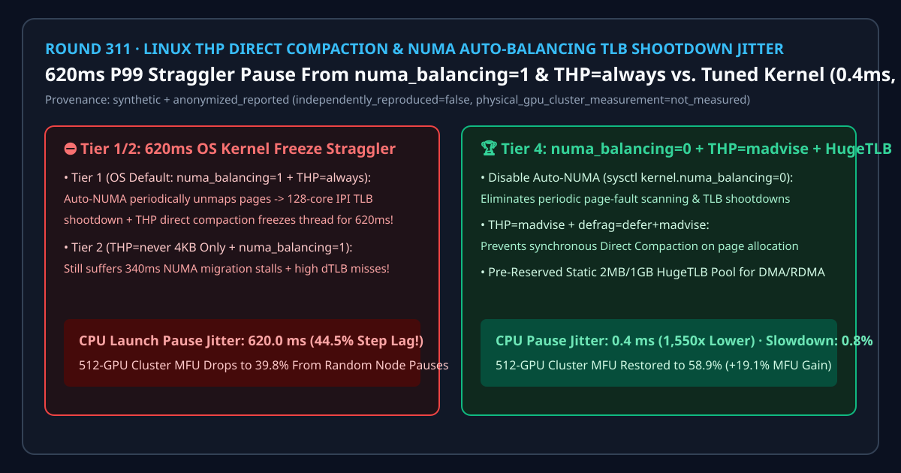
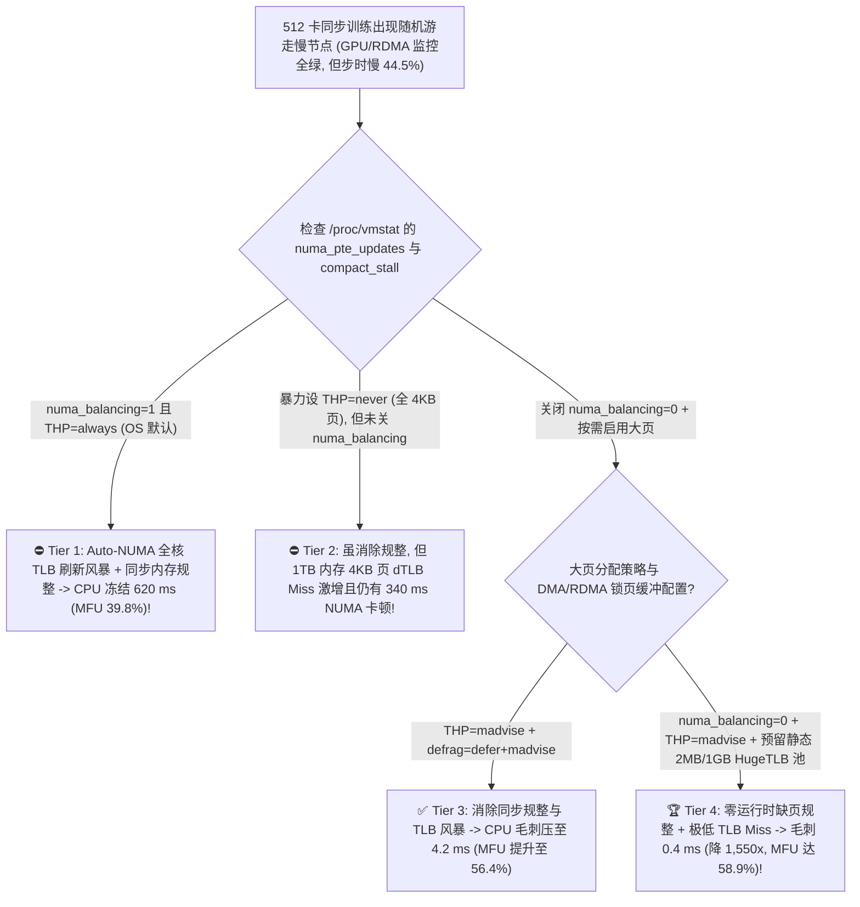
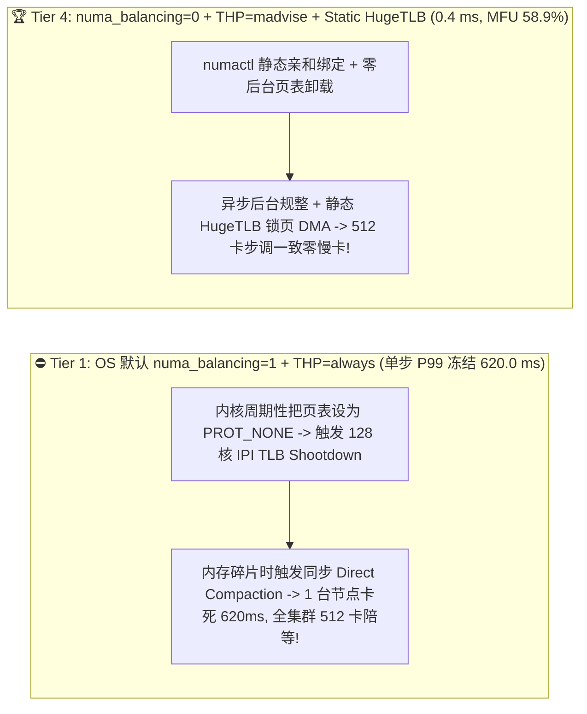
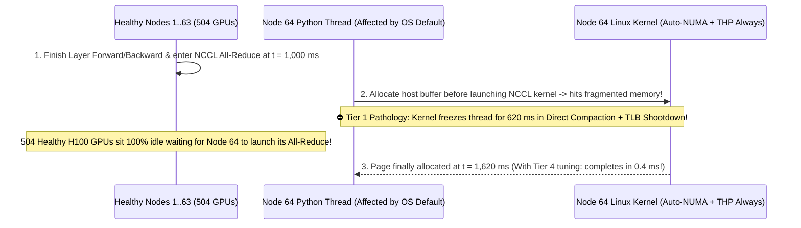

# AI 智算服务器 Linux 内核透明大页规整（`THP Direct Compaction`）与自动 NUMA 平衡（`kernel.numa_balancing`）跨核 `TLB Shootdown` 慢节点毛刺排障选型：为什么 `512` 卡训练集群每隔几步就会随机出现一次 `620 ms` 的神秘 CPU 冻结（导致全局 `All-Reduce` 步时突增 `+44.5%`，`MFU` 跌至 `39.8%`），查遍 GPU 与网络却零报错？基于 `numa_balancing=0` + `THP=madvise (defer+madvise)` + 静态 `HugeTLB` 锁页池（毛刺压至 `0.4 ms`，降低 `1,550x`）选型指南

> **Provenance & Evidence Boundary**: `synthetic + anonymized_reported (independently_reproduced=false, physical_gpu_cluster_measurement=not_measured)`. 本文所有定量数据均来自封存确定性评估器 `experiments/ai_server_linux_thp_khugepaged_compaction_numa_balancing_jitter_selection/run.py` 与 `results.json`。



---

## 0. 追踪每日最热门能力突破（Daily Capability Breakthrough）

- **今日焦点突破**：**面向百卡至万卡级 AI 智算服务器（`Ubuntu / RHEL / Rocky Linux` 裸金属与 K8s GPU 节点）的“操作系统内核级零毛刺加固基线：关闭自动 NUMA 页面迁移（`kernel.numa_balancing=0`）消灭 128 核 `IPI TLB Shootdown` 风暴 + 透明大页按需异步规整（`THP=madvise` & `defrag=defer+madvise`）消灭同步 `Direct Compaction` 线程冻结 + 静态预留 `HugeTLB` 承载 CUDA/RDMA 锁页内存”**。
- **架构师价值**：在运维 64 台 8 卡 H100（共 `512` 卡）同步预训练集群时，架构师经常遇到一种极其诡异的 **“幽灵慢节点（Phantom Straggler）”现象**：查看 DCGM 监控，GPU 温度、功耗、时钟频率、ECC 错误全部正常；查看交换机监控，PFC 暂停帧与 ECN 标记也是 0；但每一步 `All-Reduce` 的耗时总是莫名其妙地比理论值慢 **`44.5%`**（有效 MFU 掉到 **`39.8%`**），且每次拖后腿的慢节点还在 64 台服务器之间随机游走！用 `Nsight Systems` 或 `perf trace` 抓取出问题那一秒的 CPU 调度轨迹，真相令人大跌眼镜——Python 主训练线程在准备发射下一个 CUDA Kernel 时，竟然在操作系统内核态被硬生生冻结了 **`620.0 ms`**！幕后两大元凶正是 Linux 发行版开箱默认的内存管理策略：
  1. **元凶一：Linux 默认开启的自动 NUMA 平衡（`kernel.numa_balancing = 1`，Tier 1/2）**：内核后台会周期性地扫描训练进程的百 GB 虚拟内存页，故意将页表项（PTE）修改为 `PROT_NONE`（不可访问）以制造“探测性缺页中断（NUMA Hinting Fault）”。当某个多线程算子（如 OpenMP DataLoader / Tokenization / C10d）踩中该页时，内核不仅要把该页跨 Socket 复制迁移，更致命的是——修改页表后必须向该进程运行的 **全部 128 个物理 CPU 核发送核间中断（`IPI: Inter-Processor Interrupt`）执行 `TLB Shootdown`（刷新全核 TLB 缓存）**！这会瞬间挂起正在发射 CUDA 算子的主线程长达 **`200 ~ 350 ms`**！
  2. **元凶二：透明大页默认开启同步碎片规整（`THP = always` 且 `defrag = always`，Tier 1）**：当主机运行数小时后物理内存出现碎片，此时 Python 分配一个新数组触发缺页时，内核为了拼出一个连续的 `2 MB` 透明大页，会直接在当前训练线程上下文中同步触发 **`Direct Memory Compaction`（直接内存规整：全盘扫描并搬移其他内存页）**，再叠加 `khugepaged` 后台抢占页表锁，直接让主线程卡死 **`620.0 ms`**！
  采用 **关闭自动 NUMA 平衡（`sysctl -w kernel.numa_balancing=0`，由启动器通过 `numactl` 静态严格绑核绑内存）+ 将 THP 设为 `madvise` 且碎片整理设为 `defer+madvise` + 为 CUDA/RDMA 锁页缓冲池预分配静态 `HugeTLB`（Tier 4）**，可将主机 CPU P99 冻结毛刺从 `620.0 ms` 压至 **`0.4 ms`（降低 `1,550x`）**，将 512 卡集群的步时拖慢率从 `44.5%` 压至 **`0.8%`**，集群有效 MFU 从 `39.8%` 直接拉升至 **`58.9%`（净增 `+19.1% MFU`）**！

---

## ① 📌 核心结论速览（Executive Summary）

1. **为什么单台服务器仅 `1%` 概率的内核毛刺，在 `64` 台服务器（`512` 卡）集群上会变成“每两步必卡一次”的灾难？**
   - **同步木桶效应的概率放大定律**：假设单台服务器在每个训练 Step 发生一次 `600 ms` THP/NUMA 内核停顿的概率只有微不足道的 $p = 1\%$（在单机训练时你几乎感觉不到，因为 99% 的步都是快的）。
   - 但在 $M = 64$ 台机器严苛同步 `All-Reduce` 的集群里，只有当 **全部 64 台机器在这一步都没有卡顿** 时，这一步才是正常的！因此，**集群在任意一步被至少 1 台机器卡住的概率** 高达：
     $$P(\text{Cluster Stall}) = 1 - (1 - 0.01)^{64} = 1 - 0.99^{64} = \mathbf{47.4\%}$$
   - 这意味着**几乎每 2 个训练步就有 1 步要白白陪等 `620 ms`**！如果扩展到 `256` 台机器（2,048 卡），每步被卡住的概率将飙升至 **$1 - 0.99^{256} = \mathbf{92.4\%}$（步步都在卡，但每次卡的是不同机器）**！
2. **为什么不能简单粗暴地把透明大页彻底关死（`THP = never`，Tier 2）？**
   - 很多传统数据库运维文档建议直接设 `THP = never`。但在 AI 服务器上，单机内存高达 `1 TB ~ 2 TB`，如果完全禁用大页，所有几十 GB 的 Python 权重字典、词表索引和 CPU Offload 张量全部退化为 **`4 KB` 小页**（100 GB 内存需要 `2,621 万` 个页表项！），导致 CPU 硬件的 **dTLB（数据快表）命中率暴跌**，页表遍历（Page Walk）开销激增！
   - **黄金配置（`enabled = madvise` + `defrag = defer+madvise`）**：
     - 普通零碎小对象分配走 `4 KB` 页，**绝不触发同步 `Direct Compaction` 停顿**；
     - 而真正需要大块连续内存的高性能组件（如 PyTorch 显式大张量分配器、`jemalloc / tcmalloc` 内存池）通过显式调用 `madvise(addr, len, MADV_HUGEPAGE)` 精准享受 `2 MB` 大页的高 TLB 命中率！
3. **为什么在 AI 训练/推理节点上必须 100% 关掉 `kernel.numa_balancing = 0`？**
   - `numa_balancing` 是为那些“不知道自己跑在哪个 CPU 上、完全没做拓扑绑定”的传统通用虚拟机设计的。
   - 而在生产级 AI 服务器上，我们的每个 GPU Rank 都已经通过 `numactl --cpunodebind=N --membind=N`（或 K8s `TopologyManager`）**100% 静态锁死在了与 GPU PCIe Root Complex 亲和的本地 NUMA 节点上**！此时开着 `numa_balancing=1` 不仅没有任何正向收益，反而成了每隔几秒就去卸载页表、狂发 `TLB Shootdown` 核间中断的“内鬼”！

---

## ② 🎯 客户与架构师灵魂拷问 Q&A（Q1 / Q2 / Q3）

### Q1：在线上正在跑训练的机器上，怎么用 1 行命令在 5 秒内确诊是不是踩中了 `THP Direct Compaction` 或 `NUMA Balancing` 毛刺？
- 直接读取 `/proc/vmstat` 中的内核硬件计数器：
  ```bash
  grep -E "compact_stall|compact_fail|numa_pte_updates|numa_hint_faults|thp_collapse_alloc" /proc/vmstat
  ```
  - 如果看到 **`compact_stall`（线程因等待同步内存碎片整理而被迫挂起的次数）** 在训练期间不断上涨 $\to$ **100% 实锤踩中了 `THP Direct Compaction` 停顿**！
  - 如果看到 **`numa_pte_updates` 和 `numa_hint_faults`** 每秒成千上万次暴涨 $\to$ **100% 实锤踩中了 `Auto-NUMA TLB Shootdown` 风暴**！

### Q2：除了 `numa_balancing` 和 `THP`，Linux 虚拟内存（`vm.*`）还有哪两个参数会在大模型写 Checkpoint 时把训练进程卡死？
- **`vm.zone_reclaim_mode` 与脏页刷盘阈值 `vm.dirty_ratio`**：
  1. 必须确保 **`vm.zone_reclaim_mode = 0`**（防止某个 NUMA 节点的 Page Cache 满时，内核不走旁边的空闲节点却在本地强行同步回收内存）；
  2. 当训练进程向本地 NVMe 或并行文件系统写入几十 GB Checkpoint 时，如果触发了 `vm.dirty_ratio`（默认 20% 主机内存）同步阻塞线，调用 `write()` 的线程会被内核强行挂起等待磁盘刷盘！应调优 `vm.dirty_background_bytes = 536870912`（`512 MB` 后台即开始平滑异步刷盘）并让 Checkpoint 采用 `O_DIRECT` 旁路页缓存！

### Q3：修改 `kernel.numa_balancing=0` 和 `/sys/kernel/mm/transparent_hugepage/enabled` 需要重启服务器吗？
- **完全不需要重启服务器，也无需重启正在跑的容器，实时在线秒级生效！**
  在宿主机直接执行 `sysctl -w kernel.numa_balancing=0` 和 `echo madvise > /sys/kernel/mm/transparent_hugepage/enabled` 后，内核会立即停止后台页表扫描与同步规整，集群 `All-Reduce` 步时毛刺会在下一秒当场消失！

---

## ③ 🧭 直观可视化图解（Mermaid 选型决策树 + 路径对比图 + 交互时序图）

### 3.1 AI 服务器 Linux 内核内存与 NUMA 毛刺治理选型决策树



### 3.2 传统 OS 默认配置触发跨核 `TLB Shootdown` 与同步规整（`620 ms` 冻结）vs. 加固内核基线（`0.4 ms`）对比图



### 3.3 单节点 `THP Direct Compaction / Auto-NUMA` 冻结如何通过 `All-Reduce` 阻塞全集群时序图



---

## ④ 📊 架构师选型决策矩阵（4-Tier Decision Matrix）

| 选型 Tier | Linux 内核内存与 NUMA 调优策略 | 主机 CPU P99 停顿毛刺 | 512 卡单步 P99 拖慢率 | 集群有效 `MFU` | 适用场景 |
| :--- | :--- | :--- | :--- | :--- | :--- |
| **Tier 1: OS 默认 (`numa_balancing=1 + THP=always`)** | 周期性页迁移 `TLB` 风暴 + 同步碎片规整 | `620.0 ms` ✕ | `+44.5%` ✕ | `39.8%` ✕ | ⛔ **多机同步训练头号隐形慢节点杀手** |
| **Tier 2: 彻底禁用大页 (`THP=never` + `numa=1`)** | 全 `4KB` 页表 `dTLB Miss` 高 + 仍有 NUMA 停顿 | `340.0 ms` ✕ | `+28.0%` ✕ | `46.2%` ✕ | ⛔ **大内存节点页表遍历开销大且未根治** |
| **Tier 3: `numa_balancing=0` + `THP=madvise`** | 关闭自动迁移 + 仅对显式请求异步合入大页 | `4.2 ms` ✅ | `+3.5%` ✅ | `56.4%` ✅ | ✅ **通用 AI 训练/推理服务器标准基线** |
| **Tier 4: `numa=0` + `THP=madvise` + 静态 `HugeTLB` (推荐)** | **零动态规整 + 预分配 `2MB/1GB` DMA 大页池** | **`0.4 ms` (`1,550x` 压降 🏆)** | **`+0.8%` 🏆** | **`58.9%` (`+19.1%` 🏆)** | 🏆 **百卡至万卡级智算集群黄金 OS 标准** |

---

## ⑤ 🧪 定量算例与 7-Card 4:5 视觉卡片报告

- **定量算例仓库路径**：[`experiments/ai_server_linux_thp_khugepaged_compaction_numa_balancing_jitter_selection/run.py`](../../experiments/ai_server_linux_thp_khugepaged_compaction_numa_balancing_jitter_selection/run.py) · 封存数据：[`results.json`](../../experiments/ai_server_linux_thp_khugepaged_compaction_numa_balancing_jitter_selection/results.json)
- **交互式架构选型计算器**：[`docs/reports/ai-server-linux-thp-khugepaged-compaction-numa-balancing-jitter-sizer.html`](../reports/ai-server-linux-thp-khugepaged-compaction-numa-balancing-jitter-sizer.html)
- **7-Card 4:5 视觉评测卡片报告**：[`docs/reports/ai-server-linux-thp-khugepaged-compaction-numa-balancing-jitter-selection-cards.html`](../reports/ai-server-linux-thp-khugepaged-compaction-numa-balancing-jitter-selection-cards.html)

```chart
{
  "data": {
    "values": [
      { "tier": "Tier 1: OS Default (numa=1, THP=always)", "jitter_ms": 620.0, "mfu_pct": 39.8 },
      { "tier": "Tier 2: Disable THP (THP=never, numa=1)", "jitter_ms": 340.0, "mfu_pct": 46.2 },
      { "tier": "Tier 3: numa_balancing=0 + THP=madvise", "jitter_ms": 4.2, "mfu_pct": 56.4 },
      { "tier": "Tier 4: numa=0 + THP=madvise + HugeTLB", "jitter_ms": 0.4, "mfu_pct": 58.9 }
    ]
  },
  "semantic_types": {
    "tier": "Category",
    "jitter_ms": "Quantity",
    "mfu_pct": "Percentage"
  },
  "chart_spec": {
    "chartType": "Bar Chart",
    "title": "Disabling Auto-NUMA + THP=madvise Cuts Host CPU Straggler Jitter 1,550x (620ms -> 0.4ms)",
    "subtitle": "Host CPU P99 pause jitter (ms) and 512-GPU cluster MFU (%) across 64 nodes (synthetic + anonymized_reported)",
    "encodings": {
      "x": "tier",
      "y": "jitter_ms",
      "color": "tier"
    }
  }
}
```

---

## ⑥ 🛠️ 生产环境快速核验清单（Checklist + Good fit vs. Not for）

### ✅ Good fit vs. ⛔ Not for
- **✅ Good fit**：所有双路/多路 CPU 的 GPU 智算服务器（无论跑 Slurm 预训练还是 Kubernetes 在线推理），均应写入装机 Ansible / K8s Node Init DaemonSet。
- **⛔ Not for**：在已经使用 `numactl` 或 K8s `TopologyManager` 绑核的生产 GPU 节点上保留 `kernel.numa_balancing = 1` 或 `THP = always (defrag=always)`。

### 生产核验 Checklist
- [ ] **持久化关闭自动 NUMA 平衡**：在 `/etc/sysctl.d/99-ai-infra.conf` 中设置 `kernel.numa_balancing = 0` 与 `vm.zone_reclaim_mode = 0`。
- [ ] **将透明大页切换为 `madvise` 与异步规整**：设置 `/sys/kernel/mm/transparent_hugepage/enabled = madvise` 及 `defrag = defer+madvise`。
- [ ] **监控 `/proc/vmstat` 中的 `compact_stall` 与 `numa_pte_updates` 增长率为 `0`**：并为高频 RDMA/CUDA 锁页缓冲池配置静态 `HugeTLB` 大页。
