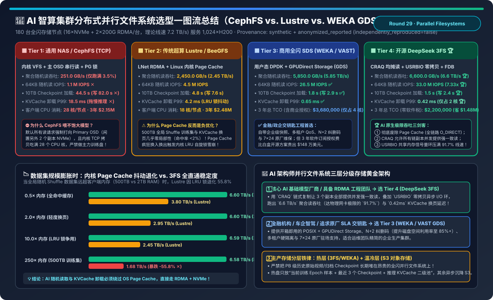
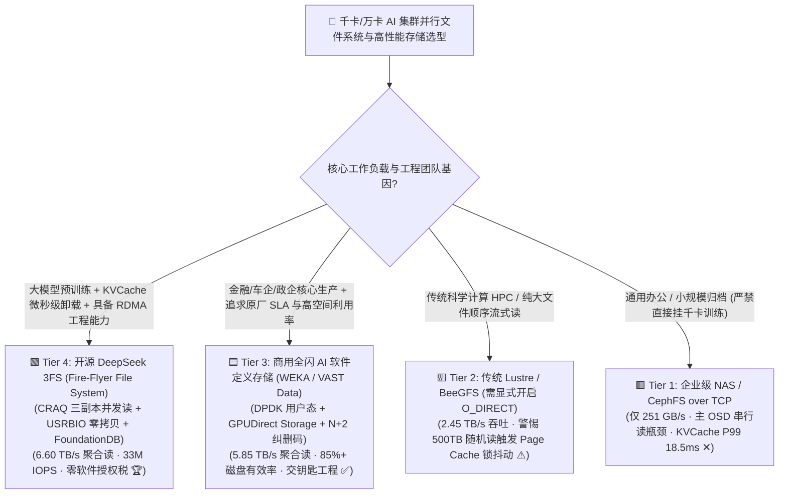
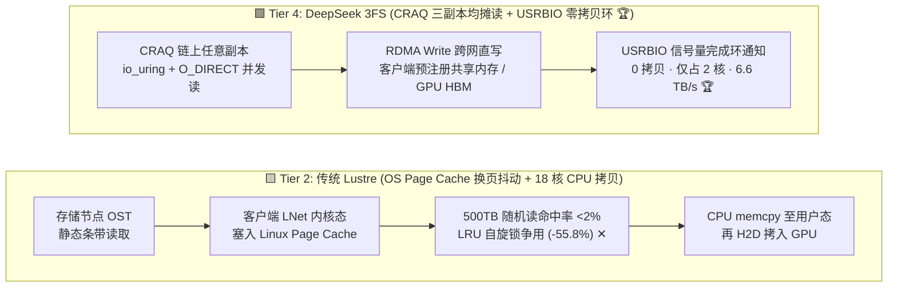
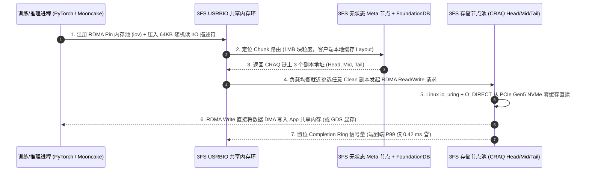

# AI 智算集群分布式并行文件系统与高性能存储架构选型指南（`通用 NAS/CephFS` vs. `传统超算 Lustre` vs. `商用全闪 WEKA/VAST GDS` vs. `开源 DeepSeek 3FS + USRBIO`）

> **阅读指南（3 分钟速通 / 10 分钟白板宣讲）**：本文面向 AI 解决方案架构师（AI Solution Architect）与存储底座负责人，用第一性原理与通俗大白话回答千卡/万卡智算中心建设中最容易踩坑的存储架构选型问题：**“为什么花几百万买全闪 NVMe 盘搭的 CephFS，跑千卡大模型时聚合读吞吐只有 251 GB/s（连网卡线速的 4% 都跑不满）？为什么传统超算霸主 Lustre 引以为傲的 Linux 内核 Page Cache 在大模型随机读取与 KVCache 卸载面前反而变成了‘负优化’？DeepSeek 开源的 3FS（Fire-Flyer File System）到底靠哪三项底层黑科技在 180 台节点上跑出 6.6 TB/s 极限带宽（比 Lustre 快 2.69 倍、随机 IOPS 高 7.33 倍）？什么时候该选商用 WEKA/VAST，什么时候该自建 3FS？”**
>
> 🔗 **English Version**: [AI Cluster Parallel Filesystem & High-Performance Storage Selection FAQ (`ai-storage-3fs-lustre-weka-parallel-filesystem-selection-faq.en.md`)](./ai-storage-3fs-lustre-weka-parallel-filesystem-selection-faq.en.md) · **7-Card 评测报告**: [`ai-storage-3fs-lustre-weka-parallel-filesystem-selection-cards.html`](../reports/ai-storage-3fs-lustre-weka-parallel-filesystem-selection-cards.html) · **交互式工作台**: [`llm-inference-engine-pd-sizer.html#parallel-fs-sizer`](../reports/llm-inference-engine-pd-sizer.html)

---

## ① 📌 核心结论速览（Executive Summary）

1. **严禁用 `通用企业级 NAS / CephFS (Tier 1)` 承担千卡集群主训练盘或 KVCache 卸载盘**：
   - 在 180 台全闪存储节点（每台 `16×PCIe Gen5 NVMe + 2×200Gbps RDMA`，理论物理网口总带宽 `7.2 TB/s`）服务 1,024 张 H200 的标准算例中，**Tier 1（CephFS over TCP）** 因“主 OSD 串行读瓶颈 + 内核 VFS 拷贝 + PG 强一致锁”，聚合随机读吞吐仅 **`251.0 GB/s`**（仅发挥硬件潜力的 `3.5%`），加载 10 TB Checkpoint 长达 **`44.5 秒`**，KVCache 换页 P99 延迟高达 **`18.5 ms`**。
2. **揭示传统超算 `Lustre / BeeGFS (Tier 2)` 在 AI 时代的“Page Cache 反噬陷阱”**：
   - 传统科学计算是高度顺序读或局部重复读，Linux 内核 `Page Cache` 功不可没；但在大模型训练中，**`500 TB` 样本经过全局随机打散（Global Shuffle），且推理 KVCache 块卸载几乎零时间局部性（缓存命中率 `< 2%`）**！
   - 当数据集规模达到主机内存的 `250 倍` 时，**Tier 2（Lustre + OS Page Cache）** 会因海量无效页面疯狂换入换出触发内核 LRU 链表自旋锁（Spinlock）争用，吞吐从 `3.80 TB/s` 暴跌 `-55.8%` 至 **`1.68 TB/s`**，还要白白吃掉客户端节点 **18 个 CPU 核**！
3. **政企交钥匙选 `商用全闪 WEKA / VAST + GDS (Tier 3)`，AI 原生极限性价比选 `开源 DeepSeek 3FS (Tier 4)`**：
   - **Tier 3（商用 WEKA / VAST Data）**：通过用户态 DPDK 绕过内核 + **GPUDirect Storage（GDS）** 直写显存 + `N+2` 分布式纠删码，跑出 **`5,850.0 GB/s`（`5.85 TB/s`）** 吞吐与 **`26.5M` IOPS**，自带企业级多租户 QoS、快照与原厂 7×24 维保（3 年总 TCO **`$3,680,000`**）。
   - **Tier 4（开源 DeepSeek 3FS）**：凭借 **① 全链路废除 Page Cache（`O_DIRECT + io_uring`）**、**② `CRAQ` 链式复制均摊强一致读（3 副本全部并发服务读请求）**、**③ `USRBIO` 共享内存零拷贝异步环 + `FoundationDB` 分布式事务元数据**，将 180 节点聚合读吞吐推至惊人的 **`6,600.0 GB/s`（`6.60 TB/s`，压满物理网口线速的 `91.7%`）**，64KB 随机读达 **`33.0M` IOPS（比 Lustre 高 `7.33x`）**，10 TB Checkpoint 仅需 **`1.5 秒`** 恢复，KVCache 换页 P99 压至 **`0.42 ms`**，且省去 **`$1,480,000` 商业软件授权税**（3 年 TCO 仅 **`$2,200,000`**）！

---

## ② 🎯 客户与架构师灵魂拷问 Q&A（FAQ-Driven）

### Q1：什么时候选商用 WEKA/VAST (Tier 3)，什么时候选开源 DeepSeek 3FS (Tier 4)，传统 Lustre (Tier 2) 还能用吗？

- **首选 `Tier 4（开源 DeepSeek 3FS）` 的场景**：
  1. **大模型原生研发团队 / 智算云厂商（具备 RDMA 与 C++/Rust 系统运维能力）**：追求极致硬件线速压榨（`6.6 TB/s`）与零商业软件授权费；
  2. **重度依赖 KVCache 二级卸载（如 Mooncake / LMCache 挂载 3FS USRBIO）与强化学习（RLHF/GRPO）高频权重同步**：需要 `< 0.5 ms` 的 P99 确定性微秒级小块随机读。
- **首选 `Tier 3（商用全闪 WEKA / VAST Data + GDS）` 的场景**：
  1. **银行、保险、大型车企智驾、医疗政企客户**：基础设施团队人数精简，要求开箱即用的图形化管理、多租户配额硬隔离、快照克隆与原厂工程师兜底 SLA；
  2. **PB 级长周期存算一体容量敏感场景**：3FS 采用三副本（3-Way Replication，磁盘空间有效率 `33.3%`），而 WEKA/VAST 支持跨机柜 **`14+2` / `16+4` 纠删码（Erasure Coding，空间有效率高达 `85%～88%`）**，在海量温数据场景下能省下大批 NVMe 盘采购费。
- **`Tier 2（Lustre / BeeGFS）` 的保留场景**：
  - 仅适合**传统气象/流体/分子动力学超算（HPC）与大文件纯顺序流式读取**；若在 AI 集群中沿用 Lustre，必须手动开启 `O_DIRECT` 绕过客户端 Page Cache 并扩充 MDS 元数据节点。

### Q2：什么是 `CRAQ（Chain Replication with Apportioned Queries）`？为什么 CephFS 三副本只有 1 块盘干活，而 3FS 能让 3 块盘同时满负荷并发读？

- **通俗大白话**：
  你买了 3 块顶级 NVMe SSD 做三副本容灾：
  - **Ceph RADOS（传统主从复制 Primary-Copy）**：为了保证强一致性，默认规定所有客户端读请求**必须全部找老大哥（Primary OSD）读取**，另外两个小弟副本（Secondary OSDs）平时只挨写、不接客读！这就导致 **2/3 的 NVMe 盘读取带宽被白白闲置浪费**！
  - **DeepSeek 3FS 的 `CRAQ（带查询分摊的链式复制）`**：把 3 个副本排成一条流水线（`Head → Middle → Tail`）。写入时从 Head 顺序传到 Tail；但**读取时，客户端可以就近或随机挑选链上的任意一个副本（Head、Middle 或 Tail）直接读取**！
- **CRAQ 是怎么防止读到未提交脏数据的（底层机制）？**
  - 每个数据块（Chunk）维护两个状态：`Clean（已全局提交）` 和 `Dirty（正在链式传递中）`。
  - **99.9% 的情况下（读取已写完的训练集或 KVCache）**：块状态为 `Clean`，任意副本直接零等待返回数据，**随机读 IOPS 与聚合带宽瞬间翻 3 倍（直奔 `33.0M IOPS` 与 `6.6 TB/s`）**！
  - **0.1% 正在并发改写的极端瞬间**：若某个中间副本发现块处于 `Dirty`，它只需向链尾 `Tail` 发送一个极轻量的 64 字节版本号查询（Apportioned Query），即可立刻确认最新已提交版本，既守住了**严苛强一致性（Strong Consistency）**，又把所有 NVMe 盘的 PCIe 通道榨到了 `90%+`！

### Q3：什么是 3FS 的 `USRBIO（User-Space Zero-Copy Async I/O）`？为什么标准 FUSE 挂载跑不满 400G RDMA 网卡？

- **传统 POSIX / FUSE 的“四次折返跑”**：
  当训练进程通过普通 FUSE 文件系统读数据时，数据要经历：`网卡 RDMA Buffer → 3FS FUSE 守护进程用户态 → 写入内核 FUSE 管道 → Linux VFS 内核态 → 拷贝回 Python 训练进程 Buffer`，光是 CPU `memcpy` 和上下文切换就要烧掉 **16～28 个物理 CPU 核心**，单客户端吞吐被死死卡在 `10～15 GB/s`。
- **`USRBIO` 的“共享内存信号量环”破局**：
  1. 应用进程预先分配一块经过 **RDMA 网卡 Pin 住注册（Memory Region Registration）的跨进程共享内存池（Shared-Memory Data Buffer）**，以及两个无锁环形队列（`Submission Ring` 提交环 + `Completion Ring` 完成环）；
  2. 当应用调用 `hf3fs_usrbio` 发起读请求时，只需往 `Submission Ring` 里写一个 64 字节描述符并敲一下信号量（`io_uring` 风格，零系统调用阻塞）；
  3. 远端存储节点的 NVMe SSD 通过 **`io_uring + O_DIRECT`** 读出数据后，直接通过 **RDMA Write 跨网络原位写入应用进程的共享内存（甚至配合 GPUDirect Storage 直接 DMA 进 GPU HBM3e 显存）**；
  4. 全程 **零内核态数据拷贝、零 Page Cache 污染**，单台计算节点仅用 **2 个 CPU 核** 就能轻松跑满双口 200G/400G RDMA 线速！

---

## ③ 🧭 直观可视化图解（Mermaid 决策树 / 数据面对比 / CRAQ+USRBIO 时序图）

### 3.1 AI 智算集群并行文件系统选型决策树

### 3.2 传统 Lustre 内核态 Page Cache 路径 (Tier 2) vs. DeepSeek 3FS USRBIO + CRAQ 路径 (Tier 4)

### 3.3 DeepSeek 3FS 元数据查询（FoundationDB）+ USRBIO 零拷贝 CRAQ 读取时序图

---

## ④ 📊 架构师选型决策矩阵（Architect Decision Matrix）

*基准环境：**180 台全闪存储节点**（每台 `16×PCIe Gen4/Gen5 NVMe SSD` + `2×200Gbps RDMA`，全集群物理网口理论线速 **`7,200 GB/s (7.2 TB/s)`**），服务 **1,024 张 H200 SXM 计算集群**。*

| 评估维度 | 🟥 Tier 1: 通用 NAS / CephFS (TCP) | 🟨 Tier 2: 传统超算 Lustre / BeeGFS | 🟦 Tier 3: 商用全闪 WEKA / VAST (GDS) | 🟩 Tier 4: 开源 DeepSeek 3FS (CRAQ + USRBIO) |
| :--- | :--- | :--- | :--- | :--- |
| **客户端 I/O 数据通路** | 内核 TCP Socket + VFS + Page Cache | 内核 LNet RDMA + Linux Page Cache | **用户态 DPDK + GPUDirect Storage** | **无 Page Cache `O_DIRECT` + `USRBIO` 共享内存环 🏆** |
| **副本与元数据架构** | 主 OSD 强一致读 + 主备 MDS | 静态 OST 条带 + 集中式 MDT 锁 | **分布式 N+2 纠删码 + 分布式元数据** | **CRAQ 链式全副本并发读 + FoundationDB 事务 🏆** |
| **180 节点聚合随机读吞吐** | `251.0 GB/s` (线速利用率 `3.5%` ✕) | `2,450.0 GB/s` (`2.45 TB/s`) | **`5,850.0 GB/s` (`5.85 TB/s` ✅)** | **`6,600.0 GB/s` (`6.60 TB/s`，达线速 `91.7%` 🏆)** |
| **64KB 随机读 IOPS** | `1.1 M` IOPS ✕ | `4.5 M` IOPS | **`26.5 M` IOPS ✅** | **`33.0 M` IOPS (比 Lustre 高 `7.33x` 🏆)** |
| **10 TB Checkpoint 加载耗时** | `44.5 s` (写 `82.0 s` ✕) | `4.8 s` (写 `7.6 s`) | **`1.8 s` (写 `2.9 s` ✅)** | **`1.5 s` (写 `2.4 s`，秒级断点续训 🏆)** |
| **KVCache 换页读取 P99 延迟** | `18.5 ms` (严重阻塞 Decode ✕) | `4.2 ms` (受 LRU 锁毛刺影响) | **`0.65 ms` ✅** | **`0.42 ms` (确定性亚毫秒级卸载 🏆)** |
| **计算节点客户端 CPU 开销** | `28 核/节点` (抢占 DataLoader 算力) | `18 核/节点` | **`4 核/节点` ✅** | **`2 核/节点` (异步信号量环极低开销 🏆)** |
| **3 年存储集群总 TCO (含授权)** | `$2,150,000` (但算力闲置代价极高) | `$2,480,000` | `$3,680,000` (含约 `$1.48M` 商业软件税) | **`$2,200,000` (开源零授权费，净省 `$1.48M` 🏆)** |

---

## ⑤ 🧪 简明定量算例与 Benchmark 洞察（Page Cache 雪崩测试与 TCO 账单）

> 📁 **封存数据源与可复现脚本**：[`experiments/ai_parallel_filesystem_3fs_lustre_weka_selection/run.py`](../../experiments/ai_parallel_filesystem_3fs_lustre_weka_selection/run.py) · [`experiments/ai_parallel_filesystem_3fs_lustre_weka_selection/results.json`](../../experiments/ai_parallel_filesystem_3fs_lustre_weka_selection/results.json) · 单测 [`tests/test_ai_parallel_filesystem_3fs_lustre_weka_selection.py`](../../tests/test_ai_parallel_filesystem_3fs_lustre_weka_selection.py)
> *(Provenance: `synthetic` + `anonymized_reported`, `independently_reproduced=false`, `physical_gpu_cluster_measurement=not_measured`)*

### 5.1 为什么 AI 数据集越大，开启 OS Page Cache 的传统并行文件系统越慢？

| 活跃数据集 / 客户端内存比 (`Working Set / RAM`) | 传统 Lustre (开启 OS Page Cache) 吞吐 | DeepSeek 3FS (`O_DIRECT` + `USRBIO`) 吞吐 | 底层物理原因诊断 |
| :--- | :--- | :--- | :--- |
| **`0.5x` (小玩具数据集，全装进内存)** | `3,800.0 GB/s` | **`6,600.0 GB/s`** | 小数据命中缓存，但 Lustre 仍受制于单主 OST 与内核拷贝 |
| **`2.0x` (轻度缓存淘汰)** | `2,950.0 GB/s` (`-22.4%`) | **`6,600.0 GB/s`** | `kswapd` 后台线程开始高频扫描回收脏页/冷页 |
| **`10.0x` (中度 LRU 锁争用)** | `2,450.0 GB/s` (`-35.5%`) | **`6,590.0 GB/s`** | 64 个 DataLoader 线程在内核 `folio_lruvec_lock` 上排队 |
| **`250.0x` (真实 500TB 全局 Shuffle 训练集)** | **`1,680.0 GB/s` (`-55.8%` 暴跌 ✕)** | **`6,580.0 GB/s` (`-0.3%` 稳如泰山 🏆)** | **缓存命中率 `<0.4%`，Page Cache 沦为纯锁竞争与内存带宽放大器！** |

### 5.2 配套 7-Card 4:5 视觉评测报告与交互式计算器

- 🃏 **7-Card 4:5 视觉评测卡片集（CSP 自包含，零外部依赖）**：[`docs/reports/ai-storage-3fs-lustre-weka-parallel-filesystem-selection-cards.html`](../reports/ai-storage-3fs-lustre-weka-parallel-filesystem-selection-cards.html)
- 🧮 **独立交互式并行文件系统定容与 TCO 计算器**：[`docs/reports/ai-storage-3fs-lustre-weka-parallel-filesystem-sizer.html`](../reports/ai-storage-3fs-lustre-weka-parallel-filesystem-sizer.html)（已同步集成至总工作台 [`docs/reports/llm-inference-engine-pd-sizer.html#parallel-fs-sizer`](../reports/llm-inference-engine-pd-sizer.html)）

---

## ⑥ 🛠️ 附录：生产环境快速核验清单（Architect Checklist）

- [ ] **1. 对全局 Shuffle 训练集与 KVCache 卸载池强制关闭 OS Page Cache（启用 `O_DIRECT`）**：当数据集远超客户端 DRAM 时，务必使用 3FS `USRBIO`、GDS `cuFile` 或 POSIX `O_DIRECT` 绕过内核缓存，彻底消灭 `kswapd` 与 LRU 自旋锁毛刺。
- [ ] **2. 将元数据集群（FoundationDB / MDS）部署在专属低延迟企业级 NVMe 上**：切勿把元数据数据库与高吞吐大块数据混部在同一块 SSD Namespace 上，防止 10 TB Checkpoint 刷盘时的写放大（Write Amplification）拖慢 `stat()/open()` 延迟。
- [ ] **3. 校准 PCIe 与 NUMA 亲和性（Storage Node Topology Alignment）**：在每台配置 `16×NVMe + 2×200G RDMA` 的存储节点上，确保每个 NUMA Socket 下的 8 块 NVMe SSD 直连同侧的 RDMA 网卡，严禁跨 QPI/UPI 总线转发存储流量。
- [ ] **4. 实施“热盘并行文件系统 + 冷盘 S3 对象存储”生命周期自动沉降**：3FS 三副本全闪热盘仅保留**当前训练周期数据集、最近 3 个 Step 的热 Checkpoint 以及在线推理 KVCache 二级池**；超过 24 小时的历史归档 Checkpoint 由后台守护进程异步转储至廉价纠删码对象存储（MinIO / Ceph RGW / S3）。
- [ ] **5. 生产验收必压“64KB 随机读 + 10TB 并发写 Checkpoint”双基准**：选型 POC 严禁只看厂商提供的 `16MB 顺序读 dd` 跑分；必须使用 `fio (bs=64k, rw=randread, direct=1, ioengine=io_uring)` 与 `dlio_benchmark` 实测千卡并发下的真实 P99 延迟。
