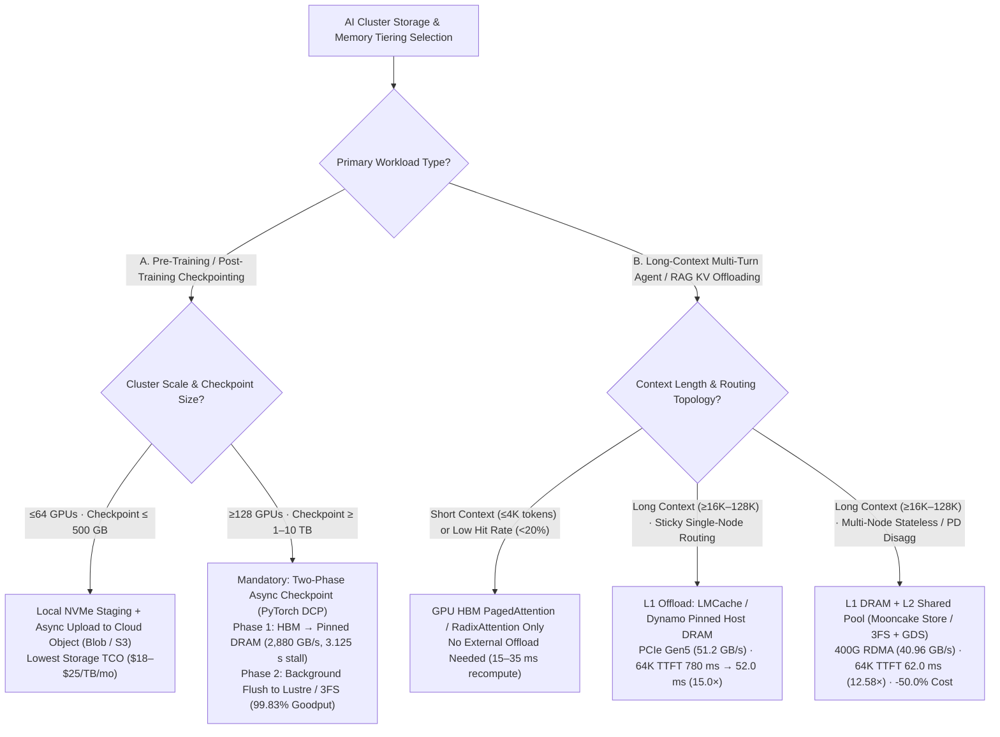
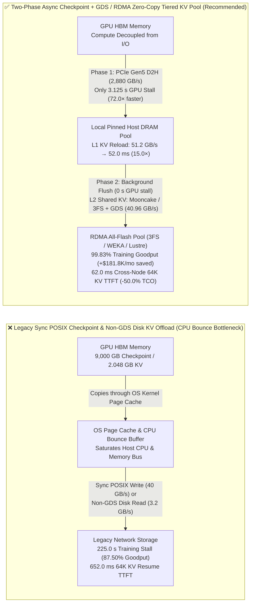

# AI Cluster Storage Selection (Object vs. Managed Lustre/GPFS vs. RDMA All-Flash 3FS/WEKA), Two-Phase Async Checkpointing & Tiered KV Cache Offloading (HBM → Host DRAM → NVMe/GDS) — Architect Selection FAQ

> **🧭 Single-Decision Split Navigation (Recommended Direct Entrypoints)**:
> To keep each FAQ strictly focused on **one independent architectural decision** (clearly separating storage file systems, zero-copy I/O access paths, training checkpointing, and inference KV tiering), this composite page is retained as a compatibility navigation hub. Read the dedicated single-decision bilingual 6-part FAQs directly:
> - **Round 3 Single-Decision FAQ (Distributed Training Checkpointing: Sync POSIX vs. Sync GDS vs. Two-Phase Async Checkpointing)**: [`docs/components/training-checkpoint-architecture-selection-faq.en.md`](./training-checkpoint-architecture-selection-faq.en.md) ｜ [中文版 (`training-checkpoint-architecture-selection-faq.md`)](./training-checkpoint-architecture-selection-faq.md)
> - **Round 4 Single-Decision FAQ (Long-Context Inference Tiered KV Cache Offloading: HBM Recompute vs. Local Pinned DRAM vs. Shared RDMA/NVMe+GDS Pool)**: [`docs/components/kv-cache-tiered-offload-selection-faq.en.md`](./kv-cache-tiered-offload-selection-faq.en.md) ｜ [中文版 (`kv-cache-tiered-offload-selection-faq.md`)](./kv-cache-tiered-offload-selection-faq.md)
> - **Orthogonal Layering Note**: `Lustre / GPFS / WEKA / DeepSeek 3FS` are **storage backends / parallel file systems**, whereas **`GPUDirect Storage (GDS / cuFile)` is a zero-copy PCIe P2P DMA I/O access path** that bypasses the Linux CPU Page Cache and operates *across* NVMe, Lustre, WEKA, and 3FS (GDS is not a mutually exclusive storage system).

> **Document Purpose**: Written for AI Solution Architects, AI cluster storage/infrastructure leads, and LLM training/inference teams, this guide uses first principles to answer the three storage and memory-tiering questions customers ask most often: **① When should an AI cluster choose Cloud Object Storage (S3/Blob), Managed Parallel File Systems (Managed Lustre / Spectrum Scale GPFS), or RDMA-native All-Flash storage (DeepSeek 3FS / WEKA / VAST + GPUDirect Storage)? ② Why do 512+ GPU training clusters lose over 10% of their compute goodput to checkpoint stalls, and how does Two-Phase Async Checkpointing (HBM → Pinned DRAM → background flush) cut GPU stall time by 72×? ③ When GPU HBM fills up during long-context multi-turn Agent serving, when is Tiered KV Cache Offloading (HBM → Host DRAM → Shared RDMA/NVMe Pool via LMCache / Mooncake Store / NVIDIA NIXL) a massive win, and when is it actually slower than recomputing Prefill?**
>
> **Provenance & Data Classification**: Hardware bandwidth baselines for PCIe Gen5 x16, 400G RoCEv2 / ConnectX-7, NVIDIA GPUDirect Storage (GDS), DeepSeek 3FS, LMCache, and Mooncake Store are **`anonymized_reported` (`independently_reproduced=false`)** from vendor and open-source specifications. The quantitative 512-GPU (`9,000 GB` / `9.0 TB` checkpoint) and `65,536`-token (`2.048 GB` FP8 KV payload) evaluations in Section ⑤ and the companion 7-Card report come from the repository's sealed **deterministic storage and PCIe/RDMA analytical model (`synthetic`, `experiments/ai_storage_checkpoint_kv_offload/results.json`)**. No paid cloud 512-GPU physical cluster was launched (`paid_cloud_gpu_launched=false`, `live_512gpu_cluster_measurement="not_measured"`); local machine verification covers the Python CLI model and `818` unit tests (`measured_local_python_unittest_and_check_cli_only`).
> **中文版本**: [`docs/components/ai-storage-checkpoint-kv-offload-selection-faq.md`](ai-storage-checkpoint-kv-offload-selection-faq.md) · **7-Card Visual Report**: [`docs/reports/ai-storage-checkpoint-kv-offload-cards.html`](../reports/ai-storage-checkpoint-kv-offload-cards.html) · **Visual Summary SVG**: [`assets/svg/ai-storage-checkpoint-kv-offload-faq-summary.svg`](../../assets/svg/ai-storage-checkpoint-kv-offload-faq-summary.svg)

---

## ① 📌 Executive Summary

1. **Storage Fabric Selection Rule (Object Storage vs. Managed Lustre/GPFS vs. RDMA All-Flash 3FS/WEKA + GDS)**:
   - **Raw data lakes, cold archives, and small-scale fine-tuning (`≤64` GPUs)**: Choose **Cloud Object Storage (Azure Blob / AWS S3) + compute-node local NVMe caching** for the lowest cost (`~$18–$25/TB/month`).
   - **Mid-to-large pre-training and multi-team shared clusters (`64–1,024` GPUs)**: Choose **Managed Parallel File Systems (Azure AMLFS / AWS FSx for Lustre / IBM Spectrum Scale GPFS)** for POSIX compatibility and `40–200+ GB/s` aggregate throughput.
   - **Large-scale MoE training/inference, high-frequency checkpointing, and disaggregated KV Cache pools (`≥256` GPUs + 400G RDMA)**: Choose **RDMA-native All-Flash Parallel File Systems (DeepSeek Fire-Flyer 3FS / WEKA / VAST) with NVIDIA GPUDirect Storage (GDS)** to DMA directly between NVMe/RDMA NICs and GPU HBM without CPU bounce buffers (`40+ GB/s` per node, hundreds of GB/s to multi-TB/s cluster-wide).
2. **Training Checkpoint Rule (Two-Phase Async Checkpointing cuts GPU stall time from `225.0 s` to `3.125 s` — a `72.0×` reduction)**:
   - On a 512-GPU cluster saving a `9,000 GB` (`9.0 TB`) distributed model + optimizer state every `30 minutes` (`1,800 s`), traditional synchronous POSIX writes (`40.0 GB/s` aggregate) freeze all GPUs for **`225.0 s`**, dropping effective training goodput to **`87.50%`**.
   - Enabling **Two-Phase Async Checkpointing (PyTorch DCP / Megatron Async Checkpoint)** copies each node's `140.625 GB` shard over PCIe Gen5 x16 into **Pinned Host DRAM (`45.0 GB/s` per node = `2,880.0 GB/s` cluster aggregate)** in **`3.125 s`** (`9,000 GB / 2,880.0 GB/s = 3.125 s`, **`72.0×` faster**) so GPUs immediately resume training, while background threads flush DRAM to persistent storage in `50.0 s` (`0 s` extra GPU stall). Cluster goodput rises to **`99.83%`** (**`+12.33 percentage points`**, recovering **`$181,813/month`** in wasted GPU time at `$4.00/GPU-hr`).
3. **Long-Context Tiered KV Cache Offloading Rule (Never use non-GDS POSIX/TCP disks for online KV offloading)**:
   - For a `65,536`-token (`2.048 GB` FP8 KV Cache) multi-turn Agent session, evicting and recomputing Prefill takes **`780.0 ms` TTFT** (`$0.96 / 1M tokens`), while offloading to a traditional POSIX/TCP cloud disk without GDS (`3.2 GB/s` via CPU bounce buffers) takes `640.0 ms` reload (**`652.0 ms` TTFT**, only `1.20×` faster while saturating host CPUs).
   - Offloading to **local Pinned Host DRAM (LMCache / Dynamo KVBM over PCIe Gen5 at `51.2 GB/s`)** reloads `2.048 GB` in `40.0 ms` (`+ 12.0 ms` delta prefill = **`52.0 ms` TTFT**, **`15.0×` faster**, **`$0.44 / 1M`, `-54.2%`**); offloading to a **cross-node Shared RDMA/NVMe Pool (Mooncake Store / 3FS + GDS at `40.96 GB/s`)** reloads in `50.0 ms` (**`62.0 ms` TTFT**, **`12.58×` faster**, **`$0.48 / 1M`, `-50.0%`**) while enabling stateless cross-node scheduling.

---

## ② 🎯 Key Architect & Customer Q&A (First-Principles Deep Dive)

### Q1: When should an AI cluster choose Object Storage (Blob/S3), Managed Lustre/GPFS, or RDMA All-Flash (DeepSeek 3FS / WEKA)?

- **First-Principles Breakdown — AI Clusters Have Three Distinct I/O Regimes**:
  1. **Dataset ingestion & cold archival (large sequential streaming I/O, latency-tolerant)**: Cloud Object Storage (S3 / Azure Blob) uses HTTP REST with virtually unlimited capacity at `~$18–$25/TB/month`, but has `10–50 ms` first-byte latency. Pairing Object Storage with local NVMe SSD caching on compute nodes (e.g., JuiceFS / Alluxio / BlobFuse) easily feeds ≤64-GPU training jobs at minimal TCO.
  2. **Multi-terabyte burst checkpoint writes (`64–1,024` GPUs)**: When hundreds of GPUs simultaneously dump `9.0 TB` of optimizer states, object storage prefixes can throttle. Managed Parallel File Systems (Azure AMLFS / AWS FSx for Lustre / Spectrum Scale GPFS) stripe files across dozens of Object Storage Targets (OSTs), providing POSIX semantics and `40–200+ GB/s` sustained write throughput.
  3. **Sub-100ms KV Cache block reloads & random multimodal reads (`≥256` GPUs + 400G RDMA)**: Reloading `2.048 GB` of KV Cache in `≤50 ms` cannot tolerate OS kernel page caches or TCP/IP stacks. **RDMA-native All-Flash file systems (DeepSeek 3FS, WEKA, VAST)** paired with **GPUDirect Storage (GDS)** transfer blocks directly between NVMe/RDMA NICs and GPU HBM via PCIe P2P DMA.

### Q2: What are GPUDirect Storage (GDS) and NVIDIA NIXL, and why does traditional POSIX I/O bottleneck on the CPU Bounce Buffer?

- **The Traditional POSIX Bottleneck**:
  - In standard Linux `read()` / `write()`, GPU HBM is not directly addressable by the OS kernel page cache. Reading a checkpoint or KV block from disk/network into GPU memory forces the storage NIC/NVMe to DMA into a **Host OS Page Cache / CPU Bounce Buffer**, copy to user space, and then invoke `cudaMemcpyHostToDevice` across PCIe.
  - The same payload crosses host DRAM and the PCIe Root Complex **2–3 times**, burning host CPU cores and capping effective throughput at `3–10 GB/s` per node.
- **How GPUDirect Storage (`cuFile`) and NIXL Solve This**:
  - **GDS (`nvidia-fs` kernel driver)** establishes a direct Peer-to-Peer DMA path between NVMe/RDMA NICs and GPU HBM BAR memory, bypassing the host CPU and OS page cache completely (`40–100+ GB/s` per node).
  - **NVIDIA NIXL / Mooncake Transfer Engine** abstracts GPU HBM, Pinned Host DRAM, local NVMe, and remote RDMA storage behind a unified asynchronous block-transfer API for inference engines.

### Q3: Why do synchronous checkpoints cripple large training clusters, and how does Two-Phase Async Checkpointing shrink a `225.0 s` stall to `3.125 s`?

- **Why Synchronous Checkpointing Wastes 12.5% of Cluster Compute**:
  - On a 512-GPU cluster training a 671B model (`9,000 GB` total FP32 master weights + Adam states), saving a checkpoint every `30 minutes` (`1,800 s`) over a `40.0 GB/s` POSIX file system freezes all 512 GPUs for `9,000 / 40.0 = 225.0 s` every 30 minutes (`12.50%` wasted wall-clock time, or `87.50%` effective goodput).
- **How Two-Phase Async Checkpointing Works**:
  1. **Phase 1 (D2H Memory Snapshot in `3.125 s`)**: Each of the 64 nodes copies its `140.625 GB` (`9,000 / 64`) shard over PCIe Gen5 x16 into pre-allocated **Pinned Host DRAM** at `45.0 GB/s` per node (`2,880.0 GB/s` aggregate across 64 nodes). As soon as the `3.125 s` (`140.625 / 45.0`) copy finishes, GPUs immediately resume the next training step!
  2. **Phase 2 (Background Persistent Flush with `0 s` GPU Stall)**: Background persister threads asynchronously stream the `9,000 GB` snapshot from Host DRAM to Lustre / 3FS over `50.0 s` (`180.0 GB/s`), 100% overlapped with training computation.

### Q4: When does Tiered KV Cache Offloading (`HBM → Host DRAM → Shared RDMA/NVMe`) pay off for long-context inference?

- **First-Principles Trade-off — Trading PCIe/RDMA Bandwidth for Prefill FLOPs**:
  - When a `65,536`-token multi-turn session (`2.048 GB` FP8 KV Cache) resumes after HBM eviction:
    - **Full Prefill Recompute**: Costs **`780.0 ms`** TTFT and 100% of 64K Prefill FLOPs (`$0.96 / 1M tokens`).
    - **L1 Local Pinned Host DRAM (`51.2 GB/s` PCIe Gen5)**: Reloads `2.048 GB` in `2.048 / 51.2 = 40.0 ms` + `12.0 ms` delta prefill = **`52.0 ms` TTFT** (**`15.0×` faster**, **`$0.44 / 1M`, `-54.2%`**).
    - **L2 Shared RDMA / NVMe Pool (`40.96 GB/s` Mooncake Store / 3FS + GDS)**: Reloads `2.048 GB` in `2.048 / 40.96 = 50.0 ms` + `12.0 ms` = **`62.0 ms` TTFT** (**`12.58×` faster**, **`$0.48 / 1M`, `-50.0%`**) and allows any Decode/Prefill node in the cluster to serve the turn.
    - **Legacy POSIX/TCP Disk without GDS (`3.2 GB/s`)**: Takes `2.048 / 3.2 = 640.0 ms` + `12.0 ms` = **`652.0 ms` TTFT** (`1.20×` — not worth the complexity or CPU overhead).

---

## ③ 🧭 Visual Diagrams (Mermaid Decision Tree + Legacy POSIX vs. GDS/Async Path + Sequence Diagram)

### 3.1 AI Cluster Storage, Checkpoint & Tiered KV Cache Selection Decision Tree (`flowchart TD`)



### 3.2 Legacy Synchronous POSIX / CPU Bounce Buffer vs. Two-Phase Async + GDS Zero-Copy Path (`flowchart LR`)



### 3.3 Two-Phase Async Checkpoint & Tiered KV Cache Zero-Copy Recovery Timeline (`sequenceDiagram`)

```mermaid
sequenceDiagram
    autonumber
    participant GPU as GPU HBM (Training Step / Inference Engine)
    participant DRAM as Local Pinned Host DRAM
    participant NIC as 400G RoCEv2 / GDS Engine (cuFile / NIXL)
    participant FS as Shared All-Flash Pool (3FS / WEKA / Mooncake Store)

    Note over GPU,FS: Scenario A: 512-GPU Cluster Saving 9,000 GB Distributed Checkpoint (Every 1,800 s)
    GPU->>DRAM: 1. Phase 1: 64-node parallel PCIe Gen5 D2H copy (140.625 GB/node @ 45.0 GB/s = 3.125 s)
    DRAM-->>GPU: 2. CUDA Event confirms D2H snapshot; GPUs immediately resume Step N+1! (3.125 s stall)
    DRAM->>NIC: 3. Phase 2: Background persister threads stream snapshot asynchronously (100% overlapped)
    NIC->>FS: 4. 9,000 GB persisted in 50.0 s with atomic metadata rename (0 s additional GPU stall)

    Note over GPU,FS: Scenario B: 65,536-Token Multi-Turn Agent Session Resume (2.048 GB FP8 KV Cache)
    GPU->>DRAM: 5. Lookup L1 Pinned DRAM block hash (if hit: 51.2 GB/s H2D reload in 40.0 ms)
    DRAM->>NIC: 6. On local miss: issue Mooncake / NIXL RDMA Read or GDS cuFileRead to L2 pool
    FS-->>GPU: 7. GPUDirect zero-copy DMA into GPU HBM (2.048 GB @ 40.96 GB/s = 50.0 ms + 12.0 ms delta = 62.0 ms)
```

---

## ④ 📊 Architect Decision Matrix

| Dimension | Cloud Object (`Blob / S3` + Local NVMe Cache) | Managed Parallel FS (`Managed Lustre / GPFS`) | Two-Phase Async Checkpoint (`PyTorch DCP + Pinned DRAM`) | Local Pinned DRAM KV Pool (`LMCache / Dynamo L1`) | Shared RDMA/NVMe KV Pool (`Mooncake Store / 3FS + GDS`) |
| :--- | :--- | :--- | :--- | :--- | :--- |
| **1. Best-Fit Scenarios** | Raw data lakes, cold archives, ≤64-GPU fine-tuning | `64–1,024` GPU pre-training, shared POSIX workspaces | **All `≥128`-GPU pre-training & RL post-training checkpointing** | **Single-node / sticky-routed long-context Agents (`16K–128K`)** | **Multi-node stateless routing, PD disaggregation & shared KV** |
| **2. Key Latency & Throughput (`synthetic` model)** | `10–50 ms` first-byte latency; sequential streaming | `40.0 GB/s` agg write; `9,000 GB` sync stall = **`225.0 s`** (`87.50%` goodput) | **`2,880.0 GB/s` agg D2H; `3.125 s` GPU stall (`72.0×` faster), `99.83%` goodput** | **`51.2 GB/s` reload (`40.0 ms`); 64K TTFT = `52.0 ms` (`15.0×` vs recompute)** | **`40.96 GB/s` reload (`50.0 ms`); 64K TTFT = `62.0 ms` (`12.58×` vs recompute)** |
| **3. Core Mechanism** | HTTP REST multipart + node NVMe directory cache | Striping across OSTs + distributed locking | Phase 1 PCIe Gen5 D2H pinned snapshot + Phase 2 async flush | Content-hash block index + PCIe Gen5 `cudaMemcpyAsync` H2D | GPUDirect Storage (`cuFile`) / RDMA Read zero-copy into HBM |
| **4. Trade-Offs & Boundaries** | Lowest storage cost; unusable for sync burst writes or live KV | Mature POSIX ecosystem; synchronous writes still stall GPUs | Eliminates 98.6% of stall; requires `256–512 GB` pinned DRAM/node | Fastest reload without RDMA; bounded by single-node DRAM size | Cluster-wide sharing & multi-TB scale; requires 400G RDMA & GDS |
| **5. Ecosystem Openness** | Cloud-native + open caching (JuiceFS / BlobFuse) | Managed cloud services (AMLFS / FSx) | **Open-source in PyTorch Distributed Checkpoint (`DCP`)** | **Open-source in LMCache, vLLM, SGLang HiCache, Dynamo KVBM** | **Open-source in Mooncake Store, DeepSeek 3FS, NVIDIA NIXL** |
| **6. TCO Impact** | Lowest storage price (`~$20/TB/mo`) | Moderate storage cost, but sync writes waste `12.5%` GPU spend | **Saves `$181,813/mo` in wasted GPU hours on 512 GPUs (`+12.33 pts` goodput)** | **Cuts 64K multi-turn cost from `$0.96` to `$0.44 / 1M` (`-54.2%`)** | **Cuts 64K multi-turn cost from `$0.96` to `$0.48 / 1M` (`-50.0%`)** |

---

## ⑤ 🧪 Quantitative Analytical Case Study & Benchmark Insights (`experiments/ai_storage_checkpoint_kv_offload`)

Our deterministic analytical model `experiments/ai_storage_checkpoint_kv_offload/run.py` (sealed in `experiments/ai_storage_checkpoint_kv_offload/results.json`, verified via `python experiments/ai_storage_checkpoint_kv_offload/run.py --check`, classified as `synthetic`) evaluates both scenarios:

### 5.1 Scenario A: 512-GPU Training Cluster Saving `9,000 GB` (`9.0 TB`) Checkpoint Every `1,800 s`

| Checkpointing Architecture | Phase-1 Aggregate Bandwidth | GPU Stall per Save (`s`) | Background Flush (`s`) | Effective Cluster Goodput (`%`) | Stall Reduction vs. Sync POSIX | Provenance |
| :--- | :--- | :--- | :--- | :--- | :--- | :--- |
| **1. Synchronous POSIX Write (`sync_posix_lustre`)** | `40.0 GB/s` | `225.0 s` | `0.0 s` (Blocking) | `87.50%` | `1.00×` (Baseline) | `synthetic` |
| **2. Synchronous GDS + RDMA All-Flash (`sync_gds_rdma_fs`)** | `360.0 GB/s` | `25.0 s` | `0.0 s` (Blocking) | `98.61%` | `9.00×` | `synthetic` |
| **3. Two-Phase Async Checkpoint (`two_phase_async_dram_nvme` · Recommended)** | **`2,880.0 GB/s`** (`64 nodes × 45.0 GB/s` D2H) | **`3.125 s`** | `50.0 s` (Overlapped) | **`99.83%`** (`+12.33 pts`) | **`72.00×`** | `synthetic` |

### 5.2 Scenario B: `65,536`-Token Multi-Turn Agent KV Cache Tiered Offloading (`2.048 GB = 16.384 Gb` FP8 KV Payload)

| KV Cache Recovery Tier | Effective Reload Bandwidth (`GB/s`) | `2.048 GB` KV Reload Time (`ms`) | Resume TTFT (`ms` · incl. `12.0 ms` Delta Prefill) | TTFT Speedup vs. Recompute | Cost per 1M Tokens (`$/1M`) | Provenance |
| :--- | :--- | :--- | :--- | :--- | :--- | :--- |
| **1. No Offload · Full 64K Prefill Recompute (`hbm_evict_recompute`)** | `0.0 GB/s` | `0.0 ms` | `780.0 ms` | `1.00×` (Baseline) | `$0.96` | `synthetic` |
| **2. Legacy POSIX/TCP Disk (`cloud_posix_tcp_nofs` · No GDS)** | `3.2 GB/s` | `640.0 ms` | `652.0 ms` | `1.20×` (Not viable) | `$0.84` (`-12.5%`) | `synthetic` |
| **3. Shared RDMA / NVMe Pool (`shared_rdma_nvme_gds` · Mooncake/3FS)** | **`40.96 GB/s`** | **`50.0 ms`** | **`62.0 ms`** | **`12.58×`** | **`$0.48` (`-50.0%`)** | `synthetic` |
| **4. Local Pinned Host DRAM (`host_dram_pinned_pcie5` · LMCache/Dynamo)** | **`51.20 GB/s`** | **`40.0 ms`** | **`52.0 ms`** | **`15.00×`** | **`$0.44` (`-54.2%`)** | `synthetic` |

---

## ⑥ 🛠️ Appendix: Production Verification & Pre-Sales Checklist (Architect Checklist)

- [ ] **1. Verify Host DRAM Sizing (`≥1.5–2.0 TB/node`) for Two-Phase Async Checkpointing**: Every 8×H200 or 8×B200 server must provision `≥1.5–2.0 TB` of system RAM with `256–512 GB` pinned memory headroom so Phase-1 `async_save` never triggers the Linux OOM killer.
- [ ] **2. Verify GPUDirect Storage (`nvidia-fs`) & Disable PCIe ACS**: Run `gdscheck -p` to confirm `nvidia-fs` is loaded and NVMe/RDMA NICs share the PCIe Root Switch with GPUs; disable PCIe ACS in BIOS to prevent DMA fallback to CPU bounce buffers.
- [ ] **3. Enforce Atomic Checkpoint Commits**: Write background flushes to `.tmp_step_N`, verify shard CRC32C/SHA256 checksums, and execute an atomic coordinator `rename()` so interrupted flushes never corrupt the last good checkpoint.
- [ ] **4. Set Minimum Context Thresholds (`≥4,096 tokens`) for External KV Offloading**: Configure LMCache / SGLang HiCache / Mooncake Store with `chunk_size = 256 tokens` and bypass external I/O for short prompts (`<4K tokens`) where recomputation takes `<35 ms`.
- [ ] **5. Enforce Multi-Tenant KV Cache Key Isolation**: Prefix every KV block hash with `tenant_id + model_revision_hash` and enforce TTL eviction on shared DRAM/NVMe pools.
- [ ] **6. Separate Analytical Sizing (`synthetic`) from Customer PoC Measurements (`measured`)**: Explicitly label pre-sales TCO/goodput projections as `synthetic` (`independently_reproduced=false`) and run `fio`, `gdsio`, and real multi-turn trace replays on the customer's target cluster before production sign-off.
