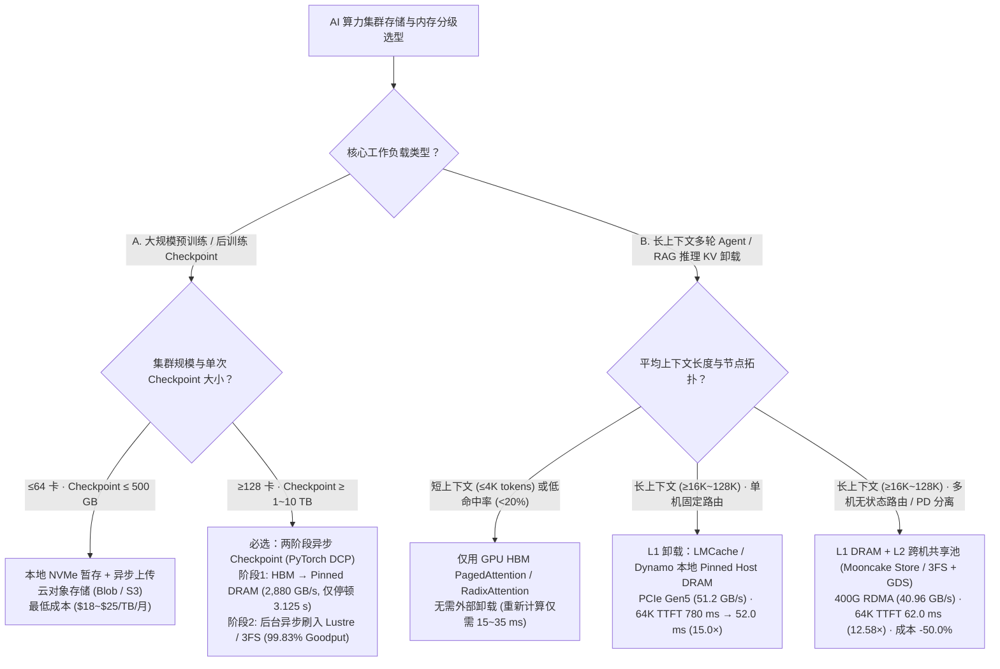
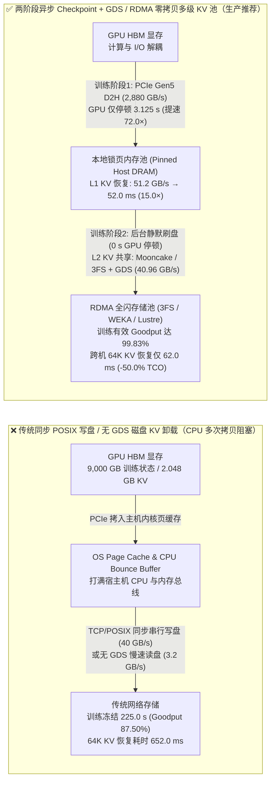
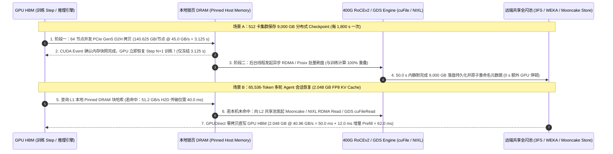

# AI 算力集群存储选型（对象存储 vs 托管 Lustre/GPFS vs RDMA 全闪 3FS/WEKA）、两阶段异步 Checkpoint 与多级 KV Cache 卸载（HBM → Host DRAM → NVMe/GDS）选型与原理解析 FAQ

> **🧭 单一决策维度独立专题拆分导航（Single-Decision Split Navigation — 推荐按独立决策直接阅读）**：
> 为确保每一篇 FAQ 严格聚焦**单一架构决策层**（避免将存储文件系统、I/O 访问通路、训练 Checkpoint 调度与推理 KV 卸载混为一谈），本页作为兼容汇总导航页保留，建议直接访问拆分的独立单决策中英双语六段式指南：
> - **Round 3 独立单专题（训练 Checkpoint 调度选型：同步 POSIX vs 同步 GDS vs 二阶段异步 Checkpoint）**：[`docs/components/training-checkpoint-architecture-selection-faq.md`](./training-checkpoint-architecture-selection-faq.md) ｜ [English (`training-checkpoint-architecture-selection-faq.en.md`)](./training-checkpoint-architecture-selection-faq.en.md)
> - **Round 4 独立单专题（长上下文推理分层 KV Cache 卸载选型：HBM 重算 vs 本地 Pinned DRAM vs 跨机共享 RDMA/NVMe+GDS 池）**：[`docs/components/kv-cache-tiered-offload-selection-faq.md`](./kv-cache-tiered-offload-selection-faq.md) ｜ [English (`kv-cache-tiered-offload-selection-faq.en.md`)](./kv-cache-tiered-offload-selection-faq.en.md)
> - **正交层级声明**：`Lustre / GPFS / WEKA / DeepSeek 3FS` 是**分布式存储后端/并行文件系统**；而 **`GPUDirect Storage (GDS / cuFile)` 是绕过 Linux CPU Page Cache 的 PCIe P2P DMA 零拷贝 I/O 访问通路**（不是与 Lustre/WEKA/3FS 互斥的文件系统，Lustre/WEKA/3FS/本地 NVMe 均可启用 GDS 通路）。

> **文档定位**：本文面向 AI 解决方案架构师（AI Solution Architect）、智算中心存储与基础设施负责人及大模型训推工程团队，用通俗易懂的第一性原理回答三个最常被客户问到的存储与内存分级架构问题：**① 训练与推理集群到底该选云对象存储（S3/Blob）、托管并行文件系统（Managed Lustre / Spectrum Scale GPFS）还是 RDMA 原生全闪存储（DeepSeek 3FS / WEKA / VAST + GPUDirect Storage）？② 千卡训练为什么会因为保存 Checkpoint 而损失超过 10% 的算力？两阶段异步 Checkpoint（HBM → Pinned DRAM → 后台落盘）如何把停顿时间压缩 72 倍？③ 长上下文多轮 Agent 推理显存不够用时，多级 KV Cache 卸载（HBM → Host DRAM → 共享 RDMA/NVMe 池，基于 LMCache / Mooncake Store / NVIDIA NIXL）什么时候划算、什么时候反而比重新计算（Recompute）更慢？**
>
> **数据溯源与口径声明（Provenance）**：本文引用的 PCIe Gen5 x16、400G RoCEv2 / ConnectX-7、NVIDIA GPUDirect Storage (GDS)、DeepSeek 3FS、LMCache 与 Mooncake Store 架构特性属于**厂商/开源社区公开发布参考规格（`anonymized_reported`, `independently_reproduced=false`）**；文中第 ⑤ 节与配套 7-Card 报告中的 512 卡 `9,000 GB`（`9.0 TB`）训练 Checkpoint 停顿算例及 `65,536` tokens（`2.048 GB` FP8 KV 载荷）多级 KV 卸载算例，均来自本仓库封存的**确定性存储与 PCIe/RDMA 带宽分析模型（`synthetic`, `experiments/ai_storage_checkpoint_kv_offload/results.json`）**。本轮未启动付费云端 512 卡物理 GPU 集群（`paid_cloud_gpu_launched=false`, `live_512gpu_cluster_measurement="not_measured"`），本机实测仅限 Python 算例 CLI 与 `818` 项单元测试（`measured_local_python_unittest_and_check_cli_only`）。
> **English Edition**: [`docs/components/ai-storage-checkpoint-kv-offload-selection-faq.en.md`](ai-storage-checkpoint-kv-offload-selection-faq.en.md) · **7-Card 视觉评测报告**：[`docs/reports/ai-storage-checkpoint-kv-offload-cards.html`](../reports/ai-storage-checkpoint-kv-offload-cards.html) · **一图流总结 SVG**：[`assets/svg/ai-storage-checkpoint-kv-offload-faq-summary.svg`](../../assets/svg/ai-storage-checkpoint-kv-offload-faq-summary.svg)

---

## ① 📌 核心结论速览（Executive Summary）

1. **存储底座选型铁律（何时选对象存储、何时选 Lustre/GPFS、何时选 RDMA 全闪 3FS/WEKA + GDS）**：
   - **原始语料湖、冷归档与小规模微调（`≤64` 卡）**：首选 **云对象存储（Azure Blob / AWS S3）+ 计算节点本地 NVMe 缓存**，单 TB 月成本最低（`~$18–$25/TB/月`），无需常驻昂贵并行文件系统。
   - **中大型预训练与多团队共享集群（`64～1,024` 卡）**：首选 **托管并行文件系统（Azure AMLFS / AWS FSx for Lustre / IBM Spectrum Scale GPFS）**，兼顾 POSIX 生态兼容性与数十至上百 GB/s 聚合吞吐。
   - **超大规模 MoE 训推一体、高频 Checkpoint 与跨机 KV Cache 共享池（`≥256` 卡 + 400G RDMA）**：首选 **RDMA 原生全闪并行文件系统（DeepSeek Fire-Flyer 3FS / WEKA / VAST）配合 NVIDIA GPUDirect Storage (GDS)**，绕过 CPU 页缓存直接从 NVMe/RDMA 网卡 DMA 到 GPU HBM，单节点读取可达 `40+ GB/s`、集群聚合吞吐达数百 GB/s 至数 TB/s。
2. **训练容灾提效铁律（两阶段异步 Checkpoint 将 GPU 停顿从 `225.0 s` 压至 `3.125 s`，压缩 `72.0×`）**：
   - 在 512 卡集群每 `30 分钟（1,800 s）` 保存一次 `9,000 GB（9.0 TB）` 分布式模型与优化器状态时，传统同步 POSIX 写盘（聚合 `40.0 GB/s`）会让全部 GPU 原地空等 **`225.0 s`**，有效训练吞吐率（Goodput）跌至 **`87.50%`**。
   - 启用 **两阶段异步 Checkpoint（PyTorch DCP / Megatron Async Checkpoint）**：第一阶段利用 64 台服务器本地 PCIe Gen5 x16 通道将分片状态高速拷贝至 **锁页主机内存（Pinned Host DRAM，单机实效 `45.0 GB/s`、全集群聚合 `2,880.0 GB/s`）**，GPU 仅冻结 **`3.125 s`**（`9,000 GB / 2,880.0 GB/s = 3.125 s`，停顿时间缩短 **`72.0×`**）即可立即恢复训练；第二阶段由后台 CPU/RDMA 线程在 `50.0 s` 内静默刷入远端持久化存储（`0 s` 额外 GPU 停顿），使集群有效训练 Goodput 跃升至 **`99.83%`**（净增 **`+12.33 个百分点`**，按 `$4.00/GPU-hr` 计算每月挽回 **`$181,813`** 白白空转的算力成本）。
3. **长上下文多轮 KV Cache 卸载铁律（为什么绝对不能用普通 TCP/POSIX 磁盘卸载 KV Cache）**：
   - 对于 `65,536` tokens（`2.048 GB` FP8 KV Cache）的多轮 Agent 会话，若直接丢弃并重新计算 Prefill（Recompute），首字延迟 TTFT 高达 **`780.0 ms`**（单百万 Token 成本 `$0.96`）；若卸载到无 GDS 的传统 POSIX/TCP 云盘（经 CPU 缓冲区仅 `3.2 GB/s`），读取耗时 `640.0 ms`（总 TTFT **`652.0 ms`**，仅比重新算快 `1.20×` 且打满宿主机 CPU）。
   - 采用 **LMCache / Dynamo KVBM 本地锁页 DRAM 缓存池（PCIe Gen5 实效 `51.2 GB/s`）**，加载 `2.048 GB` KV 仅需 `40.0 ms`（加上 `12.0 ms` 新增轮次增量计算，总 TTFT **`52.0 ms`**，提速 **`15.0×`**，成本降至 **`$0.44/1M`，`-54.2%`**）；采用 **Mooncake Store / 3FS + GDS 跨机共享 RDMA/NVMe 池（400G RoCEv2 实效 `40.96 GB/s`）**，加载耗时 `50.0 ms`（总 TTFT **`62.0 ms`**，提速 **`12.58×`**，成本降至 **`$0.48/1M`，`-50.0%`**），同时实现跨节点无状态调度。

---

## ② 🎯 客户与架构师灵魂拷问 Q&A（从第一性原理讲透）

### Q1：训练和推理集群的存储底座，什么时候用对象存储（Blob/S3），什么时候用托管 Lustre/GPFS，什么时候必须上 RDMA 全闪（如 DeepSeek 3FS / WEKA）？

- **第一性原理拆解：AI 集群的三种 I/O 模式截然不同**：
  1. **数据预处理与冷备份（大块顺序流式 I/O，对毫秒级延迟不敏感）**：对象存储（S3 / Azure Blob）采用 HTTP REST 接口，高并发吞吐大、成本极低，但单次请求首字节延迟在 `10～50 ms` 量级且不支持原位随机修改。只要配合计算节点自带的本地 NVMe SSD 做数据集预拉取缓存（如 JuiceFS / Alluxio / BlobFuse），就能以最低成本喂饱中小规模训练。
  2. **千卡级同步/异步 Checkpoint 写突发（高带宽并发写 I/O）**：当几百上千张 GPU 同时写出数 TB 优化器状态时，对象存储容易触发前缀限流（Throttling）。托管并行文件系统（Managed Lustre / GPFS）将文件条带化（Striping）分布在数十个 OST 存储目标上，提供稳定的 POSIX 语义与 `40～200+ GB/s` 聚合写带宽。
  3. **MoE 多模态小文件随机读与跨机 KV Cache 实时交换（微秒级低延迟 + 超高 IOPS 随机读）**：当多轮 Agent 需要从共享存储池在 **`50 ms` 以内**拉回 `2.048 GB` 的 KV Cache 分块时，任何经过操作系统内核页缓存（OS Page Cache）和 TCP/IP 协议栈的路径都会太慢。**RDMA 原生全闪文件系统（如开源的 DeepSeek 3FS、商业 WEKA / VAST）** 结合 **GPUDirect Storage (GDS)**，允许网卡/NVMe 控制器通过 PCIe BAR 空间把数据直接 DMA 写入 GPU HBM，彻底砍掉 CPU 内存拷贝。

### Q2：什么是 GPUDirect Storage (GDS) 与 NVIDIA NIXL？传统 POSIX 读取为什么会卡在“CPU 弹跳缓冲区（Bounce Buffer）”？

- **传统 POSIX 存储路径的瓶颈（为什么装了 8 块 PCIe Gen5 NVMe 还是跑不满带宽？）**：
  - 在传统 Linux `read()` / `write()` 路径下，GPU 显存（HBM）并不是操作系统内核文件系统的直接合法目标地址。当应用要把磁盘或网络文件系统上的 Checkpoint / KV Cache 读入 GPU 时，数据必须先由 NVMe/网卡 DMA 到 **主机内核页缓存（Host Page Cache / Bounce Buffer）**，再由 CPU 执行内存拷贝到用户态缓冲区，最后调用 `cudaMemcpyHostToDevice` 经 PCIe 总线拷入 GPU HBM。
  - 这意味着：**同一份数据在主机内存总线和 PCIe Root Complex 上往返折腾了 2～3 次**，不仅吃光了双路服务器宝贵的 CPU 内存带宽，还把单机实效吞吐限制在 `3～10 GB/s`。
- **GPUDirect Storage (`cuFile` API) 与 NIXL 的核心突破**：
  - **GDS (`nvidia-fs` 内核驱动)** 在 NVMe SSD / RDMA 网卡与 GPU HBM 之间建立点对点（Peer-to-Peer）DMA 通道。存储设备直接向 GPU 显存地址发起 DMA 读写，**绕过主机 CPU 与 OS Page Cache（Zero-Copy）**，使单台 8 卡服务器的直通读吞吐跃升至 `40～100+ GB/s`。
  - **NVIDIA NIXL（Dynamo 传输抽象层）/ Mooncake Transfer Engine**：在推理层把 GPU HBM、本地锁页 DRAM、本地 NVMe SSD 和远端 RDMA 存储统一抽象为异步非阻塞块传输接口，推理引擎无需关心底层是 `cudaMemcpyAsync`、RoCEv2 `ibv_post_send` 还是 GDS `cuFileRead`。

### Q3：千卡集群训练为什么会被 Checkpoint 拖垮？“两阶段异步 Checkpoint”在底层是如何把 225 秒停顿变成 3 秒的？

- **为什么同步 Checkpoint 是算力黑洞？**
  - 在 512～4,096 卡集群上，硬件故障（光模块闪断、HBM ECC 错误、节点掉线）平均每隔几小时就会发生一次，因此必须每 `15～30 分钟（1,800 s）` 保存一次完整训练状态（包含 FP32 主权重、一阶/二阶 Adam 动量方差，对于 671B 模型总状态约 **`9,000 GB`**）。
  - 如果采用传统**同步保存（`torch.save`）**，所有 GPU 必须停下前向/反向传播，等待 `9,000 GB` 数据以 `40.0 GB/s` 写完共享存储——每次停顿 **`225.0 秒`**，相当于每训练 30 分钟就要发呆近 4 分钟，白白烧掉 **`12.50%`** 的 GPU 租金！
- **两阶段异步 Checkpoint（Two-Phase Async Checkpointing）的工作机制**：
  1. **阶段一（D2H 内存快照，仅需 `3.125 秒`）**：当触发 Checkpoint 时，64 台计算节点各自通过本地 PCIe Gen5 x16 通道（单机实效 D2H 带宽 `45.0 GB/s`，64 机聚合高达 **`2,880.0 GB/s`**），将每台机器负责的 `140.625 GB`（`9,000 GB / 64`）分片状态高速拷贝到本地预分配的 **锁页主机内存（Pinned Host DRAM）**。拷贝完成的瞬间（仅 `140.625 / 45.0 = 3.125 s`），GPU 立即继续下一轮训练 step！
  2. **阶段二（后台异步落盘，`0 秒` GPU 停顿）**：独立后台进程（Background Persister Threads）在接下来的 `50.0 秒`（按 `180.0 GB/s` 聚合写带宽）内，把 Host DRAM 中的快照流式写入 Lustre / 3FS / 对象存储，与 GPU 计算 **100% 重叠（Overlap）**。
  - **安全护栏**：在前向/反向开始更新下一 step 权重（`optimizer.step()`）前，只需用 CUDA Event 确保阶段一的 `3.125 s` D2H 拷贝已完成，即可保证 Checkpoint 严格一致性。

### Q4：长上下文多轮推理的“多级 KV Cache 卸载（HBM → DRAM → NVMe）”什么时候值得开？它的收益拐点在哪里？

- **第一性原理：卸载（Offload）本质上是“用 PCIe/RDMA 带宽换取 GPU Prefill 算力”**：
  - 每次用户发起新一轮对话（或 Agent 工具调用返回），如果历史 `L` 个 token 的 KV Cache 已被挤出 HBM：
    - **重新计算耗时** $T_{\text{recompute}}(L)$ 随上下文长度超线性增长（在 `65,536` tokens 下约需 **`780.0 ms`**）；
    - **从外部存储加载耗时** $T_{\text{reload}}(L) = \frac{\text{KV\_Bytes}(L)}{BW_{\text{effective}}} + T_{\text{delta}}$。
  - **定量拐点公式**：只有当外部存储的实效加载带宽 $BW_{\text{effective}}$ 使得 $T_{\text{reload}}(L) \ll T_{\text{recompute}}(L)$ 时，KV 卸载才具有正收益！
  - 以 `65,536` tokens（FP8 KV 载荷 `2.048 GB = 16.384 Gb`）为例：
    - **本地锁页 DRAM（PCIe Gen5，`51.2 GB/s`）**：加载时间 `2.048 / 51.2 = 40.0 ms`，加 `12.0 ms` 增量 Prefill 共 **`52.0 ms`**（比重新算快 **`15.0×`**）——**极度划算！**
    - **跨机 RDMA / GDS 全闪池（Mooncake Store / 3FS，`40.96 GB/s`）**：加载时间 `2.048 / 40.96 = 50.0 ms`，总 TTFT **`62.0 ms`**（比重新算快 **`12.58×`**），且任意节点都能接管会话——**大规模集群必选！**
    - **普通 TCP/POSIX 云盘（无 GDS，`3.2 GB/s`）**：加载时间 `2.048 / 3.2 = 640.0 ms`，总 TTFT **`652.0 ms`**（仅快 `1.20×`，且引发严重 CPU 软中断）——**绝对不要用于在线 KV 卸载！**

---

## ③ 🧭 直观可视化图解（Mermaid 选型决策树 + 传统 POSIX vs GDS/两阶段异步路径对比 + 完整时序图）

### 3.1 AI 集群存储、Checkpoint 与多级 KV Cache 选型决策树（`flowchart TD`）

### 3.2 传统 POSIX/CPU 弹跳缓冲路径 vs GPUDirect Storage (GDS) & 两阶段异步路径对比图（`flowchart LR`）

### 3.3 两阶段异步 Checkpoint 与多级 KV Cache 零拷贝恢复时序图（`sequenceDiagram`）

---

## ④ 📊 架构师选型决策矩阵（Architect Decision Matrix）

| 对比维度 | 云对象存储 (`Blob / S3` + 本地 NVMe 缓存) | 托管并行文件系统 (`Managed Lustre / GPFS`) | 两阶段异步 Checkpoint (`PyTorch DCP + Pinned DRAM`) | 本地锁页 DRAM KV 池 (`LMCache / Dynamo L1`) | 跨机共享 RDMA/NVMe KV 池 (`Mooncake Store / 3FS + GDS`) |
| :--- | :--- | :--- | :--- | :--- | :--- |
| **1. 核心适用场景** | 原始语料湖、冷归档、中小规模微调（`≤64` 卡） | `64～1,024` 卡预训练集群、POSIX 共享工作目录 | **所有 `≥128` 卡大模型预训练 / 强化学习后训练容灾保存** | **单机/固定路由长上下文多轮 Agent 与代码助手（`16K～128K`）** | **多机无状态负载均衡、PD 分离与超长上下文共享 KV 池** |
| **2. 关键延迟与吞吐量级（封存 `synthetic` 算例）** | 首字节延迟 `10～50 ms`，适合顺序流式预取 | 聚合写 `40.0 GB/s`；同步保存 `9,000 GB` 停顿 **`225.0 s`**（Goodput `87.50%`） | **聚合 D2H `2,880.0 GB/s`；GPU 仅停顿 `3.125 s`（提速 `72.0×`），Goodput `99.83%`** | **实效恢复 `51.2 GB/s`；64K KV 恢复耗时 `40.0 ms`，总 TTFT `52.0 ms`（`15.0×`）** | **实效恢复 `40.96 GB/s`；64K KV 恢复耗时 `50.0 ms`，总 TTFT `62.0 ms`（`12.58×`）** |
| **3. 底层核心机制** | HTTP REST 分块上传下载 + 节点 SSD 目录缓存 | OST 条带化并行 I/O + 分布式锁管理 | 阶段1 PCIe Gen5 D2H 锁页内存快照 + 阶段2 后台异步落盘 | 内容哈希块索引 + PCIe Gen5 `cudaMemcpyAsync` H2D 零拷贝 | GPUDirect Storage (`cuFile`) / RDMA Read 绕过 CPU 直写 HBM |
| **4. 优劣势与容灾边界** | 成本极低、无限扩展；但不可直接用于高频同步写或在线 KV 恢复 | 生态成熟、开箱即用；但同步写仍会阻塞 GPU | 几乎彻底消除 Checkpoint 停顿；需预留每机 `256～512 GB` Host DRAM | 速度最快、无需改网络；但局限于单机内存容量且跨机不共享 | 跨机全局共享、容量可扩展至数十 TB；需 400G RoCEv2/IB 与 GDS 驱动 |
| **5. 生态开放度** | 云厂商托管服务 + 开源缓存层（JuiceFS/BlobFuse） | 云厂商全托管（AMLFS / FSx）或商业软件 | **PyTorch Distributed Checkpoint (`torch.distributed.checkpoint`) 原生开源** | **LMCache / vLLM / SGLang HiCache / Dynamo KVBM 开源** | **Mooncake Store / DeepSeek 3FS / NVIDIA NIXL 开源** |
| **6. 综合 TCO 成本收益** | 存储单价最低（`~$20/TB/月`） | 中等存储成本，但若同步写会浪费 `12.5%` 算力费 | **512 卡集群每月挽回 `$181,813` 空转算力（净增 `+12.33 pts` Goodput）** | **64K 多轮推理成本从 `$0.96` 降至 `$0.44 / 1M`（降本 `-54.2%`）** | **64K 多轮推理成本从 `$0.96` 降至 `$0.48 / 1M`（降本 `-50.0%`）** |

---

## ⑤ 🧪 简明定量算例与 Benchmark 洞察（`experiments/ai_storage_checkpoint_kv_offload`）

我们在确定性模型 `experiments/ai_storage_checkpoint_kv_offload/run.py`（封存结果位于 `experiments/ai_storage_checkpoint_kv_offload/results.json`，通过 `python experiments/ai_storage_checkpoint_kv_offload/run.py --check` 100% 校验，标注为 `synthetic`）中对两大核心场景进行了严格定量建模：

### 5.1 算例 A：512 卡训练集群 `9,000 GB`（`9.0 TB`）分布式 Checkpoint 停顿与有效算力（每 `1,800 s` 保存一次）

| Checkpoint 架构方案 | 阶段一实效聚合带宽 | 每次保存 GPU 冻结停顿 (`s`) | 后台异步刷盘耗时 (`s`) | 集群有效训练 Goodput (`%`) | 较同步 POSIX 停顿缩短倍数 | 数据属性 (`provenance`) |
| :--- | :--- | :--- | :--- | :--- | :--- | :--- |
| **1. 传统同步 POSIX 写盘 (`sync_posix_lustre`)** | `40.0 GB/s` | `225.0 s` | `0.0 s`（完全阻塞） | `87.50%` | `1.00×` (Baseline) | `synthetic` |
| **2. 同步 GDS + RDMA 全闪写盘 (`sync_gds_rdma_fs`)** | `360.0 GB/s` | `25.0 s` | `0.0 s`（同步直写） | `98.61%` | `9.00×` | `synthetic` |
| **3. 两阶段异步 Checkpoint (`two_phase_async_dram_nvme` · 推荐)** | **`2,880.0 GB/s`** (`64 机 × 45.0 GB/s` D2H) | **`3.125 s`** | `50.0 s`（与训练重叠） | **`99.83%`** (`+12.33 pts`) | **`72.00×`** | `synthetic` |

- **算术透明核验**：
  - `9,000 GB / 40.0 GB/s = 225.0 s`（`1 - 225.0 / 1800.0 = 87.50%`）；
  - `9,000 GB / 360.0 GB/s = 25.0 s`（`225.0 / 25.0 = 9.00×`）；
  - 两阶段异步第一阶段：64 台节点每节点分担 `9,000 / 64 = 140.625 GB`，按本地 PCIe Gen5 D2H 实效带宽 `45.0 GB/s`（全集群 `64 × 45.0 = 2,880.0 GB/s`），GPU 冻结时间恰好为 `9,000 / 2,880.0 = 3.125 s`（`225.0 / 3.125 = 72.00×`），有效训练 Goodput 达 `1 - 3.125 / 1800.0 = 99.83%`。按 512 卡 × `$4.00/GPU-hr` × `720 hr/月` = `$1,474,560/月` 算力成本计算，净增的 `12.33%` Goodput 每月直接挽回 **`$181,813.25`** 的 GPU 空转损失！

### 5.2 算例 B：`65,536` Tokens 多轮 Agent 会话 KV Cache 分级卸载（单会话 `2.048 GB = 16.384 Gb` FP8 KV 载荷）

| KV Cache 恢复与分级方案 | 实效加载带宽 (`GB/s`) | `2.048 GB` KV 传输耗时 (`ms`) | 恢复首字延迟 TTFT (`ms` · 含 `12.0 ms` 增量 Prefill) | 较重新计算提速倍数 | 单百万 Token 综合成本 (`$/1M`) | 数据属性 (`provenance`) |
| :--- | :--- | :--- | :--- | :--- | :--- | :--- |
| **1. 无卸载 · 重新计算 64K Prefill (`hbm_evict_recompute`)** | `0.0 GB/s` | `0.0 ms` | `780.0 ms` | `1.00×` (Baseline) | `$0.96` | `synthetic` |
| **2. 传统 POSIX/TCP 云盘卸载 (`cloud_posix_tcp_nofs` · 无 GDS)** | `3.2 GB/s` | `640.0 ms` | `652.0 ms` | `1.20×`（不划算） | `$0.84` (`-12.5%`) | `synthetic` |
| **3. 跨机共享 RDMA / NVMe 池 (`shared_rdma_nvme_gds` · Mooncake/3FS)** | **`40.96 GB/s`** | **`50.0 ms`** | **`62.0 ms`** | **`12.58×`** | **`$0.48` (`-50.0%`)** | `synthetic` |
| **4. 本地锁页 DRAM 池 (`host_dram_pinned_pcie5` · LMCache/Dynamo)** | **`51.20 GB/s`** | **`40.0 ms`** | **`52.0 ms`** | **`15.00×`** | **`$0.44` (`-54.2%`)** | `synthetic` |

- **算术透明核验**：
  - 本地锁页 DRAM：`2.048 GB / 51.20 GB/s = 0.040 s = 40.0 ms`，加 `12.0 ms` 新增轮次 Prefill = **`52.0 ms`**（`780.0 / 52.0 = 15.00×`）；
  - 跨机共享 RDMA/GDS 池：`2.048 GB / 40.96 GB/s = 0.050 s = 50.0 ms`，加 `12.0 ms` = **`62.0 ms`**（`780.0 / 62.0 = 12.58×`）；
  - 传统 POSIX/TCP 云盘：`2.048 GB / 3.20 GB/s = 0.640 s = 640.0 ms`，加 `12.0 ms` = **`652.0 ms`**（`780.0 / 652.0 = 1.20×`）。

---

## ⑥ 🛠️ 附录：生产环境快速核验与售前打单清单（Architect Checklist）

- [ ] **1. 核查训练节点 Host DRAM 配比是否支撑两阶段异步 Checkpoint**：每台 8×H200 (1,128 GB HBM) 或 8×B200 (1,440 GB HBM) 训练服务器，宿主机系统内存（Host DRAM）必须配置 **`≥1.5 TB～2.0 TB`**，并预留至少 `256～512 GB` `mlock` 锁页内存供 `torch.distributed.checkpoint.async_save` 使用，防止触发 Linux OOM Killer。
- [ ] **2. 核查 GPUDirect Storage (`nvidia-fs`) 与 PCIe ACS 状态**：在需要直接读写 NVMe 或 RDMA 存储的节点上，执行 `gdscheck -p` 确认 `nvidia-fs` 驱动已加载且 NVMe/NIC 与 GPU 位于同一 PCIe Root Switch 下；确认 BIOS 中已关闭 `PCIe ACS (Access Control Services)`，避免 P2P DMA 回落到 CPU Bounce Buffer。
- [ ] **3. 核查 Checkpoint 原子性与防静默损坏校验**：异步落盘阶段必须采用“先写入临时目录 `.tmp_step_N` → 校验分片 SHA256/CRC32C 与文件大小 → 协调节点执行原子 `rename()`”的提交协议，防止后台刷盘中途宕机产生半截损坏的 Checkpoint。
- [ ] **4. 核查 KV Cache 卸载的上下文长度阈值（避免短 Prompt 负优化）**：在 LMCache / SGLang HiCache / Mooncake Store 中设置最小卸载块阈值（推荐 `chunk_size = 256 tokens` 且仅对 `context_len ≥ 4,096 tokens` 的会话启用外部卸载），避免短请求为几毫秒的计算去发起高开销的远端存储 I/O。
- [ ] **5. 核查多租户 KV 缓存池的加密与租户隔离**：当使用跨节点共享 DRAM/NVMe 池（Mooncake Store / 3FS）缓存企业客户 Prompt 的 KV 向量时，必须在块哈希键（Cache Key）中强制拼入 `tenant_id + model_revision_hash`，并在多租户敏感场景启用传输加密与 TTL 自动过期清理。
- [ ] **6. 明确区分模拟算例与客户现场 PoC 压测基线**：向客户提交方案时，明确说明理论算例（`synthetic`）基于 `45.0 GB/s` 单机 D2H 与 `40.96～51.2 GB/s` KV 加载带宽推导；上线前需在客户目标集群使用 `fio`、`gdsio -I 0 -w 16` 及推理引擎真实长文本回放脚本采集现场 `measured` 基线。
