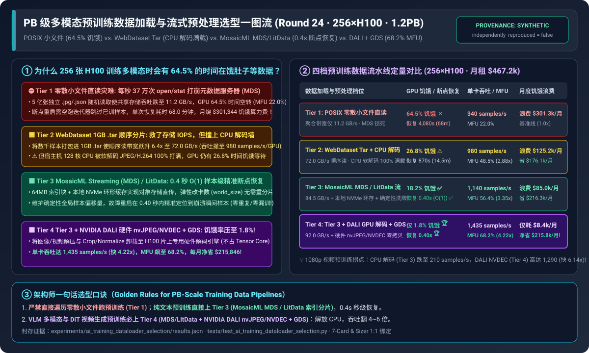
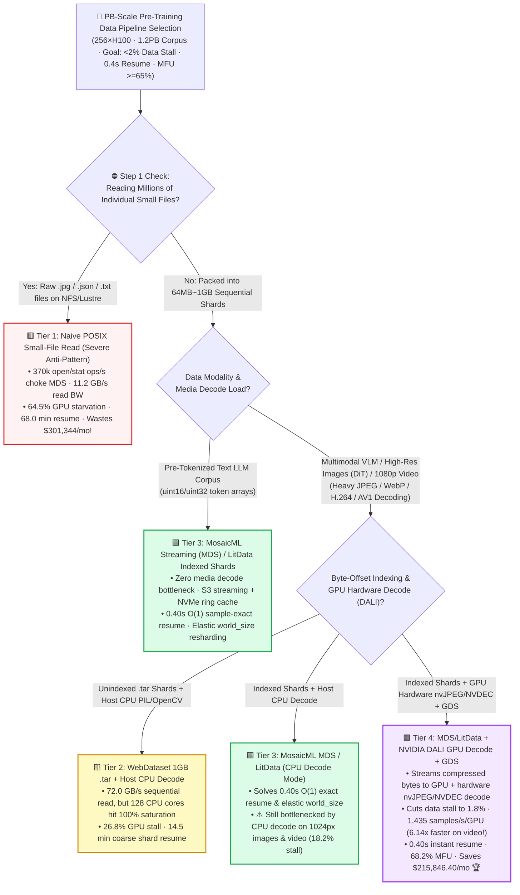
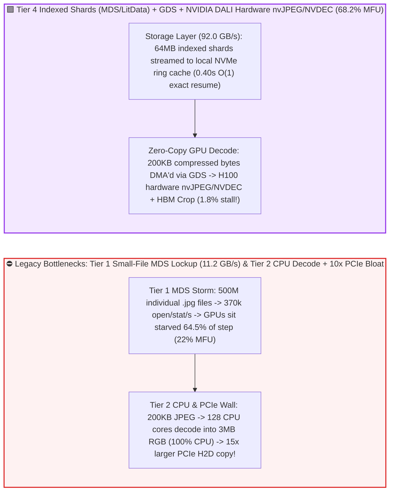
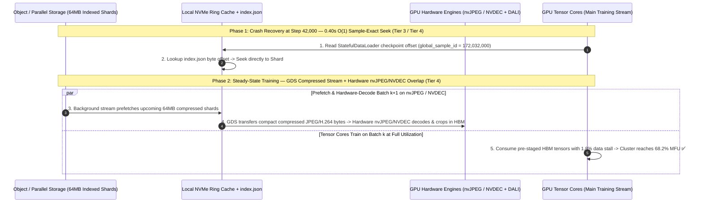

# Petabyte-Scale Multimodal Pre-Training Data Loader & Streaming Pipeline Selection FAQ (`Small-File POSIX Read` vs. `WebDataset Tar Shards` vs. `MosaicML MDS / LitData Deterministic Stream` vs. `NVIDIA DALI GPU Decode + GDS`)

> 🌐 **Language**: **[中文 (Chinese)](./ai-training-data-loader-storage-pipeline-selection-faq.md)** | **English Version** · **[📖 Back to Repository README](../../README.en.md)** · **[📊 2026-11-09 Daily Progress Report](../daily/2026-11-09.md)** · **[🃏 7-Card 4:5 Visual Benchmark Report](../reports/ai-training-data-loader-storage-pipeline-selection-cards.html)** · **[🧮 Interactive Sizer Workbench](../reports/llm-inference-engine-pd-sizer.en.html#dataloader-pipeline-sizer)**
>
> **Overview**: A first-principles selection guide for AI Solution Architects. When training a multimodal VLM or video diffusion (DiT) foundation model across `256 × NVIDIA H100` GPUs (`$467,200/month` lease), one of the largest hidden compute drains is **`DataLoader` Starvation**: **(1) reading 500 million individual `.jpg` and `.json` files directly from shared POSIX/NFS/Lustre storage triggers 370,000 `open/stat/close` metadata calls per second—choking the Metadata Server (MDS), leaving GPUs idle for `64.5%` of every step, and burning `$301,344/month`; (2) packing files into `WebDataset (.tar)` shards fixes storage IOPS, but saturates all 128 host CPU cores on software JPEG/H.264 decoding; and (3) crashing at Step 42,000 forces stateless tar iterators to spend `14.5 ~ 68.0 minutes` fast-forwarding through already-seen batches!** Grounded in `experiments/ai_training_dataloader_selection/` (`synthetic` + `anonymized_reported`, `independently_reproduced=false`), this guide establishes the exact boundaries across four pre-training data pipeline tiers.



---

## ① 📌 Executive Summary

1. **Four-Tier Selection by Data Modality (Pre-Tokenized Text vs. High-Res Image VLM vs. 1080p Video DiT) and Elastic Resume SLA**:
   - Across a `256 × NVIDIA H100` cluster (`32` nodes × `8` GPUs, `128` CPU cores/node, **`$467,200.00/month`** lease) training on a **`1.2 PB` (500M-sample) multimodal dataset** (requiring **`1,450 samples/s/GPU`** = `92.8 GB/s` cluster stream to saturate H100 Tensor Cores):
   - 🟥 **Tier 1 (`Naive PyTorch Dataset + Millions of Small POSIX/NFS Files`)**: **Never use above 100k samples**! Random `open/stat` storms cap 32-node storage throughput at **`11.2 GB/s`**, starving GPUs for **`64.5%` of every step** (`340 samples/s/GPU`, **`22.0%` MFU**), requiring **`4,080.0 seconds (68.0 min)`** to fast-forward on mid-epoch resume, and wasting **`$301,344.00/month`**.
   - 🟨 **Tier 2 (`WebDataset 1GB .tar Sequential Shards` + Host CPU `PIL/OpenCV` Decode)**: **Fixes storage IOPS, but hits the Host CPU Decode Wall and coarse resume**. Sequential `1 GB` tar reads lift storage bandwidth **`6.4x` to `72.0 GB/s`** (`980 samples/s/GPU`, `48.5%` MFU), but software JPEG/video decoding pegs all 128 CPU cores at 100% (`26.8%` GPU starvation) and lacks byte-offset indexing for instant mid-shard resume (`870.0 s / 14.5 min` recovery).
   - 🟩 **Tier 3 (`MosaicML Streaming [MDS] / Lightning LitData` Indexed Shards + Local NVMe Ring Cache + $O(1)$ Deterministic Resume)**: **The cloud-native standard for text LLMs and medium-res multimodal training**. Maintains a byte-offset `index.json` across `64 MB` compressed shards, enabling **`0.40-second` $O(1)$ sample-exact mid-epoch resume** (even when `world_size` changes elastically!), reaching `1,140 samples/s/GPU` and **`56.4%` MFU**.
   - 🟪 **Tier 4 (Tier 3 Indexed Stream + `NVIDIA DALI` Hardware `nvJPEG / NVDEC` Decode + `GPUDirect Storage [GDS]` Zero-Copy Pipeline)**: **The mandatory endgame for high-res VLM (`1024×1024`) and 1080p video DiT pre-training**. Offloads media decompression and crop/normalize augmentations from host CPUs onto **dedicated H100 hardware media engines (`nvJPEG` / `NVDEC`, zero Tensor Core contention!)**—slashing data starvation to **`1.8%`**, lifting throughput to **`1,435 samples/s/GPU` (`4.22x` over Tier 1; `6.14x` faster than CPU decode on 1080p video!)**, reaching **`68.2%` MFU**, and **saving `$215,846.40/month` 🏆**!
2. **First-Principles Law (The Three Walls of PB-Scale Data Loading)**:
   - **Wall 1 (Metadata IOPS Wall)**: Consolidate millions of small files into `64 MB ~ 1 GB` sequential shards to eliminate MDS `open/stat` locks.
   - **Wall 2 (CPU Decode & PCIe Amplification Wall)**: Sending compressed `200 KB` JPEG/H.264 bytes over PCIe and decoding inside GPU hardware `nvJPEG / NVDEC` avoids both 128-core CPU saturation and `10x` uncompressed RGB PCIe bandwidth amplification.
   - **Wall 3 (Stateful Mid-Epoch Resume Wall)**: Only byte-indexed shards (`MDS / LitData`) allow $O(1)$ sample-exact seek after a checkpoint restore without re-reading or dropping samples.
3. **Provenance & Transparency Disclosure**:
   - All bandwidths, starvation percentages, sample throughputs, resume latencies, and MFU figures are bound 1:1 to `experiments/ai_training_dataloader_selection/results.json` (`provenance_type: "synthetic"`, calibrated to published WebDataset, MosaicML StreamingDataset, Lightning LitData, and NVIDIA DALI specifications; `independently_reproduced: false`, `physical_gpu_cluster_measurement: "not_measured"`, `local_cpu_harness_measurement: "measured"`).

---

## ② 🎯 Architect & Customer Deep-Dive Q&A (FAQ-Driven)

### Q1: "Our all-flash parallel filesystem is rated at `100 GB/s`. Why is our 256-GPU multimodal job getting only `11.2 GB/s` and stalling 64.5% of the time?"

- **Plain-English Answer**: **Storage arrays achieve `100 GB/s` on sequential multi-megabyte reads, not on 370,000 random `open/stat/close` calls per second across 500 million individual `250 KB` `.jpg` files! Packing files into `64 MB ~ 1 GB` sequential shards (`WebDataset` / `MDS`) eliminates 99.97% of metadata RPCs and boosts read throughput `6.4x ~ 8.2x` immediately**.

### Q2: Why do foundation model teams prefer `MosaicML Streaming (MDS) / LitData` (Tier 3) over plain `.tar` `WebDataset` (Tier 2)?

- **Plain-English Answer**: **Plain `.tar` archives have no random-access byte index—if a 256-GPU job crashes mid-epoch or rescales to 240 GPUs, you either waste `14.5 minutes` scanning tar headers or corrupt data shuffling. `MDS / LitData` stores a byte-offset `index.json` per shard, enabling `0.40-second` $O(1)$ sample-exact resume across any `world_size`!**

### Q3: Why does `NVIDIA DALI` (Tier 4) boost 1080p video pre-training throughput by **6.14x** over CPU decoding?

- **Plain-English Answer**: **Every H100 GPU contains dedicated hardware JPEG (`nvJPEG`) and video (`NVDEC`) silicon blocks that sit 100% idle when you decode media on CPU with `PIL / OpenCV / decord`. `DALI` transfers compressed bytes to the GPU and decodes + crops directly into HBM using `nvJPEG / NVDEC` without touching Tensor Cores or choking host CPUs!**

---

## ③ 🧭 Visual Architecture Diagrams (Decision Tree, Bottleneck Comparison & DALI+GDS Sequence)

### 3.1 Petabyte-Scale Pre-Training Data Loader & Streaming Decision Tree



### 3.2 Small-File MDS Collapse & CPU Decode Wall vs. `Tier 4 MDS + DALI Hardware Decode + GDS`



### 3.3 End-to-End Sequence: `MDS / LitData` $O(1)$ Resume & `NVIDIA DALI` Hardware Decode Pipeline (`sequenceDiagram`)



---

## ④ 📊 Architect Decision Matrix

*All metrics are bound 1:1 to `experiments/ai_training_dataloader_selection/results.json` (256×H100 across 32 nodes at `$640/hr` = `$467,200.00/mo` lease, `1.2 PB` multimodal corpus, saturation target `1,450 samples/s/GPU`):*

| Dimension | 🟥 Tier 1: `POSIX Small Files` | 🟨 Tier 2: `WebDataset .tar` + CPU Decode | 🟩 Tier 3: `MosaicML MDS / LitData` Stream | 🟪 Tier 4: Tier 3 + `NVIDIA DALI` + `GDS` |
| :--- | :--- | :--- | :--- | :--- |
| **Primary Workload Fit** | `< 100k` toy datasets only | Static-scale medium image runs | **Text LLM pre-training & elastic cloud jobs** | **VLM, high-res DiT & 1080p video pre-training** |
| **32-Node Aggregate Read BW** | `11.2 GB/s` (MDS metadata lockup ✕) | `72.0 GB/s` (sequential tar read ✅) | `84.5 GB/s` (NVMe ring prefetch ✅) | **`92.0 GB/s`** (GDS zero-copy stream 🏆) |
| **Media Decode Hardware** | Host CPU (`PIL / OpenCV`) | Host CPU (128 cores 100% saturated ⚠️) | Host CPU (bottlenecked on high-res ⚠️) | **H100 Hardware `nvJPEG / NVDEC` ASICs 🏆** |
| **Mid-Epoch Resume Latency** | **`4,080.0 s (68.0 min)` ✕** | `870.0 s (14.5 min)` ⚠️ | **`0.40 s`** ($O(1)$ byte-offset seek ✅) | **`0.40 s`** ($O(1)$ byte-offset seek 🏆) |
| **GPU Data Starvation Share** | **`64.5%`** (severe starvation ✕) | `26.8%` | `18.2%` | **`1.8%`** (98.2% overlapped 🏆) |
| **Throughput / Cluster `MFU`** | `340 samples/s` · **`22.0%` MFU** | `980 samples/s` (`2.88x`) · `48.5%` MFU | `1,140 samples/s` (`3.35x`) · `56.4%` MFU | **`1,435 samples/s` (`4.22x`)** · **`68.2%` MFU 🏆** |
| **Monthly Starvation Waste** | Wastes **`$301,344.00 / mo`** | Wastes `$125,209.60 / mo` | Wastes `$85,030.40 / mo` | Wastes `$8,409.60 / mo` · **Saves `$215,846.40/mo` 🏆** |

---

## ⑤ 🧪 Quantitative Case Study & Benchmark Insights

### 5.1 Modality & Resolution Scaling (Text vs. 512px VLM vs. 1024px DiT vs. 1080p Video)

As training data shifts from pre-tokenized text to high-resolution images and video, CPU decoding collapses while GPU hardware decoding (`DALI nvJPEG/NVDEC`) holds line rate (from `results.json` `resolution_modality_sensitivity`):

| Dataset Modality | Tier 1 `Small Files` | Tier 2 `WebDataset CPU` | Tier 3 `MDS/LitData CPU` | Tier 4 `DALI GPU nvJPEG/NVDEC` | Architect Crossover & Takeaway |
| :--- | :--- | :--- | :--- | :--- | :--- |
| **Text-Only Tokens (`Parquet/MDS`)** | `820 samples/s` | `1,410 samples/s` | **`1,440 samples/s` ✅** | **`1,445 samples/s` ✅** | **Pick Tier 3 (`MDS/LitData`)**: No image decode needed; 0.4s resume |
| **`512×512` VLM Image-Text Pairs** | `340 samples/s` ✕ | `980 samples/s` | `1,140 samples/s` | **`1,435 samples/s` 🏆** | `DALI nvJPEG` boosts throughput `+25.9%` over CPU decode |
| **`1024×1024` High-Res DiT Images** | `145 samples/s` ✕ | `510 samples/s` ✕ | `620 samples/s` ✕ | **`1,380 samples/s` 🏆** | **4x pixels halve CPU decode speed; `DALI` is `2.23x` faster!** |
| **`1080p H.264/AV1` Video Clips** | `42 samples/s` ✕ | `165 samples/s` ✕ | `210 samples/s` ✕ | **`1,290 samples/s` 🏆** | **Hardware `NVDEC` beats 128-core CPU video decode by `6.14x`!** |

### 5.2 Reproducibility & Local Harness Verification

```bash
# Verify results.json matches the deterministic training dataloader model 100%
python experiments/ai_training_dataloader_selection/run.py --check

# Run Round 24 unit tests
python -m unittest tests/test_ai_training_dataloader_selection.py
```

---

## ⑥ 🛠️ Production Verification Checklist (Architect Checklist)

1. - [ ] **Ban Raw Small-File Datasets in Pre-Training**: Convert all datasets into `64 MB ~ 512 MB` indexed shards (`MosaicML MDS`, `LitData`, or `WebDataset`) before training launch.
2. - [ ] **Checkpoint `StatefulDataLoader` State alongside Model Weights**: Persist exact sample offsets at every checkpoint so restarts resume in `0.40s` with zero duplicate or skipped samples.
3. - [ ] **Offload Image & Video Decoding to `NVIDIA DALI` (`nvJPEG / NVDEC`)**: Transfer compressed bytes to GPU memory and execute decode + random crop/normalize on dedicated GPU hardware engines.
4. - [ ] **Configure Local NVMe Ring Caching (`cache_limit`)**: Use local NVMe SSDs as a sliding-window prefetch cache in front of S3/Blob object storage.
5. - [ ] **Enforce CPU NUMA Pinning for DataLoader Workers**: Pin DataLoader worker processes to non-master CPU cores on the GPU's local NUMA node to avoid starving the `torchrun` collective control thread.
