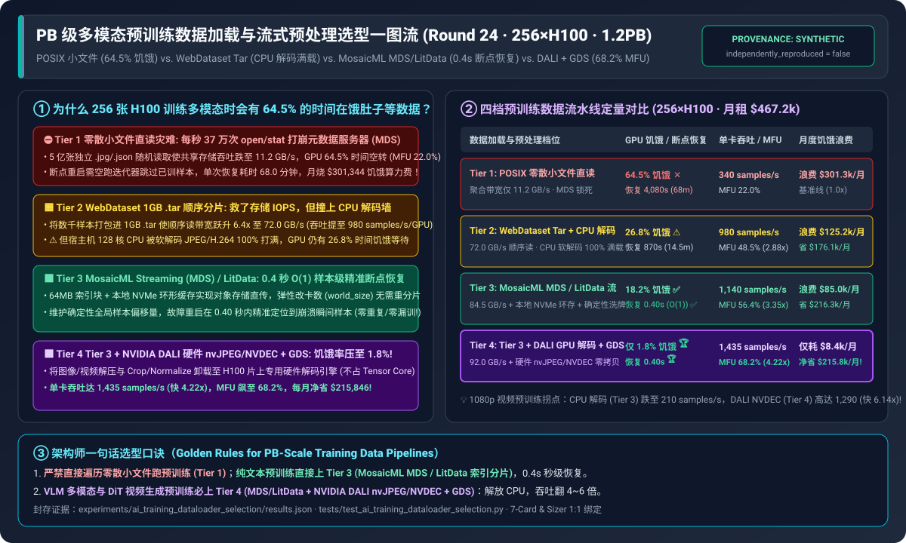
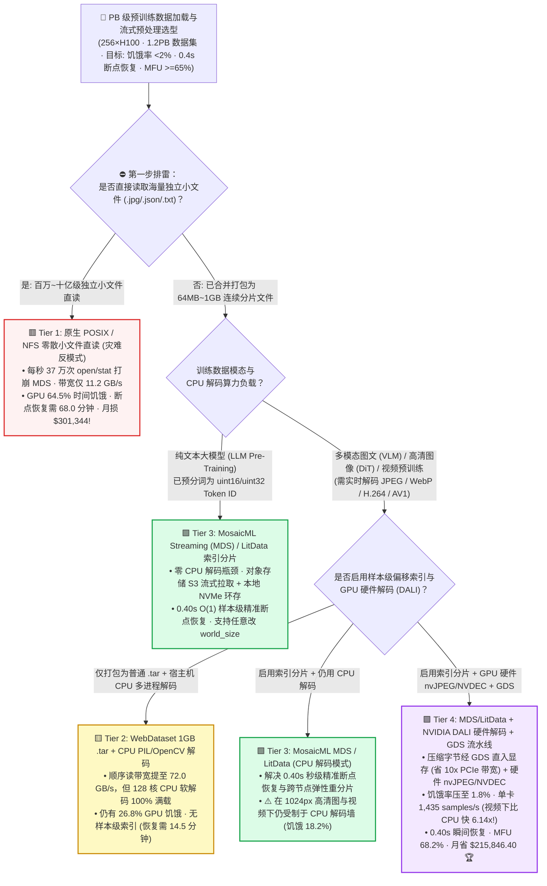
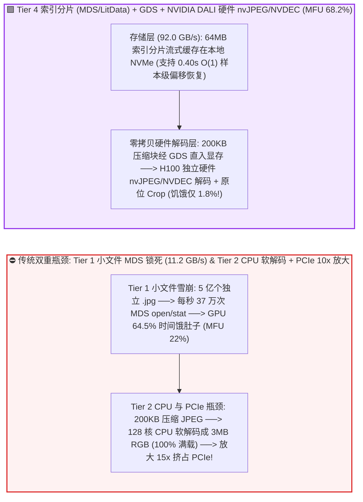
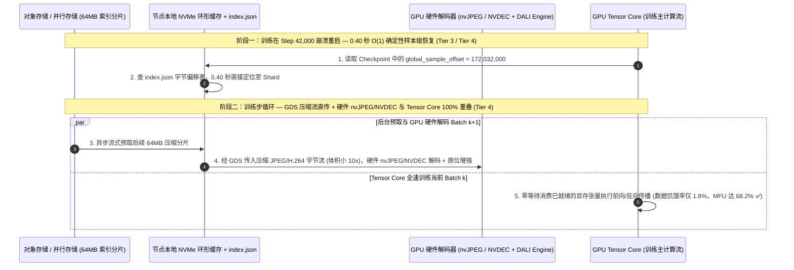

# PB 级多模态预训练数据加载与流式预处理架构选型指南（`POSIX 小文件直读` vs. `WebDataset Tar 顺序分片` vs. `MosaicML MDS / LitData 确定性流` vs. `NVIDIA DALI GPU 硬件解码 + GDS`）

> 🌐 **Language**: **中文 (Chinese)** | **[English Version](./ai-training-data-loader-storage-pipeline-selection-faq.en.md)** · **[📖 返回仓库根目录 README](../../README.md)** · **[📊 2026-11-09 每日进展日报](../daily/2026-11-09.md)** · **[🃏 7-Card 4:5 视觉评测报告](../reports/ai-training-data-loader-storage-pipeline-selection-cards.html)** · **[🧮 交互式定容工作台](../reports/llm-inference-engine-pd-sizer.html#dataloader-pipeline-sizer)**
>
> **导读**：面向 AI Solution Architect 的第一性原理实战选型指南。当企业在 `256 × NVIDIA H100` 集群（月租 `$467,200/月`）上训练多模态大模型（VLM）或视频生成模型（DiT）时，最隐蔽的算力黑洞不在模型算子，而在 **`DataLoader` 数据饥饿（Data Starvation）**：**① 如果直接把 5 亿张独立的 `.jpg` 和 `.json` 零散小文件放在共享 NFS / Lustre / 对象存储 FUSE 上读取，每秒 37 万次 `open/stat/close` 会瞬间打崩存储元数据服务器（MDS），导致 256 张 H100 有 `64.5%` 的时间停下来干等 `next(dataloader)`，每月白白烧掉 `$301,344`；② 即使打包成 `WebDataset (.tar)` 解决了磁盘 IOPS，宿主机 128 核 CPU 也会被高分辨率图像/视频软解码 100% 占满；③ 当训练在第 42,000 步因故重启时，传统流式迭代器无法直接跳转到第 42,000 步，必须空跑 `68 分钟` 重新遍历跳过前序样本！** 本文基于 `experiments/ai_training_dataloader_selection/` 封存的确定性模型（`synthetic` + `anonymized_reported`，`independently_reproduced=false`），系统拆解四档预训练数据流水线的底层机制与选型边界。



---

## ① 📌 核心结论速览（Executive Summary）

1. **按数据模态（纯文本 Token vs. 图像 VLM vs. 1080p 视频 DiT）与断点恢复要求四档精准选型**：
   - 在 `256 × NVIDIA H100` 集群（`32` 节点 × `8` 卡，每节点 `128` 核 CPU，月租 **`$467,200.00/月`**）训练 **`1.2 PB`（5 亿样本）多模态图文/视频数据集**（喂饱单张 H100 需 **`1,450 samples/s/GPU`**，全集群需 `92.8 GB/s` 数据流）基准下：
   - 🟥 **Tier 1（原生 `PyTorch Dataset` + 共享存储零散小文件直读）**：**严禁用于百万样本以上的任何预训练任务**！海量小文件随机 `open/stat` 将 32 节点聚合读取带宽卡死在 **`11.2 GB/s`**，GPU **`64.5%` 的时间处于数据饥饿空转**（单卡仅 `340 samples/s`，MFU 跌至 **`22.0%`**），且中途断点恢复需空跑跳过前序批次长达 **`4,080.0 秒（68.0 分钟）`**，月度饥饿浪费高达 **`$301,344.00/月`**。
   - 🟨 **Tier 2（`WebDataset 1GB .tar 顺序分片` + 宿主机多进程 CPU `PIL/OpenCV` 解码）**：**解决了磁盘随机 IOPS，但卡死在宿主机 CPU 软解码与粗粒度断点恢复**。顺序大块读取使存储带宽跃升 **`6.4x` 至 `72.0 GB/s`**（单卡 `980 samples/s`，MFU `48.5%`）；但每节点 128 核 CPU 被图像/视频软解码 100% 占满（GPU 仍有 **`26.8%` 时间饥饿**），且因 `.tar` 无样本级随机偏移索引，断点恢复仍需 **`870.0 秒（14.5 分钟）`**。
   - 🟩 **Tier 3（`MosaicML Streaming (MDS) / Lightning LitData` 索引分片 + 本地 NVMe 环形缓存 + $O(1)$ 确定性恢复）**：**纯文本 LLM 预训练与中等分辨率多模态的云原生黄金标准**。为每个 `64 MB` 分片建立样本字节偏移索引（`index.json`），支持从廉价对象存储（S3/Blob）流式拉取至本地 NVMe 缓存，**无论集群中途如何扩缩容（改变 `world_size`），均可在 `0.40 秒` 内实现 $O(1)$ 样本级精确断点恢复（零重复、零漏训！）**，单卡达 `1,140 samples/s`，MFU **`56.4%`**。
   - 🟪 **Tier 4（Tier 3 索引流 + `NVIDIA DALI` GPU 硬件 `nvJPEG / NVDEC` 解码 + `GPUDirect Storage (GDS)` 零拷贝流水线）**：**高分辨率多模态 VLM 与 1080p 视频生成（DiT/Sora 类）预训练的唯一终局方案**。将沉重的 JPEG/H.264/AV1 解码与 RandomCrop/Normalize 数据增强从 CPU 卸载至 **H100 片上专用硬件媒体解码器（`nvJPEG` / `NVDEC`，不占用 Tensor Core 算力！）**，数据饥饿率从 `64.5%` 骤降至 **`1.8%`**，单卡吞吐飙升至 **`1,435 samples/s/GPU`（比 Tier 1 高 `4.22x`；在 1080p 视频下比 CPU 解码高 `6.14x`！）**，MFU 推升至 **`68.2%`**，**每月净省 `$215,846.40` 算力浪费 🏆**！
2. **第一性原理定性（预训练数据流水线的“三大物理瓶颈”）**：
   - **第一关（存储元数据墙）**：并行文件系统（Lustre/GPFS/NFS）最怕千万级小文件 `stat/open`，必须合并为 `64MB ~ 1GB` 连续分片（Tar / MDS / Parquet）；
   - **第二关（CPU 软解码墙）**：1 张 H100 每秒能算 1,450 张图，但配对的 16 个 CPU 核每秒只能软解码 ~900 张 JPEG（或 ~25 段 1080p 视频），必须调用 GPU 硬件 `nvJPEG / NVDEC` 引擎；
   - **第三关（有状态迭代器恢复墙）**：万卡训练中途一旦重启或弹性改卡数，如果没有全局确定性样本映射表（Deterministic Sample Indexing），要么重训前序数据导致过拟合偏差，要么花一小时空转快进。
3. **证据口径与透明性声明**：
   - 本指南所有存储带宽、数据饥饿率、单卡吞吐、恢复耗时与 MFU 均绑定 `experiments/ai_training_dataloader_selection/results.json`（`provenance_type: "synthetic"`，基于 WebDataset、MosaicML StreamingDataset、Lightning LitData 及 NVIDIA DALI 公开规范校准的确定性算例，`independently_reproduced: false`，未在物理 256 卡集群挂载 1.2PB 存储实测 `physical_gpu_cluster_measurement: "not_measured"`；本机 Python 单测与校验为 `local_cpu_harness_measurement: "measured"`）。

---

## ② 🎯 客户与架构师灵魂拷问 Q&A（FAQ-Driven）

### Q1：客户问：“我们买了几百万美元的全闪存并行文件系统，标称带宽有 `100 GB/s`，为什么跑多模态训练时监控显示存储读取只有 `11.2 GB/s`，256 张 H100 一大半时间都在空转？”

- **直白结论**：**全闪存存储标称的 `100 GB/s` 是“大文件顺序读（Sequential Read）”带宽，而你的代码在用 `Image.open("img_0001.jpg")` 跑“5 亿个 `250 KB` 零散小文件的随机读取”！每次打开一个小文件都要先向元数据服务器（MDS）申请 Inode 锁和权限校验，32 台机器每秒发起 37 万次 `open/close` 直接把 MDS 打死锁了！**
- **第一性原理拆解（小文件 IOPS 雪崩 vs. 连续分片流）**：
  1. 在 POSIX 文件系统中，读取一个 `250 KB` 文件需要至少 3 次网络 RPC 往返（`lookup -> open -> read -> close`）。当数千个 DataLoader Worker 并发随机洗牌（Shuffle）读取 5 亿个小文件时，磁盘阵列 90% 的时间在寻道与等元数据锁，真实有效吞吐跌至 **`11.2 GB/s`**。
  2. **合并分片（Sharding）的威力**：将每 `4,000` 个样本合并打包成一个连续的 `64 MB ~ 1 GB` 分片文件（如 `WebDataset .tar` 或 `MosaicML .mds`），元数据请求次数瞬间减少 **4,000 倍**，磁盘从 `4 KB` 随机读变为 `2 MB` 满速顺序流，存储吞吐立刻跃升至 **`72.0 ~ 92.0 GB/s`**！

### Q2：既然 `WebDataset (.tar)` 已经解决了小文件问题，为什么在千卡弹性训练或 Spot 抢占式实例上，大家纷纷从普通 `WebDataset` 迁移到 `MosaicML Streaming (MDS) / LitData`（Tier 3）？

- **直白结论**：**因为普通 `.tar` 流是“顺序瞎子”——它没有样本级字节偏移索引！一旦训练在第 42,000 步崩溃重启，或者因为坏机摘除把训练卡数从 256 卡改成了 248 卡（Elastic Scaling），普通 `WebDataset` 要么被迫花 `14.5 分钟` 从头空读跳过已训部分，要么直接乱序导致部分数据被重复训练两遍、部分数据永远漏训！**
- **第一性原理拆解（`MosaicML MDS / LitData` 的 $O(1)$ 确定性样本寻址与多级洗牌）**：
  1. **样本级字节偏移表（`index.json`）**：Tier 3 在构建数据集时，为每个分片记录了每条样本精确的起始字节偏移量 `[offset_i, length_i]`。
  2. **$O(1)$ 瞬间精准恢复（`0.40 秒`）**：当任务在任意 Step $k$ 从 Checkpoint 恢复时，DataLoader 只需传入全局已消耗样本数 `samples_seen = k * global_batch_size`，即可在 **`0.40 秒`** 内通过 HTTP Range / NVMe 偏移量直接跳到第 `samples_seen + 1` 条样本继续喂数据——**即使集群从 256 卡缩容到 240 卡，也能保证整个 Epoch 内每条样本恰好被看 1 次，0 重复、0 遗漏**！

### Q3：为什么在训练高分辨率多模态（`1024×1024` 图像）或视频模型（`1080p H.264/AV1`）时，光靠 `Tier 3` 依然有 `18.2% ~ 85%` 的 GPU 饥饿？`NVIDIA DALI`（Tier 4）是如何破局的？

- **直白结论**：**因为高分辨率 JPEG 解码和 H.264 视频解封装是极度消耗算力的 CPU 密集型任务！一台 8 卡 H100 服务器通常只有 128 个 CPU 核（平均每张 GPU 只分到 16 个 CPU 核），在解 1080p 视频时 16 个 CPU 核每秒只能解出 `210` 个片段，而 H100 每秒需要 `1,450` 个！启用 `NVIDIA DALI`（Tier 4）调用 H100 芯片上自带的硬件 `nvJPEG / NVDEC` 专用解码电路，可让吞吐瞬间飙升 `6.14 倍`！**
- **第一性原理拆解（别让 H100 上的专用硬件解码器闲置！）**：
  1. 每颗 NVIDIA A100 / H100 / B200 GPU 芯片上，除了大家熟知的 SM（Tensor Core），还内置了 **完全独立于 SM 的硬件 JPEG 解码引擎（`nvJPEG`，多核硬件加速）与 5~7 路硬件视频解码器（`NVDEC`，支持 H.264/HEVC/AV1）**。
  2. 当你使用传统的 PyTorch `torchvision / PIL / decord` 时，这些价值几千美元的 GPU 硬件解码电路处于 **100% 闲置状态**，而宿主机 CPU 却跑到 100% 冒烟！
  3. **Tier 4 (`NVIDIA DALI + GDS`) 全硬件流水线**：通过 `GPUDirect Storage` 将压缩字节流直接送入 GPU 显存，调用硬件 `nvJPEG / NVDEC` 在芯片内直接解码为 RGB 张量并紧接着执行 GPU 随机裁剪与归一化——**全程零 CPU 解码、零 PCIe 放大（压缩图只有几百 KB，解码后 RGB 高达几 MB，在 GPU 上解码省去了 10 倍的 PCIe 带宽！）**，将饥饿率压至 **`1.8%`**，MFU 推至 **`68.2%`**！

---

## ③ 🧭 直观可视化图解（选型决策树 + IOPS/CPU 瓶颈对比 + DALI+GDS 零拷贝时序图）

### 3.1 PB 级预训练数据加载与流式预处理架构选型决策树



### 3.2 传统小文件 MDS 雪崩 & CPU 解码阻塞 vs. `Tier 4 MDS + DALI 硬件解码 + GDS` 路径对比图



### 3.3 `MosaicML MDS / LitData` $O(1)$ 确定性恢复与 `NVIDIA DALI` 双缓冲流水线时序图（`sequenceDiagram`）



---

## ④ 📊 架构师选型决策矩阵（Architect Decision Matrix）

*数据完全绑定 `experiments/ai_training_dataloader_selection/results.json`（256×H100 集群，32 节点，`$640/hr` = 月租 `$467,200.00/月`，训练 `1.2 PB` 多模态图文/视频数据集，单卡饱和需求 `1,450 samples/s/GPU`）：*

| 选型维度 | 🟥 Tier 1：原生 `POSIX` 零散小文件直读 | 🟨 Tier 2：`WebDataset` 1GB `.tar` + CPU 解码 | 🟩 Tier 3：`MosaicML MDS / LitData` 索引流 | 🟪 Tier 4：Tier 3 + `NVIDIA DALI` 硬件解码 + `GDS` |
| :--- | :--- | :--- | :--- | :--- |
| **核心适用场景** | 仅限 `< 10 万` 样本本地小实验 | 中小规模静态卡数图文训练 | **纯文本 LLM 预训练 & 弹性云上抢占式训练标准** | **VLM 多模态、高清图像（DiT）与视频预训练终局标准** |
| **32 节点聚合存储读取带宽** | `11.2 GB/s`（MDS 元数据锁死 ✕） | `72.0 GB/s`（顺序大块读取 ✅） | `84.5 GB/s`（NVMe 环形预取 ✅） | **`92.0 GB/s`**（GDS 零拷贝直通 🏆） |
| **图像/视频解码硬件执行单元** | 宿主机 CPU（`PIL/OpenCV`） | 宿主机 CPU（128 核 100% 跑满瓶颈 ⚠️） | 宿主机 CPU（高分辨率下受限 ⚠️） | **H100 片上专用硬件 `nvJPEG / NVDEC` 引擎 🏆** |
| **中途崩溃断点恢复耗时** | **`4,080.0 秒（68.0 分钟）` ✕** | `870.0 秒（14.5 分钟）` ⚠️ | **`0.40 秒`**（$O(1)$ 字节偏移寻址 ✅） | **`0.40 秒`**（$O(1)$ 字节偏移寻址 🏆） |
| **GPU 数据饥饿等待占比** | **`64.5%`**（严重空转 ✕） | `26.8%` | `18.2%` | **`1.8%`**（计算与加载 98.2% 掩盖 🏆） |
| **单卡样本吞吐 / 集群有效 `MFU`** | `340 samples/s` · **`22.0%` MFU** | `980 samples/s` (`2.88x`) · `48.5%` MFU | `1,140 samples/s` (`3.35x`) · `56.4%` MFU | **`1,435 samples/s` (`4.22x`)** · **`68.2%` MFU 🏆** |
| **月度数据饥饿浪费 / 每月净挽回价值** | 浪费 **`$301,344.00 / 月`** | 浪费 `$125,209.60 / 月`（省 `$176.1k`） | 浪费 `$85,030.40 / 月`（省 `$216.3k`） | 仅耗 `$8,409.60 / 月` · **净省 `$215,846.40/月` 🏆** |

---

## ⑤ 🧪 简明定量算例与 Benchmark 洞察

### 5.1 不同数据模态与分辨率下 CPU 解码（Tier 2/3）vs. GPU `DALI` 硬件解码（Tier 4）吞吐对比

为什么纯文本训练用 Tier 3 就够了，而高清图像和视频预训练非上 Tier 4（`NVIDIA DALI`）不可？下表展示了四种模态下的单卡样本吞吐（源自 `results.json` `resolution_modality_sensitivity`）：

| 预训练数据模态 (`Dataset Modality`) | Tier 1 `小文件` 吞吐 | Tier 2 `WebDataset CPU` | Tier 3 `MDS/LitData CPU` | Tier 4 `DALI GPU nvJPEG/NVDEC` | 架构师核心拐点解读 |
| :--- | :--- | :--- | :--- | :--- | :--- |
| **纯文本 Token（`Parquet / MDS`）** | `820 samples/s` | `1,410 samples/s` | **`1,440 samples/s` ✅** | **`1,445 samples/s` ✅** | 纯文本已预分词为整数数组，无图像解码开销，**选 Tier 3 即可跑满** |
| **`512×512` 标准图文对（VLM）** | `340 samples/s` ✕ | `980 samples/s` | `1,140 samples/s` | **`1,435 samples/s` 🏆** | `DALI nvJPEG` 卸载 CPU 解码，比 Tier 3 提升 **`+25.9%`** 吞吐 |
| **`1024×1024` 高清图像（DiT/Flux）** | `145 samples/s` ✕ | `510 samples/s` ✕ | `620 samples/s` ✕ | **`1,380 samples/s` 🏆** | 像素量翻 4 倍使 CPU 解码直接腰斩；**DALI 硬件解码比 CPU 快 `2.23x`！** |
| **`1080p H.264/AV1` 视频片段** | `42 samples/s` ✕ | `165 samples/s` ✕ | `210 samples/s` ✕ | **`1,290 samples/s` 🏆** | **视频软解码彻底压垮 CPU；H100 硬件 `NVDEC` 比 CPU 解码快 `6.14 倍`！** |

### 5.2 复现命令与本地校验（Local CPU Harness Check）

```bash
# 校验封存算例 JSON 与确定性数据加载流水线模型 100% 一致
python experiments/ai_training_dataloader_selection/run.py --check

# 运行 Round 24 单元测试
python -m unittest tests/test_ai_training_dataloader_selection.py
```

---

## ⑥ 🛠️ 附录：生产环境 PB 级数据加载流水线核验清单（Architect Checklist）

1. - [ ] **彻底消灭训练集中的零散小文件**：入湖前必须使用 `MosaicML Streaming (MDS)`、`LitData` 或 `WebDataset` 将零散图片/音频/文本合并为 **`64 MB ~ 512 MB`** 的连续分片文件，将存储 IOPS 压力降低 3 个数量级。
2. - [ ] **强制使用支持 $O(1)$ 状态持久化的 `StatefulDataLoader`**：使用 PyTorch 2.4+ `torchdata.stateful_dataloader` 或 `StreamingDataLoader.state_dict()`，将精确的样本偏移量随模型 Checkpoint 一起保存，确保重启后 0.4 秒无损续训。
3. - [ ] **多模态与视频训练强制开启 `NVIDIA DALI`（`nvJPEG` + `NVDEC`）**：将 JPEG 解码、视频抽帧、RandomResizedCrop 与 Normalize 算子移入 DALI GPU Pipeline，并传压缩字节上 PCIe（而非解码后膨胀 10 倍的 RGB 张量）。
4. - [ ] **配置本地 NVMe 环形预取缓存池并限制磁盘占用上限**：在云上对象存储流式训练时，将本地 NVMe 配置为 `cache_limit="2TB"` 的 LRU/Ring 缓存，利用后台预取线程掩盖网络抖动。
5. - [ ] **隔离 DataLoader Worker 的 CPU 核亲和性（NUMA Pinning）**：为每个 GPU 进程的 `num_workers` 绑定对应 NUMA 节点的非主线程物理核，防止多进程图像预处理抢占 `torchrun` 主通信调度线程（导致假性 NCCL 慢节点）。
