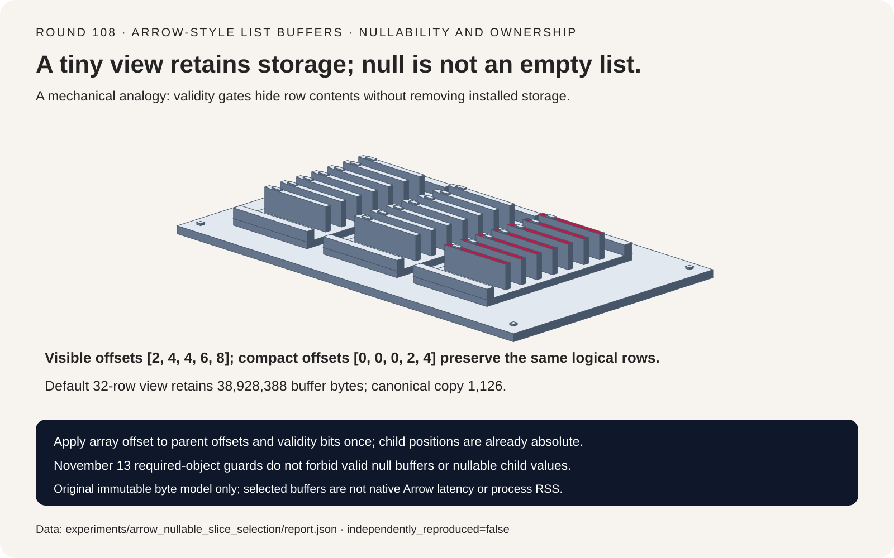
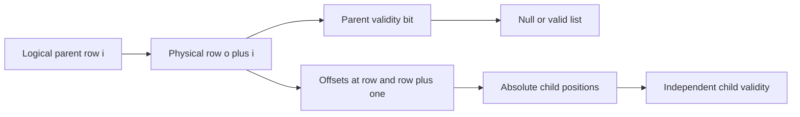
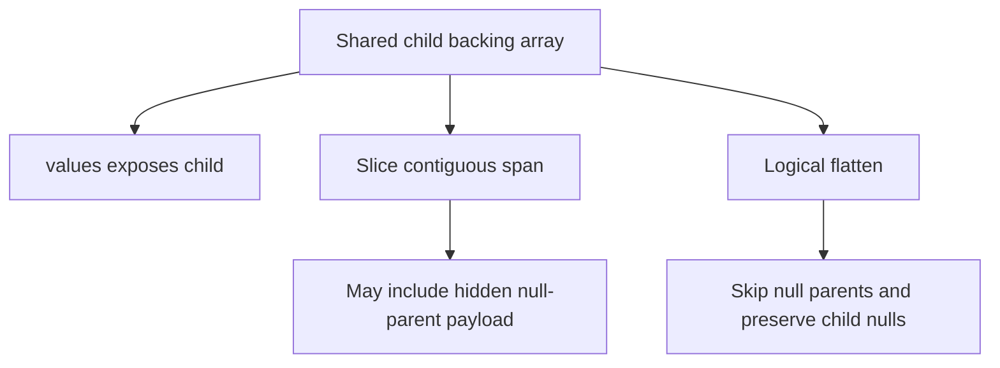
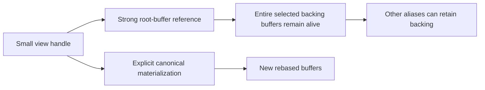

# Arrow nullable-list FAQ: slice offsets, validity bits and retained buffers

> **Language**: [中文](arrow-nullable-list-slice-buffer-retention-selection-faq.md) | English
>
> **Round 108 · 2026-11-14 (seventeenth round of the November 13 night)** · [SVG](../../assets/svg/arrow-nullable-list-slice-buffer-retention-selection-faq-summary.svg) · [7-card report](../reports/arrow-nullable-list-slice-buffer-retention-selection-cards.html) · [H5](../reports/arrow-nullable-list-slice-buffer-retention-sizer.html) · [Sealed report](../../experiments/arrow_nullable_slice_selection/report.json)
>
> **Synthetic, `independently_reproduced=false`.** Only original Python view/copy operations were timed. No native Arrow constructor execution, native failure reproduction, process RSS, allocator accounting or peak HBM was measured.



## 1. Executive summary: nullable data is not a missing required object

The pinned November 13, 2026 Arrow change guards required objects,
including the `Array.from_buffers` data type and child-array objects,
against `None`. Nullable buffers and null values remain legitimate
within their type contracts. This is a verified same-night API-safety
change, not a daily-popularity ranking or an invention of Arrow slicing.

An original immutable List&lt;int32&gt; model separates three coordinate
systems: parent row index, parent validity bit index and child value
index. A four-row slice contains `[null, [], [20,null], [30,31]]`.
Forgetting the parent offset when reading validity corrupts two rows;
adding it a second time to child positions also corrupts two rows.

| Contract | Preserve | Do not infer |
| :--- | :--- | :--- |
| Nullable list | Parent null, valid empty, nullable child | Null and empty are interchangeable |
| Sliced view | Row offset in offsets and bitmap access | A bitmap offset is measured in bytes |
| Child access | Absolute child offsets and child validity | Parent row offset must be added again |
| Ownership | Shared buffers remain referenced | Zero copied bytes means zero retained memory |

## 2. Architect Q&A: which assumptions break ragged AI ingestion?

### Q1: What exactly does a sliced parent offset change?

For logical row `i`, use physical parent row `o+i`. Read its parent
validity at bit `o+i`, then offsets at positions `o+i` and `o+i+1`.
Those offset values are already positions in the child array.

The root offsets are `[0,2,4,4,6,8,9]`. Parent validity bits are
`[1,0,1,1,1,0]`, packed least-significant-bit first as `0x1d`.
For offset one and length four, visible offsets are `[2,4,4,6,8]`.
The parent offset is a row count, not a byte or child-value count.

The toy explicitly bounds slices and rejects overflow rather than
trying to reproduce every Arrow slicing/clamping behavior. Nested
slices compose the parent row offset once and retain the same root.

### Q2: How can a null list have nonempty child storage?

A null parent row's offsets may delimit a nonempty child range.
Validity—not the physical existence of those values—makes that row
null. Here the null row owns child values `[99,98]`. The following
valid empty row has equal start and stop offsets.

The valid row `[20,null]` is different again. Its child bitmap marks
one value null; the toy stores `-777` in that raw slot but never
interprets it as logical data or substitutes zero. Parent and child
validity are separate contracts.

An absent bitmap means all valid **for these bounded List/int32
types**. Do not generalize this statement to Arrow Null, unions or
run-end encoded arrays. A required child-array object being `None`
is not an absent all-valid bitmap.

### Q3: Is `.values` the same as `.flatten()` after slicing?

No. The pinned List API documents and implements different semantics.
The child `.values` can expose the whole underlying child, ignoring
the parent slice and parent nulls. Logical flatten respects parent
offsets and skips spans hidden behind null parent rows.

In the fixture, the entire child contains nine values. Taking just the
contiguous span between the slice's first and final offsets yields
`[99,98,20,null,30,31]`. Logical flatten is `[20,null,30,31]`:
the hidden null-parent values must not become model inputs.

The toy's flatten returns a Python list, not a physical Arrow output.
Native flatten has null-free contiguous fast paths that can share
buffers and other paths that collect fragments; this study does not
claim every flatten allocates or every flatten is zero-copy.

### Q4: Why can a small zero-copy view retain a large allocation?

The view holds a strong reference to its root buffers. The default
synthetic budget has 1,048,576 parent rows and 8,388,608 child values:

| Selected backing buffer | Bytes |
| :--- | ---: |
| int32 parent offsets | 4,194,308 |
| int32 child values | 33,554,432 |
| Parent bitmap | 131,072 |
| Child bitmap | 1,048,576 |
| **Total retained buffer bytes** | **38,928,388** |

Selecting 32 rows does not shrink these backing buffers. A canonical
copy with 240 explicitly supplied visible child values uses 132 offset
bytes, 960 value bytes and 4+30 bitmap bytes: **1126 bytes**.

This is selected-buffer arithmetic, not RSS. Python objects,
allocation rounding, intermediate copies, buffer aliases and device
memory are excluded. Copying cannot free backing buffers that other
owners still reference, and allocator behavior can keep process RSS
unchanged after the last reference is released.

### Q5: Does the canonical copy model an Arrow compact API?

No. It is an explicit original policy: read logical rows, omit hidden
null-parent spans, rebase offsets and preserve null/empty/child-null
distinctions. The small fixture rebases offsets to `[0,0,0,2,4]`,
using 38 selected buffer bytes instead of retaining the root's 67.

The H5 lets users choose four/eight-byte offsets and one/two/four/eight
value bytes for payload arithmetic. The executable buffer model itself
only implements List&lt;int32&gt;. A false signed-offset fit flag requires a
different representation; a true flag is not native-type certification.
Bitmap sizes use exact integer ceiling, and counts exceeding exact
JavaScript integer arithmetic are rejected visibly.

## 3. Visual architecture: validity gates, child coordinates and ownership







## 4. Selection matrix: choose semantics before claiming zero-copy savings

| Choice | Good fit | Gate before adoption |
| :--- | :--- | :--- |
| Shared view | Short-lived batching over immutable storage | Track lifetime and other owners |
| Canonical copy | Long-lived small subset with explicit ownership | Accept copy work; preserve both validity levels |
| Raw child access | Inspect physical storage intentionally | Never equate it with logical flatten |
| Logical flatten | Validity-aware ragged feature ingestion | Verify native allocation and target representation |
| Native NumPy conversion | Compatible primitive layout | Nullable/nested layouts and writable zero-copy have separate restrictions |

The source's `to_numpy(zero_copy_only=True)` is not a blanket promise
for nested/nullable arrays; it requires a compatible primitive layout
without nulls. Requesting writable output together with zero-copy-only
is also constrained. The toy does not execute this conversion.

## 5. Hands-on evidence: exact rows and explicitly different timed work

```powershell
python -m experiments.arrow_nullable_slice_selection.run
python -m unittest discover -s tests -p test_arrow_nullable_slice_selection.py -q
python -m experiments.arrow_nullable_slice_selection.run --check
```

CPU timings were measured on the recorded ARM64 host, Python 3.12.10:

| Parent / selected rows | View handle, ms | Canonical materialization, ms |
| :--- | ---: | ---: |
| 32 / 16 | 0.000824 | 0.068804 |
| 128 / 64 | 0.000876 | 0.273000 |
| 512 / 256 | 0.000900 | 1.122612 |
| 2048 / 1024 | 0.000876 | 4.599308 |

Two warmups precede seven alternating-order repeats. Each sample is
the mean of 25 operations; the table uses the median of seven repeat
means. The view creates metadata without reading rows; the baseline
reads rows and constructs validated buffers. These intentionally
different operations do **not** establish a native Arrow speedup.
Logical equality is checked outside the timed loop.

Eight focused tests cover all fixture slice ranges, nested views,
bitmap-byte boundaries, null semantics, invalid required objects,
canonical ownership, exact Python/Node budget parity, sealed outputs,
CSP and SVG bounds. Browser inspection was not performed because
browser operation approval was previously denied.

## 6. Sources, provenance and limits

All Arrow links use pin `0974e94ef5c2d510250923a7af239ec14a522700`.

1. [November 13 required-object guard change](https://github.com/apache/arrow/commit/0974e94ef5c2d510250923a7af239ec14a522700).
2. [`array.pxi`: constructor guards, slicing, values/flatten and NumPy contracts](https://github.com/apache/arrow/blob/0974e94ef5c2d510250923a7af239ec14a522700/python/pyarrow/array.pxi).
3. [`ArrayData`: logical offsets and validity access](https://github.com/apache/arrow/blob/0974e94ef5c2d510250923a7af239ec14a522700/cpp/src/arrow/array/data.h).
4. [Nested-array flatten implementation](https://github.com/apache/arrow/blob/0974e94ef5c2d510250923a7af239ec14a522700/cpp/src/arrow/array/array_nested.cc).
5. [Apache-2.0 LICENSE.txt](https://github.com/apache/arrow/blob/0974e94ef5c2d510250923a7af239ec14a522700/LICENSE.txt).

Original Python and JavaScript arithmetic and original sorter art do
not copy Arrow implementation, data or assets. Upstream rights remain
with their holders. No native constructor crash, Arrow buffer manager,
extension type, LargeList execution, IPC/device memory, end-to-end
training throughput, private dataset or model quality was reproduced.
Report cards are self-contained with strict static CSP; all numeric
bars come from sealed report/timing data. GPU, RSS and peak HBM remain
unknown rather than coerced to zero.
