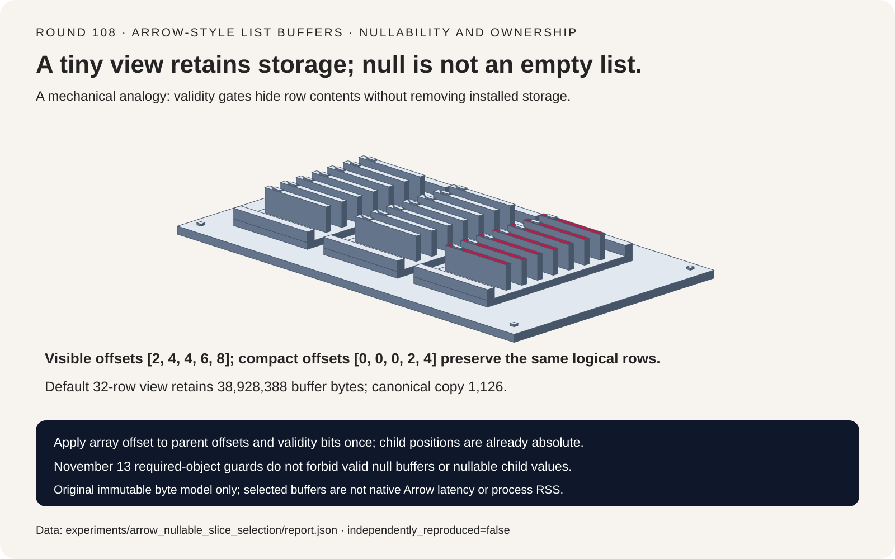
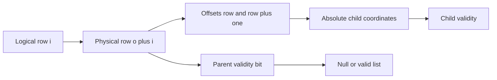
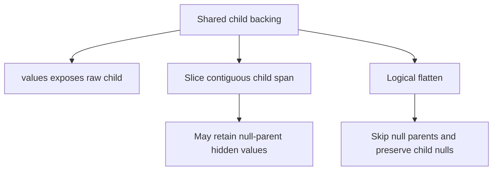
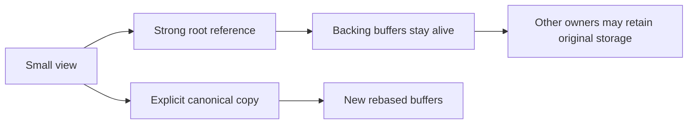

# Arrow 可空 List 选型 FAQ：Slice 偏移、有效位图与 Buffer 驻留

> **语言**：中文 | [English](arrow-nullable-list-slice-buffer-retention-selection-faq.en.md)
>
> **Round 108 · 2026-11-14（11 月 13 日夜班第十七轮）** · [SVG](../../assets/svg/arrow-nullable-list-slice-buffer-retention-selection-faq-summary.svg) · [七卡报告](../reports/arrow-nullable-list-slice-buffer-retention-selection-cards.html) · [H5](../reports/arrow-nullable-list-slice-buffer-retention-sizer.html) · [封存数据](../../experiments/arrow_nullable_slice_selection/report.json)
>
> **Synthetic，`independently_reproduced=false`。** 仅原创 Python view/copy CPU 操作单独实测；未运行 native Arrow constructor、复现 native failure、测量 RSS、allocator 或 peak HBM。



## 1. 先给结论：可空数据与缺失必需对象是两回事

固定的 Arrow 2026-11-13 变更检查必需对象不能为 `None`，包括
`Array.from_buffers` 的 data type 与 child array object。
合法的 nullable buffer、null value 并未因此被禁止。这是可核查的当晚
API 防护变化，不是“今日热度第一”，也不是宣称 Arrow slicing 刚被发明。

原创 immutable List&lt;int32&gt; 模型区分 parent row、parent validity bit、
child value 三种坐标。四行 slice 的逻辑值为
`[null, [], [20,null], [30,31]]`。读 validity 时漏加 parent offset
会错两行；对 child position 再加一次 parent offset 也会错两行。

| 契约 | 必须保留 | 不能推导 |
| :--- | :--- | :--- |
| Nullable list | Parent null、valid empty、child null | Null 等于空列表 |
| Slice | Row offset 用于 offsets 和 validity bits | Bit offset 是字节数 |
| Child | Absolute child position 与独立有效性 | 再加一次 parent row offset |
| 所有权 | Shared buffer 的生命周期 | 零复制等于零驻留 |

## 2. 架构师 Q&A：Ragged AI 数据入口容易错在哪里？

### Q1：Parent slice offset 到底作用于哪两个地方？

逻辑行 `i` 对应物理 parent row `o+i`。先读第 `o+i` 个 parent
validity bit，再读 offsets 的 `o+i` 与 `o+i+1` 项。
这两个 offset 的值已经是 child 坐标，不再加 parent offset。

Root offsets 为 `[0,2,4,4,6,8,9]`；parent bits 为
`[1,0,1,1,1,0]`，按 least-significant-bit first 打包为 `0x1d`。
Offset=1、length=4 的可见 offsets 为 `[2,4,4,6,8]`。
Parent offset 是行数，不是字节数，也不是 child 元素数。

本模型严格检查 slice 边界，越界显式报错，不冒充 Arrow 所有
clamping 规则。Nested slice 只合成一次 row offset，并保留同一个 root。

### Q2：Null list 为什么还能有非空 child span？

Null parent 的 offsets 可以覆盖非空 child 范围；决定其逻辑为空的是
validity，而非数据是否存在。算例的 null parent 背后有 `[99,98]`，
下一行则是 start=stop 的 **valid empty list**。

`[20,null]` 又是第三种情况：parent 有效，但 child bitmap 的一位无效。
原创模型在无效 child 的 raw storage 放 `-777`，读取时尊重 validity，
不会把 sentinel 当成数据，更不会擅自补零。

在本研究限定的 List/int32 类型里，缺省 bitmap 表示 all-valid；
**不能推广到 Arrow Null、union、run-end 等其他类型**。
必需的 child array object 为 `None` 与缺省 all-valid bitmap 是不同契约。

### Q3：Slice 后 `.values` 与 `.flatten()` 等价吗？

不等价。固定源码的 List `.values` 可以暴露完整底层 child，
不按 parent view 和 parent nulls 过滤；logical flatten 则尊重 parent
offset，并跳过 null parent 背后的非空 spans。

算例完整 child 有九个元素。即使只截取 slice 首尾 offset 之间的连续
child span，结果也是 `[99,98,20,null,30,31]`；正确 logical flatten
为 `[20,null,30,31]`，不能让隐藏 null payload 进入模型输入。

原创 flatten 返回 Python list，不是物理 Arrow 输出。Native flatten
存在可共享 buffer 的 null-free contiguous 快路径，也有收集 fragments
的路径；这里不声称 flatten 必然复制或必然 zero-copy。

### Q4：为什么一个很小的 zero-copy view 还能保留几十 MB？

View 强引用 root buffers。默认 synthetic 输入：
1,048,576 parent rows、8,388,608 child values。

| 选定 backing buffer | 字节 |
| :--- | ---: |
| int32 parent offsets | 4,194,308 |
| int32 child values | 33,554,432 |
| Parent bitmap | 131,072 |
| Child bitmap | 1,048,576 |
| **总 retained buffer bytes** | **38,928,388** |

只选 32 行不会缩小 backing buffers。显式输入 240 个 visible child
values 的 canonical copy 为 132 offset bytes、960 value bytes、
4+30 bitmap bytes，总计 **1126 bytes**。

这是 selected-buffer 算术，不是 RSS。未包含 Python objects、
allocator rounding、临时副本、其他 alias 或 device memory。
其他 owner 仍引用时，复制或释放一个 view 不会释放原 buffer；
最后一个引用消失后，allocator 也可能不立即归还 RSS。

### Q5：Canonical copy 是 Arrow 自带 compact API 的复现吗？

不是。这里显式定义原创策略：读取 logical rows、丢弃 null parent
背后的隐藏 spans、重新归零 offsets，并保留 null/empty/child-null。
小算例的新 offsets 为 `[0,0,0,2,4]`，新 selected buffers 共 38 bytes，
原 root 为 67 bytes。

H5 允许 4/8-byte offset、1/2/4/8-byte value 作为 payload 参数；
实际 buffer 模型只实现 List&lt;int32&gt;。Signed-offset fit=false
意味着需要另选表示，true 也不是 native type 认证。
Bitmap 字节用精确整数向上取整，超出 JavaScript exact integer
范围的预算明确报错，不显示成功形状的估计。

## 3. 可视化架构：有效性闸门、Child 坐标与 Buffer 所有权







## 4. 选型矩阵：先选语义，再谈零拷贝收益

| 路径 | 适合 | 上线门槛 |
| :--- | :--- | :--- |
| Shared view | 生命周期短的 immutable batch | 追踪 root 和其他 owner |
| Canonical copy | 小子集长期持有、显式控制所有权 | 承担复制，保留两层 validity |
| Raw child access | 有意识地查看物理存储 | 不称其为 logical flatten |
| Logical flatten | Validity-aware ragged feature ingestion | Native allocation 与目标表示另测 |
| Native NumPy conversion | 兼容的 primitive layout | Nested/null/writable zero-copy 分别检查 |

固定源码 `to_numpy(zero_copy_only=True)` 不是 nested/nullable 的通用
零拷贝承诺：需要兼容 primitive layout 且无 null。
Writable 与 zero-copy-only 同时请求也有约束；本研究未执行该转换。

## 5. 动手验证：精确逻辑值与工作量不同的 CPU 计时

```powershell
python -m experiments.arrow_nullable_slice_selection.run
python -m unittest discover -s tests -p test_arrow_nullable_slice_selection.py -q
python -m experiments.arrow_nullable_slice_selection.run --check
```

实测记录为 ARM64、Python 3.12.10，原始 samples 封存在 `latency.json`。

| Parent / selected rows | View handle，ms | Canonical materialization，ms |
| :--- | ---: | ---: |
| 32 / 16 | 0.000824 | 0.068804 |
| 128 / 64 | 0.000876 | 0.273000 |
| 512 / 256 | 0.000900 | 1.122612 |
| 2048 / 1024 | 0.000876 | 4.599308 |

两次 warmup、七次交替次序 repeats；每个 sample 为 25 次操作的均值，
表格取七个 repeat means 的 median。View 只建 metadata，不读取行；
baseline 读取 logical rows 并构造、校验新 buffers。
这是刻意不同的工作量，不能推导 native Arrow speedup。
逻辑相等在计时区外检查。

八项 focused tests 覆盖全部小算例 slice ranges、nested views、跨字节
bitmap、null 区分、必需对象报错、canonical ownership、Python/Node
精确预算一致性、sealed artifacts、CSP 与 SVG 边界。
此前 browser operation approval 被拒绝，因此未做浏览器视觉检查。

## 6. 来源、归因与研究边界

Arrow 固定 pin：`0974e94ef5c2d510250923a7af239ec14a522700`。

1. [2026-11-13 必需对象检查变更](https://github.com/apache/arrow/commit/0974e94ef5c2d510250923a7af239ec14a522700)。
2. [`array.pxi`：constructor、slice、values/flatten、NumPy 契约](https://github.com/apache/arrow/blob/0974e94ef5c2d510250923a7af239ec14a522700/python/pyarrow/array.pxi)。
3. [`ArrayData`：logical offset 与 validity](https://github.com/apache/arrow/blob/0974e94ef5c2d510250923a7af239ec14a522700/cpp/src/arrow/array/data.h)。
4. [Nested array flatten 实现](https://github.com/apache/arrow/blob/0974e94ef5c2d510250923a7af239ec14a522700/cpp/src/arrow/array/array_nested.cc)。
5. [Apache-2.0 LICENSE.txt](https://github.com/apache/arrow/blob/0974e94ef5c2d510250923a7af239ec14a522700/LICENSE.txt)。

原创 Python/JavaScript 算术与 sorter SVG 未复制 Arrow 实现、数据或
资产，上游权利保留。未复现 native constructor crash、Arrow buffer
manager、extension type、LargeList execution、IPC/device memory、
端到端训练吞吐、私有数据或模型质量。七卡严格自包含 CSP，
全部数值条来自封存数据；GPU、RSS、peak HBM 保持 unknown，不补零。
