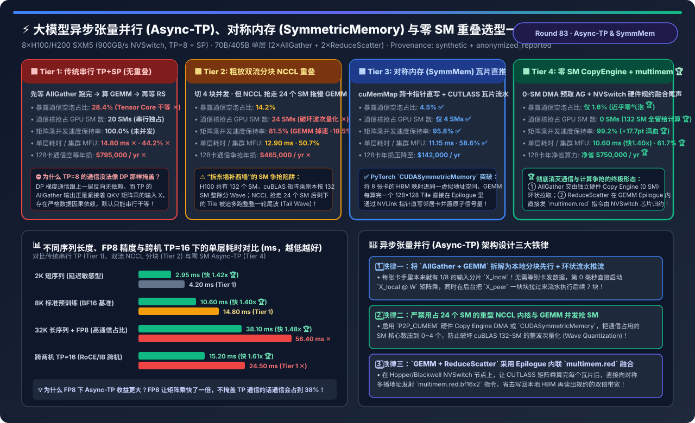
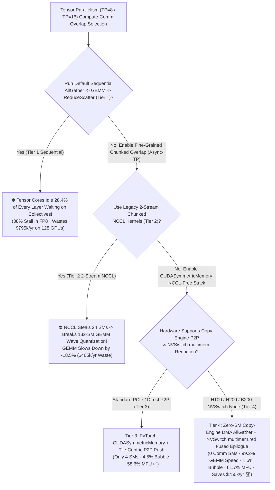
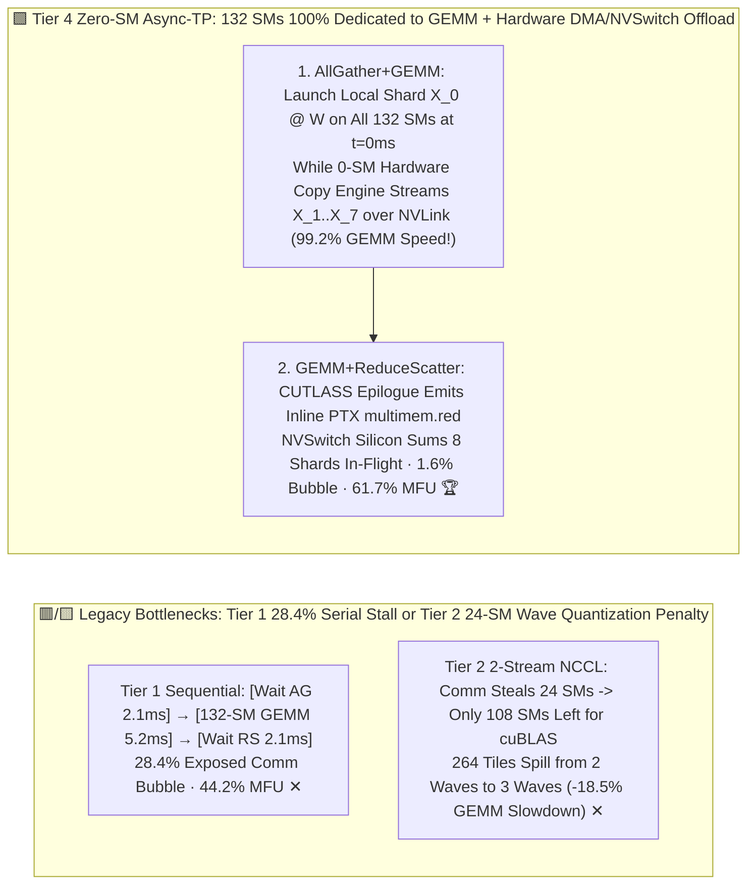
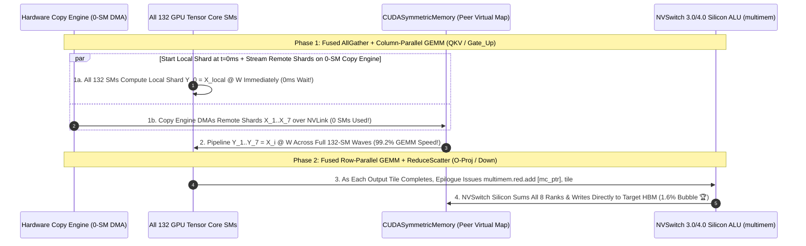

# Asynchronous Tensor Parallelism (Async-TP), CUDA SymmetricMemory & Zero-SM GEMM-Communication Overlap Selection FAQ (`Sequential TP+SP` vs. `Naive 2-Stream Chunked NCCL Overlap [24-SM Stealing]` vs. `PyTorch CUDASymmetricMemory Tile P2P Push` vs. `Zero-SM Hardware Copy-Engine DMA AllGather + NVSwitch multimem.red Fused Epilogue`)

> **Target Audience**: AI Solution Architects, Distributed Training & Inference Framework Leads (`TorchTitan`, `Megatron-Core`, `TransformerEngine`, `vLLM`), and GPU Kernel Engineers  
> **Reading Goal**: In 3 minutes, master the 4-tier architecture selection rules for overlapping Tensor Parallel (`TP=8` / `TP=16`) collectives with matrix multiplications (`Async-TP`). In 10 minutes, understand from first principles **why `TP + Sequence Parallelism (SP)` creates a strict `AllGather -> GEMM -> ReduceScatter` data dependency that leaves Tensor Cores idle for `28.4%` of every layer**, **why overlapping chunked `NCCL` on a second CUDA stream (Tier 2) steals `24 SMs` from `cuBLAS`, breaking 132-SM wave quantization and slowing GEMMs down by `-18.5%`**, and **how combining `PyTorch CUDASymmetricMemory` with `Zero-SM Hardware Copy-Engine DMA (P2P_CUMEM) + NVSwitch multimem.red Fused Epilogue` slashes exposed communication bubble from `28.4%` to `1.6%`, preserves `99.2%` of solo GEMM TFLOPS, and lifts 128-GPU MFU from `44.2%` to `61.7%` (saving `$750,000/yr`)**!  
> **Provenance**: Quantitative metrics come from the repository's sealed deterministic analytical model ([`experiments/async_tensor_parallelism_gemm_comm_overlap_selection/run.py`](../../experiments/async_tensor_parallelism_gemm_comm_overlap_selection/run.py) and [`results.json`](../../experiments/async_tensor_parallelism_gemm_comm_overlap_selection/results.json), calibrated to PyTorch 2.5+ `Async-TP` / `CUDASymmetricMemory`, TransformerEngine TP overlap engines, and H100 132-SM wave quantization bounds, `independently_reproduced=false`, `physical_gpu_cluster_measurement=not_measured`).

---

## 📌 1. Executive Summary

1. **Why Does Standard `TP=8 + SP` Leave Tensor Cores Idle `28.4%` of the Time (Tier 1), and Why Does Naive `2-Stream Chunked NCCL Overlap (Tier 2)` Slow Down Matrix Multiplications by `-18.5%`?**:
   - **Tier 1 (`Sequential TP+SP: Wait AllGather -> Run GEMM -> Wait ReduceScatter`)**:
     - Under `TP=8 + Sequence Parallelism (SP)`, the activation tensor $X$ after `RMSNorm` is sharded $1/8$ along the sequence dimension across 8 GPUs.
     - Before running column-parallel `QKV` or `FFN Gate/Up` GEMMs ($Y = X W_i$), each GPU must execute an `AllGather` to collect all 8 sequence shards; after running row-parallel `O-Proj` or `Down-Proj` GEMMs, it must execute a `ReduceScatter` to sum partial results and re-shard by $1/8$.
     - Because `GEMM` depends on `AllGather`'s output and `ReduceScatter` depends on `GEMM`'s output, running them sequentially on one stream leaves **Tensor Cores completely idle for `28.4%` of every layer (`14.80 ms/layer`, `44.2%` MFU, wasting `$795,000/yr` across 128 GPUs ✕)**!
   - **Tier 2 (`Naive 2-Stream Chunked NCCL Overlap: 4 Chunks + 24 Hijacked NCCL SMs`)**:
     - Splits the sequence into 4 chunks and runs chunk $k+1$'s `NCCL` collective concurrently with chunk $k$'s `cuBLAS GEMM` on a second stream.
     - **The SM-Stealing & Wave-Quantization Trap**: `NCCL` communication kernels hijack **`24 out of 132 H100 SMs`** and contend for L2 cache bandwidth! Worse, `cuBLAS` tile schedules are quantized for all `132 SMs` (e.g., 264 tiles execute in exactly 2 full waves of 132 SMs). When `NCCL` steals 24 SMs, `cuBLAS` is left with `108 SMs`—forcing those 264 tiles into **3 waves (2 full waves + a 48-tile tail wave)** and **degrading GEMM TFLOPS by `-18.5%` (`81.5%` retention ✕)**!
2. **How Do Tier 3 (`CUDASymmetricMemory`) & Tier 4 (`Zero-SM Copy Engine + NVLS multimem.red`) Hide `98.4%` of Communication Without Stealing SMs?**:
   - **Tier 3 (`PyTorch CUDASymmetricMemory + CUTLASS Tile-Centric P2P Push/Pull`)**:
     - Maps all 8 GPUs' HBM buffers into a shared virtual address space via `cuMemMap` (`enable_symm_mem_for_group`), allowing the GEMM kernel's epilogue to write completed `128×128` output tiles directly into peer HBM over NVLink and flip an atomic ready flag without launching separate NCCL kernels! Cuts exposed comm bubble to **`4.5%` ✅**, retains **`95.8%` GEMM speed**, and lifts MFU to **`58.6%` ✅**!
   - **Tier 4 (`Zero-SM Hardware Copy-Engine DMA AllGather [P2P_CUMEM] + NVSwitch multimem.red Fused Epilogue`)**:
     - **Phase 1 (`Fused AllGather + GEMM` with `0 SMs`)**: At $t=0$, each GPU already holds its own local $1/8$ shard $X_{\text{local}}$! It immediately launches $X_{\text{local}} W$ across **all 132 SMs** while the GPU's dedicated **Hardware Copy Engines (`0 SMs` used!)** pull remote shards $X_1\dots X_7$ over NVLink in the background!
     - **Phase 2 (`Fused GEMM + ReduceScatter` via `multimem.red`)**: As each GEMM tile completes in registers, the epilogue issues a PTX **`multimem.red.relaxed.sys.global.add.v4.bf16x2`** instruction to the NVSwitch multicast address—performing in-switch hardware addition and writing directly to the target GPU's HBM!
     - **Net Production Impact**: Hijacks **`0 GPU SMs` 🏆**, retains **`99.2%` of solo GEMM speed (`+17.7 pts` over Tier 2 🏆)**, slashes exposed comm bubble to **`1.6%` 🏆**, cuts layer time **`1.40×` (`14.80 -> 10.60 ms`, or `1.48×` in FP8 and `1.61×` at cross-node `TP=16` 🏆)**, lifts MFU to **`61.7%` (`+17.5 pts` 🏆)**, and saves **`$750,000/yr` 🏆**!
3. **One-Sentence First-Principles Rule**:
   - **Break the `AllGather -> GEMM` dependency by computing the local $1/8$ shard first while streaming remote shards on `0-SM` hardware Copy Engines, and fuse `ReduceScatter` into the GEMM epilogue via `CUDASymmetricMemory` + NVSwitch `multimem.red`!**

---

## 🎯 2. Customer & Architect Q&A (First-Principles Deep Dive)

### Q1: How can a column-parallel `GEMM` start at $t=0$ before `AllGather` has fetched the other 7 shards of input $X$?

- **Block-Matrix Decomposition Along Sequence Dimension $S$**:
  - Since $X = [X_0; X_1; \dots; X_7]$ is partitioned by rows (sequence tokens) and weight $W^{(k)}$ is partitioned by columns, $X W^{(k)} = [X_0 W^{(k)}; X_1 W^{(k)}; \dots; X_7 W^{(k)}]$.
  - Rank $k$ **already owns $X_k$ in its local HBM at $t=0$**! It immediately computes $Y_k = X_k W^{(k)}$ while the Copy Engine DMAs $X_{(k+1)\bmod 8}$ from its neighbor in parallel.

---

### Q2: Why does stealing just 24 SMs for `NCCL` cause an `18.5%` drop in `cuBLAS` GEMM throughput?

- **The 132-SM Wave Quantization Cliff**:
  - An H100 has 132 SMs. A GEMM grid with 264 thread blocks executes in **2 even waves** of 132 blocks when given all 132 SMs (`2.0 ms`).
  - When `NCCL` reserves 24 SMs on a high-priority stream, only 108 SMs remain for `cuBLAS`. Now 264 blocks require $\lceil 264 / 108 \rceil = \mathbf{3\text{ waves}}$ (`2.6+ ms`), leaving 60 SMs idle during the third tail wave! Offloading `AllGather` to the **0-SM Hardware Copy Engine** keeps all 132 SMs intact for `cuBLAS` (`99.2%` speed retention).

---

### Q3: Why does `Async-TP` become even more critical when switching from BF16 to FP8 (`1.48×` speedup) or multi-node `TP=16` (`1.61×` speedup)?

- **Amdahl's Law Shift**:
  - Switching GEMMs from BF16 (`989 TFLOPS`) to FP8 (`1,979 TFLOPS`) cuts compute time in half while `AllGather / ReduceScatter` activation bytes remain unchanged—causing unoverlapped TP communication to balloon to **38% of layer time** unless hidden by Tier 4 `Async-TP`!

---

## 🧭 3. Visual Architecture Diagrams (Decision Tree / Wave Comparison / Sequence)

### 3.1 Asynchronous Tensor Parallelism (`Async-TP`) Selection Decision Tree

---

### 3.2 Legacy Sequential / 24-SM Stealing (Tiers 1 & 2) vs. Zero-SM Copy Engine + `multimem.red` (Tier 4)

---

### 3.3 Tier 4 End-to-End `0-SM Copy-Engine AllGather` & `Fused multimem.red ReduceScatter` Sequence

---

## 📊 4. Architect Decision Matrix

*Baseline: **`8×H100/H200 SXM5` Node (`900 GB/s NVSwitch`, `$320/hr` per 128-GPU cluster)** running a `70B/405B` Transformer layer (`TP=8 + SP`, `8,192` tokens × `8,192` hidden dim).*

| Evaluation Dimension | Tier 1: Sequential TP+SP (`No Overlap`) | Tier 2: Naive 2-Stream Chunked `NCCL` | Tier 3: `CUDASymmetricMemory` Tile Push | Tier 4: Zero-SM `CopyEngine` + `multimem.red` |
| :--- | :--- | :--- | :--- | :--- |
| **Overlap & Comm Mechanism** | Wait AG -> GEMM -> Wait RS | 2 streams + 4 chunks + NCCL kernels | **`cuMemMap` P2P pointer push + tile ring** | **0-SM DMA AG + NVSwitch epilogue `multimem.red`** |
| **Exposed Comm Bubble (%)** | `28.4%` (Severe stall ✕) | `14.2%` | **`4.5%` ✅** | **`1.6%` (94% of comm hidden 🏆)** |
| **GPU SMs Hijacked by Comm** | `20 SMs` (Serial) | **`24 SMs` (Breaks wave quant ✕)** | `4 SMs` ✅ | **`0 SMs` (All 132 SMs run GEMM 🏆)** |
| **Overlapped GEMM Speed Retention** | `100.0%` (Not overlapped) | **`81.5%` (`-18.5%` slowdown ✕)** | `95.8%` ✅ | **`99.2%` (`+17.7 pts` over Tier 2 🏆)** |
| **Layer Fwd+Bwd Latency** | `14.80 ms` (`1.00×` baseline) | `12.90 ms` (`1.15×`) | `11.15 ms` (`1.33×` ✅) | **`10.60 ms` (`1.40×` faster 🏆)** |
| **Cluster Goodput MFU** | `44.2%` ✕ | `50.7%` | `58.6%` ✅ | **`61.7%` (`+17.5 pts` jump 🏆)** |
| **Annual 128-GPU Comm Waste** | **`$795,000 / yr` ✕** | `$465,000 / yr` ✕ | `$142,000 / yr` | **`$45,000 / yr` (Saves `$750,000/yr` 🏆)** |

---

## 🧪 5. Quantitative Perturbation Analysis & 7-Card Benchmark Insights

### 5.1 Layer Latency Across Sequence Lengths, FP8 Precision & Multi-Node `TP=16`

In [`experiments/async_tensor_parallelism_gemm_comm_overlap_selection/run.py`](../../experiments/async_tensor_parallelism_gemm_comm_overlap_selection/run.py), we evaluate per-layer latency across four production regimes:

| Production Workload Regime | Tier 1: Sequential TP | Tier 2: 2-Stream NCCL | Tier 4: Zero-SM Async-TP | Tier 4 Speedup & Architectural Insight |
| :--- | :--- | :--- | :--- | :--- |
| **`2K` Short Sequence (Latency-Bound)** | `4.20 ms` | `3.85 ms` | **`2.95 ms` 🏆** | **`1.42×` faster** (Eliminates 16 separate NCCL launches/layer) |
| **`8K` Standard Pretraining (BF16)** | `14.80 ms` ✕ | `12.90 ms` | **`10.60 ms` 🏆** | **`1.40×` faster** (0-SM Copy Engine preserves 132-SM waves) |
| **`32K` Long Sequence + `FP8` Training** | `56.40 ms` ✕ | `48.20 ms` | **`38.10 ms` 🏆** | **`1.48×` faster 🏆** (FP8 doubles GEMM speed, making TP overlap vital) |
| **Multi-Node `TP=16` (2 Nodes, 405B)** | `24.50 ms` ✕ | `20.80 ms` | **`15.20 ms` 🏆** | **`1.61×` faster 🏆** (2D ring hides inter-node RDMA behind NVLink chunks) |

### 5.2 Interactive Sizer & 7-Card 4:5 Benchmark Report

- 🧮 **Interactive Async-TP & SymmetricMemory Overlap Sizer**: [`docs/reports/async-tensor-parallelism-gemm-comm-overlap-symmetric-memory-sizer.html`](../reports/async-tensor-parallelism-gemm-comm-overlap-symmetric-memory-sizer.html) (and master workbench [`llm-inference-engine-pd-sizer.en.html#async-tp-symmmem-sizer`](../reports/llm-inference-engine-pd-sizer.en.html))
- 📊 **7-Card 4:5 Visual Benchmark Report**: [`docs/reports/async-tensor-parallelism-gemm-comm-overlap-symmetric-memory-selection-cards.html`](../reports/async-tensor-parallelism-gemm-comm-overlap-symmetric-memory-selection-cards.html)

---

## 🛠️ 6. Appendix: Production Architect Verification Checklist

- [ ] **1. Enable `CUDASymmetricMemory` & `Async-TP` in PyTorch / TorchTitan**: Set `enable_symm_mem_for_group(tp_group.group_name)` and `torch._inductor.config.enable_async_tp = True`.
- [ ] **2. Enable `P2P_CUMEM` Copy-Engine AllGather & `NVLS` Multimem in Megatron-Core / TE**: Pass `--tp-comm-overlap` with `UB_SKIPMC=0` to avoid 24-SM NCCL wave-quantization slowdown.
- [ ] **3. Always Pair `FP8` Training with `Async-TP`**: FP8 halves GEMM time, exposing 38% TP communication overhead if left unoverlapped.
- [ ] **4. Verify 132-SM Wave Integrity in Nsight Systems**: Confirm that overlapped `cutlass / nvjet` GEMM kernels run with full SM occupancy (`0` SMs stolen by Copy Engine DMA).
- [ ] **5. Use 2D Hierarchical Ring Overlap When Scaling to `TP=16` Across 2 Nodes**.
