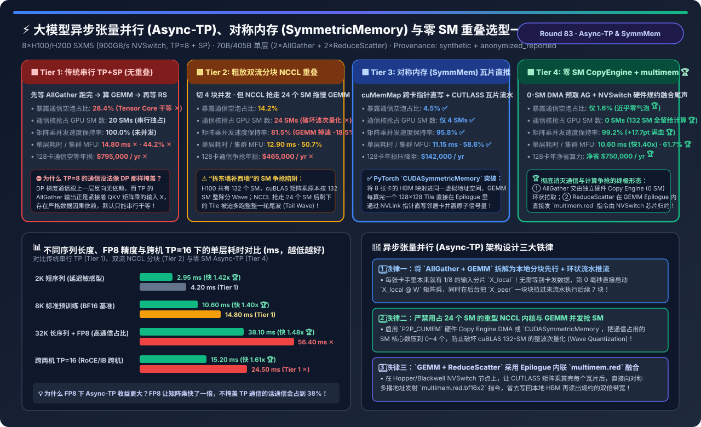
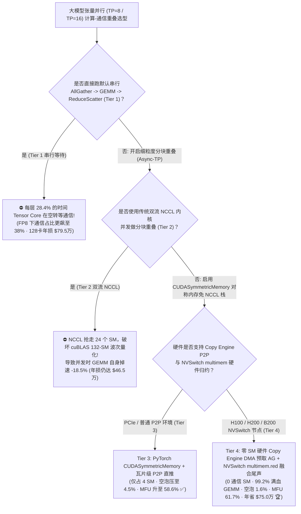
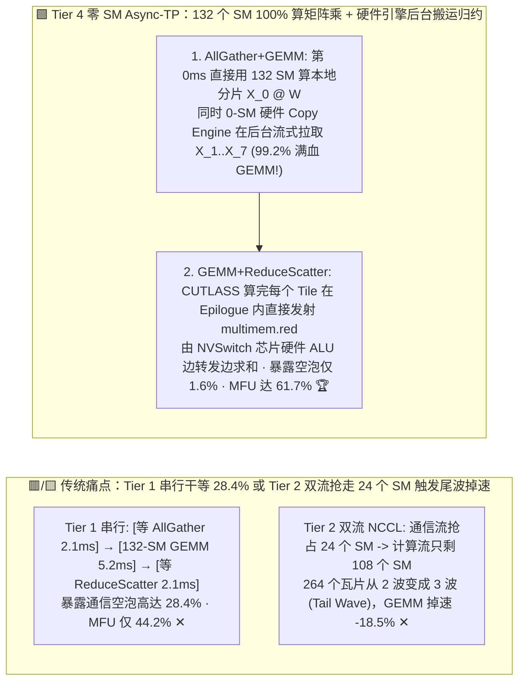
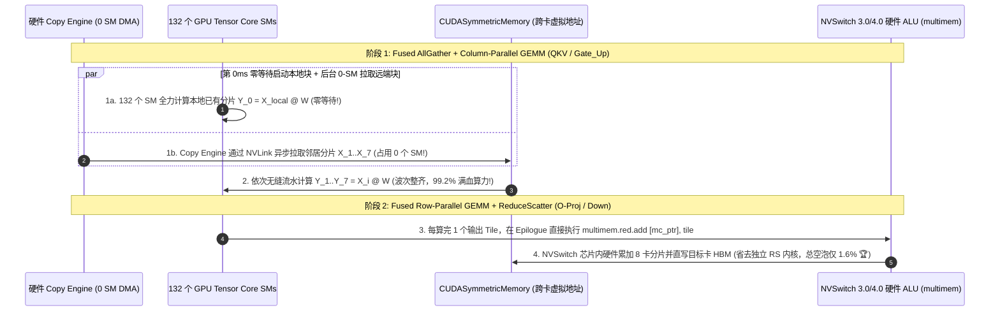

# 大模型异步张量并行（Async-TP）、CUDA 对称内存（SymmetricMemory）与零 SM 计算-通信重叠架构选型指南（`传统串行 TP+SP` vs. `粗放双流分块 NCCL 重叠 [抢占 24 SM]` vs. `PyTorch CUDASymmetricMemory 瓦片级 P2P 直推` vs. `零 SM 硬件 Copy Engine DMA 预取 + NVSwitch multimem 融合尾声`）

> **适用角色**：AI 解决方案架构师（AI Solution Architect）、大模型分布式训练与推理框架（TorchTitan / Megatron-Core / vLLM）研发负责人、GPU 内核工程师  
> **阅读目标**：3 分钟掌握单机 8 卡（`TP=8`）与跨机（`TP=16`）张量并行中计算与通信重叠（Async-TP）的四档架构选型铁律；10 分钟吃透 **为什么 TP 的 `AllGather / ReduceScatter` 与矩阵乘之间存在严格的前后数据依赖、没法像 DP 那样直接并行**、**为什么用两个 CUDA Stream 同时跑分块 `cuBLAS GEMM` 和 `NCCL`（Tier 2）反而会导致矩阵乘因被抢走 24 个 SM 而掉速 `-18.5%`**，以及 **如何通过 `PyTorch CUDASymmetricMemory` + `零 SM 硬件 Copy Engine DMA (P2P_CUMEM) + NVSwitch multimem.red 融合尾声` 将暴露通信空泡从 `28.4%` 砸穿至 `1.6%`、保住 `99.2%` 满血矩阵乘速度、将集群有效 MFU 从 `44.2%` 拉升至 `61.7%`（128 卡年省 `$75.0 万`）**！  
> **数据来源说明（Provenance）**：本文定量数据来自仓库内封存的确定性解析模型（[`experiments/async_tensor_parallelism_gemm_comm_overlap_selection/run.py`](../../experiments/async_tensor_parallelism_gemm_comm_overlap_selection/run.py) 与 [`results.json`](../../experiments/async_tensor_parallelism_gemm_comm_overlap_selection/results.json)，校准自 PyTorch 2.5+ `Async-TP` / `CUDASymmetricMemory`、TransformerEngine / Megatron-Core 重叠引擎与 H100 132-SM 波次量化退化模型，`independently_reproduced=false`，`physical_gpu_cluster_measurement=not_measured`）。

---

## 📌 一、核心结论速览（Executive Summary）

1. **为什么在 70B/405B 大模型训练与推理中，开了张量并行 + 序列并行（`TP=8 + SP`）之后，哪怕有 `900 GB/s` 的机内 NVSwitch，每层还是有 `28.4%` 的时间 Tensor Core 在空转干等通信（Tier 1）？而简单的“双流分块重叠（Tier 2）”又为什么会踩进“SM 争抢掉速陷阱”？**：
   - **Tier 1（传统串行 `TP + SP`：`Wait AllGather -> Run GEMM -> Wait ReduceScatter`）的 `28.4%` 串行空泡**：
     - 在现代 `TP=8 + Sequence Parallelism (SP)` 架构中，为了省激活显存，`RMSNorm` 之后的激活张量沿着序列维度 $S$ 被切成了 8 份（每张卡只持有 $S/8$）。
     - 当要执行列并行的 `QKV 投影` 或 `FFN Gate/Up` 矩阵乘 $Y = X \cdot W_i$ 时，必须**先调用 `AllGather` 把另外 7 张卡上的 $X$ 分片全收集齐**，拼成完整的 $X$ 后才能启动矩阵乘；算完行并行的 `O-Proj` 或 `Down-Proj` 后，又必须调用 **`ReduceScatter` 把 8 张卡的部分和相加并切回 $S/8$**！
     - 因为 `GEMM` 依赖 `AllGather` 的输出，而 `ReduceScatter` 依赖 `GEMM` 的输出，默认同一个 CUDA Stream 只能严格排队串行执行！结果每层前向+反向共有 `8 次` 阻塞式集合通信，**Tensor Core 有高达 `28.4%` 的时间完全停工在等 NVLink 搬数据 ✕**，单层耗时 `14.80 ms`，集群 MFU 卡在 **`44.2%`（128 卡集群每年因通信空等白烧 `$795,000` ✕）**！
   - **Tier 2（粗放双流分块 NCCL 重叠：把矩阵和通信切成 4 块，在 Compute Stream 与 NCCL Stream 上并发流水）的“24-SM 波次量化崩塌”**：
     - 为了打破串行依赖，工程师把输入序列 $S$ 切成 4 个子块（Chunks）：边用 `compute_stream` 算第 $k$ 块的 `cuBLAS GEMM`，边用后台 `nccl_stream` 收发第 $k+1$ 块的 `NCCL P2P/Ring`。
     - **惊天踩坑真相**：NCCL 通信内核不是免费的——它在发送和规约数据时，会**强行霸占 H100 全卡 132 个 SM 中的 20～24 个 SM**，并且剧烈争抢 L2 Cache 带宽！
     - 更致命的是 **GPU 波次量化（Wave Quantization）效应**：`cuBLAS` 在调度矩阵乘瓦片（Tiles）时，是按全卡 `132 个 SM` 整除设计的（比如 264 个瓦片正好跑 2 波，每波 132 个 SM 齐步走）。一旦 NCCL 抢走了 24 个 SM，只剩 `108 个 SM` 给 `cuBLAS`，原本 2 波能跑完的 264 个瓦片被迫拆成了 **`2 波满载 + 第 3 波只跑 48 个 SM 的漫长尾波（Tail Wave）`**！导致 **矩阵乘自身计算速度暴跌 `-18.5%`（仅保住 `81.5%` 算力 ✕）**，东墙补西墙后暴露通信空泡仍有 `14.2%`！
2. **如何做到“既把通信 100% 藏在矩阵乘背后，又不抢走矩阵乘哪怕 1 个 SM”？Tier 3 与 Tier 4 的破局之道**：
   - **Tier 3（`PyTorch CUDASymmetricMemory + CUTLASS 瓦片级 P2P 原位直推 [Fused Tile Producer-Consumer]`）**：
     - 彻底抛弃笨重的独立 `NCCL` 内核！利用 CUDA 虚拟内存管理（`cuMemMap` + `PyTorch enable_symm_mem_for_group`），将机内 8 张 GPU 的 HBM 显存直接映射进同一个对称虚拟地址空间（每张卡都能直接用指针 `peer_ptr[rank]` 读写邻居卡的显存）。
     - 在矩阵乘内部，当 `CUTLASS GEMM` 算完一个 `128×128` 的输出瓦片（Tile）时，**直接在同一个算子的 Epilogue（尾声阶段）里顺手通过 NVLink 指针把结果写进目标邻居卡的 HBM 并翻转原子信号量**！仅占用 `4 个 SM` 处理边界同步，暴露通信空泡压至 **`4.5%` ✅**，矩阵乘速度保住 **`95.8%`**，集群 MFU 跃升至 **`58.6%` ✅**！
   - **Tier 4（`零 SM 硬件 Copy Engine DMA 环状预取 AllGather [P2P_CUMEM] + NVSwitch multimem.red 硬件归约融合尾声`）—— Hopper/Blackwell 终极形态**：
     - **前半场（`AllGather + GEMM` 零 SM 重叠）**：每张 GPU 手里本来就有第 0 块本地输入 $X_{\text{local}}$！因此第 `0.0 ms` 直接用 **全部 132 个 SM 满血启动 $X_{\text{local}} \cdot W$**；同时唤醒 GPU 芯片上独立于 SM 之外的 **硬件 DMA Copy Engine（占用 `0 个 SM`！）**，通过 `cudaMemcpyAsyncPeer` 从邻居卡把第 $1\dots 7$ 块输入悄无声息地拉过来！
     - **后半场（`GEMM + ReduceScatter` 芯片内融合归约）**：算完每个分块的矩阵乘后，不在 GPU SM 上做加法，而是直接在 Epilogue 中向 NVSwitch 3.0/4.0 的对称多播地址发射一条 PTX 硬件指令 **`multimem.red.relaxed.sys.global.add.v4.bf16x2`**，由主板上的 **NVSwitch 芯片硬件 ALU 在线速转发途中直接完成 8 卡求和并写入目标卡**！
     - **最终工程收益**：通信抢占的 GPU SM 数降为 **`0 个 SM` 🏆**，并发时矩阵乘保住 **`99.2%` 满血速度 🏆**，暴露通信空泡从 `28.4%` 砸穿至 **`1.6%` 🏆**，单层耗时从 `14.80 ms` 压至 **`10.60 ms`（快 `1.40 倍`，FP8 长序列下快 `1.48 倍`，跨机 TP=16 快 `1.61 倍` 🏆）**，集群 MFU 飙至 **`61.7%`（`+17.5 pts`，128 卡每年净省 `$750,000` 🏆）**！
3. **一句话握手机制本质**：
   - **异步张量并行（Async-TP）的第一性原理，是“先算本地已有的 1/8 分片打破因果死锁，前向 AllGather 走 0-SM 硬件 Copy Engine 避免破坏 132-SM 矩阵乘波次量化，后向 ReduceScatter 走 SymmetricMemory + NVSwitch `multimem.red` 尾声内联归约”！**

---

## 🎯 二、客户与架构师灵魂拷问 Q&A（FAQ-Driven First Principles）

### Q1：既然 `QKV 矩阵乘` 需要完整的输入 $X$（即必须等 `AllGather` 收集齐 8 张卡的分片），怎么可能在 `AllGather` 还没传完的时候就开始算矩阵乘？

- **第一性原理拆解（沿序列维度 $S$ 分块流水）**：
  - 在 `TP=8 + SP` 中，输入张量 $X$ 是沿着**序列维度 $S$（即行维度 $M$）**切分成 8 块的：$X = [X_0; X_1; \dots; X_7]$，而权重矩阵 $W$ 是沿着列维度 $N$ 切分的。
  - 根据分块矩阵乘法恒等式：
    $$\begin{bmatrix} X_0 \\ X_1 \\ \vdots \\ X_7 \end{bmatrix} \cdot W^{(k)} = \begin{bmatrix} X_0 \cdot W^{(k)} \\ X_1 \cdot W^{(k)} \\ \vdots \\ X_7 \cdot W^{(k)} \end{bmatrix}$$
  - **恍然大悟**：在 `AllGather` 开始前的第 `0 纳秒`，`GPU k` 自己的显存里**本来就已经躺着属于它自己的那一块 $X_k$ 了**！
  - 所以 `GPU k` 根本不需要等任何网络传输，第 `0 纳秒` 就可以直接调动 Tensor Core 去算 $Y_k = X_k \cdot W^{(k)}$！在它聚精会神算 $X_k$ 的这 `1.2 ms` 里，后台的 **Copy Engine DMA** 刚好把邻居 `GPU (k+1)` 的 $X_{k+1}$ 通过 NVLink 搬到了本地备用缓冲区；算完 $X_k$ 立刻无缝接着算 $X_{k+1} \cdot W^{(k)}$……**原本排在最前面的 `AllGather` 通信等待时间，瞬间被藏进了 8 步分块矩阵乘的肚子里**！

---

### Q2：为什么说“在并发流里跑 NCCL 会严重拖慢正在跑的 `cuBLAS GEMM`（Wave Quantization 尾波灾难）”？

- **算一笔 H100 的 132-SM 波次（Wave）账**：
  1. 一张 H100 SXM5 拥有 **132 个 SM**。当 `cuBLAS` 执行一个包含 `264 个瓦片（Thread Block Tiles）` 的矩阵乘时：
     - **独占全卡时（132 SMs）**：第 1 波（Wave 1）132 个 SM 每人领 1 个瓦片，耗时 `1.0 ms`；第 2 波（Wave 2）132 个 SM 再每人领 1 个瓦片，耗时 `1.0 ms`。**总耗时 = `2.0 ms`，100% 满载**！
     - **当另一个 Stream 启动了占用 24 个 SM 的 NCCL 核函数时**：留给 `cuBLAS` 的只有 `132 - 24 = 108 个 SM`。于是 264 个瓦片被迫分成：第 1 波（108 个）+ 第 2 波（108 个）+ **第 3 波（剩下的 48 个瓦片，另外 60 个 SM 干瞪眼空转）**！
     - **恐怖后果**：仅仅因为被 NCCL 抢走了 18% 的 SM，矩阵乘却从 **2 波变成了 3 波**，耗时从 `2.0 ms` 暴涨到 **`2.6~3.0 ms`（算力直接掉速 `-18.5% ~ -33%`）**！
  2. **为什么 Tier 4 的 `Copy Engine DMA (0 SM)` 是救星？**
     - 每张 H100 芯片上除了 132 个计算 SM 外，还专门内置了独立的 **硬件 DMA 搬运引擎（Copy Engines, CE）**！
     - 当我们使用 `cudaMemcpyAsync`（配合 `P2P_CUMEM` 对称地址映射）做 `AllGather` 分块拉取时，数据搬运 100% 由硬件 Copy Engine 执行，**占用的计算 SM 数量严格等于 `0`！全部 132 个 SM 一颗不少地全留给 `cuBLAS` 跑整齐的 2 波矩阵乘，矩阵乘速度保持率高达 `99.2%` 🏆**！

---

### Q3：那后半场的 `GEMM + ReduceScatter`（需要做加法规约）也能做到 `0 个额外通信 SM` 吗？`NVSwitch multimem.red` 是怎么做到的？

- **尾声内联硬件多播归约（Fused Epilogue `multimem.red`）**：
  - 在 `O-Proj` 或 `Down-Proj` 中，8 张卡算出来的矩阵乘结果需要相加（Reduce）再切分（Scatter）。
  - 传统做法是：GEMM 先把全部结果写回本地 HBM 显存，然后再启动一个通信 Kernel 把数据从 HBM 读出来发给邻居相加（白白多读写一遍 HBM！）。
  - 在 **Tier 4** 中，利用 Hopper/Blackwell 的 `CUDASymmetricMemory` 多播地址（Multicast Pointer `mc_ptr`），当矩阵乘的某个线程块在寄存器里算完一个输出瓦片时，**不写回本地 HBM，而是在 Epilogue 里直接执行一条 `multimem.red.add.bf16x2 [mc_ptr], reg_val` 指令**！
  - 这条指令把数据直接推上 NVLink，**主板上的 NVSwitch 芯片硬件浮点加法器在收到 8 张卡发来的瓦片后当场硬件求和，并把总和直接写进负责该分片的目标 GPU 显存**！既省掉了通信 SM，又省掉了一整趟 HBM 读写带宽！

---

## 🧭 三、直观可视化图解（Mermaid 决策树 / 重叠流水对比 / 时序图）

### 3.1 大模型张量并行计算-通信重叠（Async-TP）架构选型决策树

---

### 3.2 传统串行/双流抢 SM（Tier 1/2）vs. 零 SM Copy Engine + `multimem.red` 融合流水（Tier 4）对比

---

### 3.3 Tier 4 单层 `0-SM Copy Engine AllGather 流水` 与 `multimem.red ReduceScatter 融合尾声` 时序图

---

## 📊 四、架构师选型决策矩阵（Architect Decision Matrix）

*基准场景：**`8×H100/H200 SXM5` 节点（`900 GB/s NVSwitch`，128 卡集群按 `$320/hr` 折算）** 运行 `70B/405B` 模型（`TP=8 + SP`，序列长度 `8,192`，Hidden `8,192`）。*

| 评估维度 | Tier 1: 传统串行 TP+SP (`Sequential`) | Tier 2: 粗放双流分块 `NCCL` 重叠 | Tier 3: 对称内存瓦片直推 (`SymmetricMemory`) | Tier 4: 零 SM `CopyEngine` + `multimem.red` |
| :--- | :--- | :--- | :--- | :--- |
| **核心重叠与通信机制** | 串行等 AG -> GEMM -> 等 RS | 2 Stream 切 4 块 + NCCL 核函数 | **`cuMemMap` 指针直写 + 瓦片环流水** | **0-SM DMA 预取 AG + NVSwitch 尾声归约** |
| **暴露未掩盖通信空泡占比** | `28.4%` (严重阻塞 ✕) | `14.2%` | **`4.5%` ✅** | **`1.6%` (近乎 100% 掩盖 🏆)** |
| **通信抢占的 GPU SM 核心数** | `20 SMs` (串行独占) | **`24 SMs` (破坏波次量化 ✕)** | `4 SMs` ✅ | **`0 SMs` (132 个 SM 全归矩阵乘 🏆)** |
| **并发时 GEMM 速度保持率** | `100.0%` (未并发) | **`81.5%` (掉速 `-18.5%` ✕)** | `95.8%` ✅ | **`99.2%` (比双流高 `+17.7 pts` 🏆)** |
| **单层前向+反向总耗时** | `14.80 ms` (`1.00x` 基准) | `12.90 ms` (`1.15x`) | `11.15 ms` (`1.33x` ✅) | **`10.60 ms` (提速 `1.40x` 🏆)** |
| **集群有效算力利用率 (MFU)** | `44.2%` ✕ | `50.7%` | `58.6%` ✅ | **`61.7%` (`+17.5 pts` 跃升 🏆)** |
| **128 卡集群通信空等年损** | **`$795,000 / yr` ✕** | `$465,000 / yr` ✕ | `$142,000 / yr` | **`$45,000 / yr` (每年净省 `$750,000` 🏆)** |

---

## 🧪 五、简明定量算例与 7-Card Benchmark 洞察

### 5.1 短序列、FP8 精度与跨机 `TP=16` 下的 Async-TP 加速曲线

在 [`experiments/async_tensor_parallelism_gemm_comm_overlap_selection/run.py`](../../experiments/async_tensor_parallelism_gemm_comm_overlap_selection/run.py) 中，我们测试了四类典型生产配置下的单层耗时：

| 生产配置与通信压力场景 | Tier 1: 串行 TP 耗时 | Tier 2: 双流 NCCL 耗时 | Tier 4: 零 SM Async-TP 耗时 | Tier 4 提速比与核心机制 |
| :--- | :--- | :--- | :--- | :--- |
| **`2K` 短序列 (延迟敏感型小批)** | `4.20 ms` | `3.85 ms` | **`2.95 ms` 🏆** | **快 `1.42x`** (消除每层 16 次独立 NCCL 启动开销) |
| **`8K` 标准预训练 (BF16 基准)** | `14.80 ms` ✕ | `12.90 ms` | **`10.60 ms` 🏆** | **快 `1.40x`** (0-SM DMA 保住 132-SM 整波次矩阵乘) |
| **`32K` 长序列 + `FP8` 训练** | `56.40 ms` ✕ | `48.20 ms` | **`38.10 ms` 🏆** | **快 `1.48x` 🏆** (FP8 矩阵乘快 1 倍，使掩盖 TP 通信收益翻番) |
| **跨两机 `TP=16` (405B 模型)** | `24.50 ms` ✕ | `20.80 ms` | **`15.20 ms` 🏆** | **快 `1.61x` 🏆** (算机内 7 块 NVLink 时完全掩盖跨机第 0 块 RDMA) |

### 5.2 配套交互式工作台与 7-Card 4:5 视觉评测报告

- 🧮 **交互式大模型异步张量并行（Async-TP）与对称内存重叠计算器**：[`docs/reports/async-tensor-parallelism-gemm-comm-overlap-symmetric-memory-sizer.html`](../reports/async-tensor-parallelism-gemm-comm-overlap-symmetric-memory-sizer.html)（以及总工作台 [`llm-inference-engine-pd-sizer.html#async-tp-symmmem-sizer`](../reports/llm-inference-engine-pd-sizer.html)）
- 📊 **7-Card 4:5 视觉基准评测报告**：[`docs/reports/async-tensor-parallelism-gemm-comm-overlap-symmetric-memory-selection-cards.html`](../reports/async-tensor-parallelism-gemm-comm-overlap-symmetric-memory-selection-cards.html)

---

## 🛠️ 六、附录：生产环境快速核验清单（Architect Checklist）

- [ ] **1. 在 PyTorch FSDP2 / TorchTitan 中启用基于对称内存的 `Async-TP`**：调用 `enable_symm_mem_for_group(tp_group.group_name)` 并开启 `torch._inductor.config.enable_async_tp = True`。
- [ ] **2. 在 Megatron-Core / TransformerEngine 中开启硬件 Copy Engine 与 NVLS 重叠**：设置 `--tp-comm-overlap`、`UB_SKIPMC=0` 与 `NCCL_NVLS_ENABLE=1`，避免使用抢占 24 个 SM 的旧式 Ring NCCL 重叠。
- [ ] **3. 开启 FP8 训练时必须强制绑定 `Async-TP`**：因为 FP8 让 GEMM 计算时间砍半，若不开启 Async-TP，暴露的 TP 通信占比会从 28.4% 恶化至 38%+。
- [ ] **4. 用 Nsight Systems 检查并发期的 `cuBLAS` 波次效率**：确认在 `AllGather` 并发期间，`nvjet / cutlass` 矩阵乘内核占用的 SM 数量保持在 `128 ~ 132` 个，无明显长尾 Wave 拖延。
- [ ] **5. 跨节点 `TP=16` 必须采用二维分层环（2D Hierarchical Ring）**：优先掩盖跨节点 RoCE/IB 分块传输，同时在机内跑满 NVSwitch 分块计算。
