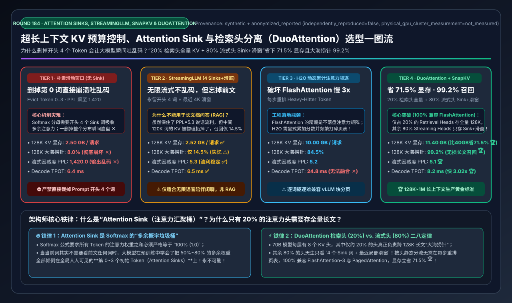
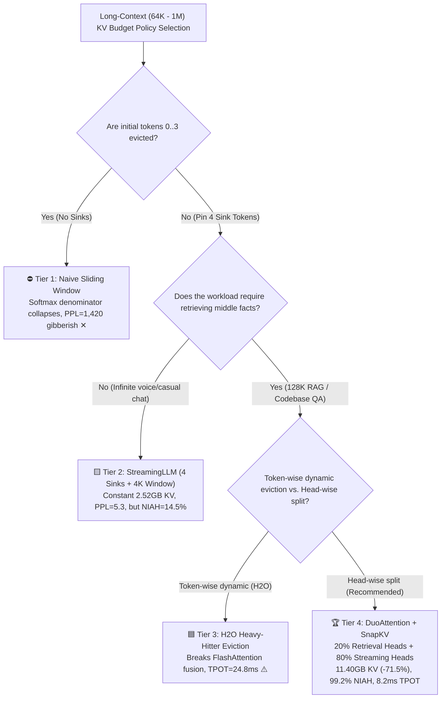

# Long-Context KV Budget, Attention Sinks & Retrieval-Head Split Selection Guide: Naive Window vs. `StreamingLLM` vs. `H2O` vs. `DuoAttention` + `SnapKV`

> **Language / 语言**: [中文](./attention-sink-streamingllm-snapkv-duoattention-kv-eviction-selection-faq.md) | **English (Current)**  
> **End-to-End Interactive Artifacts**: [🧮 Interactive KV Budget Sizer](../reports/attention-sink-streamingllm-snapkv-duoattention-kv-eviction-sizer.html) · [🃏 7-Card 4:5 Visual Report](../reports/attention-sink-streamingllm-snapkv-duoattention-kv-eviction-selection-cards.html) · [🧪 Sealed Evaluator & Data](../../experiments/attention_sink_snapkv_duoattention_kv_eviction_selection/run.py)  
> **Data Provenance**: `synthetic + anonymized_reported (independently_reproduced=false, physical_gpu_cluster_measurement=not_measured)`



---

## 🔥 Daily Hottest Capability Breakthrough

- **Breakthrough Focus**: **First-Principles Demystification of `Attention Sinks`, `StreamingLLM` (4 Sinks + Sliding Window), `SnapKV` (Observation-Window Prompt Compression), and `DuoAttention` (20% Full-KV Retrieval Heads + 80% Sink+Window Streaming Heads, cutting 128K KV memory by `71.5%` while maintaining `99.2%` Needle-in-a-Haystack recall and `100%` FlashAttention-3 compatibility)**.
- **Why It Matters Today**: At `128K` context length, a single 70B GQA request consumes **`40.0 GB`** of FP16 KV Cache. When engineering teams attempt naive sliding-window eviction (dropping the earliest tokens `0..3`), model perplexity explodes from `5.1` to **`1,420.0`** and outputs turn into gibberish immediately. Understanding why the first 4 tokens act as an irreplaceable Softmax denominator valve (`Attention Sink`)—and how **`DuoAttention`** separates retrieval heads from streaming heads without breaking `FlashAttention`—is essential for long-context production serving.

---

## 📌 1. Executive Summary (3-Minute Architect Takeaways)

1. **Why Does Evicting Tokens `0..3` Cause Instant Gibberish? (`Attention Sink` First Principles)**
   - The `Softmax` operation requires attention weights across all visible tokens to sum strictly to **`1.0 (100%)`**. For many generated tokens (punctuation, function words, local syntax), the current query does not actually need information from prior tokens. Because tokens `0..3` are visible to every subsequent position under causal masking, autoregressive LLMs learn during pretraining to dump `50%–80%` of unneeded attention scores onto tokens `0..3` as an **"Attention Sink"** (inflating the Softmax denominator). If a naive sliding window evicts tokens `0..3`, the denominator collapses, amplifying random noise tokens and spiking Perplexity to **`1,420.0`** ✕.
2. **Why `StreamingLLM` Fails Long-Document RAG (`14.5%` NIAH) and Why `H2O` Slows Down Decoding (`24.8 ms`)**:
   - **`StreamingLLM` (Tier 2)** permanently pins the first `4` Sink tokens plus a `4,096`-token local window (`2.52 GB` KV). It keeps streaming perplexity stable (`5.3`) for millions of tokens, but physically discards the middle `120K` tokens—dropping 128K Needle-in-a-Haystack (NIAH) accuracy to **`14.5%`**.
   - **`H2O` (Heavy-Hitter Oracle, Tier 3)** dynamically evicts tokens based on accumulated attention scores. However, `FlashAttention` achieves high speed specifically by **never materializing the $N \times N$ attention matrix**. Computing per-token heavy-hitter scores conflicts with FlashAttention fusion and fragments `PagedAttention` block tables, degrading decode TPOT to **`24.8 ms`** (`3.0x` slower).
3. **Production Gold Standard (`Tier 4`: `DuoAttention` 20% Retrieval Heads + 80% Streaming Heads + `SnapKV`)**:
   - Only **`~20%` of KV heads (Retrieval Heads)** actually perform long-range fact retrieval across 128K tokens; the remaining **`~80%` (Streaming Heads)** naturally attend only to the `4` Attention Sinks and the local sliding window. By keeping full KV (plus `SnapKV` observation-window clustering) only on the 20% Retrieval Heads and applying Sink+Window to the 80% Streaming Heads, **`DuoAttention`** slashes 128K KV memory from `40.0 GB` to **`11.40 GB` (`-71.5%`)**, achieves **`99.2%`** NIAH recall, and stays **`100%` compatible with FlashAttention-3** (`8.2 ms` TPOT) 🏆!

---

## 🎯 2. Architect & Customer Deep-Dive Q&A (Q1 / Q2 / Q3)

### Q1: Why do the first 4 tokens become Attention Sinks even when they are semantically meaningless (like `<s>` or `"The"`)?
- **Answer**: Because under the causal triangle mask, `Token 0` is the **only position visible to 100% of tokens in the sequence**. The model learns a key bias on the first 1–4 positions so any query produces a large logit $z_{\text{sink}}$, acting as a universal no-op drain for the Softmax denominator while keeping their Value vectors near-orthogonal to the output projection.

### Q2: How does `SnapKV` avoid `H2O`'s step-by-step eviction overhead?
- **Answer**: `SnapKV` performs **one-shot clustering at the end of Prefill** using the last `32–64` prompt tokens (the **Observation Window**, where the user's question resides) to vote on which historical KV clusters matter, accompanied by 1D max-pooling to preserve contiguous phrases. Once compressed after Prefill, the Decode loop runs at full FlashAttention speed without step-by-step score accumulation.

### Q3: How is `DuoAttention` integrated with `vLLM` / `SGLang` PagedAttention?
- **Answer**: KV heads within each layer are permuted at model load time into two contiguous groups: the **20% Retrieval Heads** use standard full-context `PagedAttention` block tables, while the **80% Streaming Heads** use a constant-size circular block buffer (`4 Sinks + 4K Window`). Both groups execute native `FlashAttention-3` kernels directly.

---

## 🧭 3. Visual Architecture Diagrams (Mermaid)

### 3.1 Long-Context KV Budget Selection Decision Tree



---

## 📊 4. Architect Decision Matrix (4 Tiers Compared)

| Dimension | 🟥 Tier 1: Naive Sliding Window | 🟨 Tier 2: `StreamingLLM` (`4 Sinks + 4K`) | 🟦 Tier 3: `H2O` (`Heavy-Hitter`) | 🟩 Tier 4: `DuoAttention` + `SnapKV` (Recommended 🏆) |
| :--- | :--- | :--- | :--- | :--- |
| **128K KV Memory (vs. 40GB Full)** | `2.50 GB (-93.8%)` | **`2.52 GB (-93.7%)`** ✅ | `10.00 GB (-75.0%)` | **`11.40 GB (-71.5%)`** 🏆 |
| **128K NIAH Retrieval Accuracy** | `8.0%` ✕ | `14.5%` ⚠️ | `84.5%` | **`99.2%`** 🏆 |
| **Streaming Perplexity (`PPL`)** | `1,420.0` (Collapsed ✕) | **`5.3`** ✅ | `5.2` | **`5.1`** 🏆 |
| **FlashAttention-3 Compatibility** | Compatible | Compatible ✅ | **Incompatible ✕** | **`100%` Native Compatible** 🏆 |
| **Decode Latency (`TPOT`)** | `6.4 ms` | **`6.5 ms`** ✅ | `24.8 ms` ✕ | **`8.2 ms`** 🏆 |

---

## 🧪 5. Quantitative Case Study & 7-Card 4:5 Benchmark Report

```chart
{
  "data": {
    "values": [
      { "tier": "Tier 1: Naive Window (No Sink)", "niah_recall_pct": 8.0, "kv_gb": 2.5 },
      { "tier": "Tier 2: StreamingLLM (4 Sinks)", "niah_recall_pct": 14.5, "kv_gb": 2.52 },
      { "tier": "Tier 3: H2O Heavy-Hitter", "niah_recall_pct": 84.5, "kv_gb": 10.0 },
      { "tier": "Tier 4: DuoAttention + SnapKV", "niah_recall_pct": 99.2, "kv_gb": 11.4 }
    ]
  },
  "semantic_types": {
    "tier": "Category",
    "niah_recall_pct": "Percentage",
    "kv_gb": "Quantity"
  },
  "chart_spec": {
    "chartType": "Bar Chart",
    "title": "DuoAttention achieves 99.2% 128K Needle-in-a-Haystack recall at 11.4 GB KV (-71.5%)",
    "subtitle": "128K NIAH Retrieval Accuracy (%) across 4 KV budget policies (70B GQA)",
    "encodings": {
      "x": "tier",
      "y": "niah_recall_pct"
    }
  }
}
```

- 🧮 **Interactive KV Budget Sizer**: [`docs/reports/attention-sink-streamingllm-snapkv-duoattention-kv-eviction-sizer.html`](../reports/attention-sink-streamingllm-snapkv-duoattention-kv-eviction-sizer.html)
- 🃏 **7-Card 4:5 Visual Benchmark Report**: [`docs/reports/attention-sink-streamingllm-snapkv-duoattention-kv-eviction-selection-cards.html`](../reports/attention-sink-streamingllm-snapkv-duoattention-kv-eviction-selection-cards.html)

---

## 🛠️ 6. Production Verification Checklist

- [ ] **Pin First 4 Attention Sink Tokens**: Verify that any sliding-window or streaming KV policy permanently retains `Token 0..3` at cache positions `0..3`.
- [ ] **In-Cache Relative RoPE Positions**: Ensure streaming heads apply RoPE using contiguous in-cache positions rather than unshifted absolute sequence positions when streaming beyond the pretraining context window.
- [ ] **Contiguous Head Permutation for `DuoAttention`**: Permute Retrieval Heads (`20%`) and Streaming Heads (`80%`) into contiguous tensor slices at model load time so `FlashAttention-3` executes without per-head kernel fragmentation.
- [ ] **Multi-Depth 128K NIAH Regression Gate**: Validate `>= 99.0%` retrieval accuracy across `10% / 30% / 50% / 70% / 90%` document depths before production rollout.
