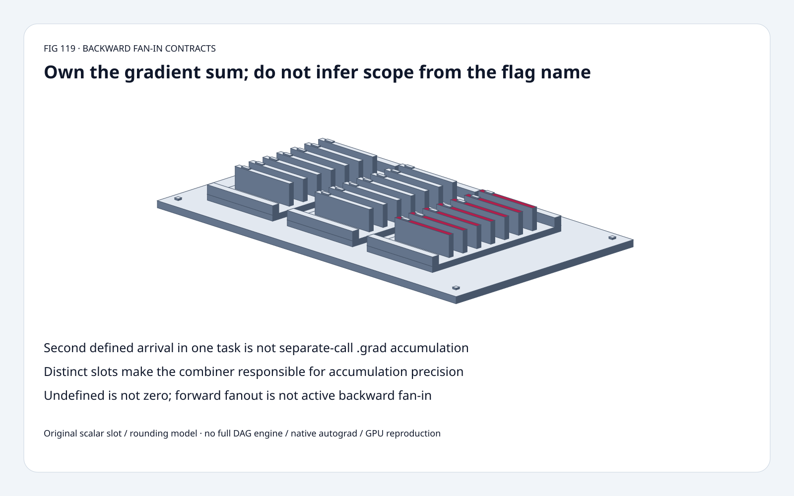
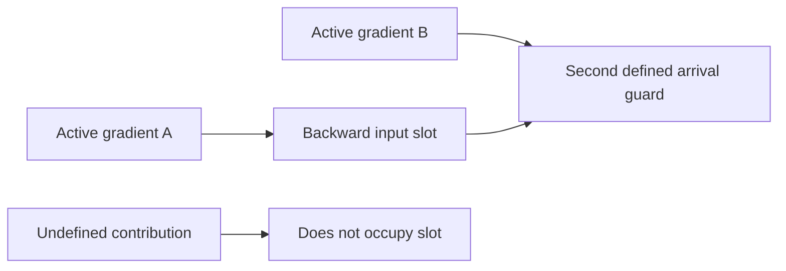
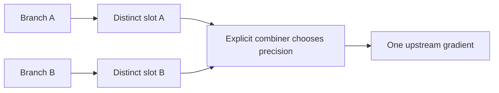
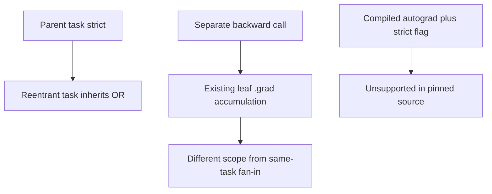

# Autograd FAQ: implicit fan-in is not cross-call .grad accumulation

> **Language**: [中文](autograd-implicit-fanin-explicit-precision-selection-faq.md) | English
>
> **Round 119 · 2026-11-14 (night round 28)** · [SVG](../../assets/svg/autograd-implicit-fanin-explicit-precision-selection-faq-summary.svg) · [7 cards](../reports/autograd-implicit-fanin-explicit-precision-selection-cards.html) · [H5](../reports/autograd-implicit-fanin-explicit-precision-sizer.html) · [Data](../../experiments/autograd_fanin_contract_selection/report.json)
>
> **Synthetic, `independently_reproduced=false`.** Original scalar task-slot and IEEE rounding controls, separate CPU timing. No native PyTorch/autograd, tensor views, full DAG engine or GPU reproduction.



## 1. Executive summary: the new guard exposes who owns a gradient sum

Verified **November 12, 2026** PyTorch change adds the keyword-only
`disallow_implicit_grad_accumulation` flag to Python backward/grad APIs.
It rejects a second **defined** gradient entering an already occupied
backward input slot within a GraphTask. It does **not** forbid leaf
`.grad` accumulation across separate backward calls.

Original float32 contributions `[16777216,1,-16777216]` have exact
encoded-input sum **1**, but a per-add float32 fold returns **0**.
Across all six orders, narrow accumulation matches the exact sum
**4/6** times; a selected float64 fold/final float32 cast matches
**6/6**. These are enumerated fixture results, not native scheduling
probabilities or general float64 exactness.

| Scope | Guard meaning | Not implied |
| :--- | :--- | :--- |
| One task/input slot | Reject second defined contribution | Every forward fanout must fail |
| Explicit custom combiner | Caller owns the sum | Flag chooses float64 |
| Separate backward calls | Existing leaf .grad may accumulate | Universal accumulation ban |
| Native engine | Exact supported execution path | Transactional rollback or memory saving |

## 2. Architect Q&A: which accumulation is actually disallowed?

### Q1: Is a tensor used twice in forward enough to decide?

Not by itself. Only edges traversed by the selected backward matter.
An unused branch, graph pruning through `inputs=`, or separate
backward calls need not cause a second arrival in one task.
The source checks actual backward buffers rather than every forward use.

The original model receives explicitly supplied `(slot,value,producer)`
events; it is **not a full graph scheduler or reachability engine**.
One active arrival succeeds even if a separate forward description
would contain more uses. Different slots can each receive once.

### Q2: Are undefined and numeric zero equivalent?

No. The inspected check requires both the new output and existing
slot buffer to be **defined**.
Our `None` represents an undefined contribution and is ignored.
A supplied numeric zero occupies a slot; a second numeric zero
still triggers the original strict guard.

The native error describes the destination slot/leaf and the producer
of the second gradient; anomaly mode can provide its forward traceback.
Our explicit exception retains first-slot state and names the second
producer. Neither this model nor the native guard should be treated as
a promise of transactional rollback after a failed backward.

### Q3: How can an explicit combiner avoid the implicit slot sum?

The pinned notes use a custom Function that returns a separate view
per use, gives each output its own backward input slot, then combines
their gradients explicitly in its backward.
Those are views: **do not modify them in place**.

Our original scalar model instead creates distinct logical slot IDs,
performs a chosen wide fold and sends **one** result upstream.
It reproduces neither native views nor their aliasing rules.
The source also documents the special `ctx.input_grad_buffers` /
returned-`None` path; the scalar model does not implement that API.

The flag does not specify summation precision, order or casting.
Float64 is a selected policy for this fixture only.
Keep encoded-input precision distinct from the accumulator and final
output precision: widening cannot recover information already lost
when contributions were formed.

### Q4: Does the guard stop microbatch accumulation or all implicit reductions?

No. Two separate original tasks each accept one leaf contribution,
1 then 2, and the external `.grad` store reaches **3**.
The source explicitly excludes accumulation into `.grad` across calls.

Broadcast-reduction sums and dtype conversions are also not covered
by this change. Do not equate it with a universal no-reduction switch,
an optimizer-step barrier, distributed gradient synchronization or
a microbatch-normalization policy.

A reentrant backward inherits the setting by logical OR with its
parent task. The source warns against passing it for higher-order
derivatives whose formulas themselves sum internally.

### Q5: Where is this unsupported, and does it reduce HBM?

The inspected compiled-autograd path raises `NotImplementedError`
for the flag; the existing C++ public backward/grad APIs do not
accept this Python-only argument.

Default selected budget: 1,048,576 elements, three float32 contribution
vectors → **12,582,912 bytes**; one selected float64 accumulator
→ **8,388,608 bytes**; one float32 output → **4,194,304 bytes**.

These are individual logical payloads, **not an execution schedule,
summed peak HBM, saved allocation or measured memory reduction**.
Native views, lifetimes, reuse and explicit-combiner implementation
determine actual memory. Native latency and precision policy remain null.

## 3. Visual architecture: actual arrivals, separate slots, explicit sum







## 4. Selection matrix: use the flag as a sum-ownership diagnostic

| Choice | Good fit | Gate |
| :--- | :--- | :--- |
| Default implicit fan-in | Existing backward semantics | Precision/order still matter |
| Strict fan-in guard | Find active implicit gradient joins | Not forward-only analysis |
| Explicit split/combiner | Custom accumulation/cast policy | View aliasing and backward implementation |
| Separate .grad accumulation | Microbatch-style accumulation | Scaling and step schedule separate |
| Reentrant backward | Inherited diagnostic scope | Cannot locally disable parent strictness |
| Compiled/higher-order paths | Their supported contracts | Not universally supported by new guard |

## 5. Hands-on evidence: exact encoded sum and six orderings

```powershell
python -m experiments.autograd_fanin_contract_selection.run --check
python -m unittest discover -s tests -p test_autograd_fanin_contract_selection.py -q
```

Eight tests cover Fraction reference sums, all six orderings, undefined
versus zero, distinct/explicit slots, separate tasks, inherited flags,
unsupported compiled scope, invalid inputs, Node/Python parity and
sealed timing medians.

| Contributions | Original wide fold/final cast (ms) | Struct-rounded float32 each add (ms) |
| :--- | ---: | ---: |
| 24 | 0.007633 | 0.013400 |
| 96 | 0.029367 | 0.052133 |
| 384 | 0.117700 | 0.211267 |
| 1,536 | 0.476300 | 0.841733 |

These policies intentionally produce **different outputs**.
Both include input float32 conversion; per-add struct packing adds
Python overhead to the narrow path. Two warmups, seven alternating
repeats, three operations/sample; median repeat means.
No native engine, tensor/view creation or GPU timing.
No browser visual inspection.

## 6. Sources, provenance and readiness

- [November 12 change](https://github.com/pytorch/pytorch/commit/22e0dfd2aed75aa2bc0a44e7ff4b49753f62c3ce): new flag, supported paths and tests.
- [Pinned mechanics notes](https://github.com/pytorch/pytorch/blob/22e0dfd2aed75aa2bc0a44e7ff4b49753f62c3ce/docs/source/notes/autograd.md): explicit views/combiner, separate-call exclusion and higher-order limitations.
- [Pinned engine](https://github.com/pytorch/pytorch/blob/22e0dfd2aed75aa2bc0a44e7ff4b49753f62c3ce/torch/csrc/autograd/engine.cpp): defined-slot check, parent inheritance and compiled-autograd rejection.
- [Pinned license](https://github.com/pytorch/pytorch/blob/22e0dfd2aed75aa2bc0a44e7ff4b49753f62c3ce/LICENSE): BSD-style repository terms; upstream rights retained.

Original scalar slots, IEEE controls, CPU orchestration and art;
no upstream implementation copied. Source authors' native test claims
are not independently reproduced here.
