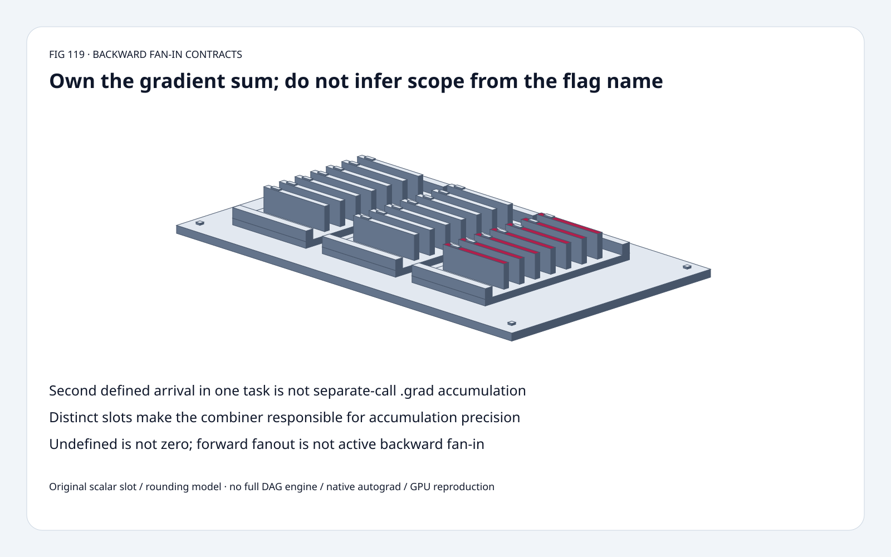
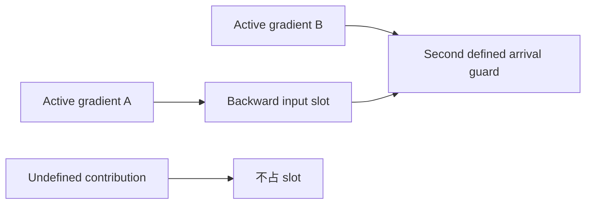
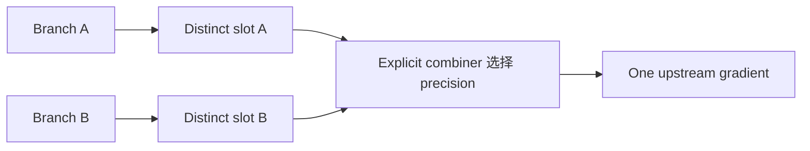
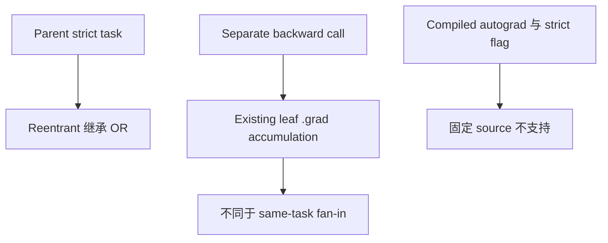

# Autograd FAQ：Implicit Fan-in 不等于跨次 .grad Accumulation

> **语言**：中文 | [English](autograd-implicit-fanin-explicit-precision-selection-faq.en.md)
>
> **Round 119 · 2026-11-14（夜班第 28 轮）** · [高清 SVG](../../assets/svg/autograd-implicit-fanin-explicit-precision-selection-faq-summary.svg) · [七卡](../reports/autograd-implicit-fanin-explicit-precision-selection-cards.html) · [H5](../reports/autograd-implicit-fanin-explicit-precision-sizer.html) · [数据](../../experiments/autograd_fanin_contract_selection/report.json)
>
> **Synthetic，`independently_reproduced=false`。** 原创 scalar task-slot、
> IEEE rounding control、独立 CPU timing；不复现 native autograd、tensor views、
> full DAG engine 或 GPU。



## 一、先看结论：新 Guard 暴露 Gradient Sum 归谁负责

核验 PyTorch **2026-11-12** 为 Python backward/grad APIs 新增
keyword-only `disallow_implicit_grad_accumulation`：
同一 GraphTask 中，已占用 backward input slot 收到第二个 **defined**
gradient 时拒绝。它**不禁止**跨多次 backward 的 leaf `.grad` accumulation。

原创 float32 `[16777216,1,-16777216]` 的 encoded-input exact sum 是 **1**，
但 per-add float32 fold 为 **0**；
六种顺序中 narrow 对齐 **4/6**，选定 float64 fold/final float32 cast **6/6**。
这是 fixture 穷举，不是 native 调度概率，也不保证 float64 一般精确。

| Scope | Guard 的含义 | 不代表 |
| :--- | :--- | :--- |
| 单 task/slot | 拒绝第二个 defined contribution | 所有 forward fanout 必然失败 |
| Explicit combiner | Caller 负责 sum | Flag 自动选 float64 |
| Separate backwards | .grad 仍可累积 | Universal accumulation ban |
| Native engine | 精确的支持路径 | Transaction rollback / memory saving |

## 二、架构师 Q&A：到底禁止哪一种 Accumulation？

### Q1：Forward 用两次就足够判定吗？

不够。只有当前 backward 真正 traversed 的 edges 有关；
unused branch、`inputs=` pruning、separate backward calls
不一定导致同 task 的第二次 arrival。
Source 检查 actual backward buffers，而非仅统计 forward uses。

原创接收显式 `(slot,value,producer)` events，
**不是 full DAG scheduler/reachability engine**。
只有一条 active arrival 时通过；不同 slots 可各接收一次。

### Q2：Undefined 与数值零是同一种情况吗？

不是。Source 要求 new output 与 existing slot buffer 都 **defined**。
原创 `None` 表示 undefined，忽略；
数值 0 会占据 slot，第二个数值 0 仍触发 strict guard。

Native error 描述 destination slot/leaf 与 second producer；
anomaly mode 可提供其 forward traceback。
原创异常保留 first-slot state 并给出 second producer。
不能把任何一方的 guard 当成失败 backward 的 transactional rollback 保证，
也不能静默 retry。

### Q3：Explicit Combiner 如何绕开 Implicit Slot Sum？

固定 notes 用 custom Function 每 use 返回独立 view，
让各 output 有独立 backward input slot，再在 backward 显式求和。
它们是 views，**不要 in-place 修改**。

原创只创建 distinct logical slot IDs，选定 wide fold，
再送 **一个** upstream result；不复现 native views/aliasing。
Source 还描述 `ctx.input_grad_buffers` / returned-`None` 特例，
原型没有实现该 API。

Flag 不选择 sum precision/order/cast；本例 float64 只是所选策略。
Input、accumulator、output precision 要分开；
widening 无法恢复 contribution 形成时已丢失的信息。

### Q4：Guard 会禁止 Microbatch Accumulation 或所有 Reductions 吗？

不会。原创两个独立 tasks 各给 leaf 一次贡献 1、2，
external `.grad` 达到 **3**；source 明确排除跨调用 `.grad` accumulation。

Broadcast reduction、dtype conversion 也不在此次覆盖范围，
不等于 no-reduction switch、optimizer-step barrier、
distributed gradient sync 或 microbatch normalization policy。

Reentrant backward 与 parent setting 做 OR 继承；
source 警告 higher-order derivative formulas 自身可能 sum，
不要在对应高阶 backward 盲目传 flag。

### Q5：哪些路径不支持，能省 HBM 吗？

固定 compiled-autograd 加 flag 时 `NotImplementedError`；
现有 C++ public backward/grad 不接收该 Python-only argument。

默认 1,048,576 elements、三条 float32 contributions：
**12,582,912 bytes**；选定 float64 accumulator **8,388,608 bytes**；
float32 output **4,194,304 bytes**。

这些是各自 logical payload，**不是执行时序、相加后的 peak HBM、
saved allocation 或实测 memory reduction**；
native views/lifetime/reuse/combiner implementation 才决定实际占用。
Native latency/precision policy 保持 null。

## 三、三张架构图：Actual Arrival、Separate Slot、Explicit Sum







## 四、选型矩阵：把 Flag 当 Sum Ownership Diagnostic

| 选择 | 适合 | Gate |
| :--- | :--- | :--- |
| Default implicit fan-in | Existing backward semantics | Precision/order 仍重要 |
| Strict guard | 暴露 active gradient joins | 不是 forward-only analysis |
| Explicit split/combiner | 自定义 sum/cast | View aliasing、backward correctness |
| Separate .grad accumulation | Microbatch-style accumulation | Scaling/step schedule 另行约束 |
| Reentrant backward | 继承 diagnostic scope | 子 task 不能取消 parent strict |
| Compiled/higher-order | 各自支持契约 | 新 flag 不是通用兼容 |

## 五、动手证据：Encoded Exact Sum 与六种顺序

```powershell
python -m experiments.autograd_fanin_contract_selection.run --check
python -m unittest discover -s tests -p test_autograd_fanin_contract_selection.py -q
```

8 项 tests：Fraction reference、六种顺序、undefined/zero、
distinct/explicit slots、separate tasks、flag inheritance、
unsupported compiled scope、invalid inputs、Node/Python parity、sealed medians。

| Contributions | Original wide fold/final cast（ms） | Struct float32 each add（ms） |
| :--- | ---: | ---: |
| 24 | 0.007633 | 0.013400 |
| 96 | 0.029367 | 0.052133 |
| 384 | 0.117700 | 0.211267 |
| 1,536 | 0.476300 | 0.841733 |

两种策略**有意输出不同**；均含 input float32 conversion，
narrow 多了 per-add Python struct packing。
2 warmups、7 alternating repeats、3 ops/sample，取 repeat means median；
不含 native engine、tensor/views、GPU，未做浏览器视觉验收。

## 六、来源、许可、溯源与 Readiness

- [11 月 12 日更新](https://github.com/pytorch/pytorch/commit/22e0dfd2aed75aa2bc0a44e7ff4b49753f62c3ce)：新 flag、支持路径、tests。
- [固定 mechanics notes](https://github.com/pytorch/pytorch/blob/22e0dfd2aed75aa2bc0a44e7ff4b49753f62c3ce/docs/source/notes/autograd.md)：views/combiner、跨调用排除、高阶限制。
- [固定 engine](https://github.com/pytorch/pytorch/blob/22e0dfd2aed75aa2bc0a44e7ff4b49753f62c3ce/torch/csrc/autograd/engine.cpp)：defined-slot check、parent inheritance、compiled rejection。
- [固定 LICENSE](https://github.com/pytorch/pytorch/blob/22e0dfd2aed75aa2bc0a44e7ff4b49753f62c3ce/LICENSE)：BSD-style repository terms，上游权利保留。

Scalar slots、IEEE controls、CPU orchestration、视觉原创，未复制上游实现；
source 作者的 native test 收据不是本研究 independently reproduced 结果。
