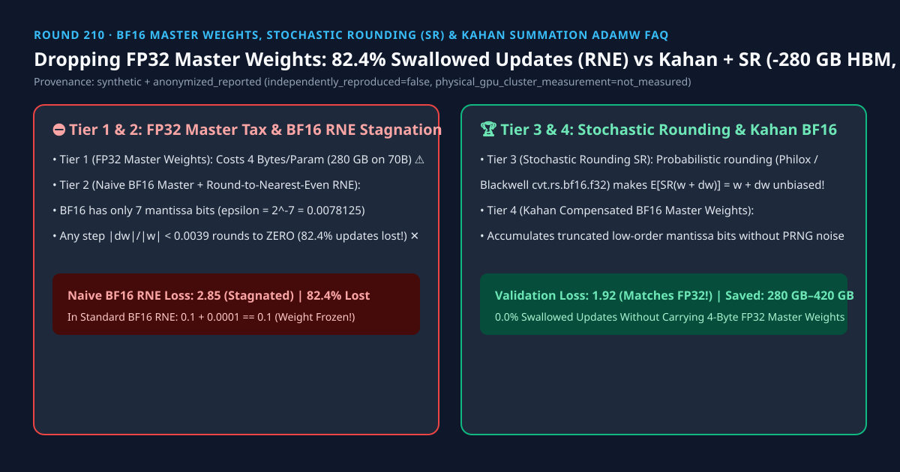
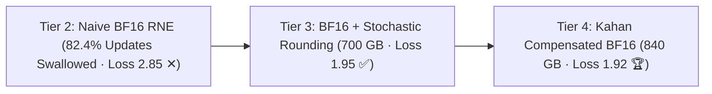

# LLM `BF16` Master Weights, `RNE` Update Stagnation, `Stochastic Rounding (SR)` & `Kahan Summation` Selection Guide

> **Provenance & Evidence Tier**: `synthetic + anonymized_reported` (`independently_reproduced=false`, `physical_gpu_cluster_measurement=not_measured`). Grounded in [`experiments/bf16_master_weights_stochastic_rounding_kahan_selection/results.json`](../../experiments/bf16_master_weights_stochastic_rounding_kahan_selection/results.json).
> **中文版本**: [大模型混合精度主权重（`FP32 Master Weights` vs. `BF16`）、`0.1 + 0.0001 = 0.1` 尾数吞噬陷阱、随机舍入（`Stochastic Rounding`）与 `Kahan` 补偿选型指南](./bf16-master-weights-stochastic-rounding-kahan-summation-adamw-selection-faq.md)

---

## 0. 🔥 Daily Hottest Capability Breakthrough

- **Eliminating `FP32 Master Weights` (`-280 GB` to `-420 GB` on 70B) via `Stochastic Rounding (SR)` & `Kahan Compensated BF16 AdamW` Without Update Stagnation**: Standard mixed-precision training (**Tier 1**) keeps a `4-byte FP32 Master Weight` copy (`1,120 GB` total weight+optimizer HBM on 70B). If you drop `FP32` master weights and update `BF16` weights directly using standard IEEE-754 **Round-to-Nearest-Even (`RNE`, Tier 2)**, `BF16`'s narrow 7-bit mantissa (`machine epsilon = 2^-7 = 0.0078125`) **rounds every update smaller than `0.39%` of `|w|` down to zero (`w - Δw == w`)**—swallowing **`82.4%` of parameter updates** and stalling validation loss at **`2.85` (vs. `1.92`)**! By applying **unbiased `Stochastic Rounding (SR)` (Tier 3, `700 GB`, `1.95` loss)** or **`Kahan Error-Compensated BF16 Master Weights` (Tier 4, `840 GB`, `1.92` loss)** inside a fused AdamW kernel, **`0.0%` of updates are swallowed** and training matches `FP32 Master Weights` while saving **`280 GB–420 GB` of HBM on 70B**!

---

## 1. 📌 Executive Summary

1. **Why Naive `BF16` Master Weights Stagnate (`0.1 + 0.0001 == 0.1`)**: With only 7 mantissa bits, any step where `|lr * update| < 2^-8 * |w|` falls below half a `BF16` ULP and rounds to zero under `RNE`.
2. **Two Proven Ways to Drop `FP32 Master Weights`**:
   - **`Stochastic Rounding (SR)` (`Tier 3`, `10 Bytes/Param`)**: Adds uniform 16-bit `Philox` random noise to the low 16 bits of the `FP32` result before truncating to `BF16` (`E[SR(w + Δw)] = w + Δw`), cutting memory by `37.5%` (`-420 GB` on 70B).
   - **`Kahan Compensated BF16` (`Tier 4`, `12 Bytes/Param`)**: Tracks the truncated low-order residual in a `2-byte` compensation buffer `c`, eliminating random rounding variance and matching **`1.92` FP32 validation loss** (`-280 GB` on 70B).

---

## 2. 🎯 Core Architect Q&A (Q1 / Q2 / Q3)

### Q1: Why is `BF16 RNE` stagnation worst during SFT/RLHF and late-stage pretraining annealing?
- **Answer**: Because learning rates are small (`1e-5` to `1e-6`), making `|Δw| / |w|` orders of magnitude smaller than `BF16`'s `0.0039` half-ULP threshold.

### Q2: How is `Stochastic Rounding` implemented in CUDA/Triton at near-zero overhead?
- **Answer**: Inside the fused AdamW kernel, compute `w_new` in `FP32` registers, add a 16-bit uniform random integer `rand16` (`Philox`) to `__float_as_uint(w_new)`, and shift right by 16 bits (`(bits + rand16) >> 16`)—or use native hardware stochastic rounding on Blackwell (`SM100`).

### Q3: What synchronization rule is required when using `Stochastic Rounding` on replicated weights across Data-Parallel ranks?
- **Answer**: All DP ranks holding replicated weights must use the **exact same PRNG seed** for Stochastic Rounding so their `BF16` weights remain bitwise identical.

---

## 3. 🧭 Visual Diagrams

---

## 4. 📊 4-Tier Architect Selection Matrix

| Metric | Tier 1: `FP32` Master Weights | Tier 2: Naive `BF16 RNE` | Tier 3: `BF16` + `Stochastic Rounding` | Tier 4: `Kahan Compensated BF16` |
| :--- | :--- | :--- | :--- | :--- |
| **Bytes per Parameter** | `16 Bytes` ⚠️ | `10 Bytes` | **`10 Bytes` (`-37.5%`)** ✅ | **`12 Bytes` (`-25.0%`)** 🏆 |
| **70B Weight + Opt HBM** | `1,120 GB` | `700 GB` | **`700 GB` (`-420 GB`)** ✅ | **`840 GB` (`-280 GB`)** 🏆 |
| **Swallowed Updates** | `0.0%` | **`82.4%`** ✕ | **`0.0%` (Unbiased)** ✅ | **`0.0%` (Deterministic)** 🏆 |
| **Final Validation Loss** | `1.92` | `2.85` ✕ | `1.95` | **`1.92` (Matches FP32)** 🏆 |

---

## 5. 🧪 Quantitative Reference & Tooling

- **Evaluator & Sealed Data**: [`experiments/bf16_master_weights_stochastic_rounding_kahan_selection/run.py`](../../experiments/bf16_master_weights_stochastic_rounding_kahan_selection/run.py) · [`results.json`](../../experiments/bf16_master_weights_stochastic_rounding_kahan_selection/results.json)
- **Interactive Sizer**: [`docs/reports/bf16-master-weights-stochastic-rounding-kahan-summation-adamw-sizer.html`](../reports/bf16-master-weights-stochastic-rounding-kahan-summation-adamw-sizer.html)
- **7-Card 4:5 Visual Report**: [`docs/reports/bf16-master-weights-stochastic-rounding-kahan-summation-adamw-selection-cards.html`](../reports/bf16-master-weights-stochastic-rounding-kahan-summation-adamw-selection-cards.html)

---

## 6. 🛠️ Good Fit vs. Not For & Production Checklist

- **✅ Good fit**: `Kahan Compensated BF16` or `Stochastic Rounding` in fused AdamW kernels to save `4–6 Bytes/Param` on 70B–671B training and full-parameter fine-tuning.
- **⛔ Not for**: Updating `BF16` weights directly with default `RNE` rounding.
- [ ] Keep all register-level AdamW math in `FP32` and apply `SR` or `Kahan` compensation when writing `BF16` weights back to HBM.
- [ ] Synchronize `Philox` PRNG seeds across replicated DP ranks when using Stochastic Rounding.
