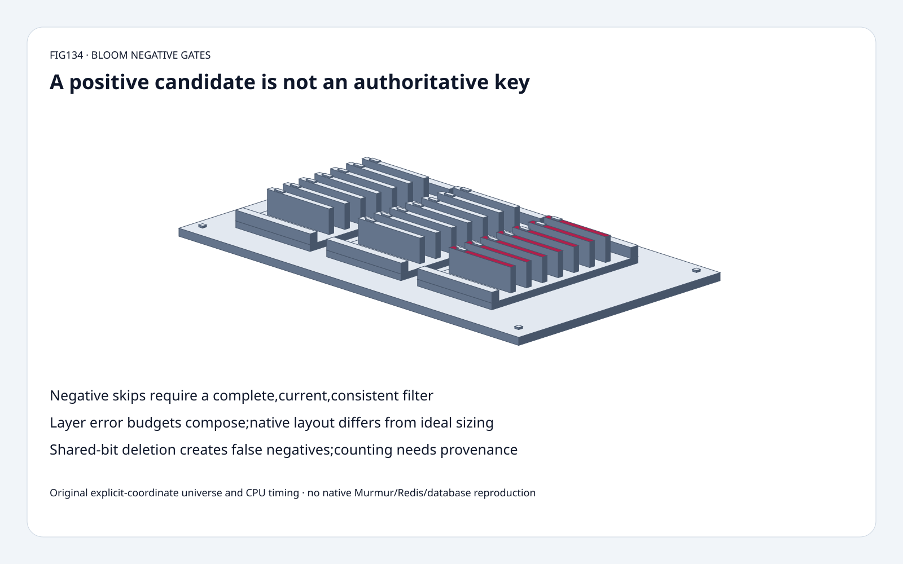
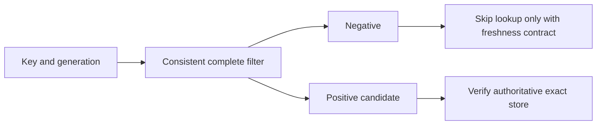
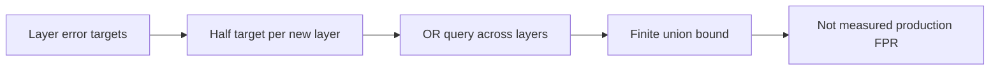
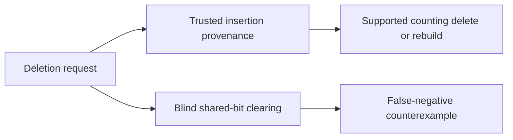

# Cache-index FAQ: Bloom negative gates,layer budgets and deletion provenance

> **Language**: [中文](bloom-negative-gate-layer-budget-safe-deletion-selection-faq.md) | English
>
> **Round134 · 2026-11-14 · Day round11** · [SVG](../../assets/svg/bloom-negative-gate-layer-budget-safe-deletion-selection-faq-summary.svg) · [H5](../reports/bloom-negative-gate-layer-budget-safe-deletion-sizer.html) · [7 cards](../reports/bloom-negative-gate-layer-budget-safe-deletion-selection-cards.html) · [Data](../../experiments/bloom_negative_gate_selection/report.json)
>
> **Synthetic, `independently_reproduced=false`.** Original explicit-coordinate bit model,finite universe and independent set oracle. CPU probes measured separately;no native Murmur hash,Redis,network,database latency or production FPR reproduction.

## 1. Executive summary: positive means candidate,not authoritative membership

The original16-bit,two-probe fixture inserts coordinate-pair tokens
A[1,5]andB[5,9]. Bits1/5/9are set.
UninsertedC[1,9]passes because other keys set both required positions.
Exhaustively enumerate the ordered16×16coordinate-pair universe:
excluding the two inserted tokens leaves254absent tokens,
of which **7pass** and **247are negative**.
Both inserted tokens remain positive.

These are exact counts for a teaching universe,not a hash-distribution
estimate or production false-positive rate.
Positive candidates must be checked against the authoritative store.
Negative skip gates require a complete,current,consistent filter;
missing updates,stale replicas or broken deletion invalidate that claim.

## 2. Architect Q&A: false positives,layer growth and safe removal

### Q1: Can a Bloom positive safely deduplicate training records?

Not if false drops are unacceptable.
Two different keys can share enough bits to produce a positive.
Treating a positive as exact prior ingestion can silently omit a new
sample or incorrectly suppress an adapter/checkpoint/object fetch.
Use it to avoid some definitely-absent lookups,and verify candidates
with an exact index. It is not an authorization primitive.

Pinned RedisBloom chain checks every existing link before insertion.
Its zero/already-present indication can therefore arise from a false
positive;it is not exact unique-key identity evidence.
Reported insertion counts are not a substitute for an authoritative set.
We inspect that control flow but do not execute Redis commands.

### Q2: When is “no false negatives” actually valid?

For the standard insert-only bit model,after every insertion has set its
required bits and those bits remain intact,an inserted key tests positive.
This is a deterministic monotonicity property,not a probability claim.

An application can still observe false absence if it queries a stale
filter,loses an update,uses different serialization/hash parameters,
checks the wrong tenant/version,or clears shared bits.
Publish exact-store and filter generations consistently;define the
fallback when freshness is unknown rather than interpreting unknown
as an authoritative negative.
We model neither replication nor transactional publication.

### Q3: How does the scalable chain budget aggregate error?

Pinned scalable initialization usesp/2;each new link halves the prior
link's error target while growing capacity.
Queries OR membership across links,so extra links can add candidates.
For selectedp1/100 and three links:
targets **1/200,1/400,1/800**,finite sum **7/800**.
Keeping each link atp instead would have union bound **3/100**.

The union bound does **not** require independent links,
but it does require valid per-link error bounds.
Targets,finite bounds and observed query rates are different quantities.
The infinite geometric target sum approachesp;the finite sum is belowp.
Hash correlations,load beyond design and implementation rounding can
invalidate simplistic interpretations. No native FPR was measured.

Pinned non-scaling mode reports full capacity rather than silently
growing. Original sizing is not an emulation of its allocation:
the source uses power-of-two and64-bit rounding and may adjust capacity.

### Q4: Why can't a standard Bloom filter delete a key by clearing its bits?

ClearA's positions1/5 andB loses shared bit5:the insertedB becomes
negative. An exact rebuild or supported deletion-capable structure is
needed if removals matter.

Original counting extension starts with counts1:1,5:2,9:1.
Trusted deletion ofA leaves5:1and9:1,soB remains positive.
But deleting uninserted false-positiveC[1,9]decrements real contributors
and breaks bothA andB. Counting alone does not establish membership.
Trusted insertion provenance,multiplicity and counter-range policy are
still required. The model rejects underflow;it does not implement a
production counting Bloom or cuckoo filter.

### Q5: How should a memory estimate be read?

The ideal-hash approximation
`m=ceil(-n*ln(p)/(ln2)^2)` and chosen
`k=ceil(ln2*m/n)` give a sizing what-if,not measured allocation or FPR.
Our selected scalable layer capacities1M/2M/4M,target1%global,
grow2,three links yield byte-rounded payloads:
**1,378,470B;3,117,613B;6,956,572B**,total **11,452,655B**,
with selected probe counts8/9/10.

These approximate layer budgets usep/2,p/4,p/8.
They exclude native power-of-two rounding,64-bit alignment,metadata,
Redis objects,allocator slack,serialization and replicated copies.
The explicit sixteen-bit toy and million-item approximation are separate
models;the toy's7/254rate is not a validation of the1%target.

## 3. Visual architecture: negative acceleration plus exact-store verification

## 4. Selection matrix: separate approximate membership from exact decisions

| Choice | Good fit | Gate |
| :--- | :--- | :--- |
| Insert-only Bloom | Complete negative prefilter | Freshness/version agreement |
| Scalable chain | Growing cardinality | Aggregate error and query cost |
| Fixed-capacity filter | Known design size | Explicit full handling |
| Exact index verification | Positive candidates | Authoritative consistency |
| Counting/rebuild strategy | Required removals | Trusted membership/multiplicity |
| Exact deduplication | No false-drop tolerance | Do not accept Bloom positives alone |

## 5. Workbench and evidence: eight focused tests,not native lookup savings

[H5](../reports/bloom-negative-gate-layer-budget-safe-deletion-sizer.html)
enumerates up to32×32ordered coordinate-pair tokens and displays exact
absent-candidate counts. Separate sizing controls label ideal-hash
approximations explicitly. Errors are visible.

Tests compare every16×16query with an independent union-of-bit-sets
oracle,check insert monotonicity,shared-bit clearing,trusted/untrusted
counting deletion,exact Fraction layer bounds,invalid inputs,
Node universe/sizing parity and sealed CPU records.

| Original two-probe queries | Packed bytearray ms | Python bool-list ms |
| :--- | ---: | ---: |
|64|0.027467|0.021400|
|256|0.110800|0.087233|
|1024|0.430267|0.342567|
|4096|1.833400|1.368567|

Two warmups,seven alternating repeats,three operations per sample;
medians of repeat means.
Packed representation is **slower in these Python fixtures**.
Hashing,construction,layers,nativeRedis,network,database lookup and
allocator footprint are excluded. Representation density does not prove
lower probe latency;no saved-database-latency claim.
Browser inspection was not performed after the prior approval refusal.

## 6. Sources,license and readiness

RedisBloom tree`393f33d3fa9da26dd8be36f41cbca91655bdf8e9`:
[chain](https://github.com/RedisBloom/RedisBloom/blob/393f33d3fa9da26dd8be36f41cbca91655bdf8e9/src/sb.c),
[bit implementation](https://github.com/RedisBloom/RedisBloom/blob/393f33d3fa9da26dd8be36f41cbca91655bdf8e9/deps/bloom/bloom.c),
[license](https://github.com/RedisBloom/RedisBloom/blob/393f33d3fa9da26dd8be36f41cbca91655bdf8e9/LICENSE.txt).
Chain source offers RSALv2/SSPLv1/AGPLv3 choice;the inspected dependency
has a BSD header. No upstream implementation copied.
The November12tree update bounds installer retries,not new Bloom theory;
no daily popularity ranking is invented.

[Original code and sealed data](../../experiments/bloom_negative_gate_selection/README.md).
Static Figure-tier original cabinet reuses sixty solids:
base,four feet,three trays,six rails,21cards,21tabs,four fasteners.
Ready for bounded negative-gate teaching/regression,
not nativeRedis,FPR,memory or consistency certification.
