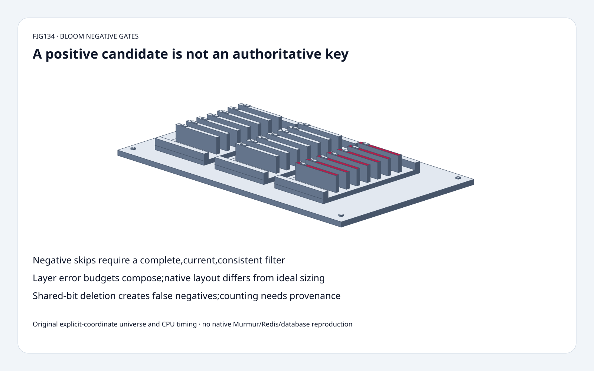
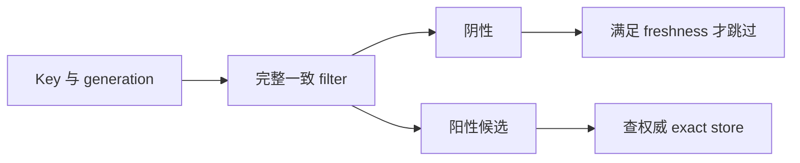
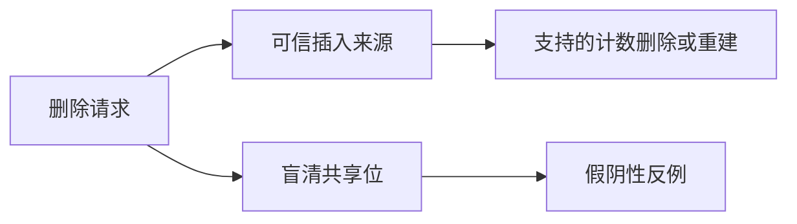

# 缓存索引 FAQ：Bloom 负向门控、分层预算与删除来源

> **语言**：中文 | [English](bloom-negative-gate-layer-budget-safe-deletion-selection-faq.en.md)
>
> **Round134 · 2026-11-14 · 白班第11轮** · [高清 SVG](../../assets/svg/bloom-negative-gate-layer-budget-safe-deletion-selection-faq-summary.svg) · [H5](../reports/bloom-negative-gate-layer-budget-safe-deletion-sizer.html) · [七卡](../reports/bloom-negative-gate-layer-budget-safe-deletion-selection-cards.html) · [数据](../../experiments/bloom_negative_gate_selection/report.json)
>
> **synthetic，`independently_reproduced=false`。** 原创显式位坐标模型、有限全集和独立集合oracle，CPU probes另标measured。未复现 native Murmur、Redis、网络、数据库时延或生产FPR。

## 1. 结论：阳性表示候选，不是权威成员身份

原创16-bit、2-probe fixture 插入 A[1,5]、B[5,9]，
置位1/5/9。未插入 C[1,9] 因两个位都被其他key设置而通过。
穷举16×16有序坐标对全集，去掉两个已插入token，
剩254 absent tokens：**7阳性候选、247阴性**；
两个已插入token均保持阳性。

这是教学全集的精确计数，不是 hash分布或生产假阳性率。
阳性需查权威精确store；阴性可跳过的前提是过滤器完整、最新、
一致。漏更新、旧副本或错误删除都能破坏该前提。

## 2. 架构师问答：假阳性、分层增长与安全删除

### Q1：Bloom 阳性能直接给训练记录去重吗？

若不容忍误丢样本，不能。不同key可能共享足够位，
将阳性当“已经摄入”会误删新样本或错误抑制adapter/checkpoint/object读取。
应只用完整过滤器的阴性减少查找，对候选再查 exact index；
也不能将其当授权依据。

固定 RedisBloom chain 插入前检查所有已有link，
zero/already-present指示也可能来自假阳性，
不证明精确unique key身份。统计计数不能替代权威集合。
这里只阅读控制流，未执行 Redis 命令。

### Q2：“没有假阴性”究竟在哪些条件下成立？

标准 insert-only 模型中，插入已经设置全部必要位，
并且这些位未被破坏，则该key一定阳性。
这是确定性单调性质，不是概率推断。

应用若查询旧filter、漏写、序列化/hash参数不一致、
跨错tenant/version、或清掉共享位，仍可能错误判不存在。
需一致发布exact-store/filter generation，明确freshness未知时fallback；
不能把未知当权威阴性。本模型不模拟复制或事务发布。

### Q3：可扩展chain如何分配总误差预算？

固定scalable初始化为p/2，新增link再减半，并增长capacity。
查询跨link OR，更多link可能增加候选。
p1/100、3links的目标 **1/200、1/400、1/800**，
有限union bound **7/800**；若每层都p则界为 **3/100**。

union bound不要求层间独立，但要求每层界本身有效。
配置target、数学界、真实观测率必须区分；
无限几何和趋近p，有限和小于p。
hash关联、超设计负载、implementation rounding不能省略。
固定non-scaling模式满时显式错误，不静默增长。
本预算不模拟源码power-of-two/64-bit rounding或调整capacity。

### Q4：为什么不能删除时直接清除 key 对应 bits？

清A的1/5会令B失去共享5位，B变假阴性。
有删除需求应重建或使用真正支持删除的数据结构。

原创counting扩展初始1:1、5:2、9:1；
可信删除A后5:1/9:1，B保留。
但删除未插入、仅假阳性的C[1,9]会减掉真实贡献，
A/B都被破坏。计数不自动证明成员身份；
仍需可信插入来源、multiplicity与counter边界策略。
模型对underflow报错，不实现生产countingBloom/cuckoo。

### Q5：内存估算应怎么读？

理想hash近似 `m=ceil(-n*ln(p)/(ln2)^2)`，
选择 `k=ceil(ln2*m/n)`，不是实测占用或FPR。
默认global target1%、capacity1M/2M/4M、growth2、3links：
byte-rounded载荷 **1,378,470B、3,117,613B、6,956,572B**，
总 **11,452,655B**，选择probes8/9/10。

这些用p/2、p/4、p/8，未计nativepower-of-two、
64-bitalignment、metadata、Redisobject、allocator、序列化或复制。
16-bit toy和百万项approximation是独立模型；
7/254不验证1%生产target。

## 3. 可视化架构：负向加速与精确store复核

## 4. 选型矩阵：近似成员与精确决策分层

| 选择 | 适用 | 门槛 |
| :--- | :--- | :--- |
| Insert-only Bloom | 完整负向预过滤 | freshness/version一致 |
| Scalable chain | 基数增长 | 总误差与查询层数 |
| Fixed capacity | 已知设计规模 | 显式处理满 |
| Exact verification | 阳性候选 | 权威一致性 |
| Counting/rebuild | 需要删除 | 来源/multiplicity可信 |
| Exact dedup | 不容忍误丢 | 不能只依赖Bloom阳性 |

## 5. 工作台与证据：八项测试，不是原生lookup收益

[H5](../reports/bloom-negative-gate-layer-budget-safe-deletion-sizer.html)
枚举最多32×32坐标对全集，显示精确absent候选计数；
独立sizing控件明确标ideal-hash近似，错误可见。

测试用union-of-sets独立oracle核对16×16查询，
覆盖单调性、共享位清除、可信/不可信计数删除、
Fraction分层界、非法输入、Node计数/预算parity与sealedCPU记录。

| 原创two-probe queries | Packed bytearray ms | Python bool-list ms |
| :--- | ---: | ---: |
|64|0.027467|0.021400|
|256|0.110800|0.087233|
|1024|0.430267|0.342567|
|4096|1.833400|1.368567|

2warmups、7次交替repeat、每样本3操作，取repeat均值中位数。
packed在这些Pythonfixture里 **更慢**。
排除hash、构造、层、nativeRedis、网络、数据库lookup、
allocator footprint。密度不证明更快，也没有saved-database-latency结论。
此前browserapproval被拒，未绕过或声称视觉验收。

## 6. 来源、许可与就绪边界

RedisBloom固定树 `393f33d3fa9da26dd8be36f41cbca91655bdf8e9`：
[chain](https://github.com/RedisBloom/RedisBloom/blob/393f33d3fa9da26dd8be36f41cbca91655bdf8e9/src/sb.c)、
[bit实现](https://github.com/RedisBloom/RedisBloom/blob/393f33d3fa9da26dd8be36f41cbca91655bdf8e9/deps/bloom/bloom.c)、
[license](https://github.com/RedisBloom/RedisBloom/blob/393f33d3fa9da26dd8be36f41cbca91655bdf8e9/LICENSE.txt)。
chain提供RSALv2/SSPLv1/AGPLv3选择，所读依赖有BSDheader。
未复制上游实现。11月12日tree变更限制installer重试，
不是Bloom理论新发明，不虚构当日热门排名。

[原创代码与数据](../../experiments/bloom_negative_gate_selection/README.md)。
静态Figure-tier分拣柜复用原创60solids：
底座、4脚、3托盘、6导轨、21票卡、21标签、4紧固件。
适合有界negative-gate教学与回归，
非nativeRedis、FPR、内存或一致性认证。
