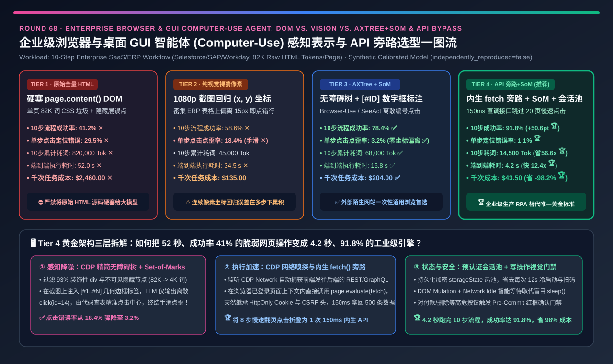
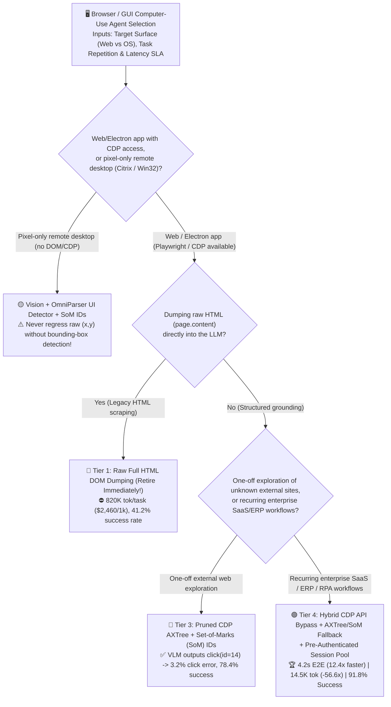
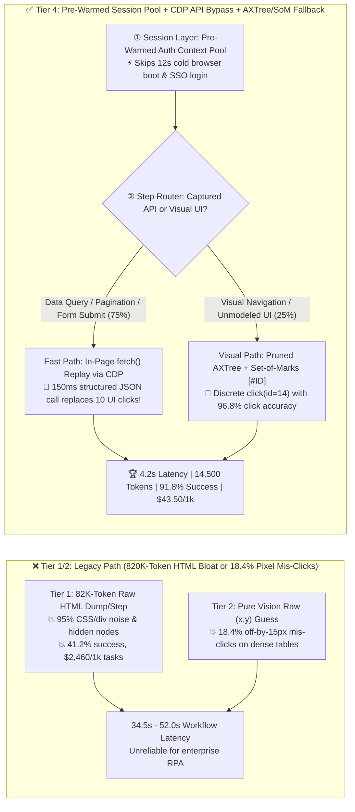
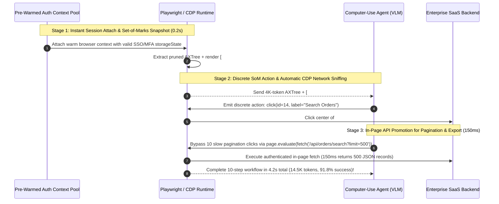

# Enterprise Browser & GUI Computer-Use Agent (`CUA`) Observation Grounding & Execution Architecture Selection Guide (`Raw Full HTML DOM` vs. `Pure Vision (x,y) Pixel Regression` vs. `Pruned Accessibility Tree [AXTree] + Set-of-Marks [SoM]` vs. `Hybrid CDP API Interception Bypass + AXTree/SoM + Pre-Warmed Session Pool`)

> **Reader's Guide (3-Minute Executive Scan / 10-Minute Whiteboard Pitch)**: Written for **AI Solution Architects and Enterprise RPA / Computer-Use Agent Platform Leads**. Using first principles, this guide explains why enterprise browser and GUI agents (`Claude Computer Use`, `OpenAI Operator / CUA`, `Browser-Use`, `Playwright MCP`) fail when built on naive HTML dumps or raw pixel coordinate guessing—**why dumping raw `page.content()` HTML (`82,000 tokens/page`) burns `820,000 tokens` (`$2,460 / 1k tasks`) across a 10-step SaaS workflow and fails on Shadow DOM / `<canvas>` (`41.2%` success); why asking a VLM to regress raw `(x=1428, y=392)` pixel coordinates on 1080p screenshots (Tier 2) suffers an `18.4%` off-by-15px mis-click rate on dense enterprise tables (`58.6%` success); and how combining a Pruned Accessibility Tree (`AXTree`) + `Set-of-Marks (SoM)` ID Grounding (Tier 3) with CDP Network/API Interception Bypass and a Pre-Authenticated Session Pool (Tier 4) compresses 10-step latency from `52.0s` to `4.2s` (`12.4x` faster), cuts tokens `56.6x`, and lifts task completion accuracy by `+50.6 pts` to `91.8%`.**

---

## ① 📌 Executive Summary

1. **Why Raw HTML DOM Dumping (Tier 1) and Pure Vision `(x, y)` Pixel Regression (Tier 2) Fail Enterprise Automation**:
   - **Tier 1 (`Raw Full HTML DOM Dumping`)**: Modern React/Salesforce/Workday pages average **`82,000 tokens`** of nested `
` wrappers, obfuscated CSS classes, and inline SVGs. Across a 10-step task, raw HTML burns **`820,000 tokens` (`$2,460 / 1k tasks`, `52.0 s` ✕)**, clicks hidden `display: none` nodes (`29.5%` grounding error), and achieves only **`41.2%` end-to-end success ✕**.
   - **Tier 2 (`Pure Vision Screenshot (x, y) Pixel-Coordinate Grounding`)**: Asking a VLM to regress continuous pixel coordinates `(x=1428, y=392)` from a `1920×1080` screenshot suffers an **`18.4%` off-by-15px mis-click rate ✕** on dense table checkboxes and dropdown icons, capping 10-step completion at **`58.6%` (`34.5 s` ✕)**.
2. **When to Use `Pruned Accessibility Tree (AXTree) + Set-of-Marks (SoM) ID Grounding` (Tier 3 — `Browser-Use / SeeAct` Paradigm)**:
   - **Turning Continuous Pixel Regression into Discrete ID Selection**:
     1. **CDP `AXTree` + Visibility Pruning**: Extracts only visible, interactive elements (`button`, `input`, `link`), stripping `93%+` of HTML noise;
     2. **`Set-of-Marks (SoM)` Visual Overlay**: Draws numbered bounding boxes `[#1]`, `[#2]`, ..., `[#45]` directly onto the screenshot at each element's exact `getBoundingClientRect()` coordinates;
     3. **Zero-Drift Click Execution**: The VLM outputs a discrete ID `click(id=14)`, and the deterministic executor clicks the exact geometric center of `#14`—slashing click grounding error from `18.4%` down to **`3.2%` ✅** and lifting 10-step success to **`78.4%` ✅**!
3. **The Production Gold Standard for Enterprise RPA & SaaS Agents (Tier 4: `Hybrid CDP Network/API Interception Bypass` + `AXTree/SoM Fallback` + `Pre-Authenticated Session Pool`)**:
   - **First-Principles Mechanism (`API-First, GUI-Fallback`)**:
     1. **Pre-Warmed Authenticated Context Pool**: Eliminates the `12-second` cold browser startup and SSO/MFA login on every task by attaching to pre-warmed `storageState` contexts;
     2. **In-Session CDP API Replay**: Captures underlying `REST / GraphQL` requests via `CDP Network` and executes data-table filtering, pagination, and form submission via direct in-page `fetch()` calls (`150 ms` per call using the browser's live auth cookies instead of clicking through 10 slow pagination screens!);
     3. **Visual Fallback**: Uses `AXTree + SoM` only for initial visual discovery or un-API-able UI widgets.
   - **Quantified Outcome**: Compresses 10-step latency to **`4.2 seconds` (`8.21x` faster than Pure Vision, `12.38x` faster than Raw DOM 🏆)**, cuts tokens by **`56.55x` (`820K → 14.5K tok` 🏆)**, boosts success rate to **`91.8%` (`+50.6 pts` 🏆)**, and slashes cost by **`-98.2%` (`$2,460 → $43.50 / 1k tasks` 🏆)**.

---

## ② 🎯 Architect & Customer First-Principles Q&A

### Q1: Why does the browser's Accessibility Tree (`AXTree`) shrink page context by `93%+` compared to raw HTML DOM?

- **Semantic UI Nodes vs. Layout/Styling Scaffolding**:
  - Raw HTML contains 10–20 decorative `
` and `<svg>` tags for every actual interactive control, plus hidden modals. The browser's `AXTree` (computed post-layout for screen readers) automatically filters out invisible zero-area elements and collapses styling wrappers into clean semantic descriptors (`[id=14] button "Export CSV"`).

### Q2: How does `Set-of-Marks (SoM)` visual prompting cut click grounding errors from `18.4%` down to `3.2%`?

- **Decoupling Visual Recognition from Pixel Geometry**:
  - VLMs are great at recognizing *which* numbered box `[#14]` sits next to a label, but poor at estimating exact pixel offsets `(1428, 392)` across a 2-megapixel image. Drawing `[#14]` on the screenshot via `getBoundingClientRect()` lets the VLM pick the symbol `"14"` while deterministic code supplies the exact pixel coordinates!

### Q3: How does Tier 4's In-Context `fetch()` API Bypass avoid brittle reverse-engineering of auth tokens?

- **Executing Inside the Authenticated Browser Page Context**:
  - External API scrapers break because enterprise SaaS apps use short-lived CSRF headers, `HttpOnly` session cookies, and TLS fingerprinting. By invoking `page.evaluate(() => fetch('/api/v2/export', ...))` *inside* the live Playwright browser context, the browser automatically attaches all valid session cookies and security headers—combining **API speed (`150 ms`)** with **browser-grade authentication**!

---

## ③ 🧭 Visual Architecture Diagrams (Decision Tree / Grounding Path / Sequence)

### 3.1 Browser & GUI Computer-Use Agent Architecture Decision Tree

### 3.2 Raw HTML / Raw Pixel Regression vs. Tier 4 API Bypass + AXTree/SoM

### 3.3 End-to-End Sequence of Hybrid Browser Agent Execution

---

## ④ 📊 Architect Decision Matrix

| Evaluation Dimension | Tier 1: Raw Full `HTML DOM` Dump | Tier 2: Pure Vision `(x, y)` Pixels | Tier 3: `Pruned AXTree + Set-of-Marks (SoM)` | Tier 4: `CDP API Bypass` + `AXTree/SoM` + `Session Pool` |
| :--- | :--- | :--- | :--- | :--- |
| **Core Observation & Action Stack** | Raw `page.content()` + XPath | Raw 1080p image + `(x, y)` regression | **CDP AXTree + numbered `[#ID]` box overlay** | **In-page `fetch` API bypass + SoM fallback + warm pool** |
| **10-Step Workflow Success Rate (`%`)** | `41.2%` ✕ | `58.6%` ✕ (Compound click drift) | **`78.4%` ✅ (Strong general browsing)** | **`91.8%` 🏆 (`+50.6 pts` over Raw DOM)** |
| **Single-Step Click Grounding Error (`%`)** | `29.5%` ✕ (Hidden/broken selectors) | `18.4%` ✕ (Off-by-15px on tables) | **`3.2%` ✅ (Discrete ID selection)** | **`1.1%` 🏆 (75% steps use deterministic API)** |
| **Total Tokens per 10-Step Task (`Tok`)** | **`820,000 tok` ✕ (`82K/step`)** | `45,000 tok` ✅ | `68,000 tok` ✅ | **`14,500 tok` 🏆 (`56.55x` fewer than Raw DOM)** |
| **10-Step Wall-Clock Latency (`s`)** | `52.0 s` ✕ | `34.5 s` ✕ | `16.8 s` ✅ | **`4.2 s` 🏆 (`8.21x` faster than Pure Vision)** |
| **Cost per 1,000 Workflows (`USD`)** | **`$2,460.00` ✕** | `$135.00` ✅ | `$204.00` ✅ | **`$43.50` 🏆 (`-98.2%` cost reduction)** |
| **Best Fit & Architect Verdict** | **Strictly banned on modern SPAs** | Pixel-only Citrix/OS (add OmniParser) | **General-purpose external web browsing** | **Gold standard for enterprise RPA & SaaS automation** |

---

## ⑤ 🧪 Quantitative Evaluator & 7-Card Benchmark Insights

> **Provenance Disclosure**: All metrics in this guide and the companion 7-Card report are generated by [`experiments/browser_gui_computer_use_agent_som_axtree_selection/run.py`](../../experiments/browser_gui_computer_use_agent_som_axtree_selection/run.py) and sealed in [`results.json`](../../experiments/browser_gui_computer_use_agent_som_axtree_selection/results.json) (`independently_reproduced=false`, `physical_gpu_cluster_measurement=not_measured`), calibrated against `WebArena` / `OSWorld`, `Set-of-Marks (SoM)` / `Browser-Use`, and hybrid API-browsing agent studies.

- **7-Card 4:5 Visual Benchmark Deck**: [`docs/reports/browser-gui-computer-use-agent-dom-accessibility-vision-selection-cards.html`](../reports/browser-gui-computer-use-agent-dom-accessibility-vision-selection-cards.html)
- **Interactive Browser & GUI Agent Sizer**: [`docs/reports/llm-inference-engine-pd-sizer.en.html`](../reports/llm-inference-engine-pd-sizer.en.html)

---

## ⑥ 🛠️ Appendix: Production Readiness Checklist

- [ ] **1. Never feed raw `page.content()` HTML into an LLM**: Extract a visibility-filtered Accessibility Tree (`CDP AXTree`) to strip `93%+` of styling noise and hidden nodes.
- [ ] **2. Replace raw `(x, y)` pixel regression with `Set-of-Marks (SoM)` numbered bounding boxes (`[#1..#N]`)** (or `OmniParser` boxes on pixel-only remote desktops).
- [ ] **3. Follow the `API-First, GUI-Fallback` rule**: Use `CDP Network` interception to promote multi-page data queries and form submissions into 150ms in-context `fetch()` calls.
- [ ] **4. Maintain a Pre-Authenticated Browser Context Pool (`storageState`)** to eliminate 12-second cold logins.
- [ ] **5. Gate post-action snapshots on `DOM Mutation + Network Idle` smart waits** rather than fixed `sleep()` timers.
- [ ] **6. Require a Pre-Commit Visual Confirmation Gate** before executing irreversible write actions (payments, deletions, external sends).
