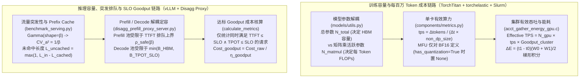

# 容量、成本与吞吐经济学：TorchTitan MFU、vLLM SLO Goodput、Prefill/Decode 分离配比、Slurm 能耗积分与创新芯片 I/O 边界源码深挖

> **Executive Summary / 核心概览**：本报告基于 `TorchTitan v0.3.0`、`vLLM v0.8.2`、`Slurm 26.05` 与 `Sequoia` 一手源码，建立从 **单 Token 真实训练/推理 FLOPs 账本、Gamma 突发流量下的 SLO Goodput 排队模型、Prefill/Decode 分离实例最佳配比** 到 **cgroups 级 GPU 焦耳能耗积分** 的完整容量与成本经济学体系。


- **组件归属**：AI Infra 全栈研究第 10 层（容量与成本建模：有效 MFU vs 理论峰值、训练每百万 Token 成本、推理 Prefill/Decode 实例配比、突发流量排队冗余、Prefix Cache 经济学与 GPU 能耗核算）
- **先修依赖**：[分布式训练并行策略与通信重叠](training-parallelism.md)、[Prefill/Decode 分离与推理 SLO 调度](inference-slo.md)、[集群调度、拓扑感知与多租户故障隔离](cluster-orchestration.md)、[GPU/HBM 深入研究](gpu-hbm.md)
- **面向对象**：需要为百卡至万卡级训练与高并发在线推理制定容量预算、核算 $/1M Tokens 真实成本、决定 Prefill/Decode 分离比例及评估创新推理加速方案的云解决方案架构师
- **核验日期**：`2026-10-18`（UTC+08:00）
- **证据等级**：
  - `implementation`：固定版本源码核验——PyTorch `torchtitan` `v0.3.0`（`commit: 086bf6c166ec85c1298eb5596fa9bf95f6a2d840`，`2026-09-03`）、`vllm-project/vllm` `v0.8.2`（`commit: 25f560a62c4f955672e2c6080b17ab3a48f96201`，`2025-03-25`）、Slurm `slurm-26-05-5-1`（`commit: ad46cad8e0969e8e5945b88f0a21f6bed0f9a3bf`，`2026-10-13`）、Fireworks `fw-ai/benchmark`（`commit: 94cd111967c7be51a35777c475d7c5d2b66ec94a`，`2026-10-08`）、Together/Infini-AI-Lab `Sequoia`（`commit: 0ff3ff71475ca148f2dfb7545e0de5caf5c67b39`，`2025-01-28`）、Groq `groqflow`（`commit: 720e024414be401a7853931a2622a26446883746`，`2023-12-19`）、Cerebras `sdk-examples`（`commit: d19f2ca3e51285fc5904c78643b38819a2f26c44`，`2026-04-27`）
  - `own-offline`：本仓库原创标准库解析算例 [`experiments/capacity_economics/`](../../experiments/capacity_economics/README.md) 与基线 Roofline 算例 [`experiments/capacity_roofline/`](../../experiments/capacity_roofline/README.md)
  - **未包含**：真实云账单采集、生产集群压测或物理硬件功耗表计实测（`own-hardware` 未执行）

---

## 1. 一手源码锚点与全栈定位

| 来源 ID | 仓库与固定版本 | 源码路径与 Git Blob SHA | 核心核验内容 |
|---|---|---|---|
| `torchtitan-models-utils-flops` | `pytorch/torchtitan@086bf6c166ec85c1298eb5596fa9bf95f6a2d840` (`v0.3.0`, `2026-09-03`) | `torchtitan/models/utils.py` (`blob: ba6da084bc6e34d724cd737a2f9141c4ba14f862`, `L364–486`) | `get_dense_model_nparams_and_flops` 与 `get_moe_model_nparams_and_flops`：分离总参数 `nparams`、活跃稀疏参数 `nparams_sparse_active` 与矩阵乘参数 `nparams_for_matmul`，精确计算单 Token 训练 FLOPs |
| `torchtitan-metrics` | `pytorch/torchtitan@086bf6c166ec85c1298eb5596fa9bf95f6a2d840` (`v0.3.0`, `2026-09-03`) | `torchtitan/components/metrics.py` (`blob: f63612eabac1985d1497c9cb1e8d22359f3119ed`, `L1–554`) | `DeviceMemoryMonitor._to_gib`（显式注释 `GiB=1024^3 vs GB=1000^3`）、`MetricsProcessor.log` 单卡 `tps`（除以 `non_data_parallel_size`）、`tflops`、`mfu` 及 `has_quantization` 下禁用 BF16 MFU 的防误导护栏 |
| `torchtitan-utils-peak-flops` | `pytorch/torchtitan@086bf6c166ec85c1298eb5596fa9bf95f6a2d840` (`v0.3.0`, `2026-09-03`) | `torchtitan/tools/utils.py` (`blob: b5303b02007c26ba46c2ee7c8e34de75289f23f3`, `L138–252`) | `get_peak_flops(device_name)`：定义 A100、H100 (PCIe/NVL/SXM)、H200、B200/B300、GB200/GB300、MI300X/MI325X/MI355X、TPU v5p/v6e/v7 的稠密 BF16 峰值算力基准 |
| `vllm-benchmark-serving` | `vllm-project/vllm@25f560a62c4f955672e2c6080b17ab3a48f96201` (`v0.8.2`, `2025-03-25`) | `benchmarks/benchmark_serving.py` (`blob: 47627126b668803b758cddb8add660cba383b0f5`, `L1–780`) | `get_request` Gamma 分布突发到达生成器（`shape=burstiness, scale=1/(rate*burstiness)`）与 `calculate_metrics` 基于 `ttft/tpot/e2el` 联合阈值的 `request_goodput` 过滤 |
| `vllm-disagg-prefill-proxy` | `vllm-project/vllm@25f560a62c4f955672e2c6080b17ab3a48f96201` (`v0.8.2`, `2025-03-25`) | `benchmarks/disagg_benchmarks/disagg_prefill_proxy_server.py` (`blob: 980e68668911f7bd28a5b7c5e87f9781966bfbfc`, `L1–61`) | 两阶段 Prefill/Decode 分离代理：先将 `max_tokens=1` 转发至 Prefill 实例填充 KV，再将完整请求转发至 Decode 实例流式生成 |
| `slurm-acct-gather-energy-gpu` | `SchedMD/slurm@ad46cad8e0969e8e5945b88f0a21f6bed0f9a3bf` (`slurm-26-05-5-1`, `2026-10-13`) | `src/plugins/acct_gather_energy/gpu/acct_gather_energy_gpu.c` (`blob: bb56cfe9d05215e28e616e7295b7c8cf737e0b32`, `L1–546`) | `_get_additional_consumption` 梯形法则焦耳积分、30 秒默认采样周期、`ave_watts` 递推更新与 `saved_usable_gpus` cgroup 级能耗归属 |
| `fireworks-prefill-load-test` | `fw-ai/benchmark@94cd111967c7be51a35777c475d7c5d2b66ec94a` (`2026-10-08`) | `llm_bench/prefill_load_test.py` (`blob: 2d1550e3d36455f95274502e85c03c44da7de138`, `L1–648`) | 多 Worker 显式路由头、`cached_tokens + 1` 预热规则、按未命中 Token 反比缩放的动态 `batch_size` 与多 Worker 最慢木桶延迟 |
| `together-sequoia-offload-engine` | `Infini-AI-Lab/Sequoia@0ff3ff71475ca148f2dfb7545e0de5caf5c67b39` (`2025-01-28`) | `Engine/offload_engine.py` (`blob: 7860ab7308cb94eb78f4e8514147257bdb3fa231`, `L1–393`) | 常驻层 `stay_layers` + 锁页内存双缓冲 `LlamaLayerBuffer[2]` 异步 PCIe 换入流水线，以及投机树对 PCIe 权重搬运的摊销机制 |
| `groq-groqflow-groqmodel` | `groq/groqflow@720e024414be401a7853931a2622a26446883746` (`2023-12-19`) | `groqflow/groqmodel/groqmodel.py` (`blob: 9e07c49316833654cc8e1ca5309e8247837b198a`, `L1–460`) | `estimate_performance`：900 MHz 编译器周期精确折算、多卡流水线 `* num_chips_used` 端到端延迟乘子与 24 GB/s + 10 µs PCIe 传输开销方程 |
| `cerebras-sdk-bw-run` & `cerebras-sdk-bw-sync-kernel` | `Cerebras/sdk-examples@d19f2ca3e51285fc5904c78643b38819a2f26c44` (`2026-04-27`) | `benchmarks/bandwidth-test/run.py` (`blob: fd1d87d73f1cb650e68688507be58e62d92e3790`, `L1–402`) & `src/bw_sync_kernel.csl` (`blob: 3060e774cc14e05d523a1d5d7e11140aafc0c376`, `L1–145`) | 100GbE 边缘 16 通道 I/O、东西两侧 `memcpy` 保留列与 46 KB/PE FIFO 缓冲列公式、Manhattan 波前时钟补偿 `time_ref - (px + py)` 及 0.85 GHz 带宽核算出具 |

---

## 2. 为什么云架构师的纸面容量估算经常在投产首日偏离 $2\times\text{–}10\times$？

在向客户或管理层交付 AI 集群容量与 TCO 方案时，纸面电子表格最常犯五个**将不同物理量纲或统计口径直接混算**的结构性错误：



1. **错误一：把厂商宣传页的“稀疏 FP8/FP4 TFLOP/s”塞进 BF16 MFU 公式分母，或在开启 FP8 量化后继续按 BF16 峰值汇报 MFU**。
   在 [`torchtitan/components/metrics.py:405–408`](https://github.com/pytorch/torchtitan/blob/086bf6c166ec85c1298eb5596fa9bf95f6a2d840/torchtitan/components/metrics.py#L405-L408) 中，PyTorch 官方团队专门写下了防误导分支：当 `self.has_quantization` 为 `True` 时，**直接跳过 MFU 计算（置为 `None`）并仅输出 `tflops`**，源码注释明确指出：*`gpu_peak_flops is computation peak flops foraci BF16, which is misleading/incorrect when quantization is enabled`*。
2. **错误二：在 MoE（混合专家）模型中混用“总参数量 $N_{\text{total}}$”与“每 Token 活跃参数量 $N_{\text{active}}$”**。
   对 DeepSeek-V3 级 MoE（总参数 `671B`，每 Token 激活 `37B`），**HBM 显存容量预算**（权重 + 优化器状态 + Checkpoint 分片）必须按全部专家总参数 $N_{\text{total}}$ 定容；但**每步训练或 Prefill 的算力消耗**只取决于路由选中的活跃专家参数 $N_{\text{matmul}}$。
3. **错误三：混淆二进制 `GiB`（$2^{30} = 1.0737 \times 10^9$）与十进制 `GB`（$10^9$）**。
   在 [`torchtitan/components/metrics.py:48–52`](https://github.com/pytorch/torchtitan/blob/086bf6c166ec85c1298eb5596fa9bf95f6a2d840/torchtitan/components/metrics.py#L48-L52) 中，`DeviceMemoryMonitor._to_gib` 显式按 `1024 * 1024 * 1024` 转换字节并注释 `# NOTE: GiB (gibibyte) is 1024, vs GB is 1000`。一张标称“80 GB”的 H100 SXM 实际可用容量约为 `79.15 GiB`，若将十进制 `140 GB` 权重直接除以 `80` 而不换算为 `130.39 GiB` 并预留 CUDA Context / NCCL Buffer / Fragmentation Reserve，会在上线时直接触发 OOM。
4. **错误四：按平均 QPS 和 90%+ 利用率规划在线推理，忽略到达分布突发性（Burstiness）导致的 SLO Goodput 崩塌**。
   在 [`benchmarks/benchmark_serving.py:76–113, 189–215`](https://github.com/vllm-project/vllm/blob/25f560a62c4f955672e2c6080b17ab3a48f96201/benchmarks/benchmark_serving.py#L76-L113) 中，vLLM 用 Gamma 分布 `shape = burstiness` 模拟真实流量：当 `burstiness = 0.25`（突发到达，变异系数平方 $\text{CV}_a^2 = 1/\beta = 4.0$）时，即使平均到达率 $\lambda$ 不变，排队等待时间也是泊松到达（`burstiness = 1.0`）的 **$4$ 倍**。若按 92% 利用率定容，虽然原始吞吐 `request_throughput` 看似很高，但满足 `TTFT <= SLO` 的有效吞吐 **`request_goodput` 会暴跌至 7.27% 以下**，意味着 92.7% 的 GPU 算力都在生产违反 SLA 的超时废品！
5. **错误五：将 Prefill 与 Decode 混部在同一组副本中，既承受相干干扰（Interference），又按较慢阶段被迫双倍扩缩容**。

---

## 3. 训练容量、MFU 与每百万训练 Token 成本核算（TorchTitan & Slurm 源码解构）

### 3.1 稠密（Dense）与混合专家（MoE）模型的精确 FLOPs/Token 方程

在固定版本 `pytorch/torchtitan@086bf6c166ec85c1298eb5596fa9bf95f6a2d840`（`v0.3.0`）的 [`torchtitan/models/utils.py`](https://github.com/pytorch/torchtitan/blob/086bf6c166ec85c1298eb5596fa9bf95f6a2d840/torchtitan/models/utils.py)（`L364–486`）中，TorchTitan 给出了工业界标准化的参数与单 Token 训练浮点运算量公式：

1. **稠密模型（`get_dense_model_nparams_and_flops`, `L364–404`）**：
   输入 Embedding 查找表在前向传播中仅做索引查表（不执行矩阵乘），因此若未开启词表权重绑定（`enable_weight_tying == False`），参与线性层 GEMM 的参数量必须扣除输入 Embedding 参数 $N_{\text{emb}}$（保留输出 LM Head 投影）：
   $$N_{\text{matmul, dense}} = \begin{cases} N_{\text{total}}, & \text{if } \texttt{enable\_weight\_tying} = \text{True} \\ N_{\text{total}} - N_{\text{emb}}, & \text{if } \texttt{enable\_weight\_tying} = \text{False} \end{cases}$$
2. **MoE 模型（`get_moe_model_nparams_and_flops`, `L407–486`）**：
   将模型总参数拆分为稠密骨架 $N_{\text{dense}}$、稀疏专家组 $N_{\text{sparse}} = N_{\text{router}} + N_{\text{shared}} + N_{\text{routed}}$ 以及可选多模态视觉塔 $N_{\text{vision}}$：
   $$N_{\text{total, moe}} = N_{\text{dense}} + N_{\text{router}} + N_{\text{shared}} + N_{\text{routed}} + N_{\text{vision}}$$
   而每个 Token 在 MoE 层实际激活的稀疏参数量仅为路由器、共享专家与 $\text{top\_k} / E$ 比例的路由专家之和（`L459–463`）：
   $$N_{\text{sparse, active}} = N_{\text{router}} + N_{\text{shared}} + \left\lfloor \frac{N_{\text{routed}} \cdot \text{top\_k}}{E} \right\rfloor$$
   $$N_{\text{matmul, moe}} = (N_{\text{dense}} - N_{\text{emb}}) + N_{\text{sparse, active}}$$
3. **单 Token 前反向总有效算力（`L400, L480`）**：
   对于层数 $L$、注意力头数 $H_q$、序列长度 $S$，在 [`torchtitan/models/llama3/model.py:95`](https://github.com/pytorch/torchtitan/blob/086bf6c166ec85c1298eb5596fa9bf95f6a2d840/torchtitan/models/llama3/model.py#L95) 中传入 `head_dims = 2 * (dim // n_heads)`（对应 $Q K^T$ 与 $P V$ 两个注意力矩阵乘），单 Token 的有效训练 FLOPs（前向 $2\times$ + 反向激活梯度 $2\times$ + 反向权重梯度 $2\times$，**不含激活重计算 Recompute 的额外开销**）为：
   $$\text{FLOPs}_{\text{token}} = 6 \cdot N_{\text{matmul}} + 6 \cdot L \cdot H_q \cdot (2 d_{\text{head}}) \cdot S = 6 \cdot N_{\text{matmul}} + 12 \cdot L \cdot d_{\text{model}} \cdot S$$

### 3.2 `MetricsProcessor` 的多维并行归一化与参考峰值表

在 [`torchtitan/components/metrics.py:382–415`](https://github.com/pytorch/torchtitan/blob/086bf6c166ec85c1298eb5596fa9bf95f6a2d840/torchtitan/components/metrics.py#L382-L415) 中，当训练启用了 TP、CP（Context Parallelism）或 PP（Pipeline Parallelism）时，同一个全局数据批次内的 Token 会被非数据并行组 `non_data_parallel_size = TP × CP × PP` 中的多张 GPU 共同处理。因此，单张 GPU 的真实净吞吐 `tps`（Tokens/s/GPU）必须除以 `non_data_parallel_size`：
$$\text{tps}_{\text{gpu}} = \frac{\Delta N_{\text{tokens, local\_dp\_rank}}}{\Delta t \cdot (\text{TP} \times \text{CP} \times \text{PP})}, \qquad \text{TFLOPS}_{\text{gpu}} = \frac{\text{FLOPs}_{\text{token}} \cdot \text{tps}_{\text{gpu}}}{10^{12}}$$
$$\text{MFU}_{\text{BF16}} (\%) = \begin{cases} \texttt{None}, & \text{if } \texttt{has\_quantization} = \text{True} \\ 100 \times \dfrac{\text{FLOPs}_{\text{token}} \cdot \text{tps}_{\text{gpu}}}{F_{\text{peak, BF16}}}, & \text{otherwise} \end{cases}$$

其中分母 $F_{\text{peak, BF16}}$ 在 [`torchtitan/tools/utils.py:138–252`](https://github.com/pytorch/torchtitan/blob/086bf6c166ec85c1298eb5596fa9bf95f6a2d840/torchtitan/tools/utils.py#L138-L252)（`get_peak_flops`）中被严格锁定为**不含 2:4 结构化稀疏翻倍的稠密 BF16 峰值**：

| 加速器型号（`device_name` 匹配分支） | `get_peak_flops` 返回值（FLOP/s, Dense BF16） | 架构师容量换算注意点 |
|---|---|---|
| NVIDIA A100 | `312e12` (`312 TFLOP/s`) | SXM4 / PCIe 80GB 统一稠密 BF16 基准 |
| NVIDIA H20 | `148e12` (`148 TFLOP/s`) | 虽具 `96 GB` HBM3 高带宽，但稠密 BF16 算力仅为 H100 SXM 的 `14.96%`，Prefill 极易进入 Compute-bound |
| NVIDIA L40S | `362e12` (`362 TFLOP/s`) | PCIe 卡，无 NVLink，跨卡 TP 通信受限于 PCIe Gen4 |
| NVIDIA H100 PCIe / H100 NVL / H100 SXM & H200 | `756e12` / `835e12` / `989e12` | 营销文档常见的 `1,979 TFLOP/s` 是 2:4 稀疏峰值，绝不可代入 MFU 分母 |
| NVIDIA B200 & B300 / GB200 & GB300 | `2.25e15` (`2,250 TFLOP/s`) / `2.5e15` (`2,500 TFLOP/s`) | Blackwell 单 GPU 稠密 BF16 基准（不含 FP4/FP8 Tensor Core 倍率） |
| AMD Instinct MI300X & MI325X / MI355X | `1300e12` (`1,300 TFLOP/s`) / `2500e12` (`2,500 TFLOP/s`) | MI300X 理论峰值高，需结合 ROCm Kernel 实测达成率评估有效 MFU |
| Google Cloud TPU v5p / v6e / v7 | `459e12` / `918e12` / `1153.5e12` (`2307e12 // 2`) | TPU v7 每个芯片包含 2 个 TensorCore 设备，PyTorch/XLA 按单设备减半计入 |

### 3.3 耦合集群 Goodput 与 Slurm 梯形能耗积分的训练总成本方程

给定目标训练 Token 总量 $D_{\text{tokens}}$、集群总卡数 $N_{\text{gpu}}$、单卡达成吞吐 $\text{tps}_{\text{gpu}}$，以及 [集群调度与弹性容错](cluster-orchestration.md) 中由 Checkpoint 开销与节点故障恢复共同决定的集群有效时间占比 $\mathcal{G}_{\text{cluster}} \in (0, 1]$，完成训练所需的日历墙钟时间 $T_{\text{wall}}$（小时）与每百万训练 Token 的算力租赁成本 $C_{\text{1M, train}}$ 为：
$$T_{\text{wall}}\text{ (hours)} = \frac{D_{\text{tokens}}}{3600 \cdot N_{\text{gpu}} \cdot \text{tps}_{\text{gpu}} \cdot \mathcal{G}_{\text{cluster}}}, \qquad C_{\text{1M, train}} = \frac{N_{\text{gpu}} \cdot T_{\text{wall}} \cdot c_{\text{gpu/hr}}}{D_{\text{tokens}} / 10^6}$$

同时，在自建或托管智算中心（Colocation）核算电力 OPEX 时，固定版本 `SchedMD/slurm@ad46cad8e0969e8e5945b88f0a21f6bed0f9a3bf` 的 [`src/plugins/acct_gather_energy/gpu/acct_gather_energy_gpu.c`](https://github.com/SchedMD/slurm/blob/ad46cad8e0969e8e5945b88f0a21f6bed0f9a3bf/src/plugins/acct_gather_energy/gpu/acct_gather_energy_gpu.c)（`L147–168, L281–328`）揭示了生产调度器如何采集并归属 GPU 焦耳能耗：
- 后台采样线程 `_thread_gpu_run` 默认每 `DEFAULT_GPU_FREQ = 30` 秒（`L57`）通过 NVML/ROCm 读取每张 GPU 的瞬时功率 $W(t)$；
- `_get_additional_consumption`（`L147–151`）使用**梯形法则（Trapezoidal Rule）**积分相邻两次采样 $[t_0, t_1]$ 之间的增量焦耳数，并递推更新滑动平均功率 `ave_watts`（`L162–163`）：
  $$\Delta E_{\text{step}}\text{ (Joules)} = \left\lfloor \frac{(t_1 - t_0) \cdot (W_0 + W_1)}{2} \right\rfloor$$
- 在多作业共享节点时，`_get_node_energy_up`（`L281–328`）检查 `slurm_conf.SelectTypeParameters & SELECT_CONSTRAIN_DEVICES` 与 `task/cgroup` 插件：若已启用设备隔离，则仅将位图 `saved_usable_gpus` 中属于当前 Step 的 GPU 能耗累加到作业账单中；否则回退为整节点全部 GPU 能耗求和。

---

## 4. 推理容量规划、突发排队安全水位与 Prefill/Decode 分离经济学（vLLM 源码解构）

### 4.1 `benchmark_serving.py` 的 Gamma 突发到达与 `request_goodput` 硬过滤

在 [`benchmarks/benchmark_serving.py`](https://github.com/vllm-project/vllm/blob/25f560a62c4f955672e2c6080b17ab3a48f96201/benchmarks/benchmark_serving.py) 中，vLLM 的压测与 SLO 核算由两段核心逻辑组成：

1. **Gamma 到达过程与突发性参数 $\beta = \texttt{burstiness}$（`get_request`, `L76–113`）**：
   ```python
   # benchmarks/benchmark_serving.py:105-107
   theta = 1.0 / (request_rate * burstiness)
   # Sample the request interval from the gamma distribution.
   # If burstiness is 1, it follows exponential distribution.
   interval = np.random.gamma(shape=burstiness, scale=theta)
   ```
   根据概率论，形状参数为 $\beta$、尺度参数为 $\theta = 1/(\lambda \beta)$ 的 Gamma 分布，其均值恒为 $\mathbb{E}[\Delta t] = \beta \theta = 1/\lambda$，方差为 $\text{Var}(\Delta t) = \beta \theta^2 = \frac{1}{\lambda^2 \beta}$。因此到达间隔的变异系数平方（Squared Coefficient of Variation）精确等于：
   $$\text{CV}_a^2 = \frac{\text{Var}(\Delta t)}{(\mathbb{E}[\Delta t])^2} = \frac{1}{\beta}$$
   - 当 $\beta = 1.0$ 时，$\text{CV}_a^2 = 1.0$，退化为标准泊松到达；
   - 当 $\beta = 0.25$（真实企业 API 常见的突发微批/Agent 并发唤醒）时，$\text{CV}_a^2 = 4.0$。根据 Kingman $G/G/m$ 排队近似公式，给定服务时间变异系数 $\text{CV}_s^2$ 与实例利用率 $\rho \in (0, 1)$，请求的平均排队等待时间 $W_q$ 为：
     $$\mathbb{E}[W_q] \approx S_{\text{prefill}} \cdot \left(\frac{\text{CV}_a^2 + \text{CV}_s^2}{2}\right) \cdot \frac{\rho}{1 - \rho}$$
     要使包含排队等待的期望首字延迟满足 $\mathbb{E}[\text{TTFT}] = S_{\text{prefill}} + \mathbb{E}[W_q] \le \text{SLO}_{\text{TTFT}}$（设最大允许排队比 $\omega_{\max} = \frac{\text{SLO}_{\text{TTFT}} - S_{\text{prefill}}}{S_{\text{prefill}}} > 0$），在确定性单次服务耗时的理想下界（$\text{CV}_s^2 \to 0$）下，Prefill 池的最大安全稳态利用率 $\rho_{\text{safe}}$ 必须满足：
     $$\rho_{\text{safe}}(\beta) \le \min\!\left(0.85,\; \frac{\omega_{\max}}{\omega_{\max} + \dfrac{1}{2\beta}}\right)$$
     **架构推论**：当 $\beta$ 从 `1.0` 恶化为 `0.25` 时，分母中的排队惩罚项 $\frac{1}{2\beta}$ 从 `0.5` 激增至 `2.0`，迫使 Prefill 实例的安全最高利用率显著下调，必须预留更多突发缓冲实例！

2. **联合 SLO 门控下的 `request_goodput`（`calculate_metrics`, `L116–220`）**：
   `calculate_metrics` 对第 $i$ 个成功完成的请求计算：
   $$\text{TPOT}_i = \frac{\text{E2EL}_i - \text{TTFT}_i}{L_{\text{out}, i} - 1} \quad (L_{\text{out}, i} > 1)$$
   若用户传入 `--goodput ttft:T_1 tpot:T_2 e2el:T_3`（毫秒阈值除以 `1000` 转为秒），源码在 `L199–205` 对每个请求执行**全称合取判定**：
   ```python
   is_good_req = all([s >= r for s, r in zip(slo_values, req_metric)])
   if is_good_req:
       good_completed += 1
   ```
   最终输出 `request_throughput = completed / dur_s` 与 **`request_goodput = good_completed / dur_s`**。
   由此定义**Goodput 达标率** $\eta_{\text{goodput}} = \frac{\text{request\_goodput}}{\text{request\_throughput}} \in (0, 1]$，则业务实际承担的**每百万达标输出 Token 成本（Effective Cost per 1M SLO-Compliant Output Tokens）**为：
   $$C_{\text{1M, goodput}} = \frac{N_{\text{gpu, total}} \cdot c_{\text{gpu/hr}}}{3600 \cdot \lambda \cdot L_{\text{out}} \cdot \eta_{\text{goodput}} / 10^6} = \frac{C_{\text{1M, raw}}}{\eta_{\text{goodput}}}$$
   一旦容量规划失误导致 $\eta_{\text{goodput}}$ 从 `0.98` 跌至 `0.10`，即使单卡每秒吐出的总 Token 数没变，**每百万合格 Token 的真实商业成本也会瞬间暴涨 $9.8\times$**！

### 4.2 Prefill/Decode 分离（Disaggregated Serving）的实例配比方程

在 [`benchmarks/disagg_benchmarks/disagg_prefill_proxy_server.py`](https://github.com/vllm-project/vllm/blob/25f560a62c4f955672e2c6080b17ab3a48f96201/benchmarks/disagg_benchmarks/disagg_prefill_proxy_server.py)（`L19–42`）中，代理网关先把请求克隆并改写 `prefill_request["max_tokens"] = 1` 发往 Prefill 实例（端口 `8100`），待 KV Cache 构建并跨卡/跨机传输完成后，再把原请求发往 Decode 实例（端口 `8200`）继续生成后续 $L_{\text{out}} - 1$ 个 Token。

给定总到达率 $\lambda$（req/s）、输入长度 $L_{\text{in}}$、Prefix Cache 命中长度 $L_{\text{cached}}$（未命中计算长度 $L_{\text{uncached}} = \max(1, L_{\text{in}} - L_{\text{cached}})$）、输出长度 $L_{\text{out}}$：
1. **Prefill 实例数 $N_P$**：
   设单个 Prefill 实例每秒可处理的未缓存输入 Token 吞吐为 $R_{\text{prefill}}$（tok/s），则单请求服务耗时为 $S_{\text{prefill}} = \frac{L_{\text{uncached}}}{R_{\text{prefill}}}$，计入突发排队安全水位 $\rho_{\text{safe}}(\beta)$ 后：
   $$\mu_P = \frac{\rho_{\text{safe}}(\beta)}{S_{\text{prefill}}} = \frac{R_{\text{prefill}} \cdot \rho_{\text{safe}}(\beta)}{L_{\text{uncached}}}, \qquad N_P = \left\lceil \frac{\lambda}{\mu_P} \right\rceil$$
2. **Decode 实例数 $N_D$（HBM 容量上界与 TPOT 带宽上界双门控）**：
   设单个 Decode 实例在扣除权重与运行时预留后，HBM 最多可容纳并发序列数 $B_{\text{HBM}}$；同时单步 Decode 耗时随批次大小 $B$ 呈仿射增长 $T_{\text{step}}(B) = t_{\text{base}} + B \cdot t_{\text{slope}} \le \text{SLO}_{\text{TPOT}}$。则受双门控限制的最大有效并发批次 $B_{\text{eff}}$ 与由 Little's Law 决定的单实例可持续吞吐 $\mu_D$ 为：
   $$B_{\text{eff}} = \min\!\left(B_{\text{HBM}},\; \left\lfloor \frac{\text{SLO}_{\text{TPOT}} - t_{\text{base}}}{t_{\text{slope}}} \right\rfloor\right), \qquad T_{\text{decode}} = \frac{\max(1, L_{\text{out}} - 1) \cdot (t_{\text{base}} + B_{\text{eff}} \cdot t_{\text{slope}})}{1000}$$
   $$\mu_D = \frac{B_{\text{eff}}}{T_{\text{decode}}}, \qquad N_D = \left\lceil \frac{\lambda}{\mu_D} \right\rceil$$
3. **Prefill : Decode 实例配比 $N_P : N_D$ 的动态漂移规律**：
   $$\frac{N_P}{N_D} \approx \frac{\mu_D}{\mu_P} = \frac{B_{\text{eff}} \cdot L_{\text{uncached}}}{R_{\text{prefill}} \cdot \rho_{\text{safe}}(\beta) \cdot T_{\text{decode}}}$$
   - **长上下文 + 低缓存命中 + 高突发场景**（如 $L_{\text{in}} = 8192, L_{\text{cached}} = 1024, \beta = 0.25$）：$L_{\text{uncached}}$ 很大且 $\rho_{\text{safe}}$ 很低，系统呈现**重度 Prefill 密集型（例如 $N_P : N_D = 31 : 5 = 6.2 : 1$）**；
   - **高 Prefix Cache 命中 + 长输出场景**（如 $L_{\text{in}} = 8192, L_{\text{cached}} = 7168, L_{\text{out}} = 512$）：$L_{\text{uncached}}$ 缩减 $7\times$，Prefill 需求骤降，配比反转为**Decode 密集型（例如 $N_P : N_D = 2 : 3 = 0.67 : 1$）**。
   - 相比之下，若采用传统 **Colocated（混部）** 部署，每个副本既要分时执行 Prefill 又要执行 Decode，还会因 Chunked Prefill 挤占 Decode 带宽产生干扰损耗因子 $\delta_{\text{interf}} \in (0.15, 0.35)$，所需混部总实例数为 $N_{\text{coloc}} = \left\lceil \frac{\lambda/\mu_P + \lambda/\mu_D}{1 - \delta_{\text{interf}}} \right\rceil$，直接多消耗 **18%–36% 的物理 GPU 卡数**。

---

## 5. AI Infra 创新公司的容量、缓存路由与边缘 I/O 经济学对比

为了把 GPU 集群容量模型与四家代表性创新公司（**Fireworks AI**、**Together AI**、**Groq**、**Cerebras**）的工程实现统一到同一套可核算坐标系下，我们在 [AI Infra 创新公司深挖（第 7 节）](ai-infra-innovators.md) 中补充核验了四份直接决定容量、批处理与 I/O 成本的源码：

| 创新公司与核验源码 | 容量 / 吞吐 / 延迟核算核心公式（`implementation`） | 对云架构师 TCO 与容量规划的定量启示 |
|---|---|---|
| **Fireworks AI**<br>`fw-ai/benchmark`<br>`llm_bench/prefill_load_test.py` (`L42–60, 128–140, 297–318, 434–441`) | • 路由头绑定：`srv = flat % num_servers`, `gen = flat // num_servers`<br>• 预热 Token 数：$L_{\text{warm}} = L_{\text{cached}} + 1$（尾 Token 预留给首步 Decode）<br>• 动态 Batch：$B_{\text{dyn}} = \max\!\left(1, \left\lfloor \dfrac{\text{min\_tokens\_to\_batch}}{L_{\text{prompt}} - L_{\text{cached}}} \right\rfloor\right)$<br>• 多 Worker 吞吐受最慢节点制约：$T_{\text{round}} = \max_w T_w$ | 当 Prefix Cache 命中率从 `12.5%` 提升到 `87.5%` 时，单请求未缓存长度 $L_{\text{uncached}}$ 从 `7,168` 降至 `1,024`，单 Worker 动态并发 Batch 自动从 `2` 放大至 **`14`**，但多副本无状态轮询会导致前缀缓存未命中，**必须启用会话/前缀亲和路由（Sticky Prefix Routing）并监控最慢 Straggler Worker** |
| **Together AI (Sequoia)**<br>`Infini-AI-Lab/Sequoia`<br>`Engine/offload_engine.py` (`L66–127, 179–215`) | • 卸载层数：$L_{\text{off}} = L_{\text{total}} - L_{\text{stay}}$<br>• 双缓冲 `LlamaLayerBuffer[2]` 锁页内存异步 H2D 步耗时：<br>$T_{\text{step}} = \max\!\left(T_{\text{compute}},\; \dfrac{L_{\text{off}} \cdot W_{\text{layer}}}{B_{\text{PCIe}}}\right)$<br>• 投机树验证吞吐：$\text{TPS}_{\text{spec}} = \dfrac{\mathbb{E}[\tau]}{T_{\text{step}}}$ | 在显存受限被迫启用 CPU-GPU PCIe Offload 时，单步耗时完全被 PCIe 带宽锁死（如卸载 60 层 `70B` 每步需 `1,821 ms`，仅 `0.55 tok/s`）；Sequoia 投机树在不增加 PCIe 权重传输字节数的前提下每次验证接受 $\mathbb{E}[\tau] = 5.4\text{–}6.8$ 个 Token，将 PCIe 受限吞吐直接放大 **`5.4x–6.8x`** |
| **Groq**<br>`groq/groqflow`<br>`groqflow/groqmodel/groqmodel.py` (`L126–164`) | • 单级片上耗时：$T_{\text{stage}} = \dfrac{\text{total\_cycles}}{900 \times 10^6\text{ Hz}}$<br>• 多芯片流水延迟：$T_{\text{compute}} = T_{\text{stage}} \times (N_{\text{chips}} \text{ if pipelined else } 1)$<br>• 主机 PCIe 耗时：$T_{\text{pcie, in/out}} = \dfrac{\text{bytes}_{\text{in/out}}}{24 \times 10^9\text{ B/s}} + 10\text{ µs}$ | 揭示了多芯片 LPU 的**延迟-吞吐二元性**：在 16 卡流水线（`pipelined=True`）下，单级周期 `900,000 cycles`（`1.0 ms`）决定了流水线满载时的级间吞吐上限，但单个请求走完 16 张卡的确定性计算延迟须乘以 `16`（`16.0 ms`）；且当单芯片计算极快（`1.0 ms`）时，每次往返主机的 `20 µs + bytes/24GB/s` PCIe 开销占比可达 **`2.03%`** |
| **Cerebras**<br>`Cerebras/sdk-examples`<br>`benchmarks/bandwidth-test/run.py` (`L92–122, 232–244, 336–380`) | • 46 KB/PE 缓冲列：$C_{\text{buf}} = \left\lceil \dfrac{W \cdot L_{\text{pe}} \cdot 4}{46{,}000} \right\rceil$<br>• 最小织物宽度：$W_{\min} = x_{\text{off}} + 3 + C_{\text{west}} + W + 3 + C_{\text{east}}$<br>• Manhattan 时钟补偿：$T_{\text{ref}}'(x,y) = T_{\text{ref}}(x,y) - (x + y)$<br>• 0.85 GHz 带宽：$B_{\text{io}} = \dfrac{W \cdot L_{\text{pe}} \cdot 4}{(C_{\text{send}} / 0.85) \times 10^{-3}} \cdot N_{\text{loops}}$ | 晶圆边缘 I/O 通过 100GbE 拆分为最多 16 个通道（单通道 `~7 Gbps`，含 `~200 µs` TCP 事务开销）；若计算核心繁忙会产生反压阻塞主机通道，必须在东西边缘额外劃出 `46 KB/PE` 的硬件 FIFO 缓冲列（如 $256 \times 512$ 网格单侧需 **12 列缓冲 PE + 3 列 `memcpy` 系统列**），直接消耗晶圆有效计算面积 |

---

## 6. 原创 CPU/Offline 合成实验核验（`experiments/capacity_economics/`）

本仓库实现了纯 Python 标准库可复算实验 [`experiments/capacity_economics/run.py`](../../experiments/capacity_economics/run.py)（输入夹具 [`input.json`](../../experiments/capacity_economics/input.json)，输出 [`results.json`](../../experiments/capacity_economics/results.json) 与 [`results.csv`](../../experiments/capacity_economics/results.csv)，测试套件 [`tests/test_capacity_economics.py`](../../tests/test_capacity_economics.py)）。以下为 3 个代表性架构场景的精确复算结果（`own-offline`）：

| 场景 ID (`case_id`) | 训练 MFU (`BF16`) | 训练每百万 Token 成本 | Slurm 30s 单卡焦耳 | 推理 P:D 实例配比 ($N_P:N_D$) | P/D 分离 vs 混部总卡数 | 盲目按 92% 利用率定容的 TTFT 达标率 | 分离部署每百万达标输出 Token 成本 | Fireworks 有效未缓存吞吐 | Sequoia 投机卸载吞吐 (加速比) | Groq 端到端确定性延迟 | Cerebras 晶圆边缘 I/O 带宽 (西缓冲列) |
|---|---|---|---|---|---|---|---|---|---|---|---|
| `dense_70b_poisson_cached_prefix`<br>(`70B` 稠密, $\beta=1.0$, 75% 缓存命中) | `44.48%`<br>(`439.87 TFLOP/s`) | `$0.9456` | `19,800 J`<br>(`660 W` 均值) | `3 : 6`<br>(`0.50`) | **`36` 卡 vs `44` 卡**<br>（节省 `8` 卡） | `95.34%`<br>(`E[TTFT]=156.25 ms`) | `$1.5462` | `58,514.29 tok/s`<br>(`batch=8, warm=3073`) | `2.96 tok/s`<br>(`5.40x` vs `0.55`) | `14.4215 ms`<br>(`8` 卡流水, PCIe `0.15%`) | `10,888.51 MB/s`<br>(`2` 列 FIFO, `W_min=75`) |
| `moe_671b_37b_bursty_long_context`<br>(`671B/37B` MoE, $\beta=0.25$ 突发, 12.5% 缓存命中) | `34.77%`<br>(`343.87 TFLOP/s`) | `$0.5355` | `20,475 J`<br>(`682.5 W` 均值) | `31 : 5`<br>(`6.20`) | **`288` 卡 vs `392` 卡**<br>（节省 `104` 卡） | **`7.27%`**<br>(`E[TTFT]=4,375.0 ms` 严重违约) | `$12.3698` | `128,862.92 tok/s`<br>(`batch=2, warm=1025`) | `6.29 tok/s`<br>(`6.20x` vs `1.01`) | `16.0256 ms`<br>(`16` 卡流水, PCIe `0.16%`) | `29,013.33 MB/s`<br>(`12` 列 FIFO, `W_min=287`) |
| `fp8_quantized_moe_high_cache_hit`<br>(`671B/37B` FP8 量化, $\beta=0.5$, 87.5% 缓存命中) | `not-assessed-quantized`<br>(`481.01 TFLOP/s`) | `$0.3743` | `20,700 J`<br>(`690 W` 均值) | `2 : 3`<br>(`0.6667`) | **`40` 卡 vs `48` 卡**<br>（节省 `8` 卡） | `99.99%`<br>(`E[TTFT]=71.43 ms`) | `$1.7180` | `229,376.00 tok/s`<br>(`batch=14, warm=7169`) | `21.16 tok/s`<br>(`6.80x` vs `3.11`) | `1.0208 ms`<br>(非流水, PCIe `2.03%`) | `14,506.67 MB/s`<br>(`3` 列 FIFO, `W_min=141`) |

### 关键架构结论与反证验证

1. **MoE 模型的“高显存驻留、低单 Token 算力成本”解耦效应**：
   对比场景 1（`70B` 稠密模型，`nparams_for_matmul = 68.95B`，单 Token 训练算力 `478.12 GFLOPs`）与场景 2（`671.1B` 总参数 MoE，其中路由专家 `664B`、`256` 选 `8`，活跃稀疏参数仅 `23.05B`，`nparams_for_matmul = 26.95B`，单 Token 训练算力 `204.68 GFLOPs`）：尽管 `671B` MoE 的总参数量是 `70B` 稠密模型的 **`9.59x`**（必须用 `2,048` 卡分摊权重与优化器状态），但其每百万 Token 的训练算力成本反而从 **`$0.9456` 降至 `$0.5355`（下降 `43.4%`）**；若进一步结合场景 3 的 FP8 训练提速（`tps` 从 `1,680` 增至 `2,350 tok/s/GPU`），每百万训练 Token 成本进一步降至 **`$0.3743`**，同时实验严格遵循 TorchTitan `metrics.py:405` 将 FP8 下的 `mfu_bf16_pct` 标记为 `None`（`not-assessed-quantized`）。
2. **突发流量（$\beta = 0.25$）下盲目追求高 GPU 利用率的“Goodput 悬崖”**：
   在场景 2 中，请求未命中前缀长达 `7,168` tokens，单次 Prefill 纯计算耗时 `291.67 ms`（TTFT SLO 为 `600 ms`）。若架构师忽略 Gamma 突发性（$\beta = 0.25 \implies \text{CV}_a^2 = 4.0$），按 92% 利用率仅配置少量 Prefill 实例，期望排队等待时间将飙升至 `4,083.33 ms`（总期望 TTFT 达 `4,375.0 ms`），导致满足 `TTFT <= 600 ms` 的 **Goodput 达标率暴跌至 `7.27%`**！而按照 Kingman 突发安全水位（$\rho_{\text{safe}} = 34.58\%$）配合 Prefill/Decode 解耦定容（`31` 个 Prefill 实例 + `5` 个 Decode 实例，共 `288` 张 GPU），相比混部方案（`392` 张 GPU）直接**节省 `104` 张 GPU（节省率 `26.5%`）**。
3. **Prefix Cache 命中率对推理 TCO 的非线性杠杆**：
   对比场景 2（缓存命中 `1,024 / 8,192 = 12.5%`）与场景 3（缓存命中 `7,168 / 8,192 = 87.5%` + FP8 加速）：Prefill 所需实例数从 `31` 个骤降至 `2` 个，集群总 GPU 数从 `288` 张降至 `40` 张，**每百万达标输出 Token 的基础设施成本从 `$12.3698` 降至 `$1.7180`（降低 `86.1%`）**。

---

## 7. 架构师计算与设计练习及后续可证伪问题

### 7.1 架构师计算与设计练习（`learning_mastery: not-assessed`）

1. **练习 1（MoE 训练 FLOPs 与 MFU 审计）**：
   某团队在 H100 SXM（稠密 BF16 峰值 `989 TFLOP/s`，FP8 稠密峰值 `1,979 TFLOP/s`）集群上使用 FP8 混合精度训练一个 `256` 专家、`top_k = 8` 的 MoE 模型，单卡吞吐达到 `2,400 tokens/s`，团队按照 $\frac{6 \times N_{\text{total}} \times 2400}{989 \times 10^{12}}$ 汇报称“训练 MFU 高达 `95%`”。请依据 `torchtitan/models/utils.py` 与 `torchtitan/components/metrics.py` 指出该汇报中同时存在的 **两个分子/分母级计算错误**，并给出正确的核算口径。
2. **练习 2（Prefill/Decode 分离配比与 Prefix Cache 亲和路由）**：
   某企业 Agent 工作负载平均到达率 $\lambda = 40\text{ req/s}$，输入 $L_{\text{in}} = 6144$ tokens，输出 $L_{\text{out}} = 256$ tokens。若网关采用随机轮询（Round-Robin）将请求分发给 8 个独立的 Prefill 实例，导致原本可共享的 `5120` tokens 系统提示词缓存命中率从 `100%` 跌至 `12.5%`。请用第 4.2 节公式计算：随机轮询相比一致性哈希前缀亲和路由（Sticky Prefix Routing）需要多采购多少张 Prefill GPU？为什么 Fireworks 在 `prefill_load_test.py` 中预热每个 Worker 时必须发送 `cached_tokens + 1` 个 Token 而不是 `cached_tokens` 个 Token？
3. **练习 3（Slurm GPU 能耗积分与机架电力成本）**：
   在 Slurm `acct_gather_energy/gpu`（采样间隔 $\Delta t = 30\text{ s}$）下，某 1,024 卡训练作业在相邻三次采样中单卡功率读数分别为 $W_0 = 420\text{ W}$（Checkpoint 写盘阶段）、$W_1 = 680\text{ W}$（前反向满载阶段）、$W_2 = 700\text{ W}$。请用 `_get_additional_consumption` 的梯形积分公式计算这 60 秒内单卡与全集群累计增加的焦耳（Joules）数及折合千瓦时（kWh）度数。

### 7.2 后续可证伪问题与演进衔接

- **下一平级问题（优先级 9）**：`rack-power-cooling`——单芯片 680–1,200W TDP 热量如何向上传导为整机架 40–132 kW 供电母排、CDU 液冷流量（LPM）、进出水温度差 $\Delta T$ 与机房 PUE 硬约束？
- **顶层综合问题（优先级 10）**：`architecture-case`——如何将 GPU/HBM、RDMA/NCCL、并行切分、并行文件系统 Checkpoint、P/D 分离推理、K8s/Slurm 拓扑调度与容量/功耗经济学整合为一份可审计的千卡级端到端架构设计蓝图？

练习掌握度状态：`not-assessed`。完整问题依赖图见 [`research/queue.json`](../../research/queue.json)。
