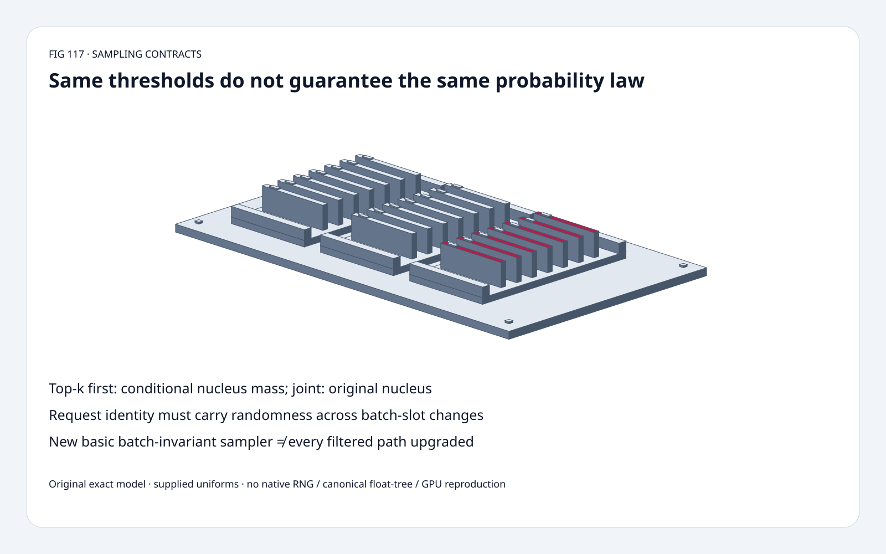
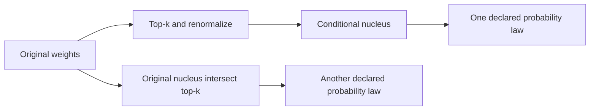
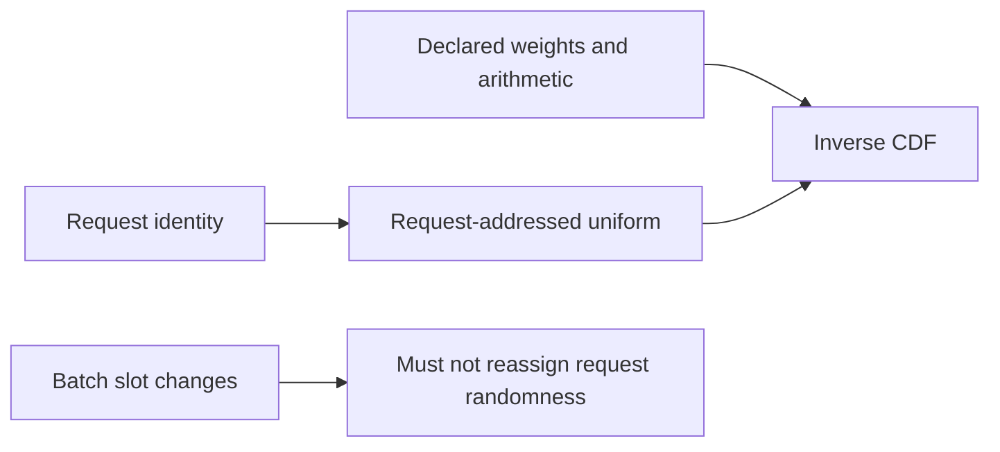
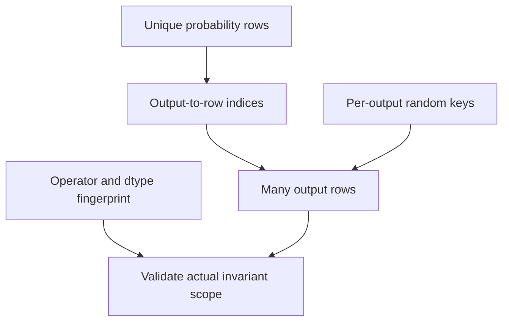

# Sampling FAQ: top-k/top-p composition and request-addressed randomness

> **Language**: [中文](categorical-topk-topp-request-identity-selection-faq.md) | English
>
> **Round 117 · 2026-11-14 (night round 26)** · [SVG](../../assets/svg/categorical-topk-topp-request-identity-selection-faq-summary.svg) · [7 cards](../reports/categorical-topk-topp-request-identity-selection-cards.html) · [H5](../reports/categorical-topk-topp-request-identity-sizer.html) · [Report](../../experiments/sampling_filter_identity_selection/report.json)
>
> **Synthetic, `independently_reproduced=false`.** Exact rational filter/CDF models, explicitly supplied uniforms and separate original CPU lookup timing. No native FlashInfer, Philox, canonical float-tree or GPU reproduction.



## 1. Executive summary: deterministic arithmetic does not choose the sampling law

Verified **November 13, 2026** FlashInfer update adds the basic
categorical `batch_invariant=True` sampling path. Its documented
`sample.icdf.v1` class uses a canonical row sum tree and a request-keyed
`(seed,offset)` stream rather than the batch slot.

Existing top-k/top-p composition remains a **separate contract**.
Original weights `[4,3,2,1]`, k=2, p=1/2 give `[1,0,0,0]` under
top-k-first, but `[4/7,3/7,0,0]` under joint filtering.
Their total-variation distance is **3/7 (42.857%)**.
The same supplied uniform 3/5 returns token **0 versus 1**.

| Contract | Pin | Not implied |
| :--- | :--- | :--- |
| Distribution | Filter order, normalization, thresholds, tie policy | Same k/p gives the same law |
| Arithmetic | Operator-specific canonical sum/fingerprint | Every upstream/downstream kernel is invariant |
| Random address | Request/output seed and offset | Per-row seed always removes batch-slot dependence |
| Reuse | Output-to-distribution indices | Shared weights imply shared random identity |

## 2. Architect Q&A: which denominator and random address are you using?

### Q1: Why do top-k-first and joint filtering differ?

Top-k-first keeps weights 4 and 3, then normalizes by seven.
The first token has mass **4/7≥1/2**, so the minimal nucleus
contains only that token.

Joint filtering evaluates the original nucleus against total mass ten:
4/10 is below 1/2; (4+3)/10 reaches it. Intersecting that nucleus
with top-k retains both tokens and normalizes to 4/7 and 3/7.
This changes the probability law, not merely implementation speed.

The pinned API explicitly distinguishes `filter_apply_order="top_k_first"`
and `"joint"`, with top-k-first default. Our model uses an exact
minimal-prefix nucleus and stable **exact-k** tie-breaking by token ID.
This is not a certificate of native tie-boundary behavior.

### Q2: Which boundaries does the original model define?

Original inputs are nonnegative exact integer/rational weights with
positive total mass, k in `[1,V]`, and `0<p<=1`.
It retains the first prefix reaching the selected threshold.
The p=1 endpoint is a model identity test, not a claim about every
native API's documented endpoint or sentinel values.

Inverse CDF uses intervals `[previous cumulative,current cumulative)`:
the first token with `u<cumulative`, for `0<=u<1`.
Zero-mass tokens are skipped. Invalid zero mass, negative weights,
non-exact inputs and invalid thresholds raise explicitly instead of
inventing a success token.

The H5 uses BigInt for integer-weight/rational-threshold comparisons.
It limits the teaching vector to 64 entries and labels its original
tie policy. Native float32 rounding, rejection sampling and
statistical RNG quality are not reproduced.

### Q3: Does supplying per-row seed/offset guarantee batch invariance?

Not for every path. The inspected default-path documentation says
the output row also enters the Philox subsequence, so moving seed
and offset to another batch slot can change the stream.

The new **basic categorical** batch-invariant class instead makes
the result a function of row values and the request's seed/offset.
Its fingerprint depends on the operator, vocabulary width and dtype.
That scope must not be generalized to filtered APIs or an entire
pipeline without checking each operator's contract.

Our original control supplies A→u=1/10 and B→u=3/5 directly.
After rebatching `[A,B]→[B,A]`, request-addressed uniforms preserve
**2/2 outputs**; assigning those uniforms by batch slot preserves
**0/2**. This demonstrates identity bookkeeping only:
**no Philox, native request-key generator or canonical float32 tree
is implemented**.

When seeds/offsets are explicitly supplied, the caller must manage
their evolution for new draws. Do not assume every rejection sampler
consumes one fixed RNG word per output.

### Q4: Can a top-k maximum be treated as an unchecked harmless speed hint?

No. The pinned documentation calls `top_k_max` an **unchecked upper
bound**. Its selected top-k-first fast path is limited to
`top_k_max<=256` and vocabulary at least 65,536. Rows exceeding
the bound, including “no top-k” rows, can sample with that bound.

The original small-vector semantic control changes requested k=3
to clipped k=2, with p=1:
`[4/9,1/3,2/9,0]→[4/7,3/7,0,0]`.
That shows why a false bound changes the law.
Its four-token fixture **does not execute or qualify for the native
large-vocabulary fast path**.

### Q5: How do distribution rows differ from output rows?

The source `indices` maps each output to a reusable probability row.
It may use int32/int64, with matching indexed-output dtype.
Per-row filtering thresholds can describe unique distribution rows;
explicit random seeds/offsets are specified per **output row** or
broadcast. These axes must not be interchanged.

Default selected budget: eight unique rows, 64 outputs,
vocabulary 131,072, float32 probabilities:
**4,194,304 bytes** of unique weights versus **33,554,432 bytes**
if repeated for all outputs. Selected int32 indices/output each
occupy **256 bytes**.

This is logical accounting under the reuse assumption, not measured
allocation, saved traffic or peak HBM. It does not claim that every
kernel materializes the repeated baseline or that shared distributions
should share random identities.

## 3. Visual architecture: separate law, arithmetic and random identity







## 4. Selection matrix: do not conflate distribution and reproducibility

| Choice | Good fit | Gate |
| :--- | :--- | :--- |
| Top-k-first | Nucleus relative to retained top-k mass | Declare conditional denominator |
| Joint filtering | Simultaneous original-law constraints | Declare original nucleus/tie semantics |
| Basic batch-invariant categorical | Supported operator/fingerprint | Fixed row values, request key and dtype scope |
| Default native sampling | Its documented RNG behavior | Seed alone may not remove slot dependence |
| Indexed row reuse | Many outputs from shared weights | Distinguish distribution/output metadata |
| Bounded fast path | Proven upper bound under eligible conditions | Understated bound can change law |

## 5. Hands-on evidence: exact laws, request permutations and CPU CDF lookup

```powershell
python -m experiments.sampling_filter_identity_selection.run --check
python -m unittest discover -s tests -p test_sampling_filter_identity_selection.py -q
```

Eight tests cover independent prefix selection, exact interval counts,
ties, p=1 identity, scale invariance, request permutations, invalid
inputs, clipping control, Node BigInt/Python parity and integer-CDF
binary/linear equivalence.

| Vocabulary | Binary CDF lookup (ms) | Linear lookup (ms) |
| :--- | ---: | ---: |
| 256 | 0.003700 | 0.166767 |
| 1,024 | 0.004233 | 0.684767 |
| 4,096 | 0.005333 | 2.926900 |
| 16,384 | 0.009167 | 11.860100 |

32 supplied integer draws per operation; CDF precomputed.
**C-backed stdlib bisect versus Python loop**, so timings include
implementation differences. Two warmups, seven alternating repeats,
three operations/sample; median repeat means. Filtering, sorting,
CDF construction, random generation and all native/GPU paths excluded.
No browser visual inspection.

## 6. Sources, provenance and readiness

- [Pinned sampling APIs](https://github.com/flashinfer-ai/flashinfer/blob/9b69c0e18a13c353bd6229d70780fd14dd19ff82/flashinfer/sampling.py): composition, renormalization, indexed rows, fast-path bound and random-address documentation.
- [November 13 update](https://github.com/flashinfer-ai/flashinfer/commit/9b69c0e18a13c353bd6229d70780fd14dd19ff82): basic batch-invariant categorical sampling; existing top-k/top-p paths separately scoped.
- [Pinned invariant classes](https://github.com/flashinfer-ai/flashinfer/blob/9b69c0e18a13c353bd6229d70780fd14dd19ff82/flashinfer/batch_invariant/README.md): inspect actual operator/fingerprint before deployment.
- [Apache-2.0 license](https://github.com/flashinfer-ai/flashinfer/blob/9b69c0e18a13c353bd6229d70780fd14dd19ff82/LICENSE): upstream rights retained.

Original rational models, supplied uniforms, CPU orchestration and
artwork; no upstream implementation or model weights copied.
Native sampler latency, native RNG/tree reproduction, model quality
and peak HBM are not claimed.
