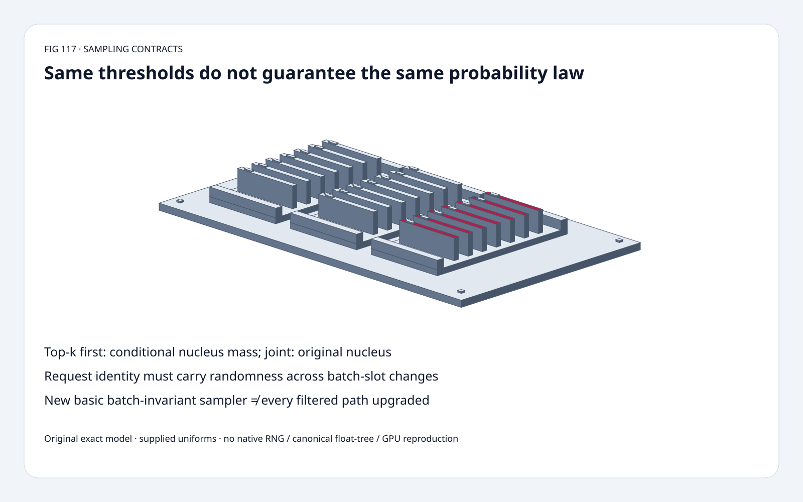
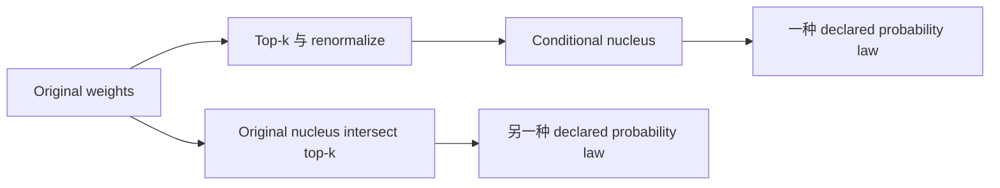
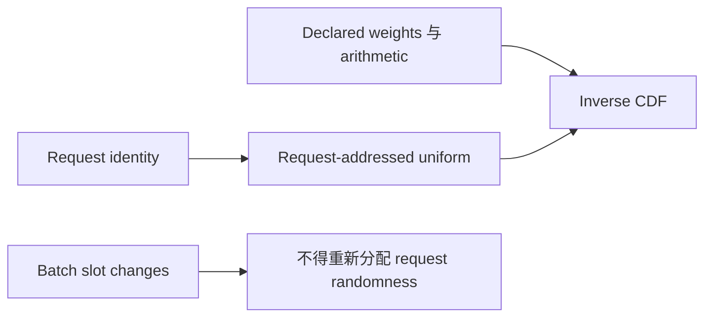
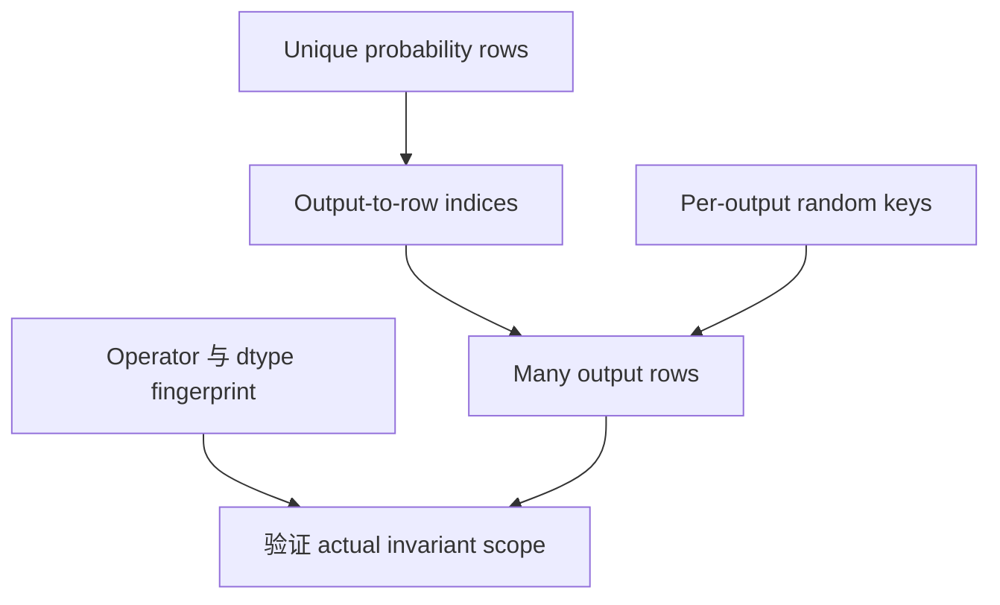

# Sampling FAQ：Top-k/Top-p 组合与 Request-Addressed Randomness

> **语言**：中文 | [English](categorical-topk-topp-request-identity-selection-faq.en.md)
>
> **Round 117 · 2026-11-14（夜班第 26 轮）** · [高清 SVG](../../assets/svg/categorical-topk-topp-request-identity-selection-faq-summary.svg) · [七卡](../reports/categorical-topk-topp-request-identity-selection-cards.html) · [H5](../reports/categorical-topk-topp-request-identity-sizer.html) · [封存数据](../../experiments/sampling_filter_identity_selection/report.json)
>
> **Synthetic，`independently_reproduced=false`。** 原创 exact rational filter/CDF、
> 显式给定 uniforms、独立 CPU lookup；不复现 native FlashInfer、Philox、canonical float tree 或 GPU。



## 一、先看结论：确定性算术不会替你选择 Sampling Law

核验 FlashInfer **2026-11-13** 新增 basic categorical
`batch_invariant=True` path：文档 `sample.icdf.v1` 使用 canonical row sum tree
与 request-keyed `(seed,offset)` stream，而非 batch slot。

已有 top-k/top-p composition 是**另一份契约**。
原创 `[4,3,2,1]`、k=2、p=1/2：
top-k-first 得 `[1,0,0,0]`，joint 得 `[4/7,3/7,0,0]`，
total-variation distance **3/7（42.857%）**。
同一个 supplied uniform=3/5，输出 token **0 / 1**。

| 契约 | 必须固定 | 不代表 |
| :--- | :--- | :--- |
| Distribution | Order、normalization、threshold、tie policy | 相同 k/p 就是相同 law |
| Arithmetic | Operator-specific sum/fingerprint | 全链路 kernels 都 invariant |
| Random address | Request/output seed、offset | 所有 per-row seed 都消除 slot 依赖 |
| Reuse | Output-to-distribution indices | Shared weights 等于 shared random identity |

## 二、架构师 Q&A：你在使用哪个分母与 Random Address？

### Q1：Top-k-First 与 Joint 为什么不同？

Top-k-first 先保留 4、3，再用总量 7 归一化；
首 token **4/7≥1/2**，minimal nucleus 只保留它。

Joint 用原总量 10 算 nucleus：4/10 不足 1/2，
(4+3)/10 达标；再与 top-k 取交集，保留两个并归一化为 4/7、3/7。
这是改变概率法则，不只是 implementation speed。

固定 API 明确区分 `filter_apply_order="top_k_first"` / `"joint"`，
默认前者。原创采用 exact minimal-prefix nucleus，
**exact-k、按 token ID 稳定破 tie**；不认证 native tie-boundary behavior。

### Q2：原创模型明确了哪些边界？

输入为非负 exact integer/rational weights，总质量正；
k 在 `[1,V]`，`0<p<=1`，保留首个达到 threshold 的 prefix。
p=1 是原型 identity test，不认证所有 native API endpoint/sentinel。

Inverse CDF 采用 `[previous cumulative,current cumulative)`：
`0<=u<1`，选择首个 `u<cumulative` token，跳过零质量。
零总量、负 weights、non-exact inputs、非法 threshold 显式报错，
不编造 success token。

H5 用 BigInt 做 integer weights / rational threshold 精确比较，
教学向量最多 64 项并标明 tie policy。
不复现 native float32 rounding、rejection sampling 或 RNG statistical quality。

### Q3：传 Per-Row Seed/Offset 就保证 Batch Invariance 吗？

不是所有 path。固定 default-path 文档说明 output row 也进入
Philox subsequence；把相同 seed/offset 移到新 slot，stream 仍可能变化。

新 **basic categorical** invariant class 则只依赖 row values 与
request seed/offset，fingerprint 还包含 operator、vocabulary width、dtype。
不能自动推广到 filtered APIs 或整条 pipeline。

原创直接给定 A→u=1/10、B→u=3/5。
`[A,B]→[B,A]` 后，按 request 携带 uniforms 保持 **2/2** outputs；
按 slot 重新分配则 **0/2**。
这只验证 identity bookkeeping，**没有实现 Philox、native request-key generator
或 canonical float32 tree**。

显式 seed/offset 的新 draws 需要调用方管理演进；
不要假定所有 rejection sampler 每输出只消耗一个固定 RNG word。

### Q4：Top-k Maximum 是不检查也无害的 Speed Hint 吗？

不是。固定文档将 `top_k_max` 称为 **unchecked upper bound**；
特定 top-k-first fast path 条件包含
`top_k_max<=256`、vocabulary≥65,536。
超过 bound 的 rows（包括 “no top-k”）可能按该 bound 采样。

原创小向量 control 把 k=3 截成 2、p=1：
`[4/9,1/3,2/9,0]→[4/7,3/7,0,0]`，说明错误 bound 会改 law。
四 token 样例**不执行也不满足 native large-vocabulary fast-path 条件**。

### Q5：Distribution Rows 与 Output Rows 有什么区别？

Source `indices` 把每个 output 映射到 reusable probability row，
支持 int32/int64，对应 indexed output dtype。
Per-row filtering thresholds 可以对应 unique distribution rows；
显式 seeds/offsets 按 **output row** 或 broadcast，不能混用两个轴。

默认八条 unique rows、64 outputs、vocabulary=131,072、float32：
unique weights **4,194,304 bytes**；
若为每个 output 重复则 **33,554,432 bytes**；
选定 int32 indices/output 各 **256 bytes**。

这是 reuse 假设下的 logical accounting，不是 allocation、traffic saved 或 peak HBM。
不声称 kernel 一定物化 repeated baseline，也不因 distributions 共享就共享 random identity。

## 三、三张架构图：Law、Arithmetic 与 Random Identity 分开成立







## 四、选型矩阵：Distribution 与 Reproducibility 不能混为一谈

| 选择 | 适合 | Gate |
| :--- | :--- | :--- |
| Top-k-first | 相对 top-k retained mass 的 nucleus | 明确 conditional denominator |
| Joint | 原始 law 的共同约束 | 明确 nucleus/tie semantics |
| Basic invariant categorical | 支持的 operator/fingerprint | 固定 row、request key、dtype |
| Default native sampler | 对应 RNG behavior | Seed 本身可能不消除 slot 依赖 |
| Indexed reuse | Shared weights、多个 outputs | 区分 distribution/output metadata |
| Bounded fast path | 在条件下证明 upper bound | 错误 bound 会改 law |

## 五、动手证据：Exact Law、Request Permutation 与 CPU CDF Lookup

```powershell
python -m experiments.sampling_filter_identity_selection.run --check
python -m unittest discover -s tests -p test_sampling_filter_identity_selection.py -q
```

8 项 tests：独立 prefix selection、exact interval counts、ties、p=1 identity、
scale invariance、request permutation、invalid inputs、clipping、
Node BigInt/Python parity、integer-CDF binary/linear equality。

| Vocabulary | Binary lookup（ms） | Linear lookup（ms） |
| :--- | ---: | ---: |
| 256 | 0.003700 | 0.166767 |
| 1,024 | 0.004233 | 0.684767 |
| 4,096 | 0.005333 | 2.926900 |
| 16,384 | 0.009167 | 11.860100 |

每 operation 32 个 supplied integer draws，CDF 预构造。
**C-backed stdlib bisect 对 Python loop**，计时包含实现差异。
2 warmups、7 次交替 repeats、每 sample 3 次操作，报告 repeat means 的 median；
排除 filtering、sorting、CDF construction、RNG generation、native/GPU。
未做浏览器视觉验收。

## 六、来源、许可、溯源与 Readiness

- [固定 sampling APIs](https://github.com/flashinfer-ai/flashinfer/blob/9b69c0e18a13c353bd6229d70780fd14dd19ff82/flashinfer/sampling.py)：composition、renormalization、indices、fast-path bound、random-address。
- [11 月 13 日更新](https://github.com/flashinfer-ai/flashinfer/commit/9b69c0e18a13c353bd6229d70780fd14dd19ff82)：basic categorical invariant sampling，不自动覆盖已有 top-k/top-p path。
- [固定 invariant classes](https://github.com/flashinfer-ai/flashinfer/blob/9b69c0e18a13c353bd6229d70780fd14dd19ff82/flashinfer/batch_invariant/README.md)：部署前核对实际 operator/fingerprint。
- [Apache-2.0 LICENSE](https://github.com/flashinfer-ai/flashinfer/blob/9b69c0e18a13c353bd6229d70780fd14dd19ff82/LICENSE)：上游权利保留。

Rational models、supplied uniforms、CPU orchestration、视觉均原创，
未复制上游实现或模型权重。不声称 native sampler latency、
native RNG/tree reproduction、model quality 或 peak HBM。
