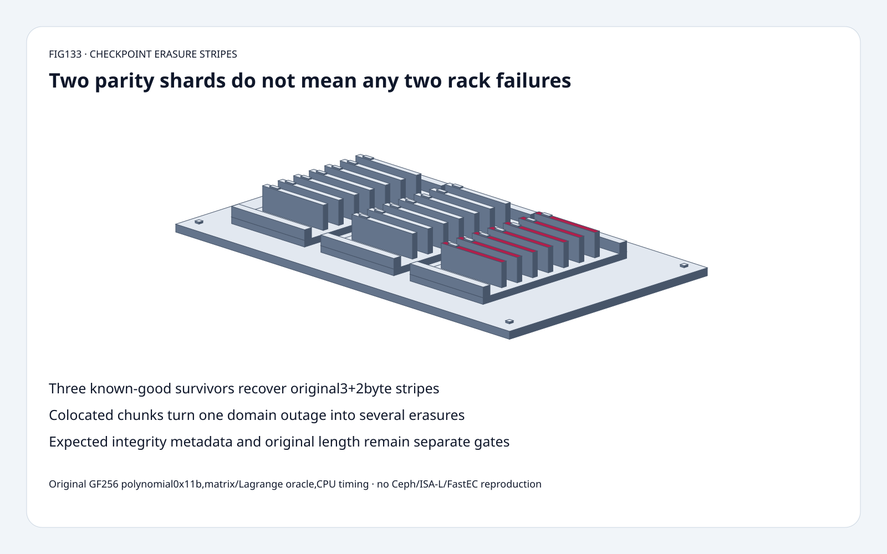
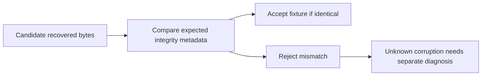

# Checkpoint storage FAQ: erasure stripes,GF256 recovery and failure domains

> **Language**: [中文](checkpoint-erasure-stripe-gf256-failure-domain-selection-faq.md) | English
>
> **Round133 · 2026-11-14 · Day round10** · [SVG](../../assets/svg/checkpoint-erasure-stripe-gf256-failure-domain-selection-faq-summary.svg) · [H5](../reports/checkpoint-erasure-stripe-gf256-failure-domain-sizer.html) · [7 cards](../reports/checkpoint-erasure-stripe-gf256-failure-domain-selection-cards.html) · [Data](../../experiments/erasure_stripe_contract_selection/report.json)
>
> **Synthetic, `independently_reproduced=false`.** Original systematic Vandermonde GF256 code,matrix decoder and independent Lagrange oracle. Original CPU parity paths measured separately;no Ceph/ISA-L/SIMD,FastEC,network,disk or durability reproduction.

## 1. Executive summary: parity protects missing chunks,not every rack layout

Original3+2 systematic code splits10bytes into three4-byte data chunks,
adds two4-byte parity chunks,and retains original length10 to remove
two padding bytes after recovery.
Every selection of two missing shard IDs is recovered:
**10/10** distinct two-erasure cases.

That is not a two-rack durability guarantee.
With three chunks on one rack,one rack loss leaves only two survivors,
fewer thank3. With one chunk per failure domain,two domain losses
remove two chunks and retain enough known-good survivors.

A known-erasure decoder also does not locate unknown silent corruption.
Our selected first-three-survivor mutation returns different bytes;
an external expected SHA-256 fixture detects the mismatch.
No reliability probability or native rebuild bandwidth is inferred.

## 2. Architect Q&A: field algebra,topology,integrity and layout versions

### Q1: What do k,m and systematic actually mean?

k is data-shard count,m is parity-shard count.
The ideal large-object storage factor is(k+m)/k:
4+2 is1.5× versus three replicas3×,before padding/metadata.
This is a storage relationship,not equal write/rebuild performance.

The original model uses distinct points in GF(2^8),polynomial0x11b.
Construct VandermondeV and
`G = V * inverse(V[first k rows])`.
The firstk rows ofG become the identity,so those shards preserve data
chunks unchanged. Anyk distinct survivor rows of this construction
provide an invertible interpolation problem.

This is original mathematical code,not a Ceph/ISA-L-compatible codec:
field convention,generator,packing and metadata formats are not asserted
byte-identical. The bounded model supportsk,m>=1,k+m<=16.

### Q2: Why not reconstruct with ordinary integer averaging or XOR alone?

The byte field adds with XOR and multiplies modulo an irreducible
binary polynomial. Ordinary integer division is not field inversion.
The decoder selects known-good survivor row identities,inverts the
corresponding generator submatrix and reconstructs each byte column.
It trims padding using the preserved original length.

Independent encoding uses direct Lagrange interpolation rather than
the matrix-construction path;tests compare their actual byte outputs.
A single XOR parity equation is not enough to solve arbitrary two
unknown data chunks. Extra independent equations and their identities
matter,not just a label saying “two copies of parity.”

### Q3: Does m2 imply surviving any two host or rack failures?

Only if those failures remove at most two chunks and survivors are
known good. The pinned Ceph docs connectk,m and CRUSH failure domain.
They describe placing chunks on separate selected failure domains,
and recommend planning topology as well as profile.

Original good map has five distinct racks.
Bad map is[A,A,A,B,C]:oneA outage removes shard IDs0/1/2,
leaving two survivors;our decoder rejects insufficient survivors.
This can mean temporary unavailability during a recoverable outage,
not automatic proof of permanent data loss.
Correlated failures,repair time,acknowledgement state and additional
failures during rebuild are outside the algebraic tolerance count.

### Q4: Can the decoder automatically repair silent bit corruption?

Not this known-erasure decoder.
With selected survivor IDs0/1/2,toggle one bit ofchunk0byte0.
The resulting data fails the expected original hash fixture.
The toy does not discover which survivor was wrong or correct unknown
errors from syndrome equations.

Protect and validate integrity metadata,shard identity,original length,
generation/version and commit state separately.
An expected digest used in this fixture is not itself a complete
checksum durability or distributed checkpoint-commit protocol.
Pinned Ceph docs discuss BlueStore checksumming for EC overwrites;
we did not reproduce that implementation.

### Q5: Why does the stripe budget explicitly say classic rather than Ceph?

Pinned Ceph documentation describes **FastEC since Tentacle**:
partial I/O support and padding elimination change the classic-layout
assumption. The per-pool optimization cannot be disabled after enablement;
monitors/OSDs must be on the supported release,and supported plugin/
technique combinations matter. The documented optimized stripe unit
must be a multiple of4KiB;the docs recommend at least16KiB for many
workloads,not a universal measured win for our checkpoint.

Our independent budget deliberately assumes a classic full-stripe padded
single object:
`stripes=ceil(object_bytes/(k*stripe_unit))`.
For1,048,577B,k4,m2,unit16,384B:
17stripes,278,528B/chunk,**1,671,168B** encoded;
data padding**65,535B**,minimum selectedk-chunk decode read**1,114,112B**;
three-replica payload**3,145,731B**.

These are selected logical byte counts,not measured Ceph allocation,
read amplification,FastEC layout,metadata,compression,write amplification
or actual network recovery traffic.
Our byte-packed teaching codec uses a different,explicit minimal padding
rule;do not confuse its10-byte fixture with the16KiB budget.

## 3. Visual architecture: coding,known survivors and independent integrity

## 4. Selection matrix: trade space against real failure and rebuild policy

| Choice | Good fit | Gate |
| :--- | :--- | :--- |
| Replication | Simpler direct-copy reads/recovery choices | Higher selected raw payload |
| Systematic erasure code | Large colder checkpoint objects | Encoding,fanout and rebuild costs |
| Distinct failure domains | Limit chunks lost per domain event | Actual CRUSH/topology rule |
| Known-erasure decoding | Sufficient identified good survivors | Not unknown-error correction |
| Classic full-stripe budget | Explicit padded layout what-if | Not FastEC/native allocation |
| FastEC-enabled pool | Supported partial-I/O layouts | Release/plugin/flag and live measurements |

## 5. Workbench and evidence: eight focused tests,not storage throughput

[H5](../reports/checkpoint-erasure-stripe-gf256-failure-domain-sizer.html)
accepts up to64bytes,k/m and unique missing IDs.
It displays generator,encoded chunks,chosen survivors,recovered bytes
and exact equality. More thanm erasures explicitly fail when fewer
thank survivors remain;no fabricated recovered payload appears.
Budget controls are independent classic full-stripe selections.

Tests compare matrix and Lagrange encoders,check all10two-erasure cases,
exercise all35four-of-seven survivor sets for a256-byte payload,
preserve original length,validate bounds,show corruption mismatch,
compare domain losses,Node/Python codec/budget parity and sealed samples.

| Bytes/chunk,parity-only3+2 | Original coefficient lookup ms | Original bitwise multiply ms |
| :--- | ---: | ---: |
|64|0.073700|0.386467|
|256|0.299400|1.573667|
|1024|1.189533|6.339800|
|4096|4.831167|25.228433|

Two warmups,seven alternating repeats,three operations per sample;
medians of repeat means.
Generator/coefficient-table setup is excluded in both timed paths.
No Ceph/ISA-L/SIMD,network,disk,recovery,FastEC or checksum timing.
Browser inspection was not performed after the prior approval refusal.

## 6. Sources,license and readiness

Ceph tree`ec322a5e95ebcb46dec7d6a9d7813a34543c64ad`:
[EC operations](https://github.com/ceph/ceph/blob/ec322a5e95ebcb46dec7d6a9d7813a34543c64ad/doc/rados/operations/erasure-code.rst),
[profiles](https://github.com/ceph/ceph/blob/ec322a5e95ebcb46dec7d6a9d7813a34543c64ad/doc/rados/operations/erasure-code-profile.rst),
[COPYING](https://github.com/ceph/ceph/blob/ec322a5e95ebcb46dec7d6a9d7813a34543c64ad/COPYING).
The linked documentation is CC-BY-SA-3.0 perCOPYINGdoc/*;
this is an original factual summary and mathematical model,no copied
upstream implementation or document text.
LatestNovember13 tree change releases completed push buffers,
not a new erasure-code invention or daily popularity claim.

[Original code and sealed data](../../experiments/erasure_stripe_contract_selection/README.md).
Static Figure-tier original cabinet reuses sixty solids:
base,four feet,three trays,six rails,21cards,21tabs,four fasteners.
Ready for algebraic/failure-domain teaching and bounded regression,
not production durability or Ceph-layout certification.
