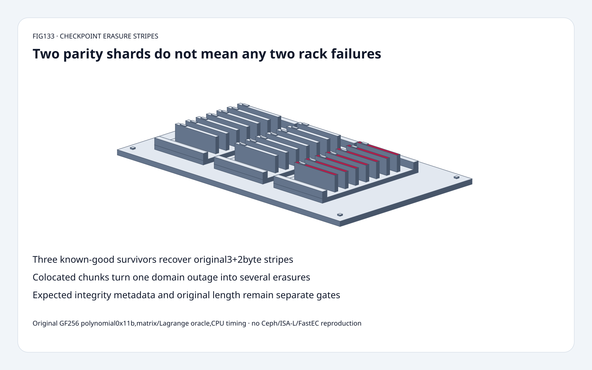
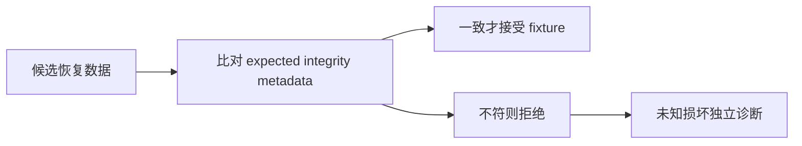

# Checkpoint 存储 FAQ：纠删条带、GF256 恢复与故障域

> **语言**：中文 | [English](checkpoint-erasure-stripe-gf256-failure-domain-selection-faq.en.md)
>
> **Round133 · 2026-11-14 · 白班第10轮** · [高清 SVG](../../assets/svg/checkpoint-erasure-stripe-gf256-failure-domain-selection-faq-summary.svg) · [H5](../reports/checkpoint-erasure-stripe-gf256-failure-domain-sizer.html) · [七卡](../reports/checkpoint-erasure-stripe-gf256-failure-domain-selection-cards.html) · [数据](../../experiments/erasure_stripe_contract_selection/report.json)
>
> **synthetic，`independently_reproduced=false`。** 原创 systematic Vandermonde GF256 编码、矩阵恢复和独立 Lagrange oracle；CPU parity 路径另标 measured。非 Ceph/ISA-L/SIMD、FastEC、网络、磁盘或耐久度复现。

## 1. 结论：parity 保护已知丢片，不自动保护任意机架布局

原创3+2 systematic 编码把10bytes切为3个4-byte数据块，
加2个4-byte parity，并保存原始长度10，恢复后裁掉2bytes padding。
任意两个 shard ID 丢失的 **10/10** 组合都恢复成功。

这不是“任意两个机架可坏”的保证。
若3片放在同机架，一次故障仅剩2片，少于 k3；
每故障域只放1片，两个域丢失才对应两个 erasures。

已知 erasure decoder 也不会定位未知 silent corruption。
选前三个 survivor，翻转一片一位后恢复内容不同，
外部 expected SHA-256 fixture 检出不符。
不能由此推出可靠性概率或原生 rebuild 带宽。

## 2. 架构师问答：有限域、拓扑、完整性与版本布局

### Q1：k、m 与 systematic 分别代表什么？

k是数据片、m是校验片；理想大对象载荷倍率 `(k+m)/k`：
4+2是1.5倍，对比三副本3倍，尚未算 padding/metadata。
空间比例不代表写入或 rebuild 性能相同。

原创使用 GF(2^8)、多项式0x11b与互异 field points：
构造 Vandermonde V，
`G=V*inverse(V前k行)`，使 G 前k行成为单位阵，
数据片保持原 byte chunk；任意 k 个不同 survivor rows
构成可逆插值问题。

这是原创数学编码，不兼容承诺 Ceph/ISA-L 的 field convention、
generator、packing、metadata 或 byte parity。
模型边界 k/m>=1、k+m<=16。

### Q2：为何不能用普通整数平均或仅一条 XOR parity？

这里加法是 XOR，乘法按不可约二进制多项式约简；
普通整数除法不是 field inverse。
解码选已知良好 survivor 身份，反演对应 generator 子矩阵，
逐 byte column 重建，再按原始长度裁掉 padding。

独立 encoder 直接作 Lagrange 插值，不走 generator 矩阵构造，
测试比较真实 byte 输出。
一条 XOR 方程不足以解任意两个未知数据片；
需要额外独立方程与身份，而不是给重复 parity 贴“双重保护”标签。

### Q3：m2是否意味着任意两台 host 或 rack 故障都能恢复？

只有这些故障总共移除不超过2片，且 survivor 已知良好时才成立。
固定 Ceph 文档把 k/m 与 CRUSH failure-domain 联合讨论，
要求 profile 规划匹配实际独立故障域。

原创 good map 五个不同 rack；
bad map[A,A,A,B,C] 中 rackA一次故障丢0/1/2，剩2片，
decoder 显式拒绝。
暂时 outage 可表现为不可用，不自动等于永久数据丢失；
相关故障、修复时间、写确认与 rebuild期间再故障都在代数计数之外。

### Q4：decoder 可以自动修复未知坏字节吗？

本 known-erasure decoder 不行。
survivor IDs0/1/2 中翻转 chunk0byte0 一位，
结果与 expected original hash 不符；
toy不会判断哪片坏，也没有 syndrome unknown-error correction。

需独立保护校验元数据、shard身份、原始长度、generation/version、
checkpoint commit 状态。
fixture 的 expected digest 不是完整 checksum durability
或分布式 checkpoint 提交协议。
Ceph文档提到 EC overwrites 的 BlueStore checksum，
本研究未复现其实现。

### Q5：为何预算明确标 classic，而不直接声称 Ceph 占用？

固定文档描述 **Tentacle 起 FastEC** 支持 partial I/O 并消除 padding，
改变经典 full-stripe 假设。优化 flag 启用后不可关闭；
需要受支持的 monitor/OSD release 与 plugin/technique组合。
优化 stripe unit 要4KiB倍数，文档对不少 workload 推荐至少16KiB，
不等于本文测得 checkpoint 加速。

独立预算明确采用经典单对象 full-stripe padding：
`stripes=ceil(object_bytes/(k*stripe_unit))`。
1,048,577B、k4/m2、unit16,384B：
17stripes、每片278,528B，编码载荷 **1,671,168B**；
data padding **65,535B**，选定最小 k片解码读取 **1,114,112B**；
三副本载荷 **3,145,731B**。

这是逻辑选择，不是原生占用、read amplification、FastEC布局、
metadata、compression、写放大或实际网络重建流量。
byte-packed教学codec另用最小byte padding，
不能混淆其10-byte fixture与16KiB预算。

## 3. 可视化架构：编码、已知 survivor 与完整性分开

## 4. 选型矩阵：空间比例必须结合故障与 rebuild 策略

| 选择 | 适用 | 门槛 |
| :--- | :--- | :--- |
| Replication | 简单 direct-copy读与恢复 | 更高选定载荷 |
| Systematic EC | 较冷大checkpoint对象 | 编码、fanout、重建成本 |
| 独立故障域 | 限制单域丢片数 | 实际 CRUSH/topology rule |
| Known-erasure decoder | 已知良好 survivor 足够 | 不等于 unknown-error 修复 |
| Classic full-stripe预算 | 明确 padded layout what-if | 非 FastEC 原生占用 |
| FastEC pool | 支持的 partial I/O 布局 | release/plugin/flag 与实测 |

## 5. 工作台与证据：八项测试，不是存储吞吐量

[H5](../reports/checkpoint-erasure-stripe-gf256-failure-domain-sizer.html)
输入最多64bytes、k/m、互异丢片IDs，
显示 generator、编码片、survivors、恢复字节与精确一致性。
不足 k survivor 时显式失败，不产生伪造恢复结果；
预算是独立的 classic full-stripe 选择。

测试包括 matrix/Lagrange编码一致、全部10个两片丢失组合、
256bytes在4+3下全部35个4-of-7 survivor sets、
原始长度、边界、不足survivors、corruption mismatch、
故障域计数、Node/Python codec与预算、封存CPU样本。

| 每片 bytes，3+2 parity-only | 原创系数查表 ms | 原创 bitwise 乘法 ms |
| :--- | ---: | ---: |
|64|0.073700|0.386467|
|256|0.299400|1.573667|
|1024|1.189533|6.339800|
|4096|4.831167|25.228433|

2warmups、7次交替repeat、每样本3操作，取repeat均值中位数。
两条路径均不计 generator/系数表构造；
无 Ceph/ISA-L/SIMD、网络、磁盘、recovery、FastEC或checksum计时。
此前 browser approval 被拒，未绕过或声称视觉验收。

## 6. 来源、许可与就绪边界

Ceph 固定树 `ec322a5e95ebcb46dec7d6a9d7813a34543c64ad`：
[EC operations](https://github.com/ceph/ceph/blob/ec322a5e95ebcb46dec7d6a9d7813a34543c64ad/doc/rados/operations/erasure-code.rst)、
[profile](https://github.com/ceph/ceph/blob/ec322a5e95ebcb46dec7d6a9d7813a34543c64ad/doc/rados/operations/erasure-code-profile.rst)、
[COPYING](https://github.com/ceph/ceph/blob/ec322a5e95ebcb46dec7d6a9d7813a34543c64ad/COPYING)。
链接文档按 COPYING doc/* 为 CC-BY-SA-3.0；
此处为原创事实总结与数学模型，未复制上游实现或文档文本。
11月13日 tree 最新变更是释放已完成 push buffers，
不是纠删码理论新发明或当日热门排名。

[原创代码与数据](../../experiments/erasure_stripe_contract_selection/README.md)。
静态 Figure-tier 分拣柜复用原创60 solids：
底座、4脚、3托盘、6导轨、21票卡、21标签、4紧固件。
适合代数与故障域教学、有界回归，不是生产耐久度或 Ceph layout 认证。
