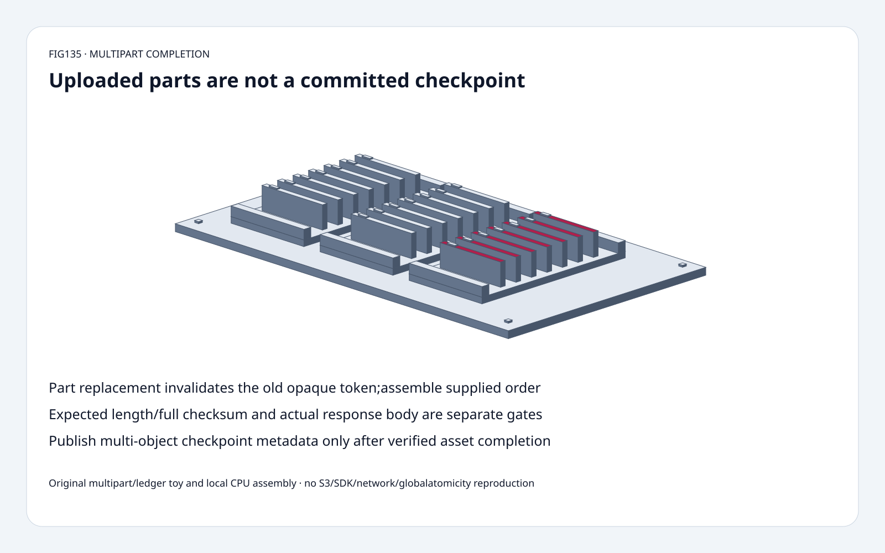
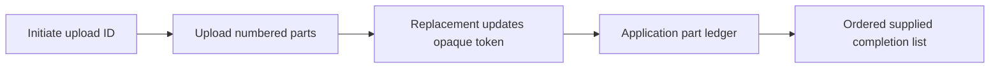
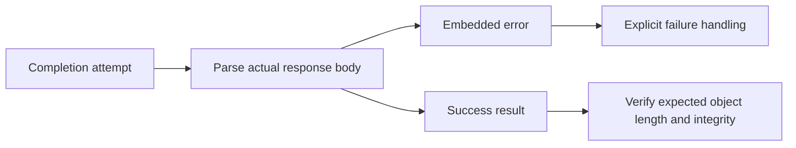
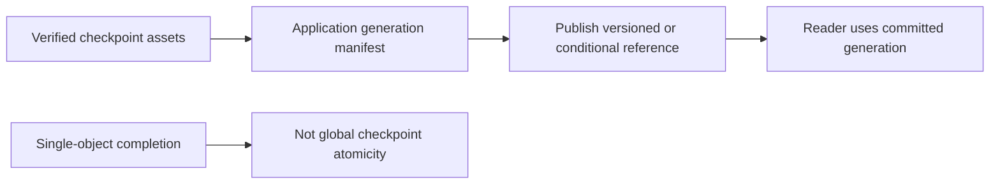

# Checkpoint object FAQ: multipart completion,opaque ETags and integrity gates

> **Language**: [中文](checkpoint-multipart-completion-etag-integrity-selection-faq.md) | English
>
> **Round135 · 2026-11-14 · Day round12** · [SVG](../../assets/svg/checkpoint-multipart-completion-etag-integrity-selection-faq-summary.svg) · [H5](../reports/checkpoint-multipart-completion-etag-integrity-sizer.html) · [7 cards](../reports/checkpoint-multipart-completion-etag-integrity-selection-cards.html) · [Data](../../experiments/multipart_completion_contract_selection/report.json)
>
> **Synthetic, `independently_reproduced=false`.** Original byte/opaque-revision state model,independent flattening oracle and separately measured local CPU assembly. No S3 upload,credentials,SDK,network,server completion or global checkpoint-atomicity reproduction.

## 1. Executive summary: parts exist before the final object is complete

Original upload events2/1/1/3replace part1once.
Final ledger1/2/3with current opaque tokens assembles
`CCCC`+`BBBB`+`DD`=**10bytes**,
regardless of arrival order. The old part1token no longer identifies
the current part.

S3 completion concatenates the **supplied** part list,not an application
plan inferred from every uploaded part. Omitting an intended part can
produce a smaller object;expected length/full checksum must catch this.

An HTTP200header is also not sufficient:the documented API can carry
an embeddedError body. Use the SDK's handling or parse the actual
completion result. Single-object completion does not atomically publish
a multi-object distributed checkpoint.

## 2. Architect Q&A: ledger identity,ordering,checksums and publication

### Q1: Can parts arrive in any order,and what does replacement change?

AWS documentation permits independent/out-of-order uploads.
Part number identifies its position;uploading that number again replaces
the previous part. Record its new response ETag with uploadID and number.
The original model creates synthetic opaque revision tokens,not native
ETags or a hash algorithm.

Original part1token changesopaque-revision-2→opaque-revision-3.
Completing with the old token explicitly fails and leaves the original
upload active/unpublished in our model.
Successful completion clears the toy's parts and exposes one object.
Retries,concurrent same-key uploads,versioning and abort races are not modeled.

### Q2: Does completion automatically know which parts my checkpoint needs?

No. The API concatenates the list supplied by the caller in ascending
part-number order. Native errors include stale/missing part identity
and invalid order.
The application should maintain its own ledger rather than constructing
the completion request blindly from a listing.

The original subset fixture uploadsAandB,but supplies only part1;
without an application expected-plan gate,it completesAalone.
With expected length2,it explicitly fails.
For the ten-byte fixture,a part1-only list produces4bytes,not10.
Expected total length and supported full-object checksum protect
application intent;they are not magically inferred by multipart.

Base multipart numbering can have gaps.
The inspected AWS checksum-mode guidance requires consecutive IDs from1;
our strict option models that selected convention explicitly.
Do not silently conflate it with all general-purpose bucket modes.

### Q3: Is the final ETag always the object's MD5?

No. The AWS guide explicitly says multipart ETag need not be the MD5
of the full object.
Part ETags are completion identities;full-object checksum algorithm/
type and server validation are separate documented mechanisms.
The guide describesBadDigest on a supplied full checksum mismatch.

Our Python application guard checks expected SHA-256 over assembled
toy bytes. This is not a claim that every AWS multipart SHA checksum
mode uses that exact full-object representation.
H5 uses bounded ASCII and expected length only;it does not pretend
to implement native ETag,MD5,SDK checksums or cloud response XML.

### Q4: Why can HTTP200still mean completion failure?

The API begins with a200response header while completion is processing.
It can later return an embeddedError in the body.
AWS SDKs handle this;raw callers must not equate transport header
with successful object creation.

The original fixture rejects
`<Error><Code>InternalError</Code></Error>`understatus200,
and accepts a namespacedCompleteMultipartUploadResult root.
It is a deliberately bounded success/error-root test,not a full
response-schema validator or retry/idempotency implementation.
Non200and malformed XML are explicit failures.

For multi-object checkpoints,use a separate application generation/
manifest protocol and publish its pointer only after intended assets
are verified. Conditional writes/versioned references can be relevant,
but we did not implement or certify that distributed protocol here.

### Q5: How should a part plan account for limits and buffers?

Live AWS limits readNovember14:maximum10,000parts,part numbers1..10,000,
nonfinal size5MiB..5GiB,last part has no minimum.
The inspected current table lists maximum object48.8TiB;
we do not substitute an older memorized limit.

Selected1TiB object,128MiBparts,concurrency16:
**8192parts**,final128MiB,**8194**create/upload/complete calls without
retries/listings,selectedequal-sizebufferupper **2,147,483,648B**.
This buffer arithmetic is not native SDK allocation or bandwidth.
There can be checksum,transport,queue and allocator copies;streaming
implementations can use different buffer policies.

Tiny4/4/2byte teaching parts and1KiBCPU parts are **not valid native
nonfinal S3 multipart sizes**. Native-size planning is separate.
Uncompleted uploads can retain billable parts until completed/aborted;
the model performs no cloud cleanup and creates no cloud resource.

## 3. Visual architecture: bind current parts before publishing a generation

## 4. Selection matrix: transfer protocol and checkpoint commit are separate

| Choice | Good fit | Gate |
| :--- | :--- | :--- |
| Multipart upload | Large/parallel/retriable object transfer | Size/part count and ledger |
| Current part ETags | Bind completion to uploaded identity | Replacement invalidates old token |
| Expected length/full checksum | Preserve application object intent | Supported algorithm/type semantics |
| SDK completion handling | Embedded-error aware response handling | SDK configuration/version |
| Generation manifest | Multi-object checkpoint publication | Separate consistent commit protocol |
| Abort/lifecycle cleanup | Incomplete-upload cost control | In-flight race and operational policy |

## 5. Workbench and evidence: eight focused tests,not upload throughput

[H5](../reports/checkpoint-multipart-completion-etag-integrity-sizer.html)
accepts up to64ASCII upload events/current-token manifest entries,
consecutive-mode choice and expected length.
It rejects stale tokens,invalid ordering and length mismatch visibly.
Native byte-plan controls are independent.

Tests cover all six part-arrival permutations,independent byte flattening,
replacement failure without publication,subset omission,ascending/unique/
consecutive contracts,expectedSHA mismatch,HTTP200Error,
namespaced success root,native size gates,Node parity and sealed samples.

| Local1KiBparts | Original bytes-join ms | Original bytearray-copy+convert ms |
| :--- | ---: | ---: |
|16|0.000667|0.005167|
|64|0.002167|0.015567|
|256|0.007433|0.062500|
|1024|0.106367|0.788767|

Two warmups,seven alternating repeats,three operations per sample;
medians of repeat means.
No S3/network/SDK/checksum/server assembly/disk/retry measurement.
Browser inspection was not performed after the prior approval refusal.

## 6. Sources,provenance and readiness

Live AWS documentation,accessed2026-11-14:
[multipart workflow](https://docs.aws.amazon.com/AmazonS3/latest/userguide/mpuoverview.html),
[completion API](https://docs.aws.amazon.com/AmazonS3/latest/API/API_CompleteMultipartUpload.html),
[limits](https://docs.aws.amazon.com/AmazonS3/latest/userguide/qfacts.html).
The API fetch initially hit a transport failure;the public page was
then successfully read with a direct HTTPS request.
No credentials or cloud operation were used.
These are live docs,not pinned source or a newly invented daily capability.
Original factual summary/model,no upstream implementation or prose copied.

[Original code and sealed data](../../experiments/multipart_completion_contract_selection/README.md).
Static Figure-tier original cabinet reuses sixty solids:
base,four feet,three trays,six rails,21cards,21tabs,four fasteners.
Ready for bounded ledger/response-contract teaching and regression,
not cloud performance,production integrity or global-atomicity certification.
