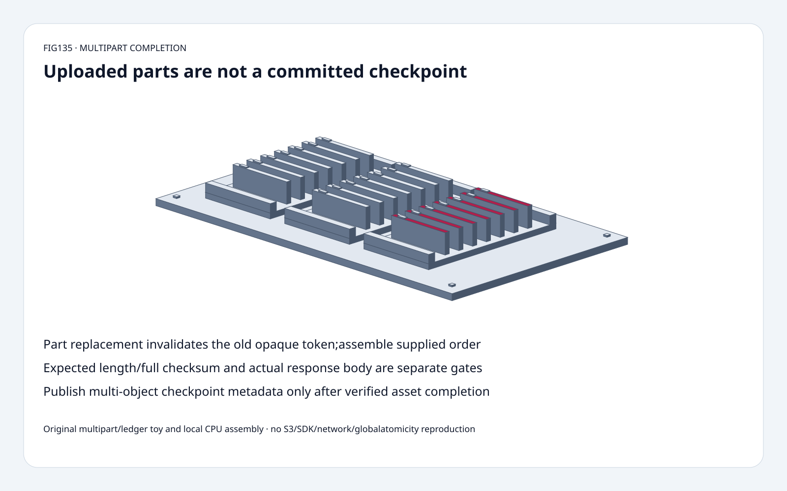
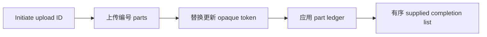
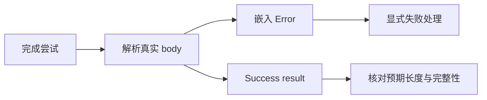
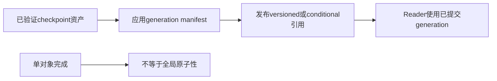

# Checkpoint 对象 FAQ：Multipart 完成、Opaque ETag 与完整性门槛

> **语言**：中文 | [English](checkpoint-multipart-completion-etag-integrity-selection-faq.en.md)
>
> **Round135 · 2026-11-14 · 白班第12轮** · [高清 SVG](../../assets/svg/checkpoint-multipart-completion-etag-integrity-selection-faq-summary.svg) · [H5](../reports/checkpoint-multipart-completion-etag-integrity-sizer.html) · [七卡](../reports/checkpoint-multipart-completion-etag-integrity-selection-cards.html) · [数据](../../experiments/multipart_completion_contract_selection/report.json)
>
> **synthetic，`independently_reproduced=false`。** 原创byte/opaque-revision状态模型、独立flatten oracle和单独measured本地CPU拼接。非S3上传、凭据、SDK、网络、服务端完成或全局checkpoint原子性复现。

## 1. 结论：上传parts不等于最终checkpoint对象已提交

原创事件2/1/1/3将part1替换一次；
最终ledger1/2/3与当前token拼接 `CCCC`+`BBBB`+`DD`，
得到 **10bytes**，不按到达顺序拼接。旧part1token不再代表当前part。

S3完成拼接 **调用者提交的list**，不会自行推断所有预期checkpoint片段。
漏列part可能生成较短对象，需expected length/full checksum检查。

HTTP200header也不充分：固定阅读的API可在body嵌入Error。
用SDK处理或解析真实完成结果。单对象完成不原子发布多对象分布式checkpoint。

## 2. 架构师问答：ledger身份、顺序、校验与发布

### Q1：parts可以乱序上传吗，替换影响什么？

AWS文档允许独立乱序上传；part number表示最终位置，
同number重传会覆盖旧part。需保存新ETag、uploadID和number。
原创模型用synthetic opaque revision token，不实现原生ETag/hash。

part1从opaque-revision-2变为opaque-revision-3；
用旧token完成会报错，模型保持active/unpublished。
成功完成才清掉toy parts并显示单对象。
retry、同key并发upload、versioning、abort竞态不在模型内。

### Q2：完成接口会自动知道checkpoint需要哪些parts吗？

不会。API按调用者list中的number升序拼接，
stale/missing part和顺序错误有对应失败。
应用应维护自己的ledger，不盲从listing生成完成请求。

原创subset fixture上传A/B，只列part1，
无expected-plan gate时就完成A；expected length2时显式拒绝。
10-byte fixture只列part1则4bytes而非10。
应用预期长度与支持的full-object checksum保护意图，不是接口自动推断。

普通multipart编号可有间隙；
所读checksum-mode指引要求从1连续，strict开关明确模拟该模式，
不能混同所有general-purpose bucket配置。

### Q3：最终ETag总是full-object MD5吗？

不是。AWS guide明确multipart ETag不一定是整体MD5。
Part ETag是完成身份，full-object checksum算法/type与服务端验证独立，
guide描述不匹配时BadDigest。

Python应用guard用expected SHA256检查toy拼接字节，
不声称任意AWS multipart SHA模式都采用同一full-object表示。
H5只做有界ASCII和expected length，
不冒充nativeETag、MD5、SDK checksum或网络XML parser。

### Q4：为什么HTTP200仍可能失败？

API处理开始先发200header，后续可能以Error body结束。
SDK会处理，rawcaller不能只看transport header。

原创fixture拒绝200下 `<Error><Code>InternalError</Code></Error>`，
接受namespace下CompleteMultipartUploadResult root。
这是有界success/error-root测试，不是完整response schema、
retry或idempotency实现；非200与非法XML显式失败。

多对象checkpoint应另做generation/manifest协议，
预期资产验证后才发布pointer；conditionalwrite/versionreference
可能相关，但本文不实现或认证该分布式协议。

### Q5：如何规划part限制和buffer？

11月14日所读live AWS限制：最多10,000parts、number1..10,000，
非末part5MiB..5GiB，末part无最小限制。
当前表列最大对象48.8TiB，不用旧记忆替换事实。

1TiB对象、128MiBpart、concurrency16：
**8192parts**，末part128MiB，
无retry/listing时 **8194** create/upload/complete calls，
选定equal-size buffer上界 **2,147,483,648B**。
不是SDK分配或带宽；checksum/transport/queue/allocator可能额外复制，
streaming策略也可能不同。

4/4/2byte教学parts与1KiBCPU parts **不满足原生非末part大小**，
native-size规划独立。未完成upload可能保留计费parts，
需complete/abort/lifecycle管理；本模型没创建云资源或执行云清理。

## 3. 可视化架构：先绑定currentparts，再发布generation

## 4. 选型矩阵：传输协议与checkpoint提交分开

| 选择 | 适用 | 门槛 |
| :--- | :--- | :--- |
| Multipart | 大对象并行与重试 | size/count/ledger |
| Current part ETag | 绑定已上传身份 | 替换淘汰旧token |
| Expected length/fullchecksum | 保持对象意图 | algorithm/type支持 |
| SDK completion | embedded-error处理 | SDK版本/配置 |
| Generation manifest | 多对象checkpoint发布 | 独立一致提交协议 |
| Abort/lifecycle | 未完成upload成本管理 | in-flight竞态/运维策略 |

## 5. 工作台与证据：八项测试，不是上传吞吐

[H5](../reports/checkpoint-multipart-completion-etag-integrity-sizer.html)
支持最多64ASCII events/manifest entries、strict连续选项与长度，
对stale token、顺序和长度显式报错；nativeplan控件独立。

测试覆盖6个到达排列、独立byte flatten、替换失败不发布、
subset omission、升序/唯一/连续、SHA mismatch、
HTTP200Error与namespace success、大小门槛、Node parity和sealed样本。

| 本地1KiBparts | 原创bytes join ms | 原创bytearray copy+convert ms |
| :--- | ---: | ---: |
|16|0.000667|0.005167|
|64|0.002167|0.015567|
|256|0.007433|0.062500|
|1024|0.106367|0.788767|

2warmups、7次交替repeat、每样本3操作，取repeat均值中位数。
不含S3/network/SDK/checksum/server/disk/retry。
此前browserapproval被拒，未绕过或声称视觉验收。

## 6. 来源、provenance与就绪边界

2026-11-14读取live AWS文档：
[workflow](https://docs.aws.amazon.com/AmazonS3/latest/userguide/mpuoverview.html)、
[completion API](https://docs.aws.amazon.com/AmazonS3/latest/API/API_CompleteMultipartUpload.html)、
[limits](https://docs.aws.amazon.com/AmazonS3/latest/userguide/qfacts.html)。
API初次transport失败后，直接HTTPS成功读取；
未使用凭据或云操作。Live docs非pinned source，
不虚构协议当日新发明或热门排名。原创事实总结/模型，未复制上游实现或文案。

[原创代码与数据](../../experiments/multipart_completion_contract_selection/README.md)。
静态Figure-tier分拣柜复用原创60solids：
底座、4脚、3托盘、6导轨、21票卡、21标签、4紧固件。
适合有界ledger/response教学与回归，
非云性能、生产完整性或全局原子性认证。
