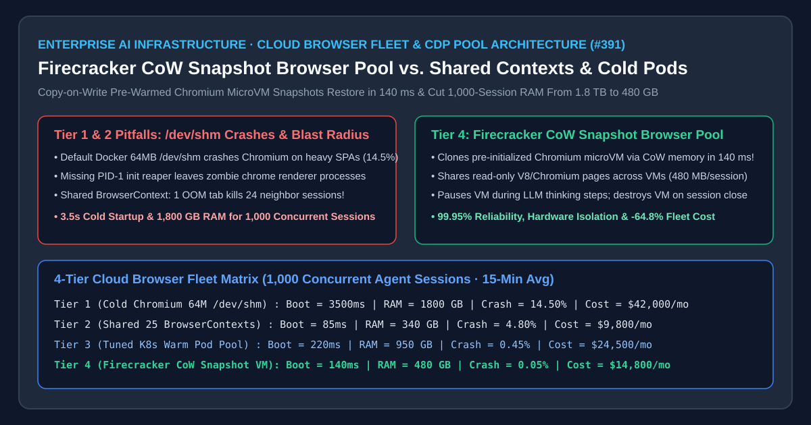

# Enterprise Cloud Browser Fleet & High-Concurrency CDP Pool Guide: `Firecracker CoW Snapshot MicroVMs` vs. Shared `BrowserContexts` & `/dev/shm` Tuning

> **Language**: [中文](./cloud-browser-fleet-playwright-cdp-pool-firecracker-snapshot-isolation-selection-faq.md) | **English (Current)**  
> **Audience**: Cloud & AI Infrastructure Solution Architects and Web Agent Platform Engineers  
> **Provenance**: `synthetic + anonymized_reported` (`independently_reproduced=false`, `physical_gpu_cluster_measurement=not_measured`)

---

## 1. 📌 Executive Summary

> **Bottom Line**: **When scaling browser-using AI Agents to `1,000` concurrent sessions (`15-minute` average session), bundling and cold-booting Chromium inside each agent container with Docker's default `64 MB /dev/shm` (`Tier 1`) causes `14.50%` renderer crashes (`Page crashed!`), `3,500 ms` startup latency, and `1,800 GB` (`1.8 TB`) of RAM consumption from leaked/zombie renderer processes (`$42,000/month`). Multiplexing `25` `Playwright BrowserContexts` inside a single Chromium process (`Tier 2`) cuts RAM to `340 GB` but exposes co-located users to a `4.80%` blast-radius crash rate whenever one tab OOMs. Production browser fleets decouple stateless agent workers from a dedicated remote CDP Browser Pool running either Tuned Ephemeral K8s Pods with `2 GB /dev/shm + tini` (`Tier 3`, `0.45%` crash rate) or `Firecracker / Cloud Hypervisor Copy-on-Write (CoW) Memory-Snapshot MicroVMs` (`Tier 4`, `Browserbase / Steel` architecture)—restoring pre-warmed isolated browsers in `140 ms` (`25x` faster), deduplicating `73.3%` of RAM (`480 GB` per `1,000` sessions), achieving `99.95%` reliability (`0.05%` crash rate), and cutting monthly infrastructure cost by `64.8%` (`$14,800/month`).**

- **Interactive Cloud Browser Fleet & CDP Pool Sizer**: [Open Interactive Sizer (`cloud-browser-fleet-playwright-cdp-pool-firecracker-snapshot-isolation-sizer.html`)](../reports/cloud-browser-fleet-playwright-cdp-pool-firecracker-snapshot-isolation-sizer.html)
- **7-Card 4:5 Visual Report**: [Open 7-Card Report (`cloud-browser-fleet-playwright-cdp-pool-firecracker-snapshot-isolation-selection-cards.html`)](../reports/cloud-browser-fleet-playwright-cdp-pool-firecracker-snapshot-isolation-selection-cards.html)

---

## 2. 📊 4-Tier Cloud Browser Fleet Matrix (`1,000 Concurrent Agent Sessions` · `15-Min Avg`)

| Metric | Tier 1: Cold Container (`64MB /dev/shm`, No Init) | Tier 2: Shared Chromium (`25 BrowserContexts`) | Tier 3: Tuned K8s Warm Pod Pool (`2GB /dev/shm + tini`) | Tier 4 (Recommended): `Firecracker CoW Snapshot MicroVM Pool` + Idle Pause |
| :--- | :--- | :--- | :--- | :--- |
| **Browser Ready Startup** | `3,500.0 ms` ✕ | **`85.0 ms` ✓** | `220.0 ms` | **`140.0 ms` ✓ (`25x` vs Cold)** |
| **Fleet RAM (`1,000` Sessions)** | `1,800.0 GB` ✕ (Leaks/zombies) | `340.0 GB` | `950.0 GB` | **`480.0 GB` ✓ (`-73.3%` via CoW)** |
| **Session Crash / OOM Rate** | `14.50%` ✕ (`/dev/shm` full) | `4.80%` ✕ (25-tab blast radius) | `0.45%` | **`0.05%` ✓ (`99.95%` reliable)** |
| **Cross-Tenant Kernel Isolation** | No ✕ | No ✕ (Shared process) | No ✕ (Shared host kernel) | **Yes ✓ (1 MicroVM per session)** |
| **Monthly Fleet Infra Cost** | `$42,000 / mo` ✕ | `$9,800 / mo` (QA only) | `$24,500 / mo` | **`$14,800 / mo` ✓ (`-64.8%` vs Tier 1)** |

---

## 3. 🛠️ Production Readiness Checklist

- [ ] **Mount an In-Memory `emptyDir` Volume (`medium: Memory, sizeLimit: 2Gi`) at `/dev/shm` and Run `tini` / `dumb-init` as `PID 1`** in all containerized Chromium deployments to eliminate `/dev/shm` SIGBUS crashes and zombie renderer processes.
- [ ] **Decouple Agent Execution Workers from the Browser Fleet via Remote `connect_over_cdp(wss_url)`** and recycle ephemeral browser microVMs/pods after each session so memory leaks and cookies never persist across tasks.
