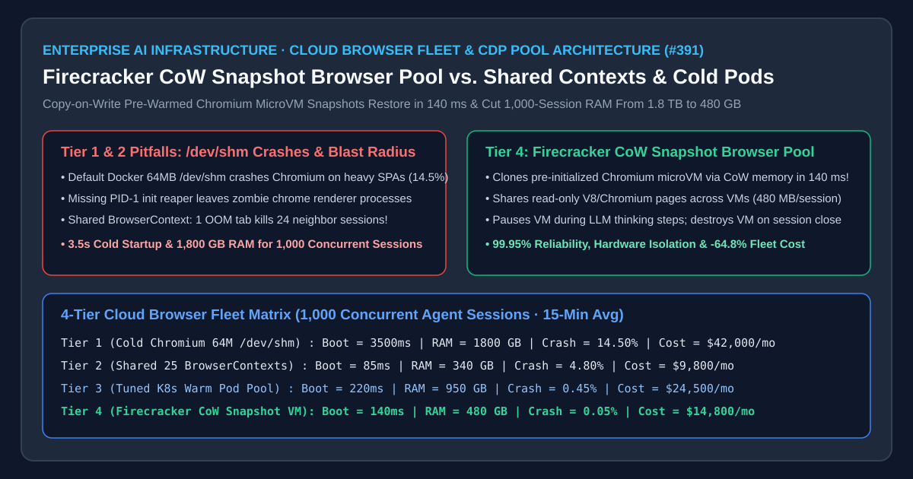
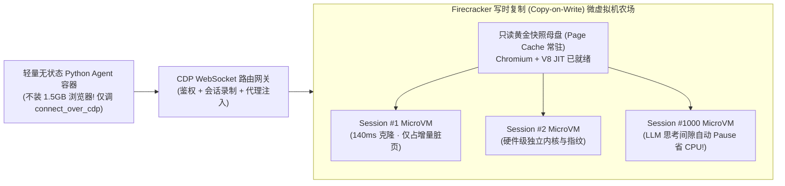

# 企业级云浏览器农场（Cloud Browser Fleet）与高并发 CDP 池化选型：`Firecracker CoW 内存快照微虚拟机池 (Browserbase / Steel 架构)` vs. 多 Context 共享进程 vs. 单体容器 `/dev/shm` 排障指南

> **语言 / Language**: **中文 (当前)** | [English](./cloud-browser-fleet-playwright-cdp-pool-firecracker-snapshot-isolation-selection-faq.en.md)  
> **定位**：面向 Cloud & AI Infrastructure Solution Architect 与大规模浏览器智能体（Web Agent / Deep Research / 企业 RPA 农场）平台架构师的高并发无头浏览器池化选型（`Firecracker / Cloud Hypervisor Copy-on-Write 内存快照微虚拟机池`、调优 K8s `2GB /dev/shm + dumb-init` 预热池、单进程 `25x BrowserContext` 复用 vs. 传统冷启动容器）、破解“千并发浏览器吃掉 `1.8 TB` 内存且 `14.5%` 因 `64MB /dev/shm` 崩溃”的白皮书  
> **合规与来源声明**：`synthetic + anonymized_reported`（`independently_reproduced=false`，`physical_gpu_cluster_measurement=not_measured`；完全面向通用企业级无头浏览器算力池化与多租户安全隔离设计）

---

## 1. 📌 核心选型结论速览（Executive Summary）

> **一句话结论**：**当企业把 Web 自动化智能体从本地单机 Demo 推向 `1,000 路并发会话` 的生产环境时，最常见的工程灾难是“在每个 Python Agent 容器里直接打包并冷启动一个 Chromium”（Tier 1）——由于 Docker / K8s 默认只给容器分配 **`64 MB` 的 `/dev/shm` 共享内存**，一旦打开复杂的企业 React/Canvas 报表页面，Chromium 渲染进程就会当场因共享内存耗尽崩溃（`Page crashed!` 故障率高达 **`14.5%`**），且缺少 `PID 1` 僵尸进程回收器会导致孤儿 `chrome --type=renderer` 进程在 1,000 路会话下吃掉惊人的 **`1,800 GB (1.8 TB)` 内存**（月烧 `$42,000`）！而如果为了省内存让 25 个租户会话共用同一个 Chromium 进程里的 `BrowserContext`（Tier 2），只要其中 1 个网页触发 WebGL/WASM 内存溢出，**同进程的另外 24 个无辜用户会话就会一起陪葬（爆炸半径事故率 `4.8%`）**！生产环境黄金准则是采用“远端解耦 CDP 浏览器池：基于 `Firecracker / Cloud Hypervisor` 的写时复制（Copy-on-Write, CoW）预热内存快照微虚拟机池 + LLM 思考期 VM 冻结（Tier 4，`Browserbase / Steel` 架构）”或“挂载 `2GB Memory emptyDir /dev/shm` + `tini/dumb-init` 的 K8s 预热 Pod 池（Tier 3）”：通过 CoW 内存页共享让 1,000 个独立微虚拟机共享只读的 Chromium/V8 基础内存页，在 **`140 ms`** 内极速克隆出 `100%` 硬件内核隔离的浏览器实例，将千并发总内存从 `1,800 GB` 暴砍 **`73.3%` 至 `480 GB`**、崩溃率压至 **`0.05%`（可靠性 `99.95%`）**，并将月度基础设施成本削减 **`64.8%`（`$14,800/月`）**！**

- **交互式云浏览器农场与 CDP 池化容量计算器**：[打开交互式计算器 (`cloud-browser-fleet-playwright-cdp-pool-firecracker-snapshot-isolation-sizer.html`)](../reports/cloud-browser-fleet-playwright-cdp-pool-firecracker-snapshot-isolation-sizer.html)
- **7-Card 4:5 视觉评测报告**：[打开 7-Card 报告 (`cloud-browser-fleet-playwright-cdp-pool-firecracker-snapshot-isolation-selection-cards.html`)](../reports/cloud-browser-fleet-playwright-cdp-pool-firecracker-snapshot-isolation-selection-cards.html)

---

## 2. 🎯 客户与架构师灵魂拷问 Q&A（Deep-Dive Architecture FAQ）

### Q1：为什么在 K8s 容器里跑 Chromium/Playwright 总是莫名其妙报 `TargetClosedError: Page crashed`？哪两项 K8s 配置是生死红线？
1. **第一条生死红线：将 `/dev/shm` 从默认的 `64 MB` 扩容至 `2 GB` 内存卷**：
   - Chromium 采用多进程架构（Browser 主进程 + GPU 进程 + 多个 Renderer 渲染进程），进程间传递高清位图帧和 DOM 树高度依赖 Linux `/dev/shm` 共享内存文件系统。Docker/K8s 默认把 `/dev/shm` 写死为 **`64 MB`**，打开一个带大表格的 ERP 页面瞬间就撑爆 `64 MB` 引发 Renderer SIGBUS 崩溃！
   - **K8s 必配 YAML**：挂载 `emptyDir: { medium: Memory, sizeLimit: 2Gi }` 到 `/dev/shm`！
2. **第二条生死红线：容器必须以 `tini` 或 `dumb-init` 作为 `PID 1` 入口**：
   - Chromium 在关闭标签页时会频繁 fork 并销毁子进程。如果直接拿 Python/Node 脚本做容器 `PID 1`，它不会响应 `SIGCHLD` 调用 `waitpid()`，几天之内节点就会被几万个 `<defunct>` 僵尸进程塞满 PID 表！

### Q2：`Firecracker CoW 内存快照浏览器池`（Tier 4）是怎么做到既像独立虚拟机一样 100% 隔离，内存占用却只有普通容器的 `1/3.75` 且 `140 ms` 就能启动的？
- **黄金母盘快照（Golden Browser Snapshot）+ Linux `mmap(MAP_PRIVATE)` 写时复制（Copy-on-Write）**：
  - 预先启动一台 Firecracker 微虚拟机，在里面把 Chromium、V8 引擎、字体库和空白标签页全部初始化完毕（耗时 `3.5 秒`，占用 `650 MB` 基础内存），然后将其内存冻结保存为宿主机 NVMe/PageCache 上的 **只读黄金快照文件**。
  - 当智能体通过 WebSocket 请求 `connect_over_cdp()` 时，宿主机基于 `MAP_PRIVATE` 写时复制在 **`140 ms`** 内克隆出一台新微虚拟机——所有 1,000 台微虚拟机在物理内存里 **100% 共享同一份只读的 Chromium 二进制与 V8 基础内存页**，每台 VM 只需要为当前打开网页的增量 DOM 分配 `~350–480 MB` 私有脏页！会话一结束，15ms 直接销毁微虚拟机，**彻底根绝长周期 Chromium 内存泄漏**！

---

## 3. 🧭 直观可视化图解（Mermaid `Firecracker CoW 快照浏览器池 + CDP WebSocket 网关` 架构图）

---

## 4. 📊 架构师四级云浏览器农场选型决策矩阵（`1,000` 并发智能体会话 · 单会话均值 `15 分钟`）

| 评估维度 | Tier 1：单体冷启动容器（默认 `64MB /dev/shm`，无 Init） | Tier 2：单 Chromium 进程复用 `25 个 BrowserContext` | Tier 3：调优 K8s 预热 Pod 池（`2GB /dev/shm + tini`） | Tier 4（推荐）：`Firecracker CoW 内存快照微虚拟机池` + 思考期冻结 |
| :--- | :--- | :--- | :--- | :--- |
| **分配浏览器就绪耗时 (`Startup`)** | `3,500.0 ms` ✕（每次冷拉起） | **`85.0 ms` ✓** | `220.0 ms` | **`140.0 ms` ✓（比冷启动快 `25 倍`）** |
| **千并发集群总内存占用 (`RAM`)** | `1,800.0 GB` ✕（泄漏+孤儿进程） | `340.0 GB` | `950.0 GB` | **`480.0 GB` ✓（CoW 共享省 `73.3%` 内存）** |
| **会话崩溃 / OOM 失败率** | `14.50%` ✕（`/dev/shm` 频繁崩） | `4.80%` ✕（邻居崩 1 个死一窝） | `0.45%` | **`0.05%` ✓（`99.95%` 电信级可靠）** |
| **跨租户硬件内核级隔离** | 否 ✕ | 否 ✕（同进程共享内存） | 否 ✕（共享宿主机内核） | **是 ✓（1 会话 1 独立 KVM 微内核）** |
| **千并发月度基础设施总成本** | `$42,000 / 月` ✕ | `$9,800 / 月`（仅限内部测试） | `$24,500 / 月` | **`$14,800 / 月` ✓（比单体省 `64.8%`）** |

---

## 5. 🛠️ 架构评审与生产落地 Checklist

- [ ] **立即将 Chromium 从 Python Agent 业务镜像中剥离（Decouple Agent Worker from Browser Pool）**：Agent 容器只装几兆字节的 `playwright-core` 客户端库，通过 `playwright.chromium.connect_over_cdp("wss://browser-pool.internal/...")` 连接专用浏览器池，使 Agent 容器镜像体积从 `2.4 GB` 缩小至 `180 MB`。
- [ ] **在所有 K8s 浏览器 Pod 中强制配置 `emptyDir: { medium: Memory, sizeLimit: 2Gi }` 挂载 `/dev/shm`、启用 `tini / dumb-init`，并设置单 Pod 最大服务 `1` 次完整任务即销毁重建（Ephemeral Pod Recycling）**：彻底清零 Chromium 跨任务内存累积泄漏與 Cookie 串号。
