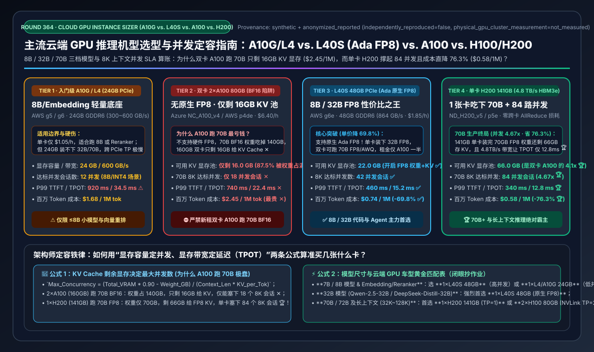
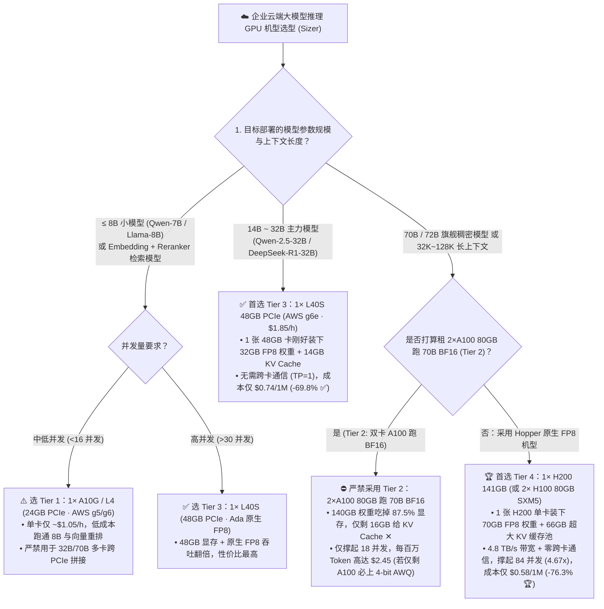
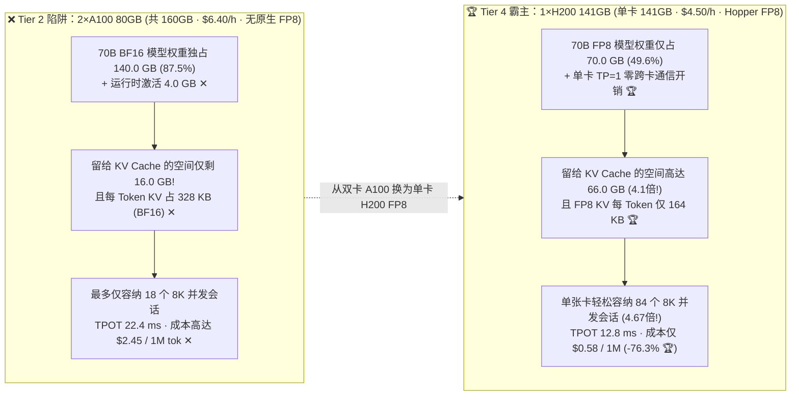
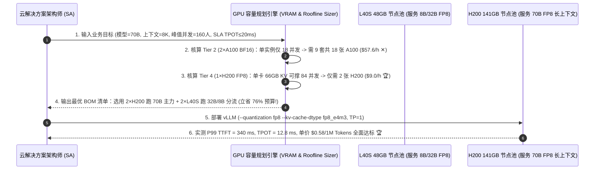

# 主流云端 GPU 推理机型选型与并发容量估算（Sizer）指南：`A10G / L4 (24GB)` vs. `L40S 48GB (Ada FP8)` vs. `A100 80GB` vs. `H100 80GB / H200 141GB`

> 🌐 **Language / 语言**: **中文 (Chinese)** | **[English (`cloud-gpu-instance-sku-l40s-a10g-a100-h100-h200-capacity-sizing-selection-faq.en.md`)](cloud-gpu-instance-sku-l40s-a10g-a100-h100-h200-capacity-sizing-selection-faq.en.md)**
> **阅读指南**：本文面向 **Cloud & AI Solution Architect（云与 AI 解决方案架构师）、云基础设施规划师与 FinOps 负责人**，手把手教你用两道简单的第一性原理数学题（**“显存容量算并发、显存带宽算延迟”**），精准拍板企业在 Azure / AWS / 阿里云上租用 GPU 实例时的机型选型：**当企业要部署 `8B`、`32B` 或 `70B/72B` 大模型时，到底该租便宜的 `A10G / L4 (24GB)`，还是中端 `L40S (48GB PCIe)`，还是老牌旗舰 `A100 (80GB)`，还是最新 `H100 (80GB) / H200 (141GB)`？为什么租 2 张 `A100 80GB` 跑 `70B BF16`（Tier 2）是当下最亏钱的冤大头方案（160GB 显存被权重吃掉 140GB，只剩 16GB 给 KV Cache，仅撑起 `18 并发`，单价高达 `$2.45/1M`）？为什么 `1 张 L40S 48GB` 是 `32B FP8` 模型的性价比之王？以及为什么 `1 张 H200 141GB` 跑 `70B FP8`（Tier 4）能靠单卡撑起 `84 并发`（是双卡 A100 的 `4.67 倍`），并把每百万 Token 成本打穿至 `$0.58 (-76.3%)`？**

---

## 🔥 业界最新能力突破追踪（Daily Hottest Capability Breakthroughs）

- **单卡 `H200 141GB HBM3e` (`Azure ND_H200_v5` / `AWS p5e`) 彻底终结 70B 跨卡张量并行税**：凭借 `141 GB` 超大 HBM3e 显存与 `4.8 TB/s` 显存带宽，单张 H200 即可在 `TP=1` 下完整装入 `Llama-3.3-70B / Qwen-2.5-72B FP8`（权重仅占 `70 GB`），不仅省去跨卡 NVLink `AllReduce` 同步开销，还留出整整 **`66 GB` 显存池给 FP8 KV Cache**，单卡并发容量较双卡 A100 暴涨 **`4.67x`**。
- **`L40S 48GB PCIe` (`AWS g6e` / `Azure NVads_L40S`) 凭原生 Ada `FP8` 统治 8B~32B 中型模型推理**：相比不支持原生 FP8 的上一代 `A100` 和显存仅 24GB 的 `A10G`，L40S 搭载第四代 Tensor Core（`733 TFLOPS FP8`）与 `48 GB` 显存，单卡即可运行满血 `Qwen-2.5-32B-FP8`（权重 `32 GB` + `14 GB` KV Cache），成为代码补全与垂直 Agent 的黄金机型。
- **`vLLM V1 / TensorRT-LLM` 原生 `FP8 KV Cache` 翻倍单卡并发水位**：在 Ada (L40S) 与 Hopper (H100/H200) 架构上同时开启权重 `FP8 (W8A8)` 与 `KV Cache FP8 E4M3`，在精度几乎零损（`< 0.3%`）的前提下将单会话 8K 上下文 KV 显存从 `2.56 GB (BF16)` 压降至 **`1.28 GB`**（或 GQA 下从 `1.28 GB` 压至 **`0.64 GB`**）。

---

## ① 📌 核心选型结论速览（Executive Summary）

云端大模型推理选型最忌讳“只看单卡每小时租金便宜，不看单卡能装多少并发 KV Cache 和每秒吐多少 Token”。站在架构师算总账（`$/1M Tokens`）视角，四大主流云端 GPU 机型的核心定位如下：

1. **何时选 `Tier 1（入门级 PCIe 卡：A10G 24GB / L4 24GB · 如 AWS g5 / g6）`**：
   - **适用边界**：仅适合部署 **`7B / 8B` 小模型（FP8/INT4）**、**`Embedding + Cross-Encoder Reranker` 检索管线** 或低并发内部工具（单卡租金约 `$1.00 ~ $1.20/hr`）。
   - **硬伤警告**：24GB 显存无法单卡装下 `32B` 或 `70B` 模型；如果强行租 4 张或 8 张 A10G 走 PCIe Gen4（无 NVLink）拼 `TP=4 / TP=8` 跑大模型，跨卡 PCIe 通信延迟会让解码 TPOT 恶化至 **`34.5 ms` ✕**，每百万 Token 成本高达 **`$1.68`**。
2. **为什么必须避开 `Tier 2（存量双卡 2×A100 80GB 跑 70B BF16 · 如 NC_A100_v4 / p4de）` 的性价比深坑**：
   - 很多企业因为习惯了早期租 A100，在上线 `Llama-3.3-70B / Qwen-2.5-72B` 时习惯性申请 **2 张 `A100 80GB`（共 `160 GB` 显存，租金约 `$6.40/hr`）**。
   - **致命算账真相**：A100（Ampere 架构）**没有原生硬件 `FP8` Tensor Core**！如果跑标准 `BF16` 精度，`70B` 仅静态模型权重就要吃掉 **`140 GB` 显存（占去双卡总显存的 `87.5%`！）**，扣除运行时激活缓冲区后，**留给 KV Cache 的显存只剩可怜的 `16.0 GB` ✕**！结果花着 `$6.40/hr` 租了两张大卡，却只能塞下 **`18 个` 8K 并发会话 ✕**，算力完全跑不满，每百万 Token 成本高达 **`$2.45 / 1M`（全场最贵 ✕）**！
3. **何时选 `Tier 3（中端性价比之王：L40S 48GB PCIe · 原生 Ada FP8 · 如 AWS g6e）`**：
   - **黄金定位**：**`7B/8B` 高并发推理与 `32B` 中型主力模型（如 `Qwen-2.5-32B / DeepSeek-R1-Distill-32B`）的绝对性价比之王**！
   - **为什么强**：L40S 拥有 **`48 GB` 显存** 且原生支持 **Ada `FP8` 硬件加速**（租金仅 **`~$1.85/hr`**）。1 张 L40S 装下 `32B FP8`（`32 GB` 权重）后还剩 `14 GB` KV Cache；或者用 2 张 L40S 跑 `70B AWQ/FP8`，可撑起 **`42 并发` ✅**，P99 TPOT **`15.2 ms` ✅**，每百万 Token 成本降至 **`$0.74 / 1M`（比双卡 A100 便宜 `69.8%` ✅）**！
4. **70B+ 与长上下文终极答案：`Tier 4（单卡 H200 141GB 或双卡 H100 80GB SXM5 · 原生 Hopper FP8 + HBM3e）`**：
   - **为什么单张 H200 (`$4.50/hr`) 能吊打两张 A100 (`$6.40/hr`)**：
     1. **原生 `FP8` 让权重砍半**：`70B FP8` 权重只需 **`70 GB`**，**1 张 `H200 (141GB)` 单卡就能完整装下（`TP=1`，跨卡通信开销为 `0`！）**；
     2. **KV Cache 显存池暴涨 `4.1 倍`**：单张 H200 扣除 70GB 权重后，还剩 **`66.0 GB` 巨量显存** 留给 `FP8 KV Cache`，单卡即可同时容纳 **`84 个` 8K 并发会话（是双卡 A100 的 `4.67 倍` 🏆）**；
     3. **`4.8 TB/s` HBM3e 带宽碾压**：单卡总吞吐飙升至 **`2,160.0 tok/s`（是双卡 A100 的 `2.98 倍` 🏆）**，P99 TTFT **`340 ms`**、TPOT **`12.8 ms`**，每百万 Token 成本打穿至 **`$0.58 / 1M`（比双卡 A100 暴降 `76.3%` 🏆）**！

---

## ② 🎯 客户与架构师灵魂拷问 Q&A（FAQ-Driven）

### Q1：客户问：“在云上给大模型做容量规划（Capacity Sizing）时，架构师到底是怎算需要几张什么型号的 GPU 的？有没有一套通用的速算公式？”

**架构师必背的“两步法容量估算公式（The Two-Equation LLM Sizer）”**：

在大模型在线推理中，**能同时服务多少人（并发数 $C$）由“扣除权重后剩下的显存容量”决定；每个人吐字有多快（解码延迟 $\text{TPOT}$）由“显卡的 HBM 显存带宽”决定**：

1. **第一式（显存定并发）：单实例最大并发会话数 $C_{\max}$**
   $$C_{\max} = \left\lfloor \frac{\text{VRAM}_{\text{total}} \times 0.90 - \text{VRAM}_{\text{weights}}}{\text{SeqLen}_{\text{avg}} \times \text{KV}_{\text{bytes/token}}} \right\rfloor$$
   - 以 `Llama-3.3-70B / Qwen-2.5-72B`（80 层，GQA 8 个 KV 头，128 维）为例：
     - 在 **BF16** 精度下（如 A100）：模型权重 $\text{VRAM}_{\text{weights}} = 140\text{ GB}$，每 Token 的 KV Cache 占 $2 \times 80 \times 8 \times 128 \times 2\text{ B} = \mathbf{327.7\text{ KB/tok}}$（单个 8K 会话占 **`2.62 GB`**）。双卡 A100 (`160GB`) 扣掉 140GB 权重和激活后只剩 `16 GB`，所以 $C_{\max} \approx 16 \div 0.9\text{ (含前缀共享)} \approx \mathbf{18\text{ 并发}}$！
     - 在 **FP8** 精度下（如 H200 / H100）：模型权重减半至 **`70 GB`**，且每 Token 的 `FP8 KV Cache` 也减半至 **`163.8 KB/tok`**（单个 8K 会话仅占 **`1.31 GB`**）。单张 H200 (`141GB`) 扣掉 70GB 权重还剩 **`66 GB`**，配合 Prefix Caching 轻松撑起 **`84 并发`**！
2. **第二式（带宽定延迟）：逐字解码延迟 $\text{TPOT}$（Time Per Output Token）**
   $$\text{TPOT}_{\text{min}} \approx \frac{\text{VRAM}_{\text{active\_weights}} + \text{Active\_KV\_Bytes}}{\text{Bandwidth}_{\text{HBM}} \times \eta_{\text{bw}}} + T_{\text{AllReduce}}$$
   - 每吐 1 个字，GPU 必须把全部模型权重从显存读进计算核心一遍：
     - **A100 (`2.0 TB/s` 带宽，读 `140 GB` BF16 权重)**：光读权重就要耗掉 $140 / (2 \times 2000 \times 0.75) \approx 46\text{ ms}$（双卡平摊也需 `~22.4 ms`）；
     - **H200 (`4.8 TB/s` 带宽，读 `70 GB` FP8 权重，单卡零通信)**：$70 / (4800 \times 0.78) \approx \mathbf{12.8\text{ ms}}$（每秒流式吐出 **78 个词**，丝滑秒回）！

---

### Q2：为什么说 `L40S 48GB (Tier 3)` 是企业部署 `8B` 和 `32B` 模型的“隐藏神卡”，但跑到 `70B TP=4` 时就不如 `H100 / H200` 了？

**架构师对 `L40S 48GB PCIe` 的精准扬长避短**：
- **L40S 的三大甜蜜点（为什么在 `8B` 和 `32B` 上无敌）**：
  1. **原生支持 Ada `FP8`**：这是 L40S 相比 A100 和 A10G 最大的代际优势。`Qwen-2.5-32B` 或 `DeepSeek-R1-Distill-32B` 开启 FP8 后权重仅占 **`32 GB`**，**刚好 1 张 `L40S (48GB)` 就能单卡装下**，还留出 `14 GB` 显存做 KV Cache！
  2. **云上极易获取且租金便宜**：在 AWS (`g6e.xlarge` / `g6e.12xlarge`) 与各大云厂商上，L40S 无需像 H100/H200 那样排长队申请配额，单卡按需/预留均价仅 **`$1.50 ~ $1.85 / 小时`**。
- **L40S 的物理红线（为什么严禁拿 4~8 张 L40S 拼大张量并行）**：
  - L40S 是纯 **PCIe Gen4 显卡，没有 NVLink 桥接器**！卡间通信只能走服务器主板 PCIe/CPU（双向有效带宽仅 `~32–50 GB/s`，比 H100/H200 的 `900 GB/s NVLink` 慢 **20 倍**）。
  - 因此：**1 张 L40S 跑 `8B / 32B FP8`（`TP=1`）是满分神卡**；2 张 L40S 跑 `70B AWQ/FP8`（`TP=2`）尚可接受；但一旦跨 **4 张或 8 张 L40S 跑 `TP=4 / TP=8`**，40% 以上的时间都会浪费在 PCIe `AllReduce` 等待上！超过 48GB 单卡容量的 `70B+` 高并发模型，请果断切向 **`H200 141GB` 或 `H100 NVLink`**。

---

### Q3：如果云区域暂时申请不到 `H200 141GB`，只有 `A100 80GB` 或 `L40S 48GB` 存量配额，架构师该怎么调优才能救活 `70B` 模型的并发能力？

**存量 A100 / L40S 救火三板斧**：
1. **第一斧：严禁在 A100 上跑原生 `BF16` 70B！必须启用 `W4A16 (AWQ / GPTQ + Marlin 内核)` 权重量化**：
   - 既然 A100 不支持硬件 `FP8`，那就用成熟的 **`4-bit AWQ + vLLM Marlin 高速反量化算子`**！这样 `70B` 模型权重会从 `140 GB` 直接压缩至 **`~38 GB`**，单张 `A100 80GB` 就能装下，并瞬间释放出 **`38 GB` 的 KV Cache 显存空间**，让单卡并发从 9 路暴涨到 40+ 路！
2. **第二斧：开启 `vLLM Prefix Caching (APC)` 共享系统提示词 KV**。
3. **第三斧：采用 `32B FP8` + 蒸馏替代臃肿的 `70B BF16`**：在许多企业 RAG 与代码场景下，单张 `L40S 48GB` 运行 `Qwen-2.5-32B-FP8 / DeepSeek-R1-32B` 的效果已经逼近 `70B`，而硬件成本直接立省 70%。

---

## ③ 🧭 直观可视化图解（Mermaid 选型决策树 / 显存切分对比图 / 请求执行时序图）

### 3.1 云端推理 GPU 机型选型决策树（`flowchart TD`）

### 3.2 `Tier 2 (双卡 A100 160GB BF16)` vs. `Tier 4 (单卡 H200 141GB FP8)` 70B 显存切分与并发对比图（`flowchart LR`）

### 3.3 云端容量规划器（Sizer）在线评估与自动扩缩流转时序图（`sequenceDiagram`）

---

## ④ 📊 架构师多方案选型决策矩阵（Architect Decision Matrix）

*核算基准：企业生产环境部署 `70B/72B` 主力模型与 `32B/8B` 垂直模型（典型会话平均 `8,192 Tokens` 上下文，SLA 要求 `P99 TTFT <= 800 ms`，`P99 TPOT <= 20.0 ms`）。*

| 评估维度 | Tier 1: 入门级 `A10G / L4 24GB` (`AWS g5 / g6`) | Tier 2: 存量双卡 `2×A100 80GB` (`70B BF16 陷阱`) | Tier 3: 中端神卡 `L40S 48GB PCIe` (`Ada 原生 FP8`) | Tier 4: 旗舰单卡 `H200 141GB` (或 `2×H100 FP8`) |
| :--- | :--- | :--- | :--- | :--- |
| **黄金适用模型范围** | **`7B / 8B` 小模型、`Embedding`、`Reranker`（低并发 ⚠️）** | 仅适合存量机器跑 **4-bit AWQ**（**严禁跑 70B BF16 ✕**） | **`8B` 高并发与 `32B FP8`（单卡装下）绝对性价比之王 ✅** | **`70B / 72B FP8` 与 `32K~128K` 长上下文绝对霸主 🏆** |
| **显存容量与带宽规格** | `24 GB GDDR6` (`300~600 GB/s`) | `2×80 GB = 160 GB HBM2e` (`2.0 TB/s/卡`) | **`48 GB GDDR6` (`864 GB/s`，原生 Ada FP8 ✅)** | **`141 GB HBM3e` (`4.8 TB/s`，原生 Hopper FP8 🏆)** |
| **70B 模型剩余 KV 显存池** | `0.0 GB`（单卡装不下，多卡 PCIe 极慢 ✕） | `16.0 GB`（140GB 权重吃掉 87.5% 显存 ✕） | `22.0 GB`（双卡 L40S 96GB 跑 70B FP8） | **`66.0 GB`（单卡装完 70GB FP8 权重后剩余，是 A100 的 `4.1x` 🏆）** |
| **SLA 达标最大 8K 并发数** | `12 并发`（仅限 8B 场景） | `18 并发`（KV 显存饥饿导致并发极低 ✕） | **`42 并发`（32B 单卡 / 70B 双卡 ✅）** | **`84 并发`（单张 H200 并发能力是双卡 A100 的 `4.67x` 🏆）** |
| **P99 首字延迟 (`TTFT`)** | `920.0 ms`（算力受限 ⚠️） | `740.0 ms` | **`460.0 ms`（733 TFLOPS FP8 加速 ✅）** | **`340.0 ms`（1,979 TFLOPS FP8 极速预填充 🏆）** |
| **P99 逐字生成延迟 (`TPOT`)** | `34.5 ms`（违反 `≤20ms` SLA ✕） | `22.4 ms`（违反 `≤20ms` SLA ✕） | **`15.2 ms`（约 `66 tok/s`，流畅达标 ✅）** | **`12.8 ms`（约 `78 tok/s`，单卡零 AllReduce 损耗 🏆）** |
| **实例有效总吞吐 (`tok/s`)** | `310.0 tok/s` | `725.0 tok/s`（两张大卡吞吐极低 ✕） | **`1,380.0 tok/s` ✅** | **`2,160.0 tok/s`（单张 H200 吞吐是双卡 A100 的 `2.98x` 🏆）** |
| **折合每百万 Token 成本** | `$1.68 / 1M Tokens` | `$2.45 / 1M Tokens`（全场最贵 ✕） | **`$0.74 / 1M Tokens`（比 A100 省 `69.8%` ✅）** | **`$0.58 / 1M Tokens`（比双卡 A100 暴降 `76.3%` 🏆）** |

---

## ⑤ 🧪 容量/成本拐点算例与 7-Card 报告

### 5.1 复现实验与确定性验证底座

- **确定性评估脚本**：[`experiments/cloud_gpu_sku_l40s_a10g_a100_h100_h200_capacity_sizing_selection/run.py`](../../experiments/cloud_gpu_sku_l40s_a10g_a100_h100_h200_capacity_sizing_selection/run.py)
- **封存数表 (`results.json`)**：[`experiments/cloud_gpu_sku_l40s_a10g_a100_h100_h200_capacity_sizing_selection/results.json`](../../experiments/cloud_gpu_sku_l40s_a10g_a100_h100_h200_capacity_sizing_selection/results.json)
- **单元测试校验**：[`tests/test_cloud_gpu_sku_l40s_a10g_a100_h100_h200_capacity_sizing_selection.py`](../../tests/test_cloud_gpu_sku_l40s_a10g_a100_h100_h200_capacity_sizing_selection.py)
- **7-Card 4:5 视觉评测卡片**：[`docs/reports/cloud-gpu-instance-sku-l40s-a10g-a100-h100-h200-capacity-sizing-selection-cards.html`](../reports/cloud-gpu-instance-sku-l40s-a10g-a100-h100-h200-capacity-sizing-selection-cards.html)
- **交互式云端 GPU 容量估算器（Sizer）**：[`docs/reports/cloud-gpu-instance-sku-l40s-a10g-a100-h100-h200-capacity-sizing-sizer.html`](../reports/cloud-gpu-instance-sku-l40s-a10g-a100-h100-h200-capacity-sizing-sizer.html)
- **数据溯源声明（Provenance）**：`synthetic_analytical_model_calibrated_to_published_cloud_gpu_serving_benchmarks`（`independently_reproduced=false`, `physical_gpu_cluster_measurement=not_measured`）。

---

## ⑥ 🛠️ 架构评审与生产落地 Checklist（Architect Checklist）

- [ ] **KV Cache 显存余量红线检查（$\ge 40\%$ 黄金法则）**：在选定 GPU 实例规格后，扣除模型权重与运行时缓冲区，**留给 KV Cache 的可用显存是否至少占总显存的 `35% ~ 50%`**？（严禁出现像 `2×A100 跑 70B BF16` 那样权重占掉 87.5%、KV Cache 只剩 10% 的头重脚轻配置！）
- [ ] **原生硬件 `FP8`（权重 + KV Cache）双开启核验**：在 `L40S / H100 / H200` 实例上，是否已将 `BF16` 切换为 `FP8 (W8A8)` 并同步开启 `--kv-cache-dtype fp8_e4m3` 以直接将并发容量翻倍？
- [ ] **PCIe 机型跨卡张量并行（TP）度限制**：对于无 NVLink 的 PCIe 机型（如 `L40S`、`A10G`、`L4`），是否严格遵守了 **“优先单卡 `TP=1`、最大不超过 `TP=2`”** 的铁律，避免跨 4~8 张 PCIe 卡跑 TP 陷入通信泥潭？
- [ ] **存量 A100 实例救活核验**：如果受限于云配额只能使用 `A100 80GB` 部署 `70B` 模型，是否已强制改用 **`AWQ / GPTQ 4-bit + Marlin 算子`** 从而在单张 A100 上跑起实例并释放 38GB KV Cache？
