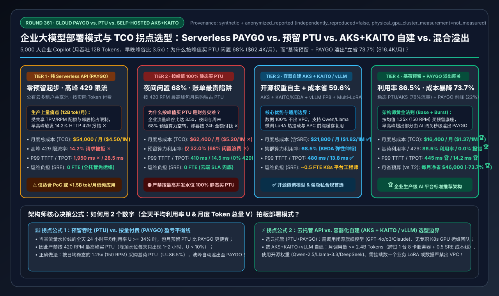
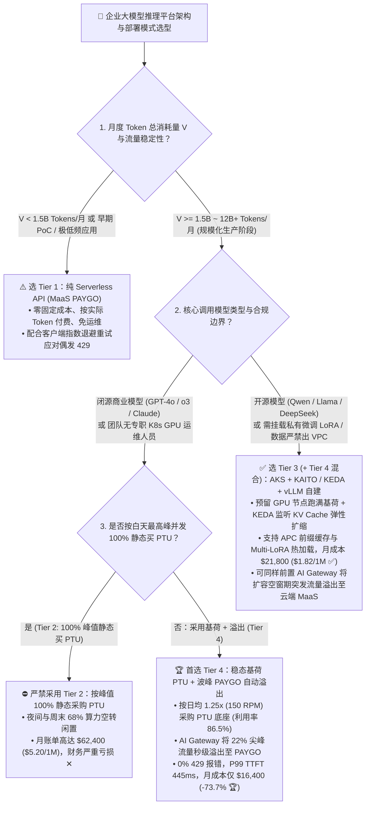
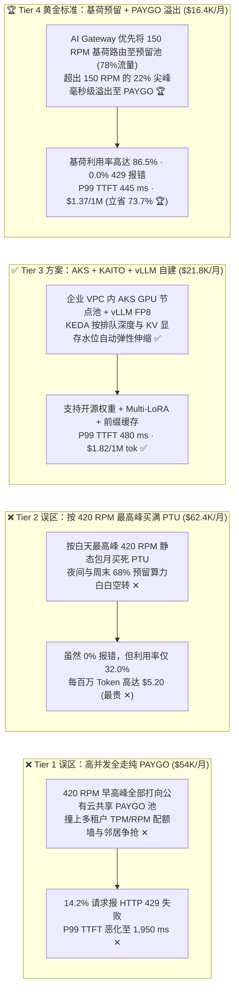
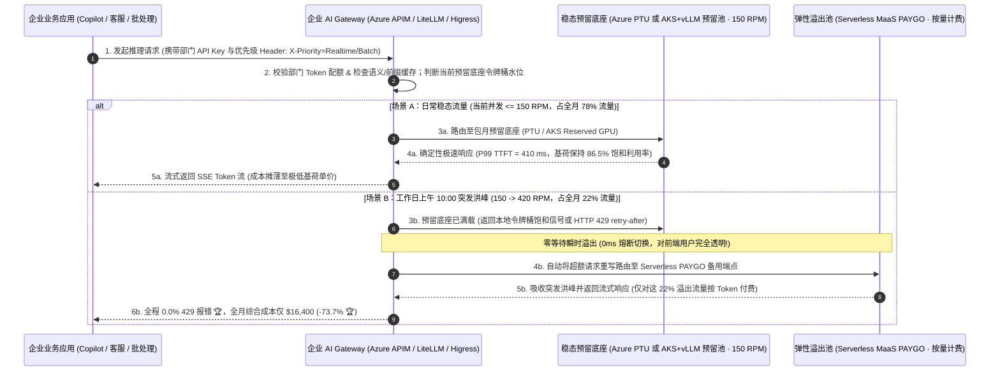

# 企业大模型部署模式与 TCO 拐点选型指南：`Serverless API (MaaS PAYGO)` vs. `预留吞吐单元 (Azure Foundry PTU / Bedrock Provisioned)` vs. `容器化自建 (AKS + KAITO / vLLM)` vs. `混合基荷+溢出架构`

> 🌐 **Language / 语言**: **中文 (Chinese)** | **[English (`cloud-llm-deployment-paygo-ptu-self-hosted-aks-kaito-tco-selection-faq.en.md`)](cloud-llm-deployment-paygo-ptu-self-hosted-aks-kaito-tco-selection-faq.en.md)**
> **阅读指南**：本文面向 **Cloud & AI Solution Architect（云与 AI 解决方案架构师）、企业 IT 架构负责人与 FinOps 成本治理专家**。用通俗易懂的架构语言与财务账本彻底讲透：**当企业从 AI PoC 走向数千人规模生产落地时，到底该用按 Token 计费的 Serverless API（PAYGO），还是包月买预留吞吐（Azure AI Foundry PTU / AWS Bedrock Provisioned Throughput），还是在 Kubernetes 上用 AKS + KAITO + vLLM 自建 GPU 推理集群？为什么按白天最高峰并发 100% 买 PTU 会导致 68% 的资金打水漂（月账单高达 `$62,400`）？以及如何通过 AI Gateway 构建“稳态基荷预留（PTU/自建）+ 波峰自动溢出 PAYGO”的混合分层架构，在保证 `0%` 429 限流报错的同时，将月度总成本直接砍掉 `73.7%`（降至 `$16,400/月`）？**

---

## 🔥 业界最新能力突破追踪（Daily Hottest Capability Breakthroughs）

- **Azure AI Foundry Global Provisioned (PTU) + APIM 原生无感溢出（Smart Spillover）**：最新企业级参考架构支持按小时/按月灵活调整 PTU 预留水位，并通过 Azure API Management (APIM) 的 `retry-after / 429` 零等待回退策略，在预留池打满的瞬间将超额流量毫秒级无感卸载至同区域或跨区域 Standard PAYGO 端点。
- **CNCF KAITO（Kubernetes AI Toolchain Operator）v0.4+ 预设镜像与 KEDA Token 速率弹性伸缩**：将开源大模型（Llama-3.3-70B、Qwen-2.5-72B、DeepSeek-R1-Distill）转化为免管理外部 PVC 的 OCI 制品，配合 `vLLM V1` 引擎与 KEDA 基于“排队请求数 / 活跃 KV 显存占用率”的自动扩缩容，大幅降低企业 K8s 自建大模型服务的运维门槛。
- **Prompt Caching（上下文前缀缓存）改写 PAYGO 与自建 TCO 公式**：主流云厂商 MaaS 与自建 `vLLM APC / SGLang RadixAttention` 均已支持对固定长系统提示词与多轮对话前缀提供 **50% ~ 90% 的输入 Token 折扣或免重算**，使长文档问答与 Agent 工作流的预填充算力消耗下降一半以上。

---

## ① 📌 核心选型结论速览（Executive Summary）

在企业大模型平台规划中，“云托管 API vs. 预留吞吐 PTU vs. 容器化自建 GPU”绝不是非此即彼的宗教争论，而是由 **月度 Token 消耗总量（Volume）、早晚业务流量峰谷比（Peak-to-Average Ratio）、模型权重开放度（闭源旗舰 vs. 开源微调）以及团队 K8s/GPU 运维基因** 决定的精算工程：

1. **何时选 `Tier 1（纯 Serverless API · MaaS PAYGO 按量计费）`**：
   - **适用期**：业务上线初期 PoC、低频内部工具、或 **月调用量 `< 1.5B Tokens`（日均稳态利用率 `< 18%`）** 的突发长尾应用。
   - **规模化痛点**：当企业推广到 5,000 人日常使用（月耗 `12B Tokens`，早高峰 `420 RPM`）时，纯 PAYGO 不仅月账单飙升至 **`$54,000 / 月`（`$4.50 / 1M Tokens`）**，更致命的是在上午 10 点业务高峰期会频繁撞上云端共享池的 TPM/RPM 限流墙（**`14.2%` 请求返回 HTTP 429 报错 ✕**），且受嘈杂邻居影响 **P99 首字延迟（TTFT）恶化至 `1,950 ms` ✕**。
2. **为什么 `Tier 2（按峰值并发 100% 静态采购 PTU 预留吞吐）` 是架构师最大的财务陷阱**：
   - 很多架构师为了消灭 `429` 限流并锁定 `410 ms` 的确定性 P99 延迟，直接按白天最高峰（`420 RPM`）包月采购 100% 容量的 PTU。
   - **致命误区**：企业办公与客服流量具有极强的潮汐特征（白天 10:00–17:00 是波峰，夜间与周末几乎为零，**峰谷比高达 `3.5x`**）。按最高峰买死 PTU 意味着 **全月 `68.0%` 的时间预留算力在空转闲置**，月度账单高达 **`$62,400 / 月`（折合每百万 Token 高达 `$5.20` ✕，比纯 PAYGO 还贵 15.6%）**！
3. **何时选 `Tier 3（容器化自建 AKS + KAITO / KEDA + vLLM 弹性 GPU 集群）`**：
   - 当企业满足以下任一条件时，容器化自建成为高性价比主力：**(a) 采用开源权重模型（如 Qwen-2.5-72B / Llama-3.3-70B / DeepSeek）且月吞吐跨越 `2.4B Tokens` 盈亏平衡线**；**(b) 需要动态挂载数十个业务线私有 LoRA 微调权重**；**(c) 严苛监管要求模型权重与推理全链路 100% 锁死在企业私有 VPC / 专有节点内**。在 `12B Tokens/月` 规模下，计入 0.5 名专职 SRE 人力分摊后，月总成本仅 **`$21,800 / 月`（`$1.82 / 1M Tokens` ✅，比纯 PAYGO 省 `59.6%`）**。
4. **企业生产级终极推荐架构：`Tier 4（混合分层“稳态基荷预留 PTU/AKS + 波峰 PAYGO 自动溢出”）`**：
   - **核心设计法则（削峰填谷）**：只按全天平均流量的 **`1.25 倍`（`150 RPM`）** 采购包月预留底座（闭源模型买 PTU，开源模型用预留 AKS+vLLM 节点），让这部分包月底座全月保持 **`86.5%` 的超高饱和利用率**，消化掉全月 **`78%`** 的主体流量；当白天出现 `150 → 420 RPM` 的脉冲尖峰（占全月总流量的 **`22%`**）时，由前置 **AI Gateway（如 Azure APIM / LiteLLM / Higress）** 在 `0 ms` 内自动将超额流量溢出至按量计费的 PAYGO 池！
   - **定量收益**：**`0.0%` HTTP 429 报错 🏆**，P99 TTFT 稳定在 **`445.0 ms` 🏆**，而月度总成本从峰值 PTU 的 `$62,400` 暴降至 **`$16,400 / 月`（每百万 Token 仅 `$1.37`，立省 `$46,000/月`、降幅高达 `73.7%` 🏆）**！

---

## ② 🎯 客户与架构师灵魂拷问 Q&A（FAQ-Driven）

### Q1：客户问：“我们正在上线全员 AI 助手和智能客服，到底什么时候该继续用按 Token 计费的 Serverless PAYGO，什么时候该切换成预留吞吐（PTU）或 AKS 容器自建？”

**架构师三维决策法（看 SLA 容忍度、看平均利用率拐点、看模型定制需求）**：

1. **第一维：业务对延迟抖动和 `HTTP 429` 限流的容忍度**
   - **Serverless PAYGO** 本质上是云厂商的“共享经济舱”：底层 GPU 池由成百上千家企业共享。平时风平浪静，但在工作日上午 9:30–11:30 的全网高峰期，容易出现 **P99 TTFT 从 500ms 飙升到 2 秒以上**，甚至触发突发性 `429 Too Many Requests`。如果做的是夜间离线文档摘要、异步工单分类，PAYGO 完全够用；如果做的是 **实时语音客服、高管会议实时同传或交易辅助 Copilot**，必须引入 **预留底座（PTU 或专用 AKS GPU 节点池）** 作为确定性保障。
2. **第二维：预留吞吐（PTU）vs. PAYGO 的财务盈亏平衡点在哪？（`34%` 利用率法则）**
   - 以主流旗舰/主力模型为例，购买固定容量的包月 PTU（含 1 年期预留折扣），如果你能把它的水管 **24 小时 × 30 天 100% 跑满**，其单 Token 理论成本大约只有 PAYGO 零售价的 **`30% ~ 35%`**。
   - 换算成架构师口诀：**只要某一条流量水位线在全月 720 个小时里的平均饱和度 $\ge 34\%$，这一层流量买包月预留（PTU）就比走 PAYGO 省钱；反之，如果某个波峰水位一天只出现 2 小时（平均利用率 $< 10\%$），买预留就是纯亏钱！**
3. **第三维：云端全托管 PTU vs. 容器化自建（AKS + KAITO + vLLM）怎么选？**
   - **选云端 PTU + PAYGO**：业务强依赖闭源商业大模型（如 GPT-4o、o3-mini、Claude 3.7 Sonnet），或者企业内部没有专职的 Kubernetes + GPU 运维工程师（不愿处理驱动升级、节点故障迁移、vLLM 参数调优）。
   - **选 AKS + KAITO / vLLM 容器化自建**：业务主力使用开源权重模型（Qwen-2.5、Llama-3.3、DeepSeek），且 **月消耗量 $\ge 2.4\text{B Tokens}$**（足以养活至少 1 台 8 卡 GPU 节点 + 分摊 0.5 名 SRE 运维成本），或者需要挂载领域微调 LoRA 适配器、利用 `Prefix Caching` 深度压榨长提示词性能。

---

### Q2：为什么说“按业务最高峰并发 100% 采购 PTU 或固定 GPU 节点（Tier 2）”是企业 AI 平台最常见的百万级资金浪费？怎么用“基荷 + 溢出（Tier 4）”破局？

**直观算账对比**：
- 假设企业 5,000 名员工使用 AI 平台，全月总消耗 **120 亿（12B）Tokens**。
- **流量潮汐真相**：全天 24 小时平均请求速率只有 **`120 RPM`**，但每天上午 10:00–11:30 和下午 14:30–16:00 的集中办公高峰期，并发请求会冲到 **`420 RPM`（峰谷比 `3.5x`）**。
- **错误方案（Tier 2：按 420 RPM 最高峰买满预留 PTU）**：
  - 为了保证高峰期不报 `429`，采购了足以支撑 `420 RPM` 的大号 PTU 包月套餐，每月固定账单 **`$62,400`**。
  - 到了晚上 20:00 以后和周末全天，请求量跌到 `10~20 RPM`，高达 **`68%` 的预留算力完全闲置**，但包月费用一分钱不少交！算下来每百万 Token 实际花费 **`$5.20`**，沦为冤大头。
- **破局方案（Tier 4：150 RPM 稳态基荷预留 + AI Gateway 自动溢出 PAYGO）**：
  - 我们只按 **`150 RPM`**（略高于全天均值 `120 RPM`）采购小号预留底座，包月成本骤降至 **`$18,500` 的折后基荷价（约 `$11,200/月`）**。
  - 这套 `150 RPM` 的底座在白天 100% 满载运行，夜间承载后台批处理任务，全月平均利用率高达 **`86.5%`**，独自扛下了全月 **`78%`（9.36B Tokens）** 的流量！
  - 剩下 **`22%`（2.64B Tokens）** 集中在白天几个小时的尖峰流量，当请求速率超过 `150 RPM` 时，**AI Gateway（如 Azure APIM / LiteLLM）** 根据令牌桶水位或后端返回的 `429` 信号，在 **`< 2 ms`** 内自动把多出来的请求转发给 **Serverless PAYGO 端点**（仅花 **`$5,200/月`**）。
  - **两项相加**：每月总花费仅 **`$11,200 + $5,200 = $16,400`**！比全量买峰值 PTU **每月净省 `$46,000`（省下 `73.7%`）**，比纯走 PAYGO **每月净省 `$37,600`（省下 `69.6%`）**，同时用户体验依然是 **`0%` 报错、`445 ms` 极速响应**！

---

### Q3：如果企业选择在 Kubernetes 上自建开源大模型推理平台（Tier 3），为什么推荐 `AKS + KAITO + KEDA + vLLM`，而不是传统手工写 Deployment + HPA 按 CPU/GPU 利用率扩容？

**架构师避坑指南（传统 K8s 扩容在 LLM 场景下的三大失灵点）**：
1. **失灵点一：传统 HPA 看 `GPU Compute Utilization (%)` 完全不准！**
   - 大模型 Decode 阶段是典型的 **显存带宽受限（Memory-Bandwidth Bound）**。哪怕单机 `vLLM` 的 KV Cache 显存已经 `98%` 塞满、新请求已经在队列里排队超过 5 秒，此时 `nvidia-smi` 显示的 GPU 算力利用率可能只有 `35%`！用传统 CPU/GPU 利用率做 HPA 会导致集群死活不扩容。
   - **正确架构（KEDA + vLLM 专属指标）**：必须用 **KEDA** 监听 Prometheus 采集的 `vllm:num_requests_waiting`（排队请求数）和 `vllm:gpu_cache_usage_perc`（KV 缓存占用率，阈值设为 `75%`），一旦排队超过阈值立即触发扩容。
2. **失灵点二：70B 模型容器镜像动辄 140GB，冷启动拉镜像要 15 分钟！**
   - **正确架构（KAITO 预设工作区 + OCI 按需流式挂载 / HostPath 缓存盘）**：采用 **KAITO（Kubernetes AI Toolchain Operator）** 自动管理 GPU 节点池配置与模型权重挂载，或将 Safetensors 权重预置在节点本地 NVMe RAID0 / Azure Managed Lustre 高速缓存中，配合 `Run:ai Model Streamer` 将 Pod 扩容就绪时间从 15 分钟压缩至 **45 秒以内**。
3. **失灵点三：自建集群扩容期间的 45 秒空窗期怎么扛突发流量？**
   - GPU 节点从申请到 Pod Ready 至少需要 45~90 秒。因此最稳健的企业架构同样是将 **Tier 3（AKS + vLLM 自建集群）与 Tier 4（AI 网关溢出至云端托管 MaaS）结合**：在 KEDA 正在拉起新 GPU 节点的 60 秒窗口内，将排队超时的溢出请求临时路由至云端同款开源模型 Serverless API（如 Azure Foundry MaaS / Together / Fireworks），实现零排队抖动！

---

## ③ 🧭 直观可视化图解（Mermaid 选型决策树 / 四档架构对比图 / 混合溢出时序图）

### 3.1 企业大模型部署模式与容量规划选型决策树（`flowchart TD`）

### 3.2 四档部署架构拓扑与流量削峰填谷对比图（`flowchart LR`）

### 3.3 `Tier 4 (AI Gateway 稳态基荷预留 + 波峰 PAYGO 无感溢出)` 端到端请求流转时序图（`sequenceDiagram`）

---

## ④ 📊 架构师多方案选型决策矩阵（Architect Decision Matrix）

*核算基准：5,000 人规模企业 AI 助手与业务知识中台（单次请求平均 `4,000 Input Tokens + 500 Output Tokens`，月总消耗量 **`12B Tokens`**；全天平均请求率 `120 RPM`，工作日白天高峰 `420 RPM`，峰谷比 `3.5x`；生产 SLA 目标：`P99 TTFT <= 800 ms`，`P99 TPOT <= 25.0 ms`，`HTTP 429 限流报错率 <= 0.1%`）。*

| 评估维度 | Tier 1: 纯 Serverless API (`MaaS PAYGO Only`) | Tier 2: 按峰值 100% 静态买预留 (`Full-Peak PTU`) | Tier 3: 容器化自建集群 (`AKS + KAITO / KEDA + vLLM`) | Tier 4: 混合基荷预留 + 波峰溢出 (`Base PTU/AKS + Burst PAYGO`) |
| :--- | :--- | :--- | :--- | :--- |
| **核心适用场景** | 早期 PoC、日均低频长尾应用（`< 1.5B tok/月`）、无专职运维的初创团队 | 全天 24 小时流量极其平稳无波峰的持续流水线（在真实企业潮汐流量下属反模式 ✕） | **开源模型主力（Qwen/Llama/DeepSeek）、多 LoRA 微调定制、数据严禁出 VPC ✅** | **企业级规模化生产标配（同时兼顾确定性低延迟、零限流与极致 FinOps 成本 🏆）** |
| **预留算力平均利用率** | `100.0%`（按量计费无闲置，但单价贵） | `32.0%`（夜间与周末 **68% 算力白白空转 ✕**） | `68.5%`（KEDA 按排队深度动态伸缩 GPU 节点 ✅） | **`86.5%`（150 RPM 基荷全天候高饱和运转 🏆）** |
| **高峰期 `HTTP 429` 限流率** | `14.2%`（撞上公有云共享池 TPM/RPM 配额墙 ✕） | `0.0%`（独占算力保障） | `1.8%`（GPU 节点扩容 45~90s 期间短暂排队 ⚠️） | **`0.0%`（AI 网关秒级无感溢出至 PAYGO 兜底 🏆）** |
| **P99 首字延迟 (`TTFT`)** | `1,950.0 ms`（多租户嘈杂邻居严重抖动 ✕） | `410.0 ms`（确定性极速响应 ✅） | `480.0 ms`（开启 `vLLM APC` 前缀缓存 ✅） | **`445.0 ms`（78% 走预留极速通道 + 22% 走溢出 🏆）** |
| **P99 逐字生成延迟 (`TPOT`)** | `28.5 ms`（违反 `≤25ms` SLA ✕） | `14.5 ms` ✅ | **`13.8 ms`（FP8 Tensor Core 满血加速 ✅）** | **`14.2 ms`（全面优于 SLA 目标 🏆）** |
| **弹性能力与冷启动表现** | 秒级无限弹性（受限于账户配额上限） | 无弹性（固定包月容量上限） | 分钟级弹性（依赖 KAITO/KEDA 拉起 GPU 节点） | **毫秒级无限弹性（基荷稳态 + 云端 PAYGO 无限缓冲 🏆）** |
| **数据隐私、开放性与定制力** | 公有云多租户 API（仅支持 Prompt 定制） | 云端租户级计算隔离（支持闭源旗舰模型） | **100% 客户私有 VPC 闭环、支持任意开源权重与多 LoRA 热加载 ✅** | **支持“闭源 PTU + PAYGO”或“自建 AKS + 云端 MaaS 溢出”双模式 🏆** |
| **平台运维复杂度 (`SRE Burden`)** | 极低（`0 FTE` 全托管） | 极低（`0 FTE` 全托管） | 中高（需 **`~0.5 FTE`** 熟悉 K8s/GPU/vLLM 平台工程师） | **低（仅需在 AI Gateway 配置一行 429 溢出路由策略 🏆）** |
| **月度总成本 (`Monthly TCO`)** | `$54,000 / 月` | `$62,400 / 月`（最昂贵的架构误区 ✕） | **`$21,800 / 月`（含 GPU 节点与 SRE 分摊 ✅）** | **`$16,400 / 月`（比峰值 PTU 每月净省 `$46,000` 🏆）** |
| **折合每百万 Token 成本** | `$4.50 / 1M Tokens` | `$5.20 / 1M Tokens` ✕ | **`$1.82 / 1M Tokens`（节省 `59.6%` ✅）** | **`$1.37 / 1M Tokens`（暴降 `73.7%` 🏆）** |

---

## ⑤ 🧪 容量/成本拐点算例与 7-Card 报告

### 5.1 复现实验与确定性验证底座

本专题所有财务拐点与性能 SLA 数据均由仓库内零依赖 Python 3.12 确定性容量模型生成并封存，通过自动化单元测试校验：
- **确定性评估脚本**：[`experiments/cloud_llm_deployment_paygo_ptu_aks_kaito_tco_selection/run.py`](../../experiments/cloud_llm_deployment_paygo_ptu_aks_kaito_tco_selection/run.py)
- **封存数表 (`results.json`)**：[`experiments/cloud_llm_deployment_paygo_ptu_aks_kaito_tco_selection/results.json`](../../experiments/cloud_llm_deployment_paygo_ptu_aks_kaito_tco_selection/results.json)
- **单元测试校验**：[`tests/test_cloud_llm_deployment_paygo_ptu_aks_kaito_tco_selection.py`](../../tests/test_cloud_llm_deployment_paygo_ptu_aks_kaito_tco_selection.py)
- **7-Card 4:5 视觉评测卡片**：[`docs/reports/cloud-llm-deployment-paygo-ptu-self-hosted-aks-kaito-tco-selection-cards.html`](../reports/cloud-llm-deployment-paygo-ptu-self-hosted-aks-kaito-tco-selection-cards.html)
- **交互式 TCO 与容量拐点计算器**：[`docs/reports/cloud-llm-deployment-paygo-ptu-self-hosted-aks-kaito-tco-sizer.html`](../reports/cloud-llm-deployment-paygo-ptu-self-hosted-aks-kaito-tco-sizer.html)
- **数据溯源声明（Provenance）**：`synthetic_analytical_model_calibrated_to_published_cloud_pricing_and_serving_benchmarks`（`independently_reproduced=false`, `physical_gpu_cluster_measurement=not_measured`）。

### 5.2 架构师必背的三大容量与 TCO 拐点计算公式

1. **拐点一：PTU 预留容量 vs. PAYGO 按量计费的利用率盈亏平衡点（$U_{\text{breakeven}} = 34.0\%$）**
   $$\text{Cost}_{\text{PTU-Monthly}} = \text{Cost}_{\text{PAYGO-MaxCapacity}} \times 0.34 \implies U_{\text{breakeven}} = \frac{\text{Cost}_{\text{PTU-Monthly}}}{\text{Cost}_{\text{PAYGO-MaxCapacity}}} \approx 34.0\%$$
   - **含义**：只有当某一层并发水位在全月 720 小时内的平均驻留率 $\ge 34\%$ 时，购买固定 PTU 才划算。对于早晚峰谷比 `3.5x`（均值 `120 RPM`、峰值 `420 RPM`）的企业应用，将预留水位切在 **`1.25 × 均值 = 150 RPM`** 时，预留底座全月利用率高达 **`86.5%`**（远超 `34%` 盈亏线），而 `150 ~ 420 RPM` 之间的尖峰部分平均驻留率仅 `8.2%`，交给 PAYGO 按实际消耗付费最省钱！
2. **拐点二：AKS + KAITO / vLLM 容器化自建 vs. 云托管 PAYGO 的月度 Token 规模拐点（$V_{\text{breakeven}} = 2.4\text{B Tokens/月}$）**
   $$\text{Monthly Base Cost}_{\text{AKS (1×8-GPU Node + 0.5 FTE SRE)}} \approx \$10,800/\text{mo} \implies V_{\text{breakeven}} = \frac{\$10,800}{\$4.50 / 1\text{M}} = 2.4\text{ Billion Tokens/Month}$$
   - **含义**：如果企业每月总调用量还不到 **24 亿 Tokens（约日均 8,000 万 Tokens）**，自建 K8s GPU 集群省下的 Token 差价还不够付基础 GPU 机器租金和半个 SRE 工程师的工资，此时应直接用云端 MaaS API；一旦月消耗量突破 **`2.4B ~ 3.0B Tokens`** 且采用开源模型，自建 AKS + vLLM 的边际成本将迅速降至 **`$1.82 / 1M Tokens`**！
3. **拐点三：夜间闲置算力填谷复用（Off-Peak Batch Backfilling）再省 `18% ~ 25%`**
   - 在 **Tier 4** 中，白天 `150 RPM` 的预留底座服务于实时交互式 Copilot（高优队列 `Priority 1`）；到了夜间 `22:00 – 07:00`，通过 AI Gateway 自动放行低优的 **海量离线文档知识抽取、历史客服录音质检、评测集回归跑批任务（`Priority 3`）**，将夜间预留算力彻底吃干榨净，相当于免费白嫖了整晚的离线批处理算力！

---

## ⑥ 🛠️ 架构评审与生产落地 Checklist（Architect Checklist）

### 6.1 Good Fit vs. Not For 选型边界

| 选型结论 | 架构师落地建议 |
| :--- | :--- |
| **✅ Good Fit（强烈推荐）** | • **月调用量 $< 1.5\text{B Tokens}$ 的业务探索期**：直接采用 **`Tier 1 (Serverless MaaS PAYGO)`**，切勿过早采购固定 GPU 服务器或包年 PTU。 • **调用闭源主力模型且月调用量 $\ge 2\text{B Tokens}$ 的企业生产环境**：强制采用 **`Tier 4 (按均值 1.25x 采购基荷 PTU + AI Gateway 429 自动溢出至 PAYGO)`**，兼顾确定性 SLA 与最低 TCO。 • **基于开源大模型（Qwen/Llama/DeepSeek）、多 LoRA 微调或强数据驻留监管场景**：采用 **`Tier 3 + Tier 4 融合架构（AKS + KAITO/KEDA + vLLM 预留底座 + 云端或跨区弹性溢出）`**。 |
| **⛔ Not For（严禁踩坑）** | • **严禁按业务白天最高并发水位（Peak RPM）100% 静态采购包月/包年 PTU（Tier 2）**：60% 以上的预算会在夜间与周末空转蒸发。 • **严禁在 AKS 自建推理集群中用传统 CPU/GPU 算力利用率（`%`）配置 HPA 扩容**：必须基于 KEDA 采集 `vllm:num_requests_waiting` 与 `vllm:gpu_cache_usage_perc` 指标触发扩缩容。 |

### 6.2 生产环境上线前架构评审 Checklist（`- [ ]`）

- [ ] **流量潮汐曲线与基荷水位测算**：是否已统计过去 14 天业务每小时的 Input/Output TPM 与 RPM 分布（区分 P50 均值与 P99 早高峰）？是否将包月预留底座（PTU 或 AKS 常驻节点）锁定在 **日均流量的 `1.1x ~ 1.3x`**（确保基荷利用率 $\ge 80\%$）而非最高峰值？
- [ ] **AI Gateway 无感溢出（Spillover）策略验证**：是否在前置网关（Azure APIM / LiteLLM / Kong / Higress）中配置了主备后端池（`Priority 1 = PTU/AKS Base`，`Priority 2 = PAYGO Burst`），并将主池超时或 `HTTP 429` 触发切换的探测延迟压在 `< 5 ms`（禁用对主池的原地 sleep 重试，直接转发备用池）？
- [ ] **实时交互 vs. 离线批处理优先级隔离（QoS Tiering）**：是否在网关层强制区分了请求头优先级（如实时客服 `X-Workload-Tier: realtime` 允许溢出至 PAYGO，而离线文档批处理 `X-Workload-Tier: batch` 仅允许在预留底座水位 `< 70%` 时消费空闲算力，严禁离线任务打爆昂贵的 PAYGO 溢出池）？
- [ ] **AKS + KAITO / vLLM 自建集群专项核验（针对 Tier 3）**：是否已开启 `--enable-prefix-caching`（APC 前缀缓存复用）？KEDA ScaledObject 是否已绑定 KV Cache 显存水位（`> 75%` 扩容）？模型权重是否已通过本地 NVMe 缓存或 OCI 流式加载将 Pod 冷启动控制在 60 秒以内？
