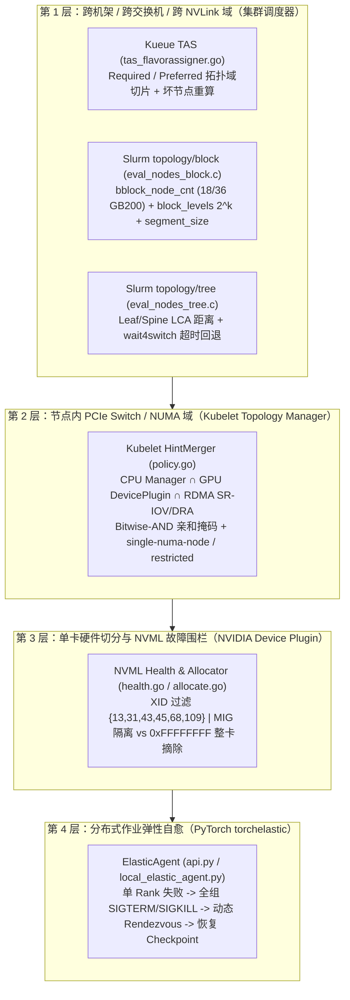

# 集群调度、拓扑感知与多租户故障隔离：Kubernetes (Topology Manager / Kueue TAS)、Slurm (`topology/block` & `tree`)、NVIDIA Device Plugin 与 PyTorch `torchelastic` 源码深挖

- **组件归属**：AI Infra 全栈研究第 9 层（集群与运维：Slurm vs Kubernetes、GPU/RDMA 拓扑感知调度、MIG/Time-Slicing 隔离、健康监控、弹性容错与 Goodput）
- **先修依赖**：[分布式训练并行策略与通信重叠](training-parallelism.md)、[Prefill/Decode 分离与推理 SLO 调度](inference-slo.md)、[RDMA Verbs 生命周期与队列语义](rdma-lifecycle.md)
- **面向对象**：需要设计百卡至万卡级 GPU/RDMA 训练与推理集群、定位跨 NUMA/跨 Leaf 交换机降速根因、规划 MIG/Time-Slicing 多租户隔离边界并量化故障恢复有效吞吐（Goodput）的云解决方案架构师
- **核验日期**：`2026-10-17`（UTC+08:00）
- **证据等级**：
  - `implementation`：固定版本源码核验——Kubernetes `v1.37.1`（`commit: f78e722310e50bcaca9276be22276d9e91d91308`，`2026-09-23`）、Kueue `v0.20.2`（`commit: 296ec3db567abbe36b65a63695710e3d3f3d0bdb`，`2026-10-15`）、NVIDIA `k8s-device-plugin` `v0.20.1`（`commit: 487d7a93894b0f3ad08097169593972eb3ca8206`，`2026-09-22`）、Slurm `slurm-26-05-5-1`（`commit: ad46cad8e0969e8e5945b88f0a21f6bed0f9a3bf`，`2026-10-13`）、PyTorch `v2.6.0` `torchelastic`（`commit: 1eba9b3aa3c43f86f4a2c807ac8e12c4a7767340`，`2025-01-29`）
  - `own-offline`：本仓库原创标准库解析算例 [`experiments/cluster_orchestration/`](../../experiments/cluster_orchestration/README.md)
  - **未包含**：真实生产集群压测、物理 GPU 注入 XID 或跨机架交换机故障演练（`own-hardware` 未执行）

---

## 1. 一手源码锚点与全栈定位

| 来源 ID | 仓库与固定版本 | 源码路径与 Git Blob SHA | 核心核验内容 |
|---|---|---|---|
| `k8s-kubelet-topology-policy` | `kubernetes/kubernetes@f78e722310e50bcaca9276be22276d9e91d91308` (`v1.37.1`, `2026-09-23`) | `pkg/kubelet/cm/topologymanager/policy.go` (`blob: aa332216e336dc8e6bf11e84c2787ac81e5ef020`, `L1–361`) | `mergePermutation` 按位与（Bitwise-AND）合并 CPU/GPU/RDMA NIC 亲和掩码、笛卡尔积遍历 $O(\prod_p |H_p|)$ 与 `Narrowest` vs `PreferClosestNUMA` 比较器 |
| `k8s-kubelet-topology-single-numa` | `kubernetes/kubernetes@f78e722310e50bcaca9276be22276d9e91d91308` (`v1.37.1`, `2026-09-23`) | `pkg/kubelet/cm/topologymanager/policy_single_numa_node.go` (`blob: 1ba0cf263540c60d726546c58cf107478400e9c6`, `L1–77`) | `filterSingleNumaHints` 仅保留 `Count() == 1 && Preferred` 提示，不满足时由 `canAdmitPodResult` 拒绝 Pod（`TopologyAffinityError`） |
| `k8s-kubelet-topology-restricted` | `kubernetes/kubernetes@f78e722310e50bcaca9276be22276d9e91d91308` (`v1.37.1`, `2026-09-23`) | `pkg/kubelet/cm/topologymanager/policy_restricted.go` (`blob: 3fb198350d1516c3c251978be901a25a6d7b0afb`, `L1–49`) | `restricted` 策略复用 `best-effort` 合并器但要求最终 `bestHint.Preferred == true`，支持整机 8-GPU 跨双 NUMA 正常准入 |
| `kueue-tas-flavorassigner` | `kubernetes-sigs/kueue@296ec3db567abbe36b65a63695710e3d3f3d0bdb` (`v0.20.2`, `2026-10-15`) | `pkg/scheduler/flavorassigner/tas_flavorassigner.go` (`blob: dd805ecc886b5ef4fa02dff78ea924c9782c7b03`, `L1–278`) | Topology-Aware Scheduling (TAS) 域构建、`HasUnhealthyNode` 坏节点域剔除、弹性 Slice 作业与显式 `Required`/`Preferred` 拓扑请求互斥校验 |
| `nvidia-k8s-device-plugin-health` | `NVIDIA/k8s-device-plugin@487d7a93894b0f3ad08097169593972eb3ca8206` (`v0.20.1`, `2026-09-22`) | `internal/rm/health.go` (`blob: dda16015a384f8aaf9722141a42e7c1999c2c94f`, `L1–363`) | NVML XID 监听、默认忽略应用级 XID `{13,31,43,45,68,109}`，以及通过 `<parentUUID, GpuInstanceId, ComputeInstanceId>` 实现 MIG 切片级 vs 整卡级故障隔离 |
| `nvidia-k8s-device-plugin-allocate` | `NVIDIA/k8s-device-plugin@487d7a93894b0f3ad08097169593972eb3ca8206` (`v0.20.1`, `2026-09-22`) | `internal/rm/allocate.go` (`blob: adf29703f5aa1fd19372166270a646803ad25820`, `L1–185`) | Time-Slicing 虚拟副本的 `distributed`（最小堆打散）与 `packed`（最大堆紧凑）贪心分配器及 `pickedFrom` 轮转消歧 |
| `slurm-topology-block` | `SchedMD/slurm@ad46cad8e0969e8e5945b88f0a21f6bed0f9a3bf` (`slurm-26-05-5-1`, `2026-10-13`) | `src/plugins/topology/block/eval_nodes_block.c` (`blob: 464ea4ce620c278a985bd2b99059169808221ac2`, `L1–1291`) | NVLink/Rail 域 `bblock_node_cnt`、`block_levels` 2 的幂次向上吸附、`--segment` 整除与 `SPREAD_SEGMENTS`、`_choose_best_bblock` 紧致度反碎片选择 |
| `slurm-topology-tree` | `SchedMD/slurm@ad46cad8e0969e8e5945b88f0a21f6bed0f9a3bf` (`slurm-26-05-5-1`, `2026-10-13`) | `src/plugins/topology/tree/eval_nodes_tree.c` (`blob: 8e8fb1e598404d711899813e9e6c925380b3e2d9`, `L1–1475`) | `_topo_compare_switches` 树型 LCA 距离与最小可用交换机优先、`req_switch` / `wait4switch` 超时回退与 `try_again` 节点缩减循环 |
| `pytorch-elastic-agent` | `pytorch/pytorch@1eba9b3aa3c43f86f4a2c807ac8e12c4a7767340` (`v2.6.0`, `2025-01-29`) | `torch/distributed/elastic/agent/server/api.py` (`blob: a056da2a19256339bbb959643fac33bf47af7791`, `L1–957`) & `local_elastic_agent.py` (`blob: 8abb092fdff3abbd42aab83e7f9ddb9b1f8d2f43`, `L1–417`) | `_monitor_workers` 单 Rank 异常触发全组 `_stop_workers`（`SIGTERM` $\to$ `SIGKILL`）$\to$ `_restart_workers`（动态 Rendezvous + 重建 TCPStore）、热节点加入免扣 `remaining_restarts` |

---

## 2. 为什么云架构师在 AI 集群中不能沿用通用微服务的“无状态装箱”思维？

在传统云原生微服务中，Pod 之间通过 TCP/IP 弱耦合通信，单机内部跨 NUMA 访问或跨机架放置仅增加数微秒尾延迟；但在 **GPU + RDMA（RoCEv2 / InfiniBand）+ NVLink** 集群中，调度器与节点资源管理器的每一个比特决策都会直接触发物理带宽断崖：



1. **节点内（Intra-Node）PCIe / NUMA 错位断崖**：
   在典型双路 8-GPU 服务器中，`GPU0–3` 与 `mlx5_0–3` 挂载在 `NUMA 0` 的 PCIe Root Complex / PCIe Switch 下，`GPU4–7` 与 `mlx5_4–7` 挂载在 `NUMA 1` 下。若容器申请 `1 GPU + 1 RDMA NIC + 16 CPU`，而 Kubelet 从 `NUMA 0` 分配了 `GPU0`、却从 `NUMA 1` 分配了 `mlx5_4`，则 [RDMA Verbs 生命周期](rdma-lifecycle.md) 中的 GPUDirect RDMA 无法走同颗 PCIe Switch 的 P2P 直通路径，所有 DMA 流量被迫穿越 CPU Socket 间的 UPI/QPI/Infinity Fabric 互连，单向有效带宽可从 `50 GB/s`（`400 Gb/s` NDR/RoCE）暴跌 40%–60% 并污染主机内存控制器。
2. **机架/集群间（Inter-Node）Block 与 Leaf 交换机碎片**：
   在 [分布式训练并行策略](training-parallelism.md) 中，TP（Tensor Parallelism）要求全部 Rank 严格落在同一个高带宽 NVLink 域（如单机 8 卡或 GB200 NVL72 的 18 个计算节点 `bblock`），而 DP/PP 跨 Leaf 交换机通信若被分散到过多非满配交换机，会在 Spine 层引发 ECMP 哈希碰撞与 PFC 队头阻塞。
3. **单卡故障爆炸半径与 Gang 同步恢复成本**：
   在 $N$ 节点同步训练中，任意 1 个 Rank 触发致命硬件 XID（如 XID 48 双比特 ECC 或 XID 79 掉卡），其余 $N-1$ 个节点会在数秒内阻塞于 NCCL Collective 或触发 Watchdog 超时。集群总有效训练时间占比（**Goodput**）直接由“节点故障率 $\lambda_{\text{cluster}} = N / \text{MTBF}_{\text{node}}$”与“单次故障恢复耗时（节点重调度 + Rendezvous + Checkpoint 回滚重算）”共同决定。

---

## 3. 节点内拓扑对齐：Kubernetes Kubelet Topology Manager 源码解构

### 3.1 `mergePermutation` 的按位与（Bitwise-AND）与相等性硬判据

在固定版本 `kubernetes/kubernetes@f78e722310e50bcaca9276be22276d9e91d91308`（`v1.37.1`）的 [`pkg/kubelet/cm/topologymanager/policy.go`](https://github.com/kubernetes/kubernetes/blob/f78e722310e50bcaca9276be22276d9e91d91308/pkg/kubelet/cm/topologymanager/policy.go)（`L44–69`）中，Kubelet 并非由某个集中调度器直接指定物理设备号，而是向所有 **HintProvider**（`cpuManager`、`deviceManager`、`draManager` 等）收集候选 `TopologyHint{NUMANodeAffinity: bitmask, Preferred: bool}` 列表，再通过 `mergePermutation` 合并每个资源维度的单个候选提示：

```go
// pkg/kubelet/cm/topologymanager/policy.go:44-69
func mergePermutation(numaNodes []int, hints []TopologyHint) TopologyHint {
    var numaAffinities []bitmask.BitMask
    preferred := true
    defaultAffinity, _ := bitmask.NewBitMask(numaNodes...)

    for _, hint := range hints {
        if hint.NUMANodeAffinity == nil {
            continue
        }
        numaAffinities = append(numaAffinities, hint.NUMANodeAffinity)
        // Only mark preferred if all affinities are equal AND all hints are preferred.
        if !hint.NUMANodeAffinity.IsEqual(numaAffinities[0]) {
            preferred = false
        }
        preferred = preferred && hint.Preferred
    }
    affinity := bitmask.And(defaultAffinity, numaAffinities...)
    if affinity.IsEmpty() {
        affinity = defaultAffinity
        preferred = false
    }
    return TopologyHint{affinity, preferred}
}
```

这段 25 行代码包含三个经常被云架构师忽略的精确语义：
1. **掩码全等要求（`!hint.NUMANodeAffinity.IsEqual(numaAffinities[0])`）**：
   即使两个资源的 NUMA 掩码交集非空（例如 GPU 返回 `0b01`（NUMA 0），而 CPU Manager 因为某种原因返回 `0b11`（NUMA 0+1）），虽然 `bitmask.And` 得到 `0b01`，但由于 `0b11 != 0b01`，合并后的 `preferred` 会被强制置为 **`false`**！
2. **空交集回退为全节点掩码（`affinity.IsEmpty()`）**：
   若 GPU 只剩 `NUMA 0`（`0b01`），而 SR-IOV RDMA NIC 只剩 `NUMA 1`（`0b10`），二者按位与为空（`0b00`）。此时 `mergePermutation` 将 `affinity` 重置为 `defaultAffinity`（全部 NUMA 节点 `0b11`）且 `preferred = false`。
3. **笛卡尔积复杂度与 8-NUMA 状态上限（`L303–358`）**：
   `HintMerger.Merge` 调用 `iterateAllProviderTopologyHints` 遍历所有 Provider 候选提示的笛卡尔积，时间复杂度为：
   $$T_{\text{merge}} = O\!\left(\prod_{p=1}^{P} |H_p|\right)$$
   因为在包含 $U$ 个 NUMA 节点的机器上，单个 Provider 最多可生成 $2^U - 1$ 个非空 NUMA 子集掩码，Kubernetes 将单机最大支持 NUMA 节点数限制在 `8`（$2^8 - 1 = 255$），防止多设备容器在 Kubelet 准入阶段发生组合爆炸。

### 3.2 四种准入策略与 `PreferClosestNUMA` 距离矩阵

在 [`policy_single_numa_node.go`](https://github.com/kubernetes/kubernetes/blob/f78e722310e50bcaca9276be22276d9e91d91308/pkg/kubelet/cm/topologymanager/policy_single_numa_node.go)（`L46–76`）与 [`policy_restricted.go`](https://github.com/kubernetes/kubernetes/blob/f78e722310e50bcaca9276be22276d9e91d91308/pkg/kubelet/cm/topologymanager/policy_restricted.go)（`L34–48`）中，Kubelet 区分了四档策略：

| Kubelet 策略 | 过滤与选优规则 | `canAdmitPodResult` 拒绝条件 | AI 集群适用场景与典型踩坑反例 |
|---|---|---|---|
| `none` | 不查询 HintProvider，直接分配 | 永不因拓扑拒绝 | 仅用于纯 CPU 或对 PCIe 带宽不敏感的轻量任务 |
| `best-effort` | 遍历全部排列，优先选 `Preferred == true` 且掩码最窄（`Narrowest`）的提示 | 永不拒绝（若不满足则退化为跨 NUMA 分配） | 混部集群默认安全网；但在 NIC/GPU 耗尽不均时会静默产生跨 Socket P2P 慢节点 |
| `restricted` | 与 `best-effort` 使用相同的 `mergeHints`，保留最小可能 NUMA 跨度 `BestNonPreferredAffinityCount` | **`!bestHint.Preferred` 时拒绝 Pod**（`TopologyAffinityError`） | **8-GPU 整机训练 Pod 的推荐策略**：当容器申请整机 8 卡（跨 2 个 NUMA）时，Provider 将 `0b11` 标为 `Preferred=true`，`restricted` 正常准入；而申请 1 卡却发生跨 NUMA 错位时 `Preferred=false`，立即拒绝 |
| `single-numa-node` | `filterSingleNumaHints`（`L46–61`）直接丢弃所有 `Count() != 1` 的提示 | **`!bestHint.Preferred`（即无法放入单个 NUMA）时拒绝 Pod** | **单卡/半机推理或按 Socket 切分（每 Pod 4 GPU + 4 NIC）的严苛隔离策略**；**反例**：若在双路 8 卡节点上直接部署单个请求 `nvidia.com/gpu: 8` 的单容器 Pod，`single-numa-node` 会因 8 卡跨越 2 个 NUMA（`Count() == 2`）而 **100% 拒绝准入**！ |

此外，在多 Socket / Chiplet（如 4–8 NUMA 域）机器上，`policy.go:158–252` 实现了 `CompareNUMAAffinityMasks` 的 **`PreferClosestNUMA`** 扩展：当两个候选掩码包含相同数量的 NUMA 节点时，计算掩码内所有节点对之间的平均硬件距离 $\bar{d}(M) = \frac{1}{|M|^2}\sum_{i \in M}\sum_{j \in M} \text{distance}(i, j)$，优先选择互连跳数更短的相邻 NUMA 组合。

---

## 4. 跨节点拓扑调度对比：Kubernetes Kueue TAS vs Slurm `topology/block` 与 `topology/tree`

### 4.1 Kubernetes `kueue` Topology-Aware Scheduling (`tas_flavorassigner.go`)

原生 `kube-scheduler` 按逐个 Pod 顺序绑定节点，极易在多作业并发时造成 Gang 死锁或把同一个分布式训练作业切散到不同机架。在固定版本 `kubernetes-sigs/kueue@296ec3db567abbe36b65a63695710e3d3f3d0bdb`（`v0.20.2`，`2026-10-15`）的 [`pkg/scheduler/flavorassigner/tas_flavorassigner.go`](https://github.com/kubernetes-sigs/kueue/blob/296ec3db567abbe36b65a63695710e3d3f3d0bdb/pkg/scheduler/flavorassigner/tas_flavorassigner.go) 中，Kueue 在 **Workload（整组 PodSet）准入阶段**统一计算拓扑域分配：

1. **四类拓扑约束原语（`L124–225`）**：
   - `Required`（`kueue.x-k8s.io/podset-required-topology`）：强制整个 PodSet 的全部 Pod 必须落在同一个拓扑域键值下（例如同一个 `cloud.provider.com/topology-block` 或同一个机架 ToR 交换机）；
   - `Preferred`（`kueue.x-k8s.io/podset-preferred-topology`）：从最细层级（如 NVLink Block）向更粗层级逐级尝试紧凑装箱；
   - `Unconstrained`（`kueue.x-k8s.io/podset-unconstrained-topology`）：仅启用 TAS 容量追踪而不限制跨层级打散；
   - **Slice 分片拓扑（`SubGroupPolicy` / `PodSetGroupName`）**：支持将大型作业切分为固定大小的 Slice（例如每个 Slice 8 个节点强制落在同一 Leaf 交换机内，不同 Slice 可跨 Leaf），对齐 Hybrid TP/DP/PP 拓扑。
2. **源码揭示的两个关键运行边界**：
   - **坏节点触发增量重算（`HasUnhealthyNode`, `L39–57, L85–89`）**：当已准入 Workload 的 `TopologyAssignment.Domains` 中包含失联或 `NotReady` 节点（`s.HasUnhealthyNode(tasResult)`）时，Kueue 自动清除失效节点并重新调用 `WorkloadsTopologyRequests` 为受影响的 PodSet 计算替换域。
   - **弹性伸缩 Slice 与显式 `Required`/`Preferred` 拓扑的互斥限制（`L61–71`）**：源码显式检查 `features.Enabled(features.ElasticJobsViaWorkloadSlicesWithTAS)`——若某个正在运行的弹性作业通过 Workload Slice 触发动态扩容，且 PodSet 声明了显式 `Required` 或 `Preferred` 拓扑约束，Kueue 会直接拒绝并返回 `ErrElasticRequiredTopologyNotSupported`（`"explicit topology constraint (required/preferred) is not supported for elastic workloads"`）。这说明在当前 Kueue `v0.20.2` 实现中，**严格的机架级拓扑锁死与在线动态增减训练节点数仍存在协议级张力**。

### 4.2 Slurm `topology/block`：面向 GB200 NVL72 与 Rail-Optimized 集群的 2 的幂次块调度

在固定版本 `SchedMD/slurm@ad46cad8e0969e8e5945b88f0a21f6bed0f9a3bf`（`slurm-26-05-5-1`，`2026-10-13`）的 [`src/plugins/topology/block/eval_nodes_block.c`](https://github.com/SchedMD/slurm/blob/ad46cad8e0969e8e5945b88f0a21f6bed0f9a3bf/src/plugins/topology/block/eval_nodes_block.c) 中，Slurm 专门为高密度 NVLink 域（如每 18 个计算节点组成一个 `bblock` 的 GB200 NVL72 机架）和 Rail-Optimized 胖树设计了分级块拓扑算法：

1. **基础块（`bblock`）与聚合块层级公式（`_get_block_level`, `L248–266`）**：
   设每个基础块包含 $B_{\text{base}} = \text{bblock\_node\_cnt}$ 个节点，作业请求 $N_{\text{req}}$ 个节点（或单段 `segment_size`）。Slurm 首先计算所需基础块数量，并取 2 的幂次对数作为聚合层级：
   $$B_{\text{req}} = \left\lceil \frac{N_{\text{req}}}{B_{\text{base}}} \right\rceil, \qquad L_{\text{raw}} = \left\lceil \log_2(\max(1, B_{\text{req}})) \right\rceil$$
   然后扫描 `topology.conf` 中允许的 `BlockLevels` 位图（`ctx->block_levels`），选取满足 $L \ge L_{\text{raw}}$ 的最小配置层级 $L^*$，此时单个聚合块包含 $2^{L^*}$ 个基础块（共 $2^{L^*} \cdot B_{\text{base}}$ 个节点）：
   - **架构陷阱**：若管理员配置 `bblock_node_cnt = 18` 且仅启用 `BlockLevels=0,2`（即允许 1 个 `bblock`（18 节点）或 4 个 `bblock`（72 节点），跳过 Level 1（36 节点）），当用户提交一个 $N_{\text{req}} = 20$ 节点的作业时，$B_{\text{req}} = 2 \implies L_{\text{raw}} = 1$，但因 Level 1 未启用，`_get_block_level` 会强制向上吸附到 **$L^* = 2$（72 节点聚合块）**，并在第 `701–781` 行筛选至少有 20 个可用节点的 72 节点大块！
2. **`--segment` 整除硬校验与 `SPREAD_SEGMENTS`（`L342–391, L636–689`）**：
   当用户指定 `--segment=S`（例如每个混合并行 DP 副本需要 $S = 8$ 节点 strictly 位于同一 `bblock` 内）时，`eval_nodes_block.c:356–375` 执行两项硬检查：
   - 若 $N_{\text{req}} \bmod S \ne 0$，立即终止并返回 `ESLURM_TOPO_SEGMENT_NO_FIT`（`EVAL_ACTION_BREAK`）；
   - 若 $S > B_{\text{base}}$（单段大小超过基础块节点数），且未开启 ` AllowLargeSegments`（`SLURM_BIT(0)`），立即报错拒绝。
3. **`_choose_best_bblock` 的反碎片（Anti-Fragmentation）双向贪心准则（`L65–172`）**：
   在选定的聚合块内部挑选具体 `bblock` 时，`_choose_best_bblock` 比较候选基础块 `i` 与当前最优基础块 `best_bblock_inx` 上的可用节点数 `nodes_on_bblock`：
   - **若单个基础块即可装下剩余请求（`fit == true`，即 `nodes_on_bblock[i] >= rem_nodes`）**：优先选择可用节点数**最少**的基础块（`nodes_on_bblock[i] < nodes_on_bblock[*best_bblock_inx]`，`L118–119, L140–141`），即 **Best-Fit 填满已有半空机架，保护完全空闲的整机架留给未来的 18 节点满配大作业**；
   - **若没有任何单个基础块能独立装下（`fit == false`）**：反过来优先选择可用节点数**最多**的基础块（`nodes_on_bblock[i] > nodes_on_bblock[*best_bblock_inx]`，`L125–126, L147–148`），以最小化作业跨越的基础块总数！

### 4.3 Slurm `topology/tree`：LCA 交换机距离与 `wait4switch` 超时折衷

在 [`src/plugins/topology/tree/eval_nodes_tree.c`](https://github.com/SchedMD/slurm/blob/ad46cad8e0969e8e5945b88f0a21f6bed0f9a3bf/src/plugins/topology/tree/eval_nodes_tree.c)（`L60–106, L708–737, L1362–1417`）中，Slurm 树型插件通过 `_topo_compare_switches` 沿父指针 `ctx->switch_table[i].parent` 向上爬升至最近公共祖先（LCA），计算交换机距离 `switches_dist`，并采用与 `_choose_best_bblock` 同构的准则：当两个同级交换机都能装下 `rem_nodes` 时选可用节点更少者（Best-Fit），都不能装下时选可用节点更多者（Largest-Fit）。若用户指定 `--switches=1@00:10:00`（`req_switch = 1, wait4switch = 600s`），当集群碎片化导致分配跨越了多個 Leaf 交换机（`leaf_switch_count > job_ptr->req_switch`）时：
- 在等待未满 `wait4switch` 期间，`job_ptr->best_switch = false`（作业继续排队等待凑齐单交换机）；
- 一旦 `time_waiting >= job_ptr->wait4switch`（`L721, L1373`），Slurm 将 `job_ptr->best_switch = true` 放行跨交换机分配，以牺牲跨 Leaf 通信带宽换取避免无限期饥饿。

---

## 5. 单卡多租户切分与硬件故障围栏：NVIDIA `k8s-device-plugin` 源码深挖

### 5.1 Time-Slicing 虚拟副本分配：最小堆 `distributed` vs `packed`（`internal/rm/allocate.go`）

当多租户推理或开发集群启用 Time-Slicing（每张物理 GPU 复制出 $R$ 个虚拟设备 ID `UUID::replica`）时，[`internal/rm/allocate.go`](https://github.com/NVIDIA/k8s-device-plugin/blob/487d7a93894b0f3ad08097169593972eb3ca8206/internal/rm/allocate.go)（`L115–185`）中的 `greedyAlloc` 使用 Go `container/heap` 维护物理 GPU 的已分配副本计数：
- **`distributed` 策略（默认分散模式，`L103–104`）**：比较器定义为 `i.allocated() < j.allocated()`。每次分配从堆顶弹出当前已分配虚拟副本最少的物理 GPU（若并列则按 `(i.index + pickedFrom) % count` 轮转，并在分配后递增 `pickedFrom`），确保多个 Time-Sliced 容器优先均匀散落到不同物理卡上，降低上下文切换与显存争用。
- **`packed` 策略（紧凑装箱模式，`L105–107`）**：比较器反转，优先将同一张物理 GPU 的所有 $R$ 个时间片副本塞满，从而把其余物理 GPU 完整留给独占卡作业。
- **架构边界**：Time-Slicing 仅在 Kubelet 设备分配层复制设备 ID，**既无显存硬隔离（单容器 OOM 可击穿同卡邻居），也无 SM 计算故障隔离**。

### 5.2 NVML XID 过滤与 MIG 切片级故障爆炸半径（`internal/rm/health.go`）

在 [`internal/rm/health.go`](https://github.com/NVIDIA/k8s-device-plugin/blob/487d7a93894b0f3ad08097169593972eb3ca8206/internal/rm/health.go)（`L78–249`）中，NVIDIA Device Plugin 通过 NVML 事件队列实时决定是否向 Kubelet 上报某张 GPU（或 MIG 切片）为 `Unhealthy`：

1. **默认忽略的 6 个应用级 XID（`L233–240`）**：
   源码硬编码了 `ignoredXids` 默认列表（可通过环境变量 `DP_DISABLE_HEALTHCHECKS` / `DP_ENABLE_HEALTHCHECKS` 覆盖）：
   ```go
   // internal/rm/health.go:233-240
   var ignoredXids = []uint64{
       13,  // Graphics Engine Exception
       31,  // GPU memory page fault
       43,  // GPU stopped processing
       45,  // Preemptive cleanup, due to previous errors
       68,  // Video processor exception
       109, // Context Switch Timeout Error
   }
   ```
   **为什么忽略？** XID `31`（非法显存地址越界导致 MMU Page Fault）、XID `13`（Shader/Kernel 非法指令）和 XID `43/45` 绝大多数是由**用户侧有 Bug 的 CUDA Kernel 触发的进程级异常**，GPU 硬件本身完好。若不忽略它们，任何一个租户写错指针越界都会导致 Kubelet 将整张物理 GPU 标记为 `Unhealthy` 并从节点容量中摘除（DoS 故障放大）。
2. **MIG 切片级隔离 vs 整卡级故障判定（`L145–176`）**：
   当捕获到未被忽略的 `nvml.EventTypeXidCriticalError`（`e.EventData` 为 XID 编号）时，`checkHealth` 读取 NVML 事件中的 MIG 实例标识 `e.GpuInstanceId` 与 `e.ComputeInstanceId`：
   ```go
   // internal/rm/health.go:160-167
   eventUUID := parentUUID
   if e.GpuInstanceId != 0xFFFFFFFF && e.ComputeInstanceId != 0xFFFFFFFF {
       gi := e.GpuInstanceId
       ci := e.ComputeInstanceId
       eventUUID = fmt.Sprintf("%s-%d-%d", parentUUID, gi, ci)
       logger.Infof("Filtering for MIG device: %s (GI=%d, CI=%d)", eventUUID, gi, ci)
   }
   ```
   - **情况 A（MIG 子实例局部异常，`gi != 0xFFFFFFFF && ci != 0xFFFFFFFF`）**：`deviceMap[eventUUID]` 仅匹配对应的单个 MIG 切片 `<parentUUID>-<gi>-<ci>`。同一张物理 A100/H100/B200 上的其余 MIG 切片继续保持 `Healthy` 服务其他租户！
   - **情况 B（整卡级硬件异常，`gi == 0xFFFFFFFF || ci == 0xFFFFFFFF`）**：例如整卡 PCIe 总线掉卡（XID 79）、Uncorrectable Double-Bit ECC（XID 48）或页表退役耗尽。由于在 MIG 模式下 `deviceMap` 将每个 MIG 切片同时注册在自身的 `<parentUUID>-<gi>-<ci>` 键与父卡 `parentUUID` 键下（`getDeviceMap`, `L275–285`），遍历 `deviceMap[parentUUID]` 会**一次性将该物理 GPU 下的全部 MIG 切片同时打入 `Unhealthy` 通道**。

---

## 6. 分布式训练弹性自愈与 Goodput 工程：PyTorch `torchelastic` 源码深挖

### 6.1 单 Worker 失败时的全组级联中止与重排状态机

在固定版本 `pytorch/pytorch@1eba9b3aa3c43f86f4a2c807ac8e12c4a7767340`（`v2.6.0`）的 [`torch/distributed/elastic/agent/server/api.py`](https://github.com/pytorch/pytorch/blob/1eba9b3aa3c43f86f4a2c807ac8e12c4a7767340/torch/distributed/elastic/agent/server/api.py)（`L611–957`）与 [`local_elastic_agent.py`](https://github.com/pytorch/pytorch/blob/1eba9b3aa3c43f86f4a2c807ac8e12c4a7767340/torch/distributed/elastic/agent/server/local_elastic_agent.py)（`L175–334`）中，`SimpleElasticAgent._invoke_run`（`api.py:854–921`）每隔 `monitor_interval` 秒轮询一次本地子进程状态 `_monitor_workers`：

1. **同机单 Rank 崩溃 $\implies$ 全组 `SIGTERM/SIGKILL`（`local_elastic_agent.py:217–334`）**：
   因为 NCCL 通信环一旦有任意 Rank 退出就会永久卡死，`_monitor_workers` 只要发现同节点 `nproc_per_node`（例如 8 个 GPU 进程）中有**任意 1 个进程处于 `FAILED`、`TERMINATED` 或 `SIGNAL_STOPPED`**，就会将整个 `WorkerGroup` 状态判定为 `WorkerState.FAILED` 或 `WorkerState.UNHEALTHY`（`L313–326`）。
2. **`_restart_workers` 的四步恢复流水线（`api.py:678–718`）**：
   当 `state in {WorkerState.UNHEALTHY, WorkerState.FAILED}` 且 `self._remaining_restarts > 0` 时（`L887–899`）：
   - **Step 1（扣减配额）**：`self._remaining_restarts -= 1`；
   - **Step 2（`_stop_workers`）**：在 `local_elastic_agent.py:175–182` 中调用 `self._pcontext.close()`，先向本节点所有幸存 GPU Worker 发送 `SIGTERM`，等待超时后发送 `SIGKILL` 彻底回收显存与 CUDA 上下文；
   - **Step 3（`_rendezvous`）**：释放旧的 `TCPStore`，调用 `spec.rdzv_handler.next_rendezvous()` 重新执行分布式屏障协商，获取新的 `(store, group_rank, group_world_size)`，并为每个本地 `local_rank` 重新计算 `global_rank = self._assign_worker_ranks(...)`；
   - **Step 4（`_start_workers`）**：重新拉起 `nproc_per_node` 个训练进程，从最近一次持久化的分布式 Checkpoint 恢复迭代。
3. **热备节点加入（Membership Change）不消耗重试次数（`api.py:904–917`）**：
   当所有在跑节点均健康（`state == WorkerState.HEALTHY`）时，Agent 额外检查 `rdzv_handler.num_nodes_waiting() > 0`。若发现热备池或新调度成功的节点正在 Rendezvous 屏障处等待加入，Agent 触发 `self._restart_workers(self._worker_group)` 扩容集群，且**注释明确指出 `# membership changes do not count as retries`（不扣减 `_remaining_restarts`）**！

### 6.2 大规模集群有效训练吞吐（Goodput）与热备节点（Hot Standby）定量方程

设同步训练作业使用 $N$ 个计算节点，单节点平均无故障时间（MTBF）为 $M_{\text{node}}$（秒），则 $N$ 节点串联系统的聚合故障率与集群 MTBF 为：
$$\lambda_{\text{cluster}} = \frac{N}{M_{\text{node}}}, \qquad M_{\text{cluster}} = \frac{1}{\lambda_{\text{cluster}}} = \frac{M_{\text{node}}}{N}$$

设每隔固定训练时长 $\tau$（秒）执行一次耗时 $T_{\text{ckpt}}$（秒）的 Checkpoint 写入。每次发生节点硬件故障时，故障平均发生在两个 Checkpoint 中点，损失的已训练未保存推进时间为 $\mathbb{E}[T_{\text{rework}}] = \frac{\tau}{2}$。此外，恢复过程还需经历节点替换/重调度耗时 $T_{\text{replace}}$ 与 `torchelastic` 进程停启 + Rendezvous + Checkpoint 加载耗时 $T_{\text{rdzv}}$：
$$T_{\text{downtime}} = T_{\text{replace}} + T_{\text{rdzv}} + \frac{\tau}{2}$$

根据一阶可用性模型，扣除周期性 Checkpoint 开销与故障重算停机后，集群的有效训练吞吐率（**Goodput**）与 Young-Daly 最优 Checkpoint 间隔 $\tau^*$ 为：
$$\tau^* \approx \sqrt{2\, T_{\text{ckpt}} \cdot M_{\text{cluster}}} = \sqrt{\frac{2\, T_{\text{ckpt}} \cdot M_{\text{node}}}{N}}$$
$$\text{Goodput}(\tau) \approx \left(1 - \frac{T_{\text{ckpt}}}{\tau + T_{\text{ckpt}}}\right) \cdot \max\!\left(0,\; 1 - \lambda_{\text{cluster}} \left(T_{\text{replace}} + T_{\text{rdzv}} + \frac{\tau}{2}\right)\right)$$

若集群额外预留 $S$ 个已预热镜像与驱动的**热备节点（Hot Standby Nodes）**，当主节点掉卡被 NVIDIA Device Plugin / Node Problem Detector 隔离时，`torchelastic` 直接在 $T_{\text{replace}} \approx 0$ 下与热备节点完成 `next_rendezvous()`，但总占用节点分母变为 $N + S$，因此**单配置节点净有效产出（Provisioned-Node Effective Goodput）**为：
$$\text{Goodput}_{\text{net-per-node}} = \text{Goodput}_{\text{hot}} \times \frac{N}{N + S}$$

---

## 7. 原创 CPU/Offline 实验结果（`experiments/cluster_orchestration/`）

通过运行 [`python experiments/cluster_orchestration/run.py --check`](../../experiments/cluster_orchestration/run.py)（证据等级：`own-offline`），我们对三个典型集群编排场景进行了精确复算（完整输出见 [`results.json`](../../experiments/cluster_orchestration/results.json)）：

| 场景 ID | K8s Topology Manager (`policy` / 合并掩码 / 准入) | Slurm `topology/block` (`bblock` / 层级吸附 / 首选块) | NVML XID 隔离 (`XID` / `(gi,ci)` / 失效切片数) | Elastic 训练 Goodput（冷替换 vs 热备池） |
|---|---|---|---|---|
| `single_numa_pcie_aligned_vs_cross_numa_8gpu` (`64` 节点, `MTBF=500h`) | `single-numa-node`：`0b01 & 0b01 & 0b01 = 0b01`，`Preferred=true` $\implies$ **准入通过** | `bblock=18`，请求 `16` 节点（`segment=8`）：$L^*=0$，从可用 `[12, 16, 18, 10]` 中精准选中 **`bblock[1]`（`16` 节点 Best-Fit）**，完整保留 `bblock[2]`（`18` 节点） | `XID 31`（MMU 页错误，位于 `gi=2, ci=0`）：命中默认忽略表 $\implies$ **`0/7` 切片失效**（应用异常不摘卡） | 集群 `MTBF = 7.81h`；冷替换（`420s`）Goodput 为 **`92.86%`**，2 节点热备池提升至 **`94.32%`**（扣除热备分母后净效率 `91.46%`） |
| `cross_numa_nic_mismatch_rejected_and_block_rounding` (`256` 节点, `MTBF=360h`) | `single-numa-node`：CPU/GPU 在 `NUMA 0`（`0b01`）但 RDMA NIC 在 `NUMA 1`（`0b10`），交集为 `0` $\implies$ **`TopologyAffinityError` 拒绝** | `bblock=18`，`block_levels=[0, 2]`（缺失 Level 1），请求 `20` 节点：$L_{\text{raw}}=1$ 被迫向上吸附至 **$L^*=2$（`72` 节点大块）** | `XID 48`（双比特 ECC，`gi=0xFFFFFFFF` 整卡事件）$\implies$ **整卡全部 `7/7` 个 MIG 切片同时标记 `Unhealthy`** | 集群 `MTBF = 1.41h`（每 84 分钟一次故障）；冷替换（`600s`）且 `30min` 慢速 Checkpoint 下 Goodput 跌至 **`65.89%`**，热备池恢复至 **`77.18%`（`+11.29 pts`）** |
| `mig_isolated_xid_vs_elastic_hot_standby_256node` (`256` 节点 + `4` 热备, `ckpt=15min`) | `restricted`：整机 8-GPU 申请跨双 NUMA（`0b11 & 0b11 & 0b11 = 0b11`），三者掩码全等且 `Preferred=true` $\implies$ **准入通过** | `bblock=16`，`block_levels=[0, 1, 2]`，请求 `24` 节点（`3 × 8` 段）：$L^*=1$（`32` 节点块），由于无单块可容纳 `24` 节点，按 Largest-Fit 选中 **`bblock[1]`（`16` 节点）** | `XID 79/slice`（显式携带 `gi=1, ci=0` 的 MIG 实例级错误）$\implies$ **仅隔离 `1/7` 个切片，其余 `6` 个切片正常服务** | 缩短 Checkpoint 间隔至 `900s`（贴近 Young-Daly 最优值 `779.4s`）并配 `4` 个热备节点：Goodput 从 **`73.47%` 跃升至 `84.58%`（`+11.11 pts`）**，扣除 `4/260` 热备节点成本后单节点净产出仍达 **`83.28%`（净赚 `+9.81 pts`）** |

---

## 8. 架构师恢复手册、计算练习与后续可证伪问题

### 8.1 生产集群典型故障排查与架构反模式清单

1. **反模式 1：在双路 8-GPU 训练节点上无脑开启 Kubelet `topology-manager-policy: single-numa-node`**
   - **症状**：申请 `1 GPU`、`2 GPU`、`4 GPU` 的 Pod 均能正常启动，但申请整机 `8 GPU + 8 RDMA NIC` 的单容器分布式训练 Pod 全部卡在 `TopologyAffinityError`。
   - **根因與修复**：`policy_single_numa_node.go:53` 硬编码要求 `NUMANodeAffinity.Count() == 1`，而 8 张 GPU 物理分布在 2 个 NUMA 节点上（`Count() == 2`）。若集群既跑 1–4 卡切片任务又跑 8 卡整机任务，应将训练节点池配置为 **`restricted`**（或每节点启动 2 个 4-GPU Worker Pod）。
2. **反模式 2：在 Slurm `topology/block` 中遗漏中间 `BlockLevels` 或令 `--segment` 不整除节点数**
   - **症状**：集群有大量空闲节点，但 20–36 节点的作业长期处于 `Resources` 等待状态，或者提交即报错 `Requested topology configuration is not available`。
   - **根因与修复**：检查 `topology.conf` 的 `BlockLevels` 是否连续覆盖 $0, 1, 2, \dots$，并确保作业 `--nodes` 严格是 `--segment` 的整数倍且 `--segment <= bblock_node_cnt`。
3. **反模式 3：多租户推理集群用 Time-Slicing 代替 MIG 承载不可信代码**
   - **症状**：虽然 `internal/rm/health.go` 默认忽略了 XID `31`（页错误）不摘除设备，但当租户 A 触发 XID `48/79` 或耗尽显存带宽时，同卡 Time-Slicing 的租户 B–D 全部崩溃或 TPOT 恶化。
   - **根因与修复**：需要硬件故障围栏与显存带宽隔离的多租户在线推理必须使用 **MIG**（配合 `health.go:160–167` 的 `<parentUUID, gi, ci>` 切片级隔离）。

### 8.2 架构师计算与设计练习

1. **Kubelet Topology Manager 掩码手算**：
   某双 Socket 节点（`NUMA 0 = 0b01, NUMA 1 = 0b10`）剩余空闲资源为：`NUMA 0` 有 32 核 CPU 和 `GPU0`，`NUMA 1` 有 32 核 CPU 和 `mlx5_4`（`NUMA 0` 的 RDMA NIC 已用尽）。当一个请求 `16 CPU + 1 GPU + 1 RDMA NIC` 的 Pod 到达该节点时：
   - 写出 `mergePermutation` 计算出的 `(NUMANodeAffinity, Preferred)` 结果；
   - 分别判断该 Pod 在 `best-effort`、`restricted` 和 `single-numa-node` 策略下是否会被准入，以及若被 `best-effort` 准入后 GPUDirect RDMA 数据路径会发生什么变化？
2. **256 节点集群 Young-Daly 最优 Checkpoint 与热备池 ROI 计算**：
   已知单节点平均无故障时间 $\text{MTBF}_{\text{node}} = 360\text{ hours}$，作业规模 $N = 256$ 节点，单次异步/半同步 Checkpoint 阻塞训练流水线 $T_{\text{ckpt}} = 60\text{ s}$，冷节点替换重拉起耗时 $T_{\text{cold}} = 600\text{ s}$，`torchelastic` Rendezvous 与加载耗时 $T_{\text{rdzv}} = 45\text{ s}$：
   - 求集群聚合故障间隔 $M_{\text{cluster}}$（小时）与理论最优 Checkpoint 间隔 $\tau^*$（秒）；
   - 计算配置 $S = 4$ 个热备节点（使 $T_{\text{replace}} \to 0$）前后的集群 Goodput 及扣除 $4/260$ 备机成本后的净收益率。

练习掌握度状态：`not-assessed`。后续可证伪问题（下一优先级：`capacity-economics` 与 `rack-power-cooling` 容量/成本/机架功率预算建模）见 [`research/queue.json`](../../research/queue.json)。
