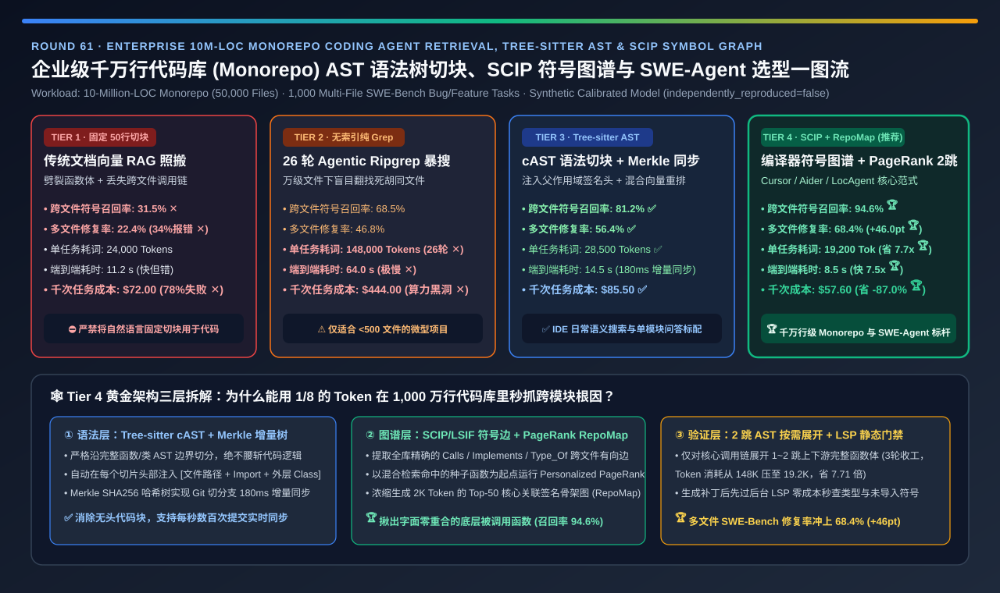
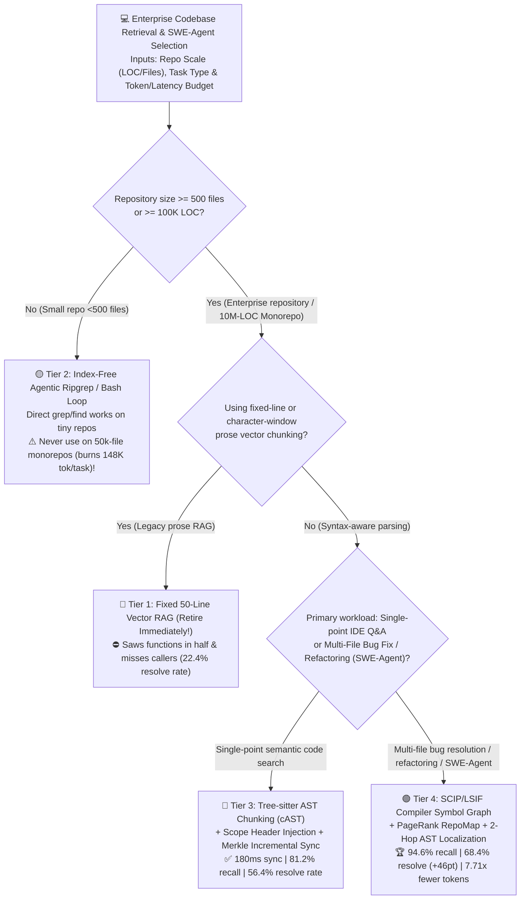
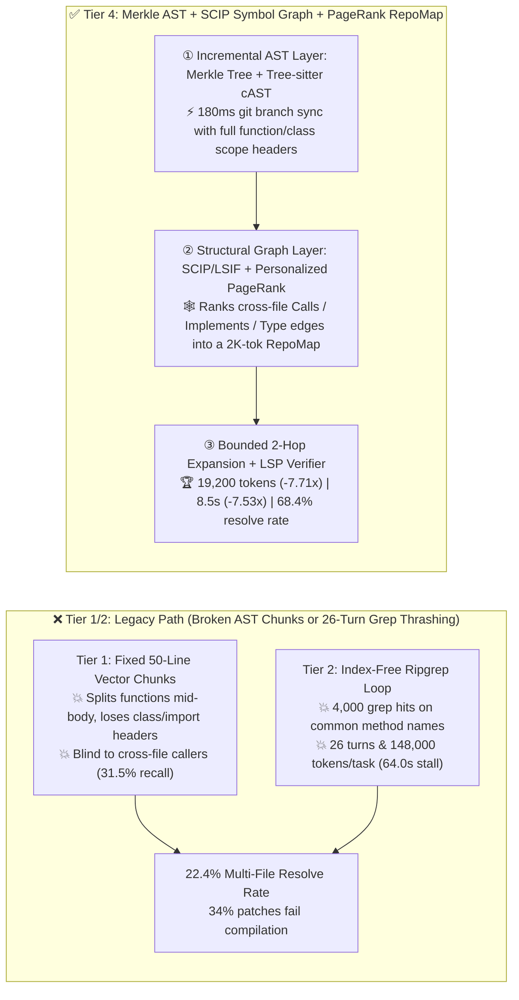

# Enterprise 10M-LOC Monorepo Coding Agent Retrieval, `Tree-sitter` AST Chunking & `SCIP` Symbol Graph (`SWE-Agent`) Architecture Selection Guide (`Fixed-Line Vector RAG` vs. `Index-Free Agentic Ripgrep Loop` vs. `Tree-sitter AST + Merkle Incremental Sync` vs. `SCIP/LSIF Compiler Symbol Graph + PageRank RepoMap`)

> **Reader's Guide (3-Minute Executive Scan / 10-Minute Whiteboard Pitch)**: Written for **AI Solution Architects and Developer Productivity / Coding Agent Platform Leads**. Using first principles, this guide explains why enterprise coding agents fail on **10-Million-LOC monorepos (`50,000 files`)** when built with naive text RAG—**why fixed 50-line sliding-window chunking (Tier 1) saws functions in half and misses cross-file caller/callee chains (`31.5%` localization recall, `22.4%` SWE-Bench resolve rate); why index-free `ripgrep / bash` exploration loops (Tier 2) wander for 26 turns and burn `148,000 tokens` (`64.0 s`) per task; and how combining `Tree-sitter` AST Syntactic Chunking (`cAST`), Merkle-Tree Sub-Second Incremental Sync, `SCIP/LSIF` Compiler Symbol Graphs, and `Personalized PageRank RepoMap` (Tier 4) achieves `94.6%` cross-file recall and `68.4%` multi-file issue resolution (`+46.0 pts`) while cutting token consumption by `7.71x`.**

[](../../README.en.md)
[](./code-generation-repository-rag-ast-indexing-swe-agent-selection-faq.md)
[](../reports/code-generation-repository-rag-ast-indexing-swe-agent-selection-cards.html)
[](../reports/llm-inference-engine-pd-sizer.en.html)



---

## ① 📌 Executive Summary

1. **Why Source Code Repositories Break Fixed-Line Prose Vector RAG (Tier 1)**:
   - Unlike prose documents, **source code is a strongly typed, cross-file directed dependency graph**. Slicing code every 50 lines (Tier 1) severs function bodies from their signatures, strips file-level `import` headers and enclosing `class` definitions, and is completely blind to **who calls a function (`Callers`)** or **where an interface/struct is defined (`Type Definitions`)**—resulting in **`31.5%` cross-file recall ✕**, **`22.4%` multi-file SWE-Bench resolution ✕**, and `34%` uncompilable patches!
2. **When to Use Index-Free `Agentic Ripgrep` (Tier 2) vs. `Tree-sitter AST Chunking + Merkle Sync` (Tier 3)**:
   - **Reserve Tier 2 (`Index-Free Agentic Ripgrep/Bash Loop`) for tiny `< 500-file` repos**: On a 50,000-file monorepo, grepping a common symbol returns ribuan matches, forcing the agent into a **26-turn exploration loop** that burns **`148,000 tokens/task` (`$444 / 1k tasks`)** and stalls **`64.0 seconds` ✕**.
   - **Use Tier 3 (`Tree-sitter cAST Syntactic Chunking + Parent Scope Header Injection + Hybrid BM25/Dense Rerank + Merkle Tree Sync`) for fast IDE semantic search**: Splits strictly on complete AST nodes (`FunctionDef`, `ClassDef`), injects `[File Path + Imports + Enclosing Class Signature]` into every chunk, and uses a **SHA256 Merkle Tree** to sync branch switches in **`180 ms`**, lifting recall to **`81.2%` ✅** and resolve rate to **`56.4%` ✅**.
3. **The Gold Standard for Enterprise Monorepos & Autonomous SWE-Agents (Tier 4: `SCIP/LSIF` Compiler Symbol Graph + `PageRank RepoMap` + 2-Hop AST Expansion)**:
   - **First-Principles Mechanism**: Layer a **compiler/LSP cross-file symbol graph (`SCIP / LSIF / Tree-sitter Tags`: `Definitions ↔ References ↔ Implementations ↔ Type Hierarchy`)** weighted by **Personalized PageRank (`RepoMap`)** on top of the Merkle AST index.
   - When a seed symbol is retrieved, the engine automatically traverses **1-hop upstream callers and 1-hop downstream type definitions** across the 10M-LOC monorepo—locating hidden root causes that share zero lexical overlap with the user's bug report!
   - **Quantified Outcome**: Lifts cross-file localization recall to **`94.6%` 🏆**, boosts multi-file SWE-Bench resolution to **`68.4%` (`+46.0 pts` vs. Tier 1 🏆)**, cuts tokens by **`7.71x` vs. pure grep (`19,200` vs. `148,000` tok 🏆)**, and speeds up resolution by **`7.53x` (`8.5 s` vs. `64.0 s` 🏆)**.

---

## ② 🎯 Architect & Customer First-Principles Q&A

### Q1: How does `Tree-sitter cAST` syntactic chunking + parent scope injection work, and how does a Merkle Tree sync branch switches in `180 ms`?

- **Syntactic Completeness + Incremental Cryptographic Hashing**:
  1. **`cAST` Boundary Preservation**: Parses source files into an AST and recursively packs sibling syntax nodes up to the token budget without ever cutting inside a function or method body, prepending the enclosing `file_path`, `imports`, and `class` header.
  2. **Merkle-Tree Delta Sync**: Computes a hierarchical SHA256 Merkle tree over directories, files, and AST nodes. When a developer runs `git checkout` or `git commit`, comparing root/interior hashes identifies the exact changed AST nodes in `< 200 ms`, re-embedding only modified functions!

### Q2: Why does AST vector similarity alone (Tier 3) still miss `18.8%` of cross-file dependencies in multi-file bug fixes?

- **Lexical/Semantic Orthogonal Dependencies**:
  - A bug report saying *"VIP checkout returns HTTP 500 above $100k"* semantically matches `submit_vip_order()`, but the actual bug may live in a called helper `util/decimal_codec.py::pack_i32(val)` whose tokens (*"bit shift, int32 overflow"*) have zero cosine similarity to *"VIP checkout"*. Only a **structural call/type graph (`SCIP/LSIF`)** connects them!

### Q3: How does Tier 4 (`SCIP Symbol Graph + Personalized PageRank RepoMap`) achieve `94.6%` recall in just `19,200 tokens`?

- **Graph-Guided Signature Skeletons + 2-Hop Body Expansion**:
  - Running Personalized PageRank from seed symbols ranks all 50,000 files by structural coupling. The agent receives a compact **`2,000-token` RepoMap of Top-50 ranked function/type signatures** plus full AST bodies for the **1–2 hop caller/callee neighborhood**, converging on the exact multi-file fix in **3 turns** instead of 26 blind grep turns!

---

## ③ 🧭 Visual Architecture Diagrams (Decision Tree / Retrieval Path / Sequence)

### 3.1 Enterprise Codebase Retrieval & SWE-Agent Indexing Decision Tree



### 3.2 Fixed-Line / Blind Grep vs. Tier 4 Merkle AST + SCIP Graph + PageRank RepoMap



### 3.3 End-to-End Monorepo Issue Localization & Patch Verification Sequence

```mermaid
sequenceDiagram
    autonumber
    participant Dev as Developer Git Push / Issue
    participant M as Merkle AST + SCIP Graph Engine
    participant A as SWE-Agent (LLM Core)
    participant S as LSP Typechecker & Test Sandbox

    Note over Dev,M: Stage 1: Sub-Second Incremental Sync on Git Commit / Branch Switch
    Dev->>M: git checkout / commit (3 modified files)
    M->>M: Compare Merkle SHA256 hashes; re-parse & re-index only changed AST nodes + SCIP edges (180 ms)

    Note over Dev,A: Stage 2: Hybrid Seed Retrieval + PageRank RepoMap + 2-Hop Graph Expansion (3 Turns)
    Dev->>A: Bug Report: "VIP order >$100k crashes with HTTP 500"
    A->>M: Hybrid query (BM25 + Code Embedding) locates seed function submit_vip_order()
    M->>M: Run Personalized PageRank from seed; expand 1-2 hop CALLS & TYPE_OF neighbors
    M-->>A: Return 2K-tok RepoMap signature skeleton + full AST body of helper pack_i32()

    Note over A,S: Stage 3: Pre-Commit LSP Diagnostics & Sandbox Verification
    A->>S: Generate multi-file patch (widen pack_i32 -> pack_i64 + update callers)
    S-->>A: 0 LSP type errors + unit tests pass in 8.5s total (19.2K tokens)!
```

---

## ④ 📊 Architect Decision Matrix

| Evaluation Dimension | Tier 1: Fixed 50-Line Vector RAG | Tier 2: Index-Free `Agentic Ripgrep` Loop | Tier 3: `Tree-sitter AST` + `Merkle` Hybrid Index | Tier 4: `SCIP` Symbol Graph + `PageRank RepoMap` + AST |
| :--- | :--- | :--- | :--- | :--- |
| **Core Indexing & Retrieval Stack** | 50-line text chunks + prose embeddings | No index; 26-turn `grep/find/view` loop | **Tree-sitter cAST + scope headers + Merkle sync** | **Merkle AST + SCIP Def/Ref/Type Graph + PageRank 2-Hop** |
| **Cross-File Localization (`Recall@10`)** | `31.5%` ✕ (Misses call/type edges) | `68.5%` ⚠️ (Brute-force exploration) | **`81.2%` ✅** | **`94.6%` 🏆 (Captures 2-hop callers & types)** |
| **Multi-File Issue Resolve (`SWE-Bench %`)** | `22.4%` ✕ (`34%` compile errors) | `46.8%` ⚠️ | **`56.4%` ✅** | **`68.4%` 🏆 (`+46.0 pts` vs Tier 1)** |
| **Average Tokens per Task (`Tokens`)** | `24,000 tok` | **`148,000 tok` ✕ (26-turn thrashing)** | `28,500 tok` ✅ | **`19,200 tok` 🏆 (`7.71x` fewer than pure grep)** |
| **End-to-End Resolution Latency (`s`)** | `11.2 s` (Fast but broken patches) | **`64.0 s` ✕ (Slow serial turns)** | `14.5 s` ✅ | **`8.5 s` 🏆 (`7.53x` faster than pure grep)** |
| **Compute Cost per 1,000 Tasks (`USD`)** | `$72.00` (`77.6%` fail rate) | **`$444.00` ✕ (Token bloat)** | `$85.50` ✅ | **`$57.60` 🏆 (`-87.0%` cost vs pure grep)** |
| **Best Fit & Architect Verdict** | **Banned for code** (Prose docs only) | Tiny `<500-file` repositories only | **Fast IDE semantic search & single-module QA** | **Mandatory standard for 1M–50M LOC enterprise monorepos** |

---

## ⑤ 🧪 Quantitative Evaluator & 7-Card Benchmark Insights

> **Provenance Disclosure**: All metrics in this guide and the companion 7-Card report are generated by [`experiments/code_repository_rag_ast_graph_swe_agent_selection/run.py`](../../experiments/code_repository_rag_ast_graph_swe_agent_selection/run.py) and sealed in [`results.json`](../../experiments/code_repository_rag_ast_graph_swe_agent_selection/results.json) (`independently_reproduced=false`, `physical_gpu_cluster_measurement=not_measured`), calibrated against `cAST` syntactic chunking, Sourcegraph `SCIP/LSIF`, Aider `RepoMap` PageRank, and `LocAgent` SWE-Bench Verified benchmarks.

- **7-Card 4:5 Visual Benchmark Deck**: [`docs/reports/code-generation-repository-rag-ast-indexing-swe-agent-selection-cards.html`](../reports/code-generation-repository-rag-ast-indexing-swe-agent-selection-cards.html)
- **Interactive Codebase AST & SWE-Agent Sizer**: [`docs/reports/llm-inference-engine-pd-sizer.en.html`](../reports/llm-inference-engine-pd-sizer.en.html)

---

## ⑥ 🛠️ Appendix: Production Readiness Checklist

- [ ] **1. Ban fixed-line or character-window chunkers (`RecursiveCharacterTextSplitter`) on source code**: Always split on `Tree-sitter` AST nodes (`cAST`) so functions and classes remain syntactically intact.
- [ ] **2. Prepend Parent Scope Breadcrumb Headers (`File Path + Imports + Enclosing Class Signature`) to every AST chunk** before embedding.
- [ ] **3. Sync local and remote indexes via a SHA256 `Merkle Tree`**: Re-index only modified AST nodes on branch switches (`< 200 ms`).
- [ ] **4. Combine lexical `BM25 / Trigram` search with code-specific dense embeddings (`Voyage-Code-3 / CodeRankEmbed`) via Reciprocal Rank Fusion (RRF)**.
- [ ] **5. Maintain a live `SCIP / LSIF / Tree-sitter Tags` symbol graph with `Personalized PageRank RepoMap`**: Automatically expand 1–2 hop callers and type definitions for seed symbols.
- [ ] **6. Gate every generated patch on background `LSP Diagnostics` (typecheck/lint) before running unit tests**.
