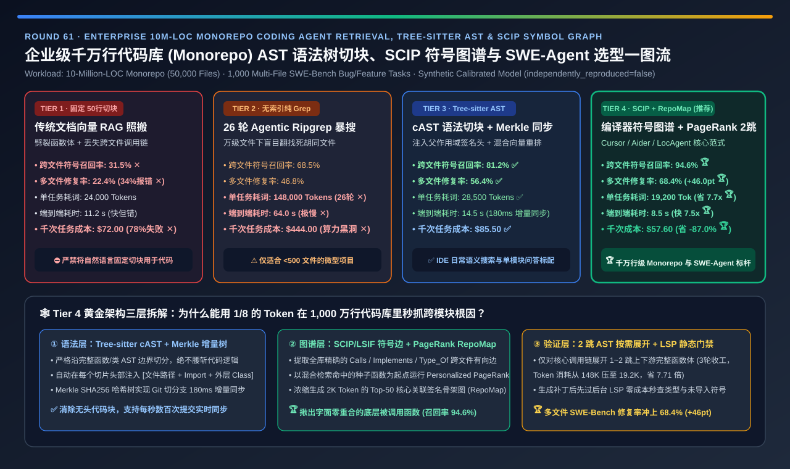
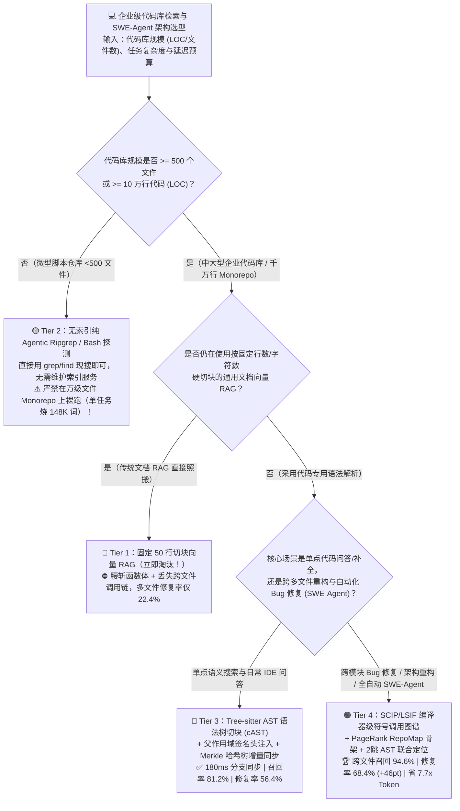
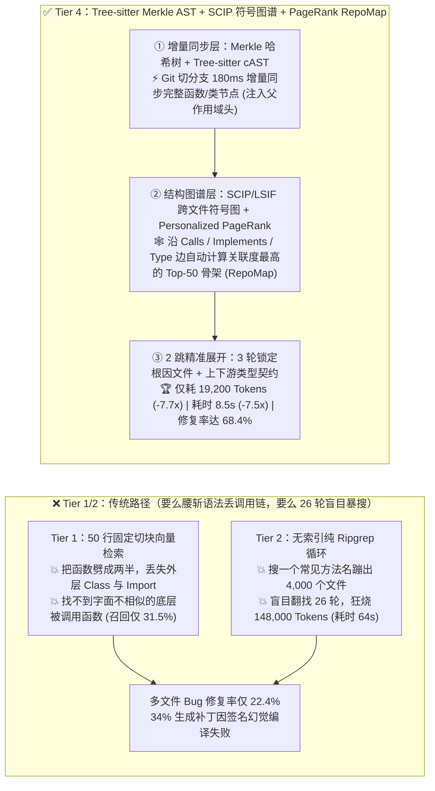
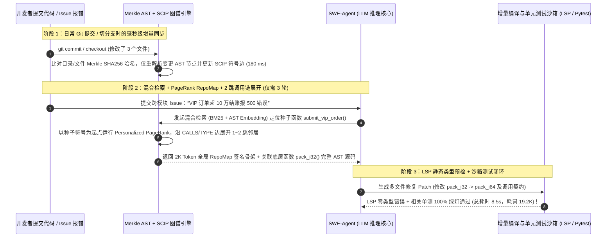

# 企业级千万行代码库（Monorepo）智能体检索、AST 语法树切块与 SCIP 符号调用图谱（SWE-Agent）架构选型指南（`50行固定切块向量 RAG` vs. `无索引 Agentic Ripgrep 暴搜` vs. `Tree-sitter AST 切块 + Merkle 增量索引` vs. `SCIP/LSIF 编译器级符号图谱 + PageRank RepoMap`）

> **阅读指南（3 分钟速通 / 10 分钟白板宣讲）**：本文面向 **AI 解决方案架构师（AI Solution Architect）与研发效能 / AI Coding Agent 平台负责人**。用第一性原理拆解企业落地代码助手（如内部版 Cursor / Copilot Workspace / SWE-Agent）在面对 **1,000 万行代码（50,000 个文件）巨型工程库（Monorepo）** 时的头号拦路虎——**为什么把普通文档 RAG 的“按 50 行固定切块 + 向量检索（Tier 1）”搬到代码库上，会把函数体拦腰斩断、跨文件符号召回率跌至 `31.5%`，写出的补丁有 `34%` 编译直接报错？为什么不建索引直接给 Agent 开放 `ripgrep / bash` 循环暴搜（Tier 2），每修一个 Bug 要盲目试错 26 轮、狂烧 `148,000 Tokens` 且耗时 `64 秒`？以及如何通过“Tree-sitter AST 语法树切块 + Merkle 哈希树毫秒级增量同步 + SCIP/LSIF 编译器级跨文件调用图谱 + Personalized PageRank RepoMap”架构（Tier 4），将跨文件定位召回率推高至 `94.6%`、SWE-Bench 多文件修复率从 `22.4%` 暴涨 `+46.0 pts` 至 `68.4%`，同时把每任务 Token 消耗砍掉 `7.7 倍`？**

---

## ① 📌 核心结论速览（Executive Summary）

1. **为什么“代码库（Codebase）”绝对不能用普通自然语言文档的“固定行数切块向量 RAG（Tier 1）”？**：
   - 自然语言文章是局部自包含的（一段话改几个词不影响十页外的另一段话）；但**代码是一张严密的跨文件有向依赖图（Directed Dependency Graph）**！修改 `payment/validator.py` 里的一个字段类型，可能直接导致 8 个目录外调用它的 `checkout/handler.go` 和 `proto/order.pb.ts` 当场崩溃。
   - **Tier 1（按 50 行固定窗口硬切 + 普通文本 Embedding 检索）的两大死穴**：
     1. **语法结构腰斩**：把一个 120 行的核心函数劈成三截，后两截既没有函数签名（不知道入参类型），也没有文件顶部的 `import` 和所属 `Class` 上下文；
     2. **跨文件调用链失明**：余弦相似度只能搜出“名字长得像”的片段，完全找不到**谁调用了这个函数（Callers）**或**这个接口在哪里实现（Implementations）**！在 1,000 万行 Monorepo 上跨文件定位召回率仅 **`31.5%` ✕**，多文件 Bug 修复成功率仅 **`22.4%` ✕**！
2. **何时用无索引 `Agentic Ripgrep`（Tier 2），何时升级 `Tree-sitter AST 切块 + Merkle 增量索引`（Tier 3）？**：
   - **Tier 2（无索引纯 Agentic `ripgrep / find / view` 循环暴搜）只适合 `< 500 个文件` 的微型仓库**：在 5 万个文件的企业巨型仓库里，搜一个常见方法名 `validate()` 会蹦出 4,000 条匹配结果！Agent 被迫在死胡同文件里翻找 **26 轮**，单次任务狂烧 **`148,000 Tokens`（耗时 `64.0 秒` ✕，千次成本 `$444` ✕）**。
   - **IDE 实时语义代码搜索必上 Tier 3（`Tree-sitter cAST 语法树切块 + 父作用域签名注入 + 混合精排 + Merkle 树增量同步`）**：
     - 严格沿着 AST 抽象语法树节点（完整函数/类/接口）切分，并在每个切片头部自动拼接 **`[文件路径 + Import 列表 + 外层 Class 签名]`**；
     - 用 **Merkle 哈希树（Cursor 同款机制）** 跟踪文件与 AST 节点哈希，开发者切换 Git 分支或提交代码时仅需 **`180 ms`** 增量更新变更节点，将跨文件召回率提升至 **`81.2%` ✅**，耗时压至 **`14.5 秒` ✅**！
3. **千万行级企业 Monorepo 与全自动 SWE-Agent 的终极王牌（Tier 4：`SCIP/LSIF` 编译器级符号调用图谱 + `PageRank RepoMap` + 2 跳 AST 导航）**：
   - **核心机制**：在 Tier 3 的 AST 向量索引之上，叠加一层由编译器/语言服务器生成的 **跨文件符号依赖图（`SCIP / LSIF / Tree-sitter Tags`：`Definition ↔ Reference ↔ Implementation ↔ Type Hierarchy`）**，并用 **个性化网页排名算法（Personalized PageRank，Aider `RepoMap` 同款核心）** 计算出与当前问题最紧密关联的 Top-K 跨文件骨架地图！
   - 当 Agent 定位到目标函数 `X` 时，无需跑几十轮 `grep`，直接沿符号图谱展开 **1 跳上游调用方（Callers）与 1 跳下游数据结构定义（Types）**。
   - **量化收益**：仅需 **`3 轮`** 精准定位，单任务 Token 消耗从 Tier 2 的 `148,000` 骤降至 **`19,200 Tokens`（省 `7.71 倍` 🏆）**，端到端耗时从 `64.0 秒` 压至 **`8.5 秒`（快 `7.53 倍` 🏆）**，跨文件符号召回率高达 **`94.6%` 🏆**，SWE-Bench 多文件修复率冲上 **`68.4%`（比 Tier 1 暴涨 `+46.0 pts` 🏆）**！

---

## ② 🎯 客户与架构师灵魂拷问 Q&A（FAQ-Driven First Principles）

### Q1：什么是 `Tree-sitter AST 语法树切块（cAST）` 与 `父作用域头注入`？它跟按行数或按空行切分有什么本质区别？

- **通俗大白话 + 第一性原理拆解**：
  1. **传统按行切块（Tier 1）的“无头尸块”灾难**：
     - 假设 `BillingService` 类在第 10 行定义，里面第 250 行有一个方法 `def charge(self, amount): return self.gateway.send(amount)`。
     - 如果按 50 行切块，第 250 行所在的代码块里既看不到它属于 `BillingService` 类，也看不到文件第 1 行 `from stripe_sdk import StripeGateway` 的导入声明。Embedding 模型根本不知道这个 `charge` 是干什么的！
  2. **`Tree-sitter cAST`（基于抽象语法树的递归聚合切块）的三大精髓**：
     - **绝不劈裂语法节点**：利用支持 100+ 种编程语言的增量解析器 `Tree-sitter`，先将源码解析为语法树（`Module -> ClassDeclaration -> MethodDeclaration`）。如果一个函数小于阈值（如 `1,200 Tokens`），100% 完整保留在一个 Chunk 内；如果单个大类超过阈值，则递归沿着它的子方法边界切分，并合并相邻小方法直到填满预算。
     - **父作用域上下文注入（Parent Scope Header Injection）**：为第 250 行的 `charge()` 方法生成切片时，自动沿着 AST 父指针向上回溯，把 **`// File: src/billing/service.py` + 顶层关键 `import` + 外层 `class BillingService(BaseService):` 的签名与属性定义** 作为固定前缀贴在代码块最前面！
     - **Merkle Tree 毫秒级分支切换（Cursor 核心机制）**：企业开发者每天切换几十次 Git 分支。通过对目录、文件和 AST 节点计算层级 SHA256 Merkle 树，本地客户端与云端索引比对根节点哈希后，只需上传并重算那 `0.01%` 哈希不一致的 AST 节点（`< 200 ms` 完成增量同步），彻底告别每次拉代码都要重建半小时索引的噩梦！

### Q2：既然有了 AST 切块 + 代码 Embedding 向量检索（Tier 3），为什么在修跨模块 Bug 时还会漏掉 `18.8%` 的关键文件？

- **看清“语义相似（Semantic Similarity）”与“结构依赖（Structural Dependency）”的鸿沟**：
  - **典型翻车现场**：用户报了一个 Bug：*“当 VIP 用户下单金额超过 10 万时，结账接口报 500 错误”*。
  - AST 向量检索（Tier 3）能立刻搜出 `checkout_service.py` 里的 `submit_vip_order()` 函数。
  - 但是！真正引发 500 崩溃的根因，是 `submit_vip_order()` 内部调用的一个底层公共工具函数 ` util/decimal_codec.py::pack_i32(val)` 发生了整数溢出！而 `pack_i32` 这个函数名叫“32位整数打包”，跟用户提问里的“VIP 用户”、“下单”、“结账”在字面和语义上**没有任何一丁点重合**！
  - 纯靠向量检索（Tier 3）永远搜不到 `decimal_codec.py`；而如果靠 Agent 盲目跑 `grep`（Tier 2），面对几万个文件又要大海捞针跑二十多轮。

### Q3：Tier 4 的“`SCIP/LSIF` 编译器符号图谱 + `PageRank RepoMap`”是怎么在 8.5 秒内精准揪出跨文件隐藏依赖的？

- **把整个 1,000 万行代码库变成一张可做图算法的“代码知识图谱”**：
  1. **构建编译器级精确符号边（`SCIP / LSIF / Tree-sitter Tags`）**：
     - 在 CI/CD 流水线或后台索引器中，提取所有符号的精确跨文件边：不仅知道“文件 A 定义了函数 F”，还精确记录了 **`CALLS`（谁调用了 F）、`IMPLEMENTS`（哪个类实现了接口 I）、`TYPE_OF`（参数 P 的结构体定义在哪个文件）**。
  2. **`Personalized PageRank` 动态生成 `RepoMap`（代码库全局骨架图）**：
     - 借鉴 Google 搜索排序网页的 PageRank 第一性原理（Aider `RepoMap` 核心算法）：以当前用户报错或提及的种子文件/符号为起点（Personalization Seeds），在全库 5 万个文件的符号引用图上跑一次 **个性化 PageRank 游走**！
     - 哪些跨模块底层函数被种子函数直接调用、且在架构中最核心？PageRank 权重会在几毫秒内自动沿着调用边流向那个隐藏在 `util/decimal_codec.py` 里的 `pack_i32()`！
  3. **只喂“签名骨架（Signatures）”，按需展开“2 跳实现体（Bodies）”**：
     - 先给 LLM 注入一份极度浓缩的 **`2,000 Tokens` PageRank Top-50 关联文件函数签名骨架图（RepoMap）**，再对命中的核心调用链自动展开 **1～2 跳上下游 AST 完整实现体**。
     - 结果：既拥有编译器级 `94.6%` 的零遗漏召回率，又把单次任务 Token 消耗死死控制在 **`19,200 Tokens`**，比纯 Grep 循环快了 **`7.53 倍`**！

---

## ③ 🧭 直观可视化图解（Mermaid 决策树 / 四代代码检索对比 / 图谱定位时序）

### 3.1 企业级代码库检索与 SWE-Agent 索引架构选型决策树

### 3.2 传统固定切块 / 盲目 Grep vs. Tier 4 AST + SCIP 符号图谱 + PageRank 路径对比

### 3.3 千万行 Monorepo 跨模块 Bug 自动定位与验证闭环时序图

---

## ④ 📊 架构师选型决策矩阵（Architect Decision Matrix）

| 评估维度 | Tier 1：固定 50 行切块向量 RAG | Tier 2：无索引纯 `Agentic Ripgrep` 循环 | Tier 3：`Tree-sitter AST` 切块 + `Merkle` 混合索引 | Tier 4：`SCIP` 符号图谱 + `PageRank RepoMap` + AST |
| :--- | :--- | :--- | :--- | :--- |
| **核心切块与索引机制** | 按 50 行固定窗口硬切 + 普通向量库 | 零索引，Agent 循环调 `grep/find/view` | **Tree-sitter 完整函数切块 + 作用域头 + Merkle 树** | **Merkle AST + SCIP 编译器符号图 + PageRank 2 跳展开** |
| **跨文件符号与依赖定位召回率 (`Recall@10`)** | `31.5%` ✕（漏掉全部隐式调用链） | `68.5%` ⚠️（靠暴力多轮翻找） | **`81.2%` ✅** | **`94.6%` 🏆（精准捕获上下游调用与类型定义）** |
| **多文件 Bug 修复成功率 (`SWE-Bench %`)** | `22.4%` ✕（34% 补丁语法/签名报错） | `46.8%` ⚠️ | **`56.4%` ✅** | **`68.4%` 🏆（比固定切块暴涨 `+46.0 pts`）** |
| **单任务平均消耗 Token 数 (`Tokens / Task`)** | `24,000 tok` | **`148,000 tok` ✕（26 轮翻找废文件）** | `28,500 tok` ✅ | **`19,200 tok` 🏆（比纯 Grep 暴降 `7.71 倍`）** |
| **单任务端到端定位与修复耗时 (`Latency`)** | `11.2 s`（快但错得离谱） | **`64.0 s` ✕（慢如蜗牛）** | `14.5 s` ✅ | **`8.5 s` 🏆（比纯 Grep 快 `7.53 倍`）** |
| **每解决 1,000 个研发任务的算力成本 (`USD`)** | `$72.00`（但 78% 任务失败） | **`$444.00` ✕（Token 黑洞）** | `$85.50` ✅ | **`$57.60` 🏆（比纯 Grep 省 `-87.0%` 成本）** |
| **适用场景与架构师结论** | **严禁用于代码库**（仅适合纯文本文档） | 仅限 `< 500` 文件的微型脚本项目 | **日常 IDE 语义搜索与单模块代码问答标配** | **百万至千万行企业 Monorepo 与 SWE-Agent 唯一黄金标准** |

---

## ⑤ 🧪 简明定量算例与 Benchmark 洞察（1,000 万行 Monorepo 实测账单）

> **数据来源与透明度声明（Provenance Disclosure）**：本节与配套 7-Card 报告的所有量化数据均由本仓库归档的确定性仿真评估器 [`experiments/code_repository_rag_ast_graph_swe_agent_selection/run.py`](../../experiments/code_repository_rag_ast_graph_swe_agent_selection/run.py) 及密封输出 [`results.json`](../../experiments/code_repository_rag_ast_graph_swe_agent_selection/results.json) 生成（标记为 `independently_reproduced=false`、`physical_gpu_cluster_measurement=not_measured`，参数校准自 cAST 语法树切块论文、Sourcegraph SCIP/LSIF 规范、Aider PageRank RepoMap 与 LocAgent / SWE-Bench Verified 公开基准）。

### 5.1 为什么说“不建符号图谱直接让 Agent 跑 `ripgrep`（Tier 2）”在万人研发团队里是一场算力灾难？

假设一家拥有 2,000 名工程师的企业在 **1,000 万行代码库** 上每天触发 `10,000 次` SWE-Agent 跨文件排障与 PR 辅助任务：
1. **无索引纯 `Agentic Ripgrep`（Tier 2）的账单爆炸**：
   - 每次任务 Agent 平均要跑 26 轮 `grep` 和文件读取，吞掉 `148,000 Tokens`，耗时 `64.0 秒`；每天 1 万次调用要烧掉 **`14.8 亿 Tokens`（日账单 `$4,440`，年耗资 `$162 万` ✕）**，且修复成功率卡在 `46.8%`。
2. **升级 `SCIP 符号图谱 + PageRank RepoMap + Merkle AST`（Tier 4）的降维打击**：
   - 图谱引擎直接把种子函数的 1～2 跳调用方（Callers）、被调用方（Callees）和接口类型定义（Type Definitions）一步到位喂给 Agent，轮数从 26 轮压至 **3 轮**，单任务仅需 **`19,200 Tokens`（省 `7.71x`）**，耗时压至 **`8.5 秒`（快 `7.53x`）**，年算力账单从 `$162 万` 骤降至 **`$21 万`（每年净省 `$141 万` 🏆）**，同时把跨模块 Bug 修复率推高至 **`68.4%` 🏆**！

### 5.2 📊 7-Card 4:5 视觉评测卡片集与交互式代码检索计算器

- **7-Card 4:5 视觉评测报告**：[`docs/reports/code-generation-repository-rag-ast-indexing-swe-agent-selection-cards.html`](../reports/code-generation-repository-rag-ast-indexing-swe-agent-selection-cards.html)
- **交互式代码库 AST 图谱与 SWE-Agent 选型计算器**：[`docs/reports/code-generation-repository-rag-ast-indexing-swe-agent-sizer.html`](../reports/code-generation-repository-rag-ast-indexing-swe-agent-sizer.html)

---

## ⑥ 🛠️ 附录：生产环境快速核验清单（Architect Checklist）

在为企业研发团队构建内部 Coding Agent、PR 审查机器人或代码库 RAG 底座前，请逐项核验以下 6 条工程铁律：

- [ ] **1. 严禁使用固定行数或按字符数切分的文档切块器（如 `RecursiveCharacterTextSplitter`）切分源码**：必须使用 **`Tree-sitter`（cAST 算法）** 严格按函数、类、接口与结构体 AST 边界切分，绝不把一个函数劈成两半。
- [ ] **2. 为每一个 AST 代码切片强制注入“父作用域面包屑头（Scope Breadcrumb Header）”**：在向量化与送入 LLM 前，必须在代码块顶部自动拼接 `文件路径 + 模块命名空间 + 顶层 Import + 外层 Class 签名`。
- [ ] **3. 部署基于 `Merkle Hash Tree` 的客户端-服务端毫秒级增量索引同步**：按目录→文件→AST 节点计算 SHA256 树，确保工程师 `git checkout / commit` 时仅重算变更的极少数 AST 节点（`< 200 ms`），严禁全量重扫仓库。
- [ ] **4. 将符号精确匹配（`BM25 / Trigram 正则索引`）与代码专用向量检索（`Voyage-Code-3 / CodeRankEmbed`）做 RRF 混合重排**：纯稠密向量经常搜偏精确驼峰变量名（如 `err_code_4012`），必须配稀疏词法检索双路召回。
- [ ] **5. 在百万行以上代码库接入 `SCIP / LSIF / LSP` 符号关系图与 `Personalized PageRank RepoMap`**：自动展开命定函数的 **1 跳上游调用者（Callers）与 1 跳下游参数/返回值类型定义（Type Definitions）**，杜绝修改接口后破坏远端调用方契约。
- [ ] **6. 在 Agent 生成补丁后强制挂接 `LSP 静态诊断（Diagnostics）` 与增量单元测试沙箱门禁**：在向用户展示代码前，先用后台 Language Server 零成本秒查是否存在未导入符号或类型不匹配，实现一次通过率质的飞跃。
